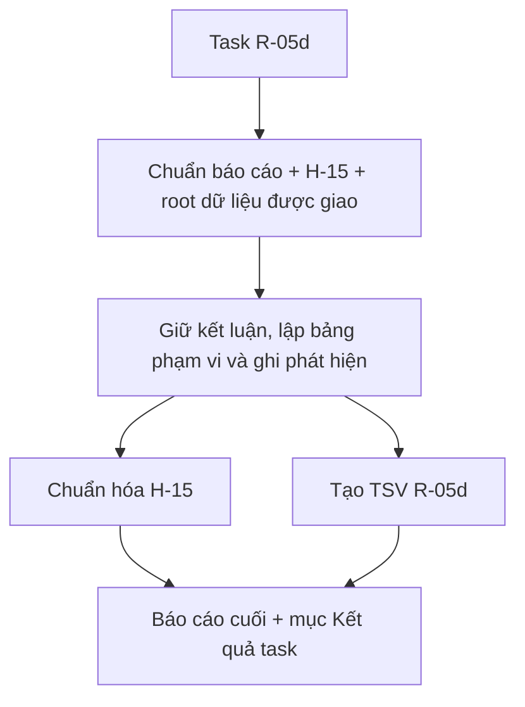

TÓM TẮT 1: PARTIAL — nội dung chuẩn hóa hoàn tất; commit bị chặn bởi quyền ghi Git ngoài worktree. [NGUỒN]
TÓM TẮT 2: Giữ nguyên tóm tắt, số liệu và kết luận H-15; bổ sung khối thông tin, Mermaid, bảng độ phủ và phát hiện. [NGUỒN]
TÓM TẮT 3: Bảng đối chiếu ghi 7/13 file client có điểm neo đã kiểm; 6 file chỉ xác nhận có mặt; 9 file server không có trong root task. [NGUỒN]
TÓM TẮT 4: H-13/H-14/J-05 có task nhưng thiếu báo cáo; không chạy test, build, exe, VM hoặc mạng theo giới hạn. [NGUỒN]
TÓM TẮT 5: BỊ CHẶN – CHƯA PUSH; Git trả Permission denied khi tạo `index.lock`; chưa có commit/SHA. [NGUỒN]

# R-05d — Chuẩn hóa báo cáo H-15

Loại: tổng hợp
Chủ đề: Chuẩn hóa cấu trúc báo cáo H-15 về đạn xuyên quái khi FPS cao và lập chỉ mục R-05d.
Từ khóa: đạn xuyên quái, missile, FPS, H-15, R-05d, collision, va chạm, tick logic
Trạng thái: PARTIAL — nội dung bốn hạng mục bàn giao đã hoàn tất; Git không cho stage để commit.
Độ phủ: 4/4 hạng mục nội dung hoàn tất (H-15, TSV, báo cáo R-05d và mục kết quả cuối task); commit bị chặn.
Liên quan: `JX1_OPS/REPORTS/H-15-dan-xuyen-quai-fps.md`, `JX1_OPS/DESIGN/CHUAN-BAO-CAO.md`, `JX1_OPS/DESIGN/MUC-LUC-TRI-THUC.md`, `JX1_OPS/DESIGN/HUONG-DAN-TRA-CUU.md`.
Cần tôi quyết định: không.

## Phạm vi và độ phủ

| File | Kết quả | Bằng chứng |
|---|---|---|
| `JX1_OPS/REPORTS/H-15-dan-xuyen-quai-fps.md` | Đã chuẩn hóa; giữ nguyên tóm tắt/kết luận; thêm metadata, Mermaid, bảng phủ từng file và phát hiện | `JX1_OPS/REPORTS/H-15-dan-xuyen-quai-fps.md:1-5,7-18,28-61,178-185` |
| `JX1_OPS/REPORTS/_CHIMUC/R-05d.tsv` | Đã thêm dòng chỉ mục cho H-15 | `JX1_OPS/REPORTS/_CHIMUC/R-05d.tsv:1-2` |
| `JX1_OPS/REPORTS/R-05d.md` | Báo cáo theo chuẩn, ghi xác minh, giới hạn, phát hiện, test và bàn giao | `JX1_OPS/REPORTS/R-05d.md:1-5` và các mục bên dưới |
| `JX1_OPS/TASKS/R-05d.md` | Đã điền mục Kết quả theo yêu cầu | `JX1_OPS/TASKS/R-05d.md:33-39` |

Phạm vi đọc chỉ gồm task R-05d, chuẩn báo cáo, mục lục, hướng dẫn tra cứu, H-15 và các vị trí nguồn cần lập bảng độ phủ. Sáu kỹ năng JX1 được nạp theo yêu cầu; không sửa mã nguồn hay dữ liệu game.

## Phát hiện khi chuẩn hóa

- Task R-05d chỉ định client qh9A và thư mục server `gs` để lập bảng phạm vi. Tại qh9A, 13 file client được H-15 trích đều tồn tại; đã kiểm các symbol/điểm neo trên 7 file và chỉ kiểm sự hiện diện trên 6 file còn lại. File:dòng: `D:/JX-build/qh9A/Classes/gameui/KuiOptions.cpp:185-188,453-457`; `D:/JX-build/qh9A/Classes/vn/gamescence/KgameWorldVN.cpp:1574-1577,1614-1619`; `D:/JX-build/qh9A/Classes/gamecore/KMissle.cpp:555,658,701-702,721`; `D:/JX-build/qh9A/Classes/gamecore/KNpc.cpp:60,1924`; `D:/JX-build/qh9A/Classes/gamecore/KProtocol.cpp:338-343`; `D:/JX-build/qh9A/Classes/gamecore/KPlayer.cpp:578,672`; `D:/JX-build/qh9A/Classes/gamescene/KHRocker.cpp:598,614-639`.
- Root `C:/Jx1CocoV3/Folder/ServerNew-20260116T043145Z-3-001/ServerNew/_bin_v2_/gs` không có 9 file C++ server được H-15 trích. H-15 dẫn source từ root khác. Không đọc/chạy executable hoặc suy nội dung từ binary; các kết luận server cũ được giữ nguyên và đánh dấu chưa đối chiếu trên root task.
- H-15 không nêu skill ID/bản ghi cụ thể, nên chưa thể định vị dữ liệu `LifeTime`, `Speed`, `CollidRange`, `DmgRange`, `FlyEventTime`, `ClientSend`; không đọc bảng dữ liệu theo phỏng đoán.
- Task H-13, H-14, J-05 tồn tại, nhưng các báo cáo tương ứng không có tại `JX1_OPS/REPORTS/`. H-15 ghi không tìm thấy cả task lẫn report; nội dung gốc được giữ, khác biệt được ghi ở phụ lục H-15.
- H-15 còn ghi `KMissleSkill.cpp` rỗng ở root server cũ; chưa xác minh lại chi tiết đó. Không phát hiện việc nào cần sửa kết luận cũ.

## ĐÃ XÁC MINH

- `JX1_OPS/TASKS/R-05d.md:19-31`: mục tiêu, file được phép, nguồn, quyền commit và giới hạn push.
- `JX1_OPS/DESIGN/CHUAN-BAO-CAO.md:1-24`: mẫu bắt buộc cho báo cáo và chỉ mục.
- `JX1_OPS/DESIGN/MUC-LUC-TRI-THUC.md:1-20`; `JX1_OPS/DESIGN/HUONG-DAN-TRA-CUU.md:1-27`: cấu trúc liên quan và hướng dẫn tra cứu.
- H-15 còn giữ nguyên năm dòng tóm tắt cùng phần kết luận/sổ thông số; metadata và bảng phạm vi mới có trong `JX1_OPS/REPORTS/H-15-dan-xuyen-quai-fps.md:1-60`.
- Các task H-13/H-14/J-05 tồn tại và các report `.md` tương ứng không có tại đường dẫn đã kiểm; ghi nhận trong `JX1_OPS/REPORTS/H-15-dan-xuyen-quai-fps.md:55-57,180-181`.
- Chỉ mục TSV có header đủ bảy cột và một hàng cho H-15: `JX1_OPS/REPORTS/_CHIMUC/R-05d.tsv:1-2`.

## CHƯA XÁC MINH

- Chưa đối chiếu nội dung 6/13 file client chỉ xác nhận có mặt và 9/9 file server không tồn tại trong root task; chưa kiểm tra giá trị skill cụ thể/runtime.
- Không chạy automated tests, build, exe, VM hoặc mạng; đây là tác vụ tài liệu và giới hạn runtime được nêu trong task.
- `git add` bị chặn với `fatal: Unable to create 'D:/jx1-reports/.git/worktrees/R-05d/index.lock': Permission denied`. Lock không tồn tại sau lỗi; status xác nhận các file còn trong worktree. Không thử cách ghi ngoài quyền được cấp.

## Bàn giao

BỊ CHẶN – CHƯA PUSH. Chưa có commit hoặc SHA. Git cần tạo index tại `D:/jx1-reports/.git/worktrees/R-05d/index.lock`, ngoài vùng ghi được cấp; PM cần stage/commit các file task trong môi trường có quyền Git phù hợp. Không đổi quyền, credential hoặc cấu hình để vượt giới hạn.

liên quan: `JX1_OPS/REPORTS/H-15-dan-xuyen-quai-fps.md`; `JX1_OPS/DESIGN/CHUAN-BAO-CAO.md`; `JX1_OPS/DESIGN/MUC-LUC-TRI-THUC.md`; `JX1_OPS/DESIGN/HUONG-DAN-TRA-CUU.md`.
