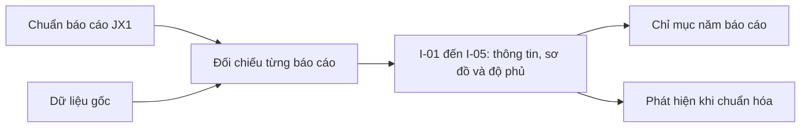

**TÓM TẮT 1. [NGUỒN]** PARTIAL. Đã chuẩn hóa 5/5 báo cáo I-01 đến I-05. Bàn giao commit bị chặn.\
**TÓM TẮT 2. [NGUỒN]** Mỗi báo cáo có khối thông tin, một sơ đồ Mermaid và bảng độ phủ đối chiếu từ dữ liệu gốc.\
**TÓM TẮT 3. [NGUỒN]** Đã ghi chỉ mục R-06a gồm năm báo cáo và cập nhật mục Kết quả của task.\
**TÓM TẮT 4. [NGUỒN]** Đã giải thích chênh lệch cách đếm loại map giữa I-03/I-04 và mã hàng giữa I-02/I-05.\
**TÓM TẮT 5. [CHƯA KIỂM]** Chưa chạy build, kiểm thử game, exe game hoặc VM. Git chưa tạo commit mới vì lỗi quyền ghi `index.lock`.

# R-06a — Chuẩn hóa báo cáo điểm, cửa hàng, quái vật, bản đồ và NPC

Loại: tổng hợp\
Chủ đề: Chuẩn hóa năm báo cáo khảo sát thế giới JX1 từ I-01 đến I-05.\
Từ khóa: R-06a, I-01, I-02, I-03, I-04, I-05, thế giới JX1, độ phủ\
Trạng thái: PARTIAL, đã xong tài liệu, Git từ chối ghi chỉ mục.\
Độ phủ: Đã chuẩn hóa 5 trên tổng 5 báo cáo.\
Liên quan: [Chuẩn báo cáo](../DESIGN/CHUAN-BAO-CAO.md), [Mục lục tri thức](../DESIGN/MUC-LUC-TRI-THUC.md), [Hướng dẫn tra cứu](../DESIGN/HUONG-DAN-TRA-CUU.md), [Task R-06a](../TASKS/R-06a.md).\
Cần tôi quyết định: không.

## Phạm vi và độ phủ

| Báo cáo | Độ phủ chuẩn hóa | Phần khảo sát cũ còn thiếu |
|---|---|---|
| [I-01 — Các loại điểm](I-01-cac-loai-diem.md) | Đã phủ. Có nguồn xử lý tĩnh cho 4/5 nhóm điểm chính. | Thiếu file rời triển khai HuoYueDu, nguồn ghép skill lửa trại và xác minh runtime. |
| [I-02 — Vật phẩm bán](I-02-vat-pham-ban.md) | Đã phủ. Có kiểm kê 1.464/1.464 hàng goods, 160/160 hàng shop và 4/4 tab Bảo vật. | Chưa biết hết giá hiệu lực, giới hạn mua, dữ liệu đóng gói của client và gán shop cho NPC. |
| [I-03 — Quái vật](I-03-khao-sat-quai-vat.md) | Đã phủ. Có kiểm kê 2.435/2.435 mẫu NPC. I-03 đã ghép 955/993 ID map với .wor trong hai PAK. | 38 ID chưa khớp .wor và chưa phủ đường spawn từ file rời hoặc Lua động. |
| [I-04 — Bản đồ](I-04-khao-sat-map.md) | Đã phủ. Có kiểm kê 993/993 ID catalog gốc và 342 cặp nối MapTraffic giữa 156 ID. | Chưa phủ đồ thị trap/Lua, ma trận quy tắc từng map, spawn trong PAK của I-04 và đường áp dụng cấm cưỡi. |
| [I-05 — NPC chức năng](I-05-npc-chuc-nang.md) | Đã phủ. Có kiểm kê 958/958 mẫu đối thoại và vị trí đường xử lý tĩnh của 6/8 nhóm chức năng. | Chưa có ánh xạ NPC thường trú với template, vị trí và script. Nhiệm vụ và hảo hữu là hai nhóm chưa có ánh xạ. |

Các bảng mới ghi rõ đơn vị đếm và mức đối chiếu. Tóm tắt, nội dung, kết luận và dẫn chứng gốc được giữ nguyên theo `JX1_OPS/DESIGN/CHUAN-BAO-CAO.md:23–28` và skill jx1-retrofit. Nhãn xác minh nằm ở nội dung bổ sung. Trạng thái của I-01 đến I-05 mô tả kết quả khảo sát gốc. Trạng thái của R-06a bao gồm phần bàn giao Git.

## Phát hiện khi chuẩn hóa

- [NGUỒN] I-01 có 200 hàng EXP tại `GS/Settings/npc/player/level_exp.txt:2–201` và 5 hàng thuộc tính ngũ hành tại `GS/Settings/npc/player/level_add.txt:2–6`. Lời gọi HuoYueDu ở `GS/script/battles/guozhan/head.lua:409` và thiếu file Lua rời cùng tên. Bản A xử lý EXP tại `A/gamecore/KProtocolProcess.cpp:512`, khác số dòng Coco gốc được dẫn từ I-01.
- [NGUỒN] I-02 và I-05 đếm theo hai đơn vị. Trong `GS/Settings/buysell.txt:2–161`, có 2.644 tham chiếu số dương cho 474 ID. Tính thêm năm ô chữ ở các dòng 150, 151, 155, 156, 157 cho 2.649 ô và 479 giá trị khác nhau. Bản A dùng `type.txt` tại `A/gameui/KuiDynamicShop.cpp:198`.
- [NGUỒN] I-03 và I-04 đếm khác nhau do ID 42 dùng `42_Maptype=Cave` ở `GS/Settings/MapList.ini:522`. Đếm đúng chữ hoa/thường tái lập 48 Cave và 789 ID thiếu khóa của I-04. Gộp hoa thường tái lập 49 Cave và 788 ID thiếu khóa của I-03. Cùng khóa xuất hiện ở `GS/Settings/vn/MapList.ini:560`.
- [NGUỒN] I-03 đếm 1.412 mẫu quái theo Kind=0 tường minh. I-05 đếm 958 mẫu Kind=3, cả 958 trống ActionScript. Nguồn là `GS/Settings/Npcs.txt:1–2436`. Tên ở dòng 2080 giải mã GBK thành `篝火`, mẫu lửa trại 2078. Báo cáo I-05 dẫn đường tạo mẫu tại `GS/script/task/gouhuo.lua:27`.
- [NGUỒN] I-04 kiểm kê 872 mục WorldSet gs001 với Count=800 tại `GS/maps/WorldSet_gs001.ini:2`, `:803–804`. Đếm lại `GS/Settings/MapTraffic.ini:2–13661` cho 493 điểm Type=0 theo khóa duy nhất, tương ứng 342 cặp nối và 156 ID đầu/cuối.

### Sổ thông số đối chiếu

| Nhóm | Tên hoặc hằng số | File:dòng | Giá trị | Đơn vị | Ảnh hưởng | Đổi an toàn | Nguồn đo |
|---|---|---|---:|---|---|---|---|
| Kinh nghiệm | MAX_LEVEL | `A/gamecore/KPlayerSet.h:6` | 500 | cấp | Hằng trong header client bản A. Bảng EXP rời của server có 200 hàng. | CẨN THẬN | Đọc tĩnh header và bảng rời |
| Danh mục map | Count | `GS/Settings/MapList.ini:2` | 1000 | mục khai báo | Catalog có 993 khóa ID vật lý. | CẨN THẬN | Đọc INI, đếm khóa ID |
| Danh sách tải gs001 | Count | `GS/maps/WorldSet_gs001.ini:2` | 800 | mục khai báo | I-04 dẫn vòng đọc theo Count. File chứa 872 mục World. | CẨN THẬN | Đọc INI, luồng tải dẫn lại từ I-04 |

## Đã xác minh / Chưa xác minh

- **ĐÃ XÁC MINH** Nguồn GS là gói server được giao tại `JX1_OPS/TASKS/R-06a.md:24`. `A/` chỉ `D:/JX-build/qh9A/Classes`. Đã đọc bảng TXT, INI và Lua legacy bằng khóa ASCII khi đếm, dùng GBK cho tên lửa trại và UTF-8 để đọc tài liệu. Đã mở trực tiếp các vị trí client bản A.
- **ĐÃ XÁC MINH** Đã kiểm đối chiếu UTF-8 không BOM, cấu trúc Markdown, liên kết nội bộ và chỉ mục TSV 5 hàng × 7 cột. `git diff --numstat` cho 0 dòng bị xóa ở cả năm báo cáo cũ. Kiểm tra diff dùng quy tắc chấp nhận CRLF có sẵn.
- **CHƯA XÁC MINH** R-06a mới đối chiếu sự hiện diện và kích thước các PAK. Số 955/993 và 94.098 bản ghi shKind=0 dẫn lại từ mục kiểm kê PAK của I-03. Chưa kiểm cách loader xử lý hoa thường/trùng khóa, phiên bản dữ liệu được nạp, spawn/NPC thường trú và hành vi lúc chạy. Chưa chạy build, kiểm thử game, exe game hoặc VM. Lượt này không dùng mạng.

### Lỗi và cách xử lý

- Máy không có `rg`. Đã chuyển sang `Select-String`, `Get-ChildItem` giới hạn phạm vi và đọc bảng trực tiếp bằng PowerShell.
- Lượt in gộp báo cáo vượt giới hạn đầu ra. Đã đọc lại các đoạn bị cắt theo đúng đường dẫn. Lượt lọc cấp NPC ban đầu dùng thiếu chữ `Auto` trong tên khóa. Đọc lại `NpcAutoLevelFlag/Min/Max` cho đúng 131 ID.
- `git diff --check` lần đầu báo khoảng trắng ở cuối các dòng CRLF của I-03. Kiểm lại với tùy chọn `cr-at-eol` cho kết quả đạt và giữ kiểu xuống dòng của báo cáo gốc.
- `git add` thử lô đầu gồm I-01, I-02, I-03 và báo cáo R-06a trả mã 128 với lỗi `fatal: Unable to create 'D:/jx1-reports/.git/worktrees/R-06a/index.lock': Permission denied`. Metadata nằm ngoài vùng ghi của phiên. Các file đã được lưu trong worktree.

## Bàn giao

**BỊ CHẶN – CHƯA PUSH.** Nhánh `task/R-06a` bắt đầu ở `125aed9`. Chưa có SHA mới. PM có thể dùng phiên có quyền ghi metadata Git và commit hai lô local theo thứ tự sau.

1. Ba báo cáo I-01, I-02, I-03.
2. Hai báo cáo I-04, I-05, chỉ mục R-06a, mục Kết quả trong task và báo cáo này.

[Chỉ mục R-06a](./_CHIMUC/R-06a.tsv) dùng cho hàng “Điểm, tiền, cửa hàng, quái, bản đồ, NPC, nhiệm vụ” tại `JX1_OPS/DESIGN/MUC-LUC-TRI-THUC.md:14`. Đề xuất PM thêm liên kết đến chỉ mục cho nhóm I-01 đến I-05 và giữ mức **khảo sát tĩnh**.
