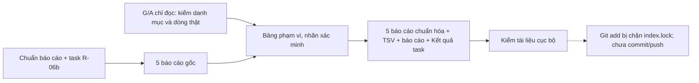

TÓM TẮT 1: [NGUỒN] PARTIAL toàn task R-06b: đã chuẩn hóa đủ 5/5 báo cáo và ghi chỉ mục/kết quả task; chưa commit vì Git từ chối ghi metadata.
TÓM TẮT 2: [NGUỒN] Mỗi báo cáo có khối thông tin, một Mermaid, bảng phạm vi/độ phủ, liên quan, bàn giao và phát hiện; giữ nguyên toàn bộ tóm tắt/nội dung khảo sát gốc.
TÓM TẮT 3: [NGUỒN] Đầu ra trong đúng vùng giao gồm 5 báo cáo cũ, chỉ mục TSV 6 hàng báo cáo, báo cáo này và mục Kết quả của task được người dùng yêu cầu trực tiếp.
TÓM TẮT 4: [NGUỒN] Đã đối chiếu văn bản gốc và dữ liệu/source chỉ đọc G/A; kiểm cấu trúc, UTF-8, liên kết, bảng và TSV là kiểm tài liệu, không phải test game.
TÓM TẮT 5: [NGUỒN] Chưa có SHA; BỊ CHẶN – CHƯA PUSH do index.lock Permission denied. Không build, chạy exe, VM hoặc mạng; PM tiếp tục commit trong môi trường có quyền.

# R-06b — Chuẩn hóa báo cáo R-06 phần b

Loại: tổng hợp
Chủ đề: Chuẩn hóa năm báo cáo thế giới, tiền tệ, nhiệm vụ và animation theo chuẩn báo cáo ngày 17/11/2026.
Từ khóa: chuẩn hóa, retrofit, R-06b, I-06, I-06b, I-07, I-08, J-01, Mermaid, CHIMUC
Trạng thái: PARTIAL — tài liệu hoàn tất; BLOCKED riêng bước stage/commit do quyền ghi Git metadata.
Độ phủ: đã phủ 5 trên tổng 5 báo cáo cũ và 3/3 file bàn giao; chưa có commit chuẩn hóa.
Liên quan: [Chuẩn báo cáo](../DESIGN/CHUAN-BAO-CAO.md), [Mục lục tri thức](../DESIGN/MUC-LUC-TRI-THUC.md), [Hướng dẫn tra cứu](../DESIGN/HUONG-DAN-TRA-CUU.md), [Task R-06b](../TASKS/R-06b.md), [Chỉ mục TSV](_CHIMUC/R-06b.tsv)
Cần tôi quyết định: không — PM cần môi trường được phép ghi metadata Git để commit các file đã hoàn tất.

## Phạm vi và độ phủ

Được giao trên nhánh `task/R-06b`, worktree `D:/JX-wt/R-06b`; đầu lượt đã chạy một lần `git status --short --branch` và `git log --oneline jx1-ops..HEAD`: đúng nhánh, chỉ task R-06b untracked có sẵn, không có commit R-06b trước đó. Không có phần đã commit từ lượt trước để làm lại. Chỉ sửa bảy đường dẫn trong `vung_file` và mục Kết quả của chính task theo yêu cầu trực tiếp; giữ phần giao việc/metadata task.

| File/đơn vị giao | Độ phủ | Kết quả / bằng chứng |
|---|---|---|
| [I-06](I-06.md) | Đã phủ chuẩn hóa | `JX1_OPS/REPORTS/I-06.md:9`, `:26`; 10/13 nguồn lịch sử, giữ PARTIAL do Git của lượt gốc |
| [I-06b](I-06b.md) | Đã phủ chuẩn hóa | `JX1_OPS/REPORTS/I-06b.md:9`, `:26`; 6/7 nguồn, thiếu J-06 |
| [I-07](I-07-cac-loai-tien-te.md) | Đã phủ chuẩn hóa | `JX1_OPS/REPORTS/I-07-cac-loai-tien-te.md:9`, `:27`; 8/11 nhóm có phần tĩnh, giữ BLOCKED lịch sử |
| [I-08](I-08-he-thong-nhiem-vu.md) | Đã phủ chuẩn hóa | `JX1_OPS/REPORTS/I-08-he-thong-nhiem-vu.md:9`, `:27`; 11/11 nhóm có mô tả tĩnh, giữ DONE tĩnh |
| [J-01](J-01-animation-nhan-vat-tran.md) | Đã phủ chuẩn hóa | `JX1_OPS/REPORTS/J-01-animation-nhan-vat-tran.md:9`, `:27`; 10 nhóm, đo asset/runtime 0/10, giữ PARTIAL |
| [Chỉ mục](_CHIMUC/R-06b.tsv) | Đã phủ | `JX1_OPS/REPORTS/_CHIMUC/R-06b.tsv:1`; 7 cột, 5 hàng báo cáo cũ và 1 hàng tổng kết R-06b |
| Báo cáo R-06b | Đã phủ | File này là báo cáo cuối duy nhất của task |
| [Kết quả task](../TASKS/R-06b.md) | Đã phủ | Ghi cuối mục Kết quả, không đổi nội dung giao việc |
| Stage/commit theo nhóm 3–5 file | Chưa phủ | Đã thử stage nhóm đầu 3 báo cáo; Git từ chối trước commit, không thử vượt quyền |

## Cách chuẩn hóa và nguồn đã đọc

[ĐÃ XÁC MINH] Đọc trước `JX1_OPS/DESIGN/CHUAN-BAO-CAO.md:1`, rồi task, hai tài liệu tra cứu được chỉ định, năm báo cáo và phần phạm vi/timing của `JX1_OPS/DESIGN/THE-GIOI-TONG-QUAN.md:3`. Đã dùng các skill local jx1-retrofit, jx1-read-server, jx1-read-client, jx1-parameters, jx1-knowledge, jx1-report. Không tạo đồ thị hoặc script/parser phụ trên đĩa.

[ĐÃ XÁC MINH ở cấp tài liệu] Thêm năm dòng tra cứu và phần chuẩn hóa ở đầu; tóm tắt gốc giữ nguyên trong mục Nội dung báo cáo gốc. Tiêu đề ID được đưa về sau năm dòng tra cứu; I-07 được bổ sung tiêu đề ID còn thiếu. Nội dung tóm tắt, kết luận, số liệu, bằng chứng, sổ thông số và các kế hoạch test cũ không bị viết lại. Phát hiện mới để ở mục cuối từng báo cáo. Trạng thái/độ phủ trong TSV tách số nhóm tài liệu khỏi mức xác minh runtime.

Nguồn gốc chỉ đọc dùng lập bảng, theo đúng root task:

- `G/` = `C:/Jx1CocoV3/Folder/ServerNew-20260116T043145Z-3-001/ServerNew/_bin_v2_/gs/`.
- `A/` = `D:/JX-build/qh9A/`; không thay bằng qh7 hoặc source client khác.
- Tài liệu/chỉ mục được đọc và ghi UTF-8 không BOM. Dữ liệu legacy được đọc GB18030 (tương thích GBK); chỉ dùng token/cột số khi chuỗi Việt có dấu hiệu sai mã hóa. Không đổi mã hóa dữ liệu game.

## Đã xác minh

| Bằng chứng đọc/kiểm thực tế | Kết quả và giới hạn |
|---|---|
| G `Settings/Task/taskguide.txt:2` | 14 bản ghi; 16 đường Lua duy nhất trong hai cột guide/trace, không có file rời tương ứng dưới G; chưa kiểm PAK |
| G `Settings/Task/task_type.txt:2` đến `:5` | 4 loại random; không đồng nghĩa 4 quest |
| G `Settings/Task/dailytask/killmonster.txt:2` | 17 TaskId duy nhất, KillCount đều 20; không xác nhận 17 quest đang hoạt động |
| G `Settings/Task/missions.txt:2`; `Settings/TimerTask.txt:2` | 33/47 bản ghi; bỏ header/dòng trắng, không cộng thành tổng quest |
| G `Settings/Task/tasklist.ini:2`; `tasklist_default.ini:2` | Count 1/39; chưa biết bản được loader dùng |
| G `Settings/Task/random/{talk,coll,kill,next}/entity.txt:3` và các `rate_*.txt:3` đã chỉ rõ trong I-08 | Entity 9/32/32/44, rate 5/28/32/42; tổng 117/107, khớp số liệu gốc |
| G `script/mineitem/kimnguyenbao.lua:4`/`:5`/`:7`; `script/global/npcchucnang/tientrang.lua:68`/`:78`/`:80` | Comment tiêu item, EarnXu(1), ngưỡng và thứ tự cộng/trừ khớp các token đã dẫn; không xác minh tự tiêu hoặc rollback |
| A `Classes/gamecore/GameDataDef.h:233` đến `:239` | 7 giá trị MONEYUNIT, không tính sentinel; không suy enum thành 7 ví độc lập |
| A `Classes/gamecore/KNpc.h:106` đến `:120`; `KNpcResNode.cpp:316`/`:326`/`:348` | 15 giá trị CLIENTACTION gồm none; NoHorse/OnHorse là nhánh chọn bảng riêng |
| A `Classes/engine/KbugInfo.h:245`/`:247`/`:248`/`:264` | Có các trường frame/hướng/interval và kích thước frame; chưa có giá trị asset thực |
| A `Classes/gameui/KuiTaskInfo.cpp:124`/`:955`; `Classes/gamecore/KProtocolProcess.cpp:1552` | Xác nhận token đường UI/TaskId/SetSaveVal bản A; mốc lịch sử C/O trong thân được giữ nguyên |

Kiểm tra tài liệu thực chạy bằng Python `-I -` trong bộ nhớ: **PASS 6/6 báo cáo**, giữ nguyên phần gốc của **5/5 báo cáo**, UTF-8 nghiêm ngặt/không BOM/U+FFFD, năm dòng tra cứu, thứ tự 7 trường thông tin, 5–10 từ khóa, đúng một khối Mermaid và hàng rào cân bằng, bảng độ phủ, hai mức xác minh, bàn giao/phát hiện cuối. **PASS 48 tham chiếu liên kết Markdown cục bộ và 459 dòng bảng Markdown đúng số cột; PASS TSV 7 cột × 6 hàng dữ liệu**, đủ mọi báo cáo, trạng thái/loại khớp khối thông tin, các file liên quan tồn tại. Task có Kết quả và UTF-8 không BOM: **PASS**. Mermaid được kiểm khối và đọc sơ đồ, chưa render bằng engine. Đây là kiểm tài liệu, không biên dịch hay chạy mã game.

## Chưa xác minh

- [CHƯA XÁC MINH] Root S/H/L/C/O và hash/PAK trong các báo cáo cũ được giữ như bằng chứng lịch sử; R-06b không có phạm vi tái khảo sát những root đó. Graphify chỉ định vị; các kết luận bổ sung dùng file/dòng thật G/A.
- [CHƯA XÁC MINH] Binary/source/data thực nạp, TASKSYS/PARTNER, ABI/persistence, UI trên APK, quest/đổi tiền/phát thưởng/kill credit, khung SPR và FPS/RAM chưa chạy hoặc đo.
- [CHƯA XÁC MINH] Không build, unit/integration test game, TESTER, exe/DLL, giải nén/chuyển đổi asset, VM, mạng hay remote. Không ghi khóa/mật khẩu hoặc dữ liệu tài khoản thực.
- [CHƯA XÁC MINH] Chưa có commit cho lượt R-06b; không push theo yêu cầu. Nội dung đã lưu local không được nhận là đã có trên GitHub.

## Lỗi, cách thử và kết quả

| Lỗi/sự việc | Cách xử lý trong lượt | Kết quả |
|---|---|---|
| `rg` không được nhận diện | Chuyển `Select-String`/đọc file cụ thể, không cài | Định vị được nguồn G/A cần dùng |
| Đọc gộp dài bị cắt output | Thu hẹp theo đề mục/dải dòng và đếm trực tiếp trong bộ nhớ | Không dùng phần bị cắt làm bằng chứng đã đọc đủ |
| Một hunk I-08 không khớp dòng cuối dự đoán | Bỏ hunk sai, dùng ngữ cảnh thật; đối chiếu phát hiện phần bổ sung đang chen giữa sổ | Chuyển phần bổ sung xuống sau toàn bộ sổ; giữ nguyên các hàng gốc |
| Python in chữ Việt gặp `UnicodeEncodeError` | Đặt `sys.stdout.reconfigure(encoding='utf-8')` rồi chạy lại kiểm tài liệu | Không sửa dữ liệu để xử lý lỗi console |
| Tên dự đoán `dailytask/collect.txt` không tồn tại | Liệt kê đúng thư mục dữ liệu; dùng guide và bảng kill hiện có | Không coi tên đoán sai là thiếu chức năng gather, giữ số liệu lịch sử chưa đếm lại |
| `git add --` ba báo cáo I-06/I-06b/I-07 thất bại | Một lần stage nhóm đầu sau kiểm/diff; không chạy commit vì add thất bại | `fatal: Unable to create 'D:/jx1-reports/.git/worktrees/R-06b/index.lock': Permission denied` |

Metadata Git nằm ngoài vùng được phép ghi của phiên; không đổi quyền, credential, config, index/repo thay thế hoặc thử bypass. Hoàn tất tài liệu còn lại, không lặp thao tác stage đã bị từ chối.

## Bàn giao

**PARTIAL toàn task; tài liệu hoàn tất, BLOCKED riêng Git. BỊ CHẶN – CHƯA PUSH.** Commit SHA: **chưa có**; không có commit thành công hoặc bằng chứng push. Lượt đầu định chia nhóm 3 file rồi 5 file để có checkpoint, nhưng bị chặn ngay nhóm đầu.

PM tiếp tục trong môi trường được phép ghi metadata Git: giữ các chỉnh sửa đã có, không khảo sát lại; review rồi stage/commit nhóm 1 gồm I-06, I-06b, I-07; nhóm 2 gồm I-08, J-01, chỉ mục TSV, báo cáo R-06b và task R-06b. Không push theo task. Kiểm tài liệu cuối **PASS** theo mục Đã xác minh; kiểm/diff chỉ áp dụng các file giao, không coi lỗi Git là lỗi nội dung báo cáo.

Đề xuất mục lục để PM gộp, không sửa file chung: dùng sáu hàng trong `JX1_OPS/REPORTS/_CHIMUC/R-06b.tsv:2` đến `:7`, với độ chắc “tổng hợp tài liệu/khảo sát tĩnh; xem giới hạn ở báo cáo”; không nâng trạng thái lịch sử hoặc độ chắc runtime.

## Phát hiện khi chuẩn hóa

- [ĐÃ XÁC MINH ở cấp tài liệu] I-06 còn câu thiếu J-03/J-04, I-07 còn câu thiếu I-02, J-01 còn câu thiếu J-05; các file nay có. Đã ghi bối cảnh thời điểm trong từng báo cáo, không sửa lặng kết luận cũ.
- [ĐÃ XÁC MINH ở cấp tài liệu] I-06 giữ PARTIAL toàn task do Git, còn `JX1_OPS/DESIGN/THE-GIOI-TONG-QUAN.md:3` ghi DONE riêng phần tổng hợp. Giữ cả hai mức, không chọn ngầm.
- [ĐÃ XÁC MINH ở cấp danh mục] J-06 vẫn chỉ có task, chưa có báo cáo khớp tên trong `REPORTS`; sáu nguồn J-01..J-05/L-01 của I-06b không thay được đầu ra J-06.
- [ĐÃ XÁC MINH ở cấp source/văn bản] Mốc UI/callback bản A khác source lịch sử; Lua tiền trang và một số comment/tên legacy có dấu hiệu mojibake. Đã nêu giới hạn đọc token/GB18030, không đổi file game hoặc kết luận từ lời thoại lỗi.
- [CHƯA XÁC MINH] Số dòng dẫn các báo cáo được chuẩn hóa là mốc lịch sử, có thể dịch sau khi chèn phần đầu; giữ nguyên bằng chứng theo yêu cầu, tra thêm tên mục/symbol. Không phát hiện U+FFFD trong các file báo cáo; điều này không xác nhận encoding nguồn game.
