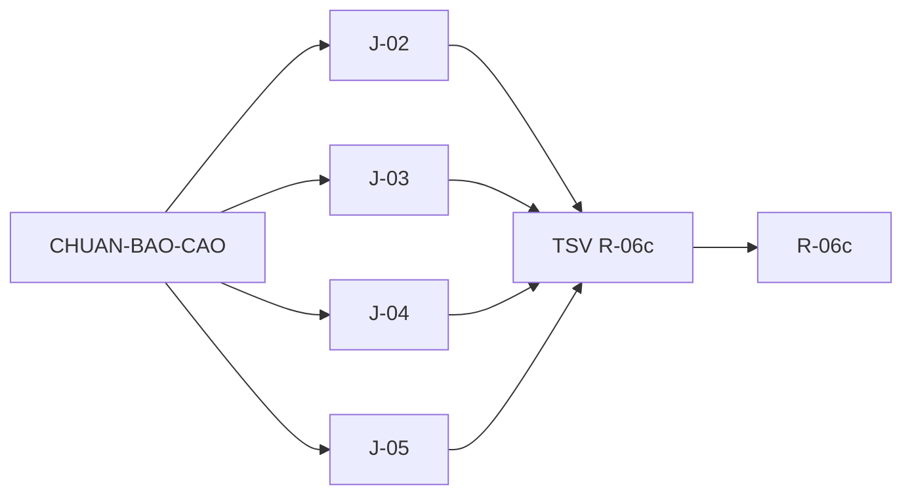

TÓM TẮT 1..5
1. [XÁC MINH] Đã đọc task R-06c, chuẩn báo cáo, mục lục tri thức và hướng dẫn tra cứu.
2. [XÁC MINH] Phạm vi được giao gồm bốn báo cáo J-02..J-05, chỉ mục TSV và báo cáo cuối R-06c.
3. [XÁC MINH] Nguồn server Settings và client qh9A tồn tại; action NPC có 14 dòng cấu hình, còn dữ liệu asset/runtime chưa kiểm.
4. [CHƯA KIỂM] Asset/runtime, build/test và toàn bộ nguồn cũ chưa được tái xác minh trên root task; không đổi kết luận cũ.
5. [NGUỒN] `git add` bị `Permission denied` khi tạo index.lock; BỊ CHẶN – CHƯA PUSH, chưa có SHA; không chạy build/exe/VM/mạng.

# R-06c — Chuẩn hóa báo cáo R-06 phần c
Loại: tổng hợp
Chủ đề: Chuẩn hóa bốn báo cáo animation J-02..J-05 theo chuẩn báo cáo JX1.
Từ khóa: hoạt ảnh, animation, NPC, kỹ năng, lớp chồng, cắt khung, J-02, J-03, J-04, J-05
Trạng thái: PARTIAL — nội dung 4 báo cáo và TSV hoàn tất; commit bị chặn, mục Kết quả trong task chưa cập nhật do ngoài `vung_file`.
Độ phủ: đã chuẩn hóa 4/4 báo cáo; đã tạo 1/1 chỉ mục TSV; 0/1 commit.
Liên quan: J-02-animation-quai-npc.md, J-03-hoat-anh-ky-nang.md, J-04-lop-chong-nhan-vat.md, J-05-cat-khung-animation.md, DESIGN/CHUAN-BAO-CAO.md
Cần tôi quyết định: có — xác nhận có ghi mục Kết quả vào `JX1_OPS/TASKS/R-06c.md` ngoài `vung_file` hay không.

## Quan hệ

## Phạm vi và độ phủ
| Phần tử | Đã phủ | Chưa phủ |
|---|---|---|
| J-02 — metadata animation quái/NPC | Đã thêm tóm tắt có nhãn, metadata, Mermaid, bảng phạm vi | Tái xác minh mọi nguồn/root cũ chưa phủ |
| J-03 — hoạt ảnh và hiệu ứng kỹ năng | Đã thêm tóm tắt có nhãn, metadata, Mermaid, bảng phạm vi | Header SPR, thời lượng runtime chưa phủ |
| J-04 — lớp chồng nhân vật | Đã thêm tóm tắt có nhãn, metadata, Mermaid, bảng phạm vi | Tài nguyên sort/appearance và runtime chưa phủ |
| J-05 — cắt khung animation | Đã thêm tóm tắt có nhãn, metadata, Mermaid, bảng phạm vi | Số đo frame thực theo cảnh chưa phủ |
| `_CHIMUC/R-06c.tsv` | Đã tạo bốn hàng chỉ mục theo chuẩn | PM gộp vào `MUC-LUC-TRI-THUC.md` |
| `R-06c.md` | Đã ghi báo cáo kết quả và lỗi Git | Chưa có SHA commit |
| `TASKS/R-06c.md` | Đã đọc, xác định yêu cầu ghi Kết quả | Chưa sửa vì file không nằm trong `vung_file`; chờ xác nhận ngoại lệ |

## ĐÃ XÁC MINH
- `JX1_OPS/DESIGN/CHUAN-BAO-CAO.md:1-28`: cấu trúc bắt buộc, không đổi kết luận cũ, bảng phạm vi từ dữ liệu gốc chỉ đọc, TSV UTF-8.
- `JX1_OPS/TASKS/R-06c.md:1-29`: phạm vi bốn báo cáo, TSV và báo cáo tổng kết; commit được, không push.
- `JX1_OPS/CONTEXT-PACK/GS001-MAP.md:3-8`: mục định vị server; chỉ dùng làm chỉ mục, không thay bằng chứng file thật.
- `D:/JX-build/qh9A/Classes/graphify-out/GRAPH_REPORT.md:1-10`: Graphify thuộc cây `Classes`, ngày 17/11/2026; đã dùng để định vị symbol.
- `D:/JX-build/qh9A/Classes/gamecore/KNpcResNode.h:23-27`: định nghĩa 6 nhóm, 4 section/nhóm, 24 section và `MAX_ACTION=128`.
- `C:/Jx1CocoV3/Folder/ServerNew-20260116T043145Z-3-001/ServerNew/_bin_v2_/gs/Settings/NpcRes/npc¶¯×÷±í.txt:2-15`: 14 action NPC; tên file trên filesystem đang hiển thị theo mã legacy.
- Các file resource NPC được enumerate tại `.../Settings/NpcRes/`; tên hiển thị của hai bảng resource khác dạng Unicode mà J-02 ghi, cần ghi nhận ở mục phát hiện thay vì sửa bằng chứng cũ.
- Bốn báo cáo J-02..J-05 đều có đúng 5 dòng tóm tắt, đủ metadata, một khối Mermaid, bảng phạm vi và mục `Phát hiện khi chuẩn hóa`; UTF-8 không BOM.
- `JX1_OPS/REPORTS/_CHIMUC/R-06c.tsv`: header và 4 hàng dữ liệu, mỗi hàng 7 cột tab-separated; UTF-8 không BOM.

## KIỂM THỬ
- Đã chạy kiểm cấu trúc bằng PowerShell: đủ 5 dòng tóm tắt, metadata bắt buộc, 1 Mermaid và 1 mục phát hiện ở mỗi báo cáo; TSV có 4 hàng × 7 cột, file không BOM.
- `git -c core.whitespace=cr-at-eol diff --check` đạt; mặc định `git diff --check` cảnh báo CRLF ở các dòng mới của J-03 vì file gốc CRLF.
- Chưa chạy build, unit/integration test, game/exe, VM hoặc runtime; task chỉ cho phép chuẩn hóa tài liệu.

## CHƯA XÁC MINH
- Chưa đối chiếu đầy đủ mọi kết luận cũ với root client qh9A; một số báo cáo trỏ tới checkout client khác.
- Chưa kiểm SPR/PAK, nội dung hình, trạng thái runtime, tốc độ thực, FPS, build, test hoặc VM.
- Chưa có commit SHA vì Git không tạo được index lock. Chưa chạy build, exe, VM, mạng hoặc kiểm thử runtime.

## Lỗi, cách thử, kết quả và nguyên nhân
- Thử stage đúng năm file đầu bằng `git add -- JX1_OPS/REPORTS/J-02-animation-quai-npc.md JX1_OPS/REPORTS/J-03-hoat-anh-ky-nang.md JX1_OPS/REPORTS/J-04-lop-chong-nhan-vat.md JX1_OPS/REPORTS/J-05-cat-khung-animation.md JX1_OPS/REPORTS/_CHIMUC/R-06c.tsv`; Git trả `fatal: Unable to create 'D:/jx1-reports/.git/worktrees/R-06c/index.lock': Permission denied`.
- Không lặp lại lệnh ghi hoặc đổi quyền/config/credential. Git metadata nằm ngoài vùng ghi hiện tại; không thể hoàn tất stage/commit an toàn trong lượt này.
- Không chạy build, exe, VM, mạng hoặc game; không có kiểm thử runtime trong task.

## Bàn giao
- Trạng thái: PARTIAL. Nội dung sửa còn trong worktree, chưa stage/commit; BỊ CHẶN – CHƯA PUSH, chưa có SHA.
- Bước tiếp theo: người có quyền xử lý quyền ghi Git metadata rồi stage/commit đúng các file thuộc `vung_file`; sau đó chốt việc cập nhật mục Kết quả task nếu được xác nhận.

## Phát hiện khi chuẩn hóa
- File task yêu cầu ghi mục `Kết quả` nhưng không nằm trong `vung_file`; đang chờ chốt phạm vi, chưa sửa file task.
- J-02/J-04 ghi rằng chưa thấy báo cáo J-05, trong khi `JX1_OPS/REPORTS/J-05-cat-khung-animation.md` đang tồn tại.
- Các client/source cũ trong J-02..J-05 có root khác root qh9A được task chỉ định; các bảng phủ đã tách phần đã đối chiếu khỏi phần chưa tái xác minh, không đổi kết luận cũ.
- Báo cáo J-02 trỏ tới hai tên bảng resource tiếng Hoa, còn filesystem task hiển thị tên legacy; tên thực đang thấy được ghi trong bảng phủ, dẫn chứng cũ được giữ nguyên.
- Git stage bị chặn bởi `Permission denied` khi tạo `.git/worktrees/R-06c/index.lock`; chưa commit, chưa push và không có SHA.
