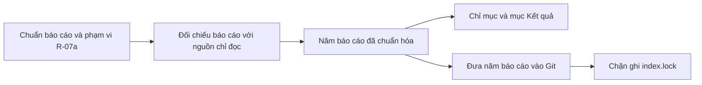

TÓM TẮT 1 [NGUỒN] Đã chuẩn hóa 5/5 báo cáo trong phạm vi R-07a.\
TÓM TẮT 2 [NGUỒN] Đã đối chiếu tóm tắt và thân báo cáo với bản gốc. Phần chữ, số liệu và kết luận gốc khớp.\
TÓM TẮT 3 [NGUỒN] Đã lập chỉ mục 5 hàng và ghi mục Kết quả trong tệp task.\
TÓM TẮT 4 [NGUỒN] PARTIAL. Git từ chối tạo `index.lock` ngoài worktree. Chưa có commit SHA.\
TÓM TẮT 5 [NGUỒN] Đã đọc tĩnh và kiểm tài liệu. Chưa build, chạy exe, VM hoặc kiểm tra mạng.

# R-07a — Chuẩn hóa báo cáo R-07 phần a

Loại: tổng hợp
Chủ đề: Chuẩn hóa năm báo cáo JX1 và lập chỉ mục tra cứu cho phần a.
Từ khóa: chuẩn báo cáo, độ phủ, chỉ mục, R-07a, JIBS, L-01, L-02, L-03, M-01
Trạng thái: PARTIAL — Đủ các tệp tài liệu. Git chặn ghi metadata để tạo commit.
Độ phủ: đã phủ 5 trên tổng 5 báo cáo cần chuẩn hóa.
Liên quan: [Chuẩn báo cáo](../DESIGN/CHUAN-BAO-CAO.md), [Mục lục tri thức](../DESIGN/MUC-LUC-TRI-THUC.md), [Hướng dẫn tra cứu](../DESIGN/HUONG-DAN-TRA-CUU.md).
Cần tôi quyết định: không

## Phạm vi và độ phủ

Phạm vi lấy từ `JX1_OPS/TASKS/R-07a.md:11`. Mỗi mẫu số trong cột cuối dùng đơn vị riêng ghi ở báo cáo tương ứng. Phần này có năm báo cáo cũ và không có tệp daily hoặc TEST được phân công.

| Báo cáo | Chuẩn hóa | Độ phủ trong báo cáo và bằng chứng |
|---|---|---|
| [JIBS](JIBS-danh-gia-bot.md) | Đã phủ | 6/7 câu hỏi. `JIBS-danh-gia-bot.md:29` |
| [L-01](L-01-lam-muot-hinh-anh.md) | Đã phủ | 9/12 hạng mục. `L-01-lam-muot-hinh-anh.md:27` |
| [L-02](L-02.md) | Đã phủ | 6/9 hạng mục. `L-02.md:26` |
| [L-03](L-03-quy-trinh-dung-apk.md) | Đã phủ | 7/8 hạng mục. `L-03-quy-trinh-dung-apk.md:26` |
| [M-01](M-01-kiem-tra-may-that.md) | Đã phủ | 7/11 nhóm kiểm tra. `M-01-kiem-tra-may-that.md:27` |

Đã ghi năm hàng từ các khối thông tin vào `_CHIMUC/R-07a.tsv:2` đến `_CHIMUC/R-07a.tsv:6`. Đã cập nhật mục Kết quả tại `JX1_OPS/TASKS/R-07a.md:33`.

## Nguồn và giới hạn đối chiếu

- **ĐÃ XÁC MINH** chuẩn và cách tra cứu tại `JX1_OPS/DESIGN/CHUAN-BAO-CAO.md:6`, `JX1_OPS/DESIGN/MUC-LUC-TRI-THUC.md:10` và `JX1_OPS/DESIGN/HUONG-DAN-TRA-CUU.md:23`. Báo cáo và chỉ mục đều là UTF-8 không BOM.
- **ĐÃ XÁC MINH** ở client bản A `D:/JX-build/qh9A`. Dùng `Classes/graphify-out/.graphify_root:1` và `Classes/graphify-out/GRAPH_REPORT.md:675` để định vị trong `Classes`, rồi mở tệp thật. Dẫn chiếu `Classes/`, `cocos2d/`, `proj.android/` và `L02/` bên dưới đều tương đối với bản A. Có tệp UTF-8 và tệp giải mã được bằng GBK. Với tệp chưa xác định bảng mã toàn bộ, chỉ lấy dòng ASCII chứa symbol hoặc đường dẫn.
- **ĐÃ XÁC MINH** ở server `C:/Jx1CocoV3/Folder/ServerNew-20260116T043145Z-3-001/ServerNew/_bin_v2_/gs`. `JX1_OPS/CONTEXT-PACK/GS001-MAP.md:3` là bản định vị. Dữ liệu đọc được trong vùng gồm lời gọi `AddOwnExp` ở `script/global/goldacition.lua:15` và `AddItem` ở `script/global/gucaxia.lua:80`. Tệp thứ nhất đọc được dưới dạng UTF-8/ASCII. Tệp thứ hai được đối chiếu ở dòng ASCII gọi hàm.

## Phát hiện khi chuẩn hóa

- **JIBS.** Đã có báo cáo A-06 đối chiếu gói tin ở mức tĩnh. JIBS ghi A-06 chưa có bảng ở thời điểm viết. Thư mục `gs` được giao thiếu mã C++ mà JIBS dẫn về sức chứa, nhịp và lọc hiển thị. CPU/RAM thực dùng của VM chưa đo. `A-06-bang-goi-tin.md:7`, `JIBS-danh-gia-bot.md:82`, `JIBS-danh-gia-bot.md:96`.
- **L-01.** Bản A có `g_jxAdditive` và `jxDrawBolts`. L-01 ghi chưa tìm thấy trên bản nguồn của lượt khảo sát gốc. Hiệu ứng trên APK còn chờ kiểm. `L-01-lam-muot-hinh-anh.md:211`, `L-01-lam-muot-hinh-anh.md:223`, `Classes/vn/gamecore/KNpcResVN.cpp:560`, `Classes/vn/gamecore/KNpcResVN.cpp:618`.
- **L-02.** Mặc định `JX_L02_SUBPIXEL` của bản A là `1`, còn báo cáo gốc ghi `0` ở bản thử. Hash của hai shader glow bản A khớp mốc cũ. Hash của `KNpcResVN.cpp` khác. So sánh này đối chiếu tệp trên đĩa, chưa xác định cờ build hay kết quả hiển thị. `L-02.md:57`, `L-02.md:65`, `L-02.md:94`, `Classes/L02RenderTrial.h:6`.
- **L-03.** `versionCode` của bản A là `20`. Báo cáo gốc ghi `17` cho APK `jx-qh7`. Chưa tái lập quy trình trên máy khác. `L-03-quy-trinh-dung-apk.md:3`, `L-03-quy-trinh-dung-apk.md:55`, `proj.android/app/build.gradle:13`.
- **M-01.** Tổng Working Set là số liệu lịch sử của lần đo. Báo cáo còn thiếu RAM vật lý và Private Bytes, kích thước hiberfil/pagefile, RAM VM dùng thật và chi tiết bên trong Program Files. `M-01-kiem-tra-may-that.md:1`, `M-01-kiem-tra-may-that.md:66`, `M-01-kiem-tra-may-that.md:81`.

## Mục sổ thông số

| Nhóm | Tên/hằng số | file:dòng | Giá trị | Đơn vị | Ảnh hưởng | Đổi an toàn | Nguồn đo |
|---|---|---|---|---|---|---|---|
| Sức chứa | `MAX_PLAYER` | `JIBS-danh-gia-bot.md:51` | 500 | chỗ người chơi | Giới hạn cứng ghi ở báo cáo cũ | CẨN THẬN | Dẫn lại JIBS. Chưa đọc khai báo C++ trong lượt này |
| Nhịp server | `GAME_FPS` | `JIBS-danh-gia-bot.md:52` | 18 | Hz | Nhịp vòng lặp ghi ở báo cáo cũ | CẨN THẬN | Dẫn lại JIBS. Chưa đo tải |
| Hình ảnh | `mediumResolutionSize` | `Classes/AppDelegate.cpp:53`, `Classes/AppDelegate.cpp:56` | 1040 × 603,2 | px thiết kế | Kích thước tham chiếu cho phép co giãn | CẨN THẬN | Đọc tĩnh bản A. Chiều cao bằng 1040 × 0,58 |
| Bản đồ | `RenderTexture::create` | `Classes/gamescene/KgameWorld.cpp:7462`, `cocos2d/cocos/2d/CCRenderTexture.cpp:223` | 512 × 512 | px logic | Kích thước yêu cầu khi tạo canvas ô bản đồ | CẨN THẬN | Đọc tĩnh bản A. Còn phụ thuộc hệ số nội dung khi cấp texture |
| L-02 | `JX_L02_SUBPIXEL` | `L-02.md:65`, `Classes/L02RenderTrial.h:6` | 0 ở báo cáo gốc, 1 mặc định ở bản A | cờ biên dịch | Chọn kiểu tọa độ dùng trên đường vẽ đã bọc cờ | CẨN THẬN | Kết quả cũ và đọc tĩnh bản A |
| L-02 | `JX_L02_TARGET_FPS` | `Classes/L02RenderTrial.h:9`, `Classes/AppDelegate.cpp:120` | 60 mặc định ở bản A | khung/giây mục tiêu | Giá trị dùng để đặt khoảng thời gian vẽ | CẨN THẬN | Đọc tĩnh bản A. Chưa đo FPS |
| APK | `versionCode` | `L-03-quy-trinh-dung-apk.md:3`, `proj.android/app/build.gradle:13` | 17 ở APK mốc, 20 ở bản A | mã phiên bản Android | Mốc thứ tự phiên bản cho phép kiểm cài đè | CẨN THẬN | Dẫn lại L-03 và đọc cấu hình bản A |

## Đã xác minh / Chưa xác minh

- **ĐÃ XÁC MINH.** Đã so năm tóm tắt và thân năm báo cáo với `HEAD` lúc bắt đầu, kiểm định UTF-8 không BOM, đối chiếu liên kết đích tồn tại, số hàng độ phủ và khối Mermaid. `git diff --check` đạt cho năm báo cáo.
- **ĐÃ XÁC MINH.** PowerShell không tìm thấy `rg`. Đã dùng `Select-String` và `Get-ChildItem` trong các thư mục được giao. Lần `git diff --check` đầu báo CRLF ở M-01. Đã chuyển tệp sang LF và kiểm lại, phần chữ thân bài khớp theo từng dòng.
- **CHƯA XÁC MINH.** Chưa chạy build, APK, exe game, VM, kiểm tra mạng, kiểm thử game hay đo runtime. Chưa đọc lại bản nguồn cũ của L-01 hoặc bản thử gốc của L-02. Kết quả máy thật của M-01 là đo lịch sử.

## Bàn giao

- **BỊ CHẶN – CHƯA PUSH.** Đã thử `git add` đúng năm báo cáo trên `task/R-07a`. Git trả về `fatal: Unable to create 'D:/jx1-reports/.git/worktrees/R-07a/index.lock': Permission denied`. Metadata của worktree nằm ngoài vùng được ghi. Chưa stage, chưa có SHA.
- Tám tệp bàn giao nằm trong worktree. Phần còn lại là tạo commit cho nhóm năm báo cáo và nhóm ba tệp bàn giao trong phiên có quyền ghi metadata Git. Chỉ mục để PM gộp vào mục lục tri thức. [Chỉ mục R-07a](./_CHIMUC/R-07a.tsv).
- Hàng đề xuất cho mục lục tri thức: Làm mượt hình ảnh trên bản A, đối chiếu tĩnh | R-07a | `Classes/L02RenderTrial.h:6`, `Classes/vn/gamecore/KNpcResVN.cpp:618` | khảo sát tĩnh.
