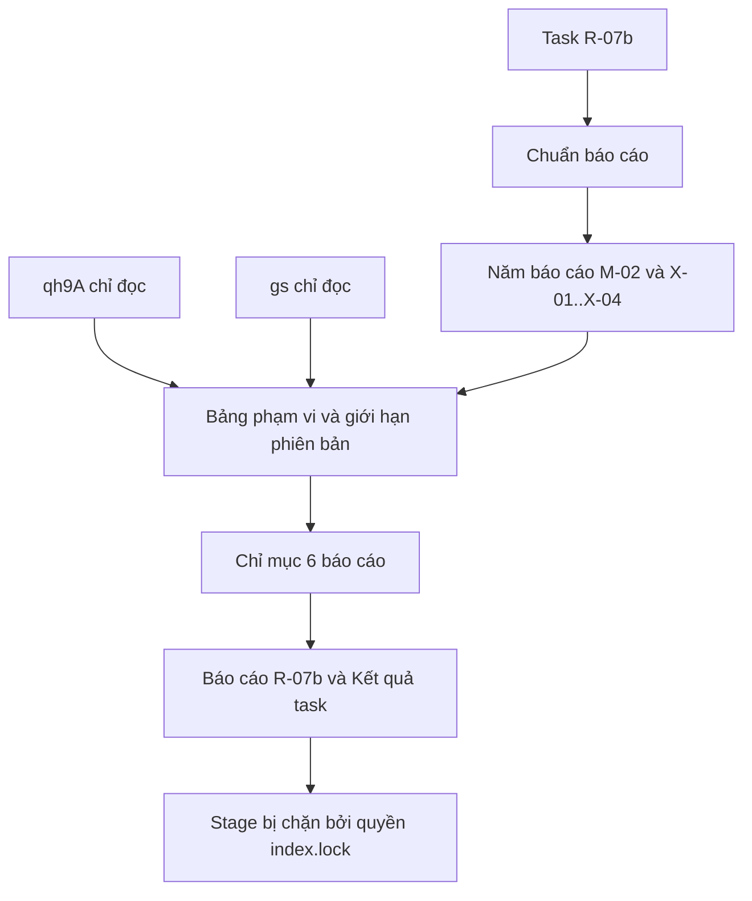

## TÓM TẮT 5 DÒNG
1. PARTIAL [NGUỒN] — Đã bổ sung cấu trúc chuẩn cho 5/5 báo cáo M-02, X-01, X-02, X-03, X-04; phần thân gốc được giữ nguyên.
2. [NGUỒN] — Mỗi báo cáo có metadata, một Mermaid, bảng phạm vi từng phần tử và mục Phát hiện khi chuẩn hóa.
3. [NGUỒN] — Đã tạo chỉ mục 6 báo cáo và ghi mục Kết quả cuối task R-07b.
4. [CHƯA KIỂM] — Source lịch sử chưa được tái xác minh: qh9A khác Client2912/qh7; root gs được phép không có các tệp C++ mà X-02/X-04 dẫn.
5. [NGUỒN] — Không chạy build/test, exe, VM hoặc mạng; BỊ CHẶN – CHƯA PUSH: git add không tạo được index.lock, chưa có SHA commit.

# R-07b — Chuẩn hóa báo cáo R-07 phần b
Loại: tổng hợp
Chủ đề: Bổ sung cấu trúc tra cứu cho năm báo cáo cũ, kiểm kê độ phủ và lập chỉ mục theo chuẩn JX1.
Từ khóa: chuẩn hóa, retrofit, M-02, X-01, X-02, X-03, X-04, độ phủ, Mermaid, TSV
Trạng thái: PARTIAL — đã hoàn tất phần tài liệu trong khả năng; commit bị chặn và còn giới hạn tái xác minh nguồn lịch sử.
Độ phủ: 5/5 báo cáo cũ có cấu trúc chuẩn; 6/6 dòng chỉ mục; 1/1 mục Kết quả task; 0 commit thành công.
Liên quan: JX1_OPS/DESIGN/CHUAN-BAO-CAO.md, JX1_OPS/DESIGN/MUC-LUC-TRI-THUC.md, JX1_OPS/DESIGN/HUONG-DAN-TRA-CUU.md, JX1_OPS/REPORTS/A-17-roi-do-boss-trang-bi.md, JX1_OPS/REPORTS/H-13-tick-do-tre-don.md
Cần tôi quyết định: không

## Phạm vi và độ phủ

| Phần tử | Độ phủ cấu trúc | Độ phủ đối chiếu trong R-07b |
|---|---|---|
| `JX1_OPS/REPORTS/M-02.md` | Đã phủ | 13 hạng mục được kiểm kê: 9 đã có nội dung lịch sử, 4 chưa phủ; không đo lại benchmark |
| `JX1_OPS/REPORTS/X-01.md` | Đã phủ | Định vị 11/11 tệp tương ứng qh9A; chưa xác minh lại source Client2912 |
| `JX1_OPS/REPORTS/X-02.md` | Đã phủ | Kiểm kê 12/12 tệp source được dẫn; chưa tái xác minh 12/12 tại root gs vì thiếu các đường dẫn C++ |
| `JX1_OPS/REPORTS/X-03.md` | Đã phủ | Định vị 6/6 tệp tương ứng qh9A; không đọc source qh7 bị task loại trừ |
| `JX1_OPS/REPORTS/X-04.md` | Đã phủ | Kiểm kê 10/10 phần tử; đối chiếu bảng dữ liệu và A-17 (2/10), chưa tái xác minh 8 source C++ |
| `JX1_OPS/REPORTS/_CHIMUC/R-07b.tsv` | Đã phủ | Header và 6 dòng, mỗi dòng đủ 7 cột; gồm năm báo cáo cũ và báo cáo R-07b |
| `JX1_OPS/REPORTS/R-07b.md` | Đã phủ | Báo cáo cuối, có giới hạn, kiểm tra và bàn giao |
| `JX1_OPS/TASKS/R-07b.md` — chỉ mục Kết quả | Đã phủ theo yêu cầu trực tiếp của người dùng | Giữ nguyên YAML/phạm vi, chỉ thay nội dung Kết quả cuối file |

Đơn vị kiểm kê là hạng mục/tệp mà báo cáo gốc dẫn, không phải toàn bộ cây source, toàn hệ thống game hoặc bằng chứng runtime. Mục Kết quả task được sửa theo chỉ thị trực tiếp của người dùng ngoài bảy đường dẫn `vung_file`; không sửa mã, cấu hình, các skill, mục lục chung hay BAI_HOC.

## Cách thực hiện và nguồn đối chiếu

- Đã chạy `git status --short --branch` và `git log --oneline jx1-ops..HEAD` trước ghi. Nhánh là `task/R-07b`, ban đầu chỉ task R-07b untracked; log so với jx1-ops rỗng. Không có commit/thay đổi báo cáo từ lần trước để làm lại.
- Chuẩn bắt buộc tại `JX1_OPS/DESIGN/CHUAN-BAO-CAO.md:7-21` và quy tắc giữ kết luận/số liệu/bằng chứng tại `:24-28`. Phạm vi và root theo `JX1_OPS/TASKS/R-07b.md:11,19-28`.
- Đã đọc sáu skill được yêu cầu trong `.agents/skills`: jx1-retrofit, jx1-read-server, jx1-read-client, jx1-parameters, jx1-knowledge, jx1-report. Chỉ đọc tệp/symbol cần thiết; không tạo/update Graphify, không đọc source ở root ngoài task.
- Root client đối chiếu: `D:/JX-build/qh9A`. Các định vị tĩnh được ghi riêng trong bảng phạm vi X-01/X-03; không thay thế nguồn Client2912/qh7 mà các báo cáo cũ đã sử dụng.
- Root server đối chiếu: `C:/Jx1CocoV3/Folder/ServerNew-20260116T043145Z-3-001/ServerNew/_bin_v2_/gs`. Kiểm tra các đường dẫn nguồn mà X-02/X-04 dẫn cho kết quả không hiện diện; không quét ổ đĩa tìm bản khác, không chạy DLL/EXE. Bảng `Settings/droprate/npcdroprate110.ini` có thật và được đọc giới hạn.
- Mã hóa báo cáo, task Kết quả và TSV: UTF-8 không BOM. Trích source/data mới chỉ dùng định danh và biểu thức ASCII; encoding toàn tệp/comment gốc chưa xác minh, không tự nhận GBK/TCVN3 hoặc chuyển mã nguồn.

## Đã xác minh

- Có đủ năm dòng tóm tắt trước tiêu đề, bảy trường metadata, đúng một khối Mermaid, bảng phạm vi và mục Phát hiện khi chuẩn hóa trong cả sáu báo cáo đầu ra.
- Đối chiếu phần thân từng báo cáo với `git show HEAD:<file>`: 5/5 phần thân giữ nguyên sau khi bỏ phần bổ sung và quy đổi tên heading xác minh/bàn giao. Các câu kết luận, số liệu, bảng tham số và bằng chứng gốc không bị thay đổi; tóm tắt được giữ nội dung, thêm nhãn độ chắc và giới hạn để theo chuẩn.
- `D:/JX-build/qh9A/Classes/gamecore/GameDataDef.h:29` có ngưỡng movement; `Classes/gamecore/KPlayer.cpp:244-254` có nhánh pending joystick; `Classes/gamescene/KHRocker.cpp:587,598,639` có callback/Goto; `Classes/AppDelegate.cpp:120` dùng JX_L02_TARGET_FPS. Đây là định vị qh9A, không kiểm chứng lại nhịp render/packet của Client2912.
- `D:/JX-build/qh9A/Classes/gamescene/KgameWorld.h:32` và `Classes/gameui/KuiItemImmediaBox.h:92-93` có các khai báo số ô; `Classes/gameui/KuiItemImmediaBox.cpp:591-598` có kích thước/offset ô. Không suy tọa độ qh7 hoặc hình hiển thị từ chúng.
- Tại root gs, `Settings/droprate/npcdroprate110.ini:2-5,15,335` có Count=52, RandRange=1.000.000, MagicRate=1, MoneyRate=5, nTypeNum=2 và section [53]. Chỉ xác minh dữ liệu trong file; chưa xác minh bảng được gắn, tổng trọng số hay số rơi thực.
- Đã đọc phần bảng rơi của `JX1_OPS/REPORTS/A-17-roi-do-boss-trang-bi.md:61-70`; báo cáo `JX1_OPS/REPORTS/H-13-tick-do-tre-don.md` tồn tại. Không chạy lại khảo sát hai báo cáo này.

## Chưa xác minh

- Chưa tái kiểm chứng các kết luận lịch sử bằng đúng source Client2912, SwordOnline, D:/JX-source hoặc qh7. R-07b chỉ định qh9A và root gs; qh7 bị cấm rõ ràng. Thiếu source không biến thành kết luận cũ sai.
- Không dùng bảng dữ liệu gs thay bằng chứng thuật toán EXP/tick/loader trong C++; 12 tệp X-02 và 8 tệp X-04 vẫn chưa tái xác minh. Không suy source có khớp DLL/EXE triển khai.
- Chưa đo runtime, FPS, gói/s, tick/jitter, hitbox, cấu hình đang dùng hoặc dữ liệu mission/map hiệu lực. Không chạy build/test game, exe, VM hoặc mạng theo phạm vi.
- Mermaid đã kiểm tra cấu trúc khối/văn bản; chưa render bằng trình Mermaid. Không cài công cụ hoặc truy cập mạng để render.
- Commit chưa thành công; không có SHA hoặc bằng chứng push.

## Kiểm tra tài liệu, lỗi và cách xử lý

| Lệnh/thao tác | Kết quả thực tế |
|---|---|
| `git diff --check` | Đạt lượt cuối (exit 0, không có lỗi khoảng trắng), sau khi chuẩn hóa LF cho các dòng mới từng bị trộn CRLF |
| Kiểm kê cấu trúc sáu báo cáo | Mỗi báo cáo có 5 dòng tóm tắt trước tiêu đề và đủ nhãn/khối yêu cầu |
| Kiểm tra UTF-8/BOM và TSV | Tệp đầu ra không BOM; TSV có 6 dòng dữ liệu, 7 cột mỗi dòng |
| So phần thân với HEAD | 5/5 báo cáo cũ giữ nguyên phần thân, chỉ đổi tên heading xác minh/bàn giao |
| `rg` | Không có trong PATH; chuyển sang Get-ChildItem/Select-String/Get-Content giới hạn đường dẫn, không cài |
| Đọc không chỉ định encoding | Console hiển thị sai dấu; đọc lại UTF-8 thành công, không kết luận file hỏng |
| Truy vấn `Goto(` bằng regex | Lỗi ngoặc; sửa thành SimpleMatch, lấy được dòng |
| Kiểm tra nhãn bằng regex lồng nhau | Lệnh kiểm tra dùng sai biến, sinh lỗi lặp; không sửa file, thay bằng kiểm nhãn literal có giới hạn và chạy lại |
| Ghi chỉ mục lần đầu | Thiếu thư mục _CHIMUC; tạo đúng thư mục được giao rồi ghi TSV thành công |
| Xem diff một lần | Phát hiện hai chỗ nối bảng/heading thiếu xuống dòng; sửa và đọc lại vùng nối; không đổi thân gốc |
| Stage nhóm đầu 4 file | Thất bại do không tạo được index.lock; không chạy commit phụ thuộc stage |

Lỗi Git nguyên văn: `fatal: Unable to create 'D:/jx1-reports/.git/worktrees/R-07b/index.lock': Permission denied`. Đã thử stage đúng M-02, X-01, X-02 và báo cáo tiến độ R-07b để commit sớm theo nhóm. Không thử lại cùng lỗi quyền, không đổi quyền/credential/config, không đổi Git dir hoặc chạy ngoài sandbox. Phần tài liệu còn lại tiếp tục được ghi trong worktree.

## Bàn giao

Trạng thái cuối: **PARTIAL**. **BỊ CHẶN – CHƯA PUSH**; chưa có commit SHA vì stage bị chặn. Không có yêu cầu push và không dùng mạng.

PM cần thực hiện stage/commit tại môi trường có quyền ghi Git metadata, theo nhóm 3–5 file đã sửa, chỉ chọn năm báo cáo cũ, chỉ mục, báo cáo R-07b và nội dung Kết quả task được giao. Không stage file khác. Nếu cần hoàn tất tái kiểm chứng source lịch sử, giao riêng quyền/root phù hợp; không mở rộng ngầm trong R-07b.

Chỉ mục nộp cho PM tại `JX1_OPS/REPORTS/_CHIMUC/R-07b.tsv`; không sửa `MUC-LUC-TRI-THUC.md`. Báo cáo R-07b là hồ sơ chuẩn hóa và giới hạn nguồn; không thêm kết luận vận hành game mới vào mục lục chung.

## Phát hiện khi chuẩn hóa

- M-02 phản ánh thời điểm chưa triển khai bốn skill và stage bị chặn. Bốn tệp skill hiện có trong worktree R-07b; ghi nhận khác biệt thời điểm, không sửa kết luận lịch sử hoặc đoán chúng được cài từ commit nào.
- X-01 dùng Client2912; X-02 dùng SwordOnline/H-13; X-03 dùng qh7. Các nguồn đó không đồng nhất root hiện được giao. qh9A có nhánh pending joystick ở `Classes/gamecore/KPlayer.cpp:244-254` và interval FPS qua macro ở `Classes/AppDelegate.cpp:120`; không nhập hai điểm này vào kết luận cũ.
- Root gs có dữ liệu rơi đồ nhưng không có cây C++ được X-02/X-04 dẫn. Các hàng chưa phủ được liệt kê riêng, không dùng tổng số nhóm nội dung để nhận đã tái kiểm chứng đầy đủ.
- MoneyRate=5 trong `Settings/droprate/npcdroprate110.ini:5` là dữ liệu tệp; MoneyRate mặc định 2 trong X-04 là default loader theo báo cáo lịch sử. Hai lớp giá trị khác nhau, không thay số cũ hoặc nhận runtime đã xác minh.
