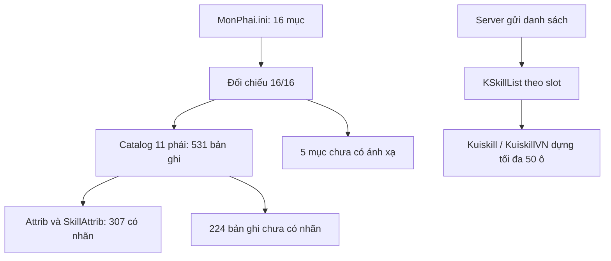

TÓM TẮT 1: [NGUỒN] BLOCKED ở bước commit; phần tài liệu khảo sát 16/16 mục đã xong, catalog 531 bản ghi liên hệ 11 phái, 5 mục thiếu ánh xạ ghi rõ.
TÓM TẮT 2: [NGUỒN] Đã có ID/tên TCVN3/ReqLevel/MaxLevel/Attrib, số bản ghi mỗi nhóm, tên trùng, bản riêng và 81 tên tạm.
TÓM TẮT 3: [NGUỒN] Võ Đang ID 8 có 40 dòng trỏ đúng wudang.lua + 5 dòng dưới thư mục wudang = 45; đã tách 193/215/267/268/1603.
TÓM TẮT 4: [CHƯA KIỂM] 224 bản ghi chưa có nhãn Attrib; chưa chốt roster học/nhánh triển khai và dữ liệu của 5 mục còn lại.
TÓM TẮT 5: [NGUỒN]/[CHƯA KIỂM] BỊ CHẶN – CHƯA PUSH: git add lỗi quyền ghi index.lock, chưa có SHA; cần PM commit 4 file. Chưa build/chạy exe/VM/mạng/test game.

# S-01 — Bảng kỹ năng theo phái
Loại: tổng hợp
Chủ đề: Kiểm kê nhánh và dữ liệu cấp kỹ năng cho đủ các mục MonPhai.ini.
Từ khóa: môn phái, kỹ năng, Võ Đang, wudang, 武当, SkillId, Attrib, SkillAttrib, ReqLevel, MaxLevel
Trạng thái: BLOCKED — nội dung khảo sát tĩnh đã xong; git add bị chặn quyền ghi metadata worktree nên chưa stage/commit.
Độ phủ: 16/16 mục khai báo; 11/16 mục có catalog, 531 bản ghi; 307 có nhãn Attrib và 224 chưa có; 5 mục chưa có danh sách kỹ năng.
Liên quan: DESIGN/BANG-KY-NANG-THEO-PHAI.md; REPORTS/A-08a-mon-phai-ky-nang.md; REPORTS/A-15a-ky-nang-phai-1-4.md; REPORTS/A-15b-ky-nang-phai-5-8.md; REPORTS/A-15c-ky-nang-phai-9-cuoi.md; DESIGN/CHUAN-BAO-CAO.md
Cần tôi quyết định: không

## Phạm vi và độ phủ

Tiền tố G/ = `C:/Jx1CocoV3/Folder/ServerNew-20260116T043145Z-3-001/ServerNew/_bin_v2_/gs/`; C/ = `D:/JX-build/qh9A/Classes/`. Chỉ đọc hai gốc task chỉ định. Bảng đầy đủ dưới đây đối chiếu trực tiếp MonPhai.ini; số bản ghi không phải số kỹ năng học được. Tài liệu đầu ra UTF-8 không BOM.

| ID INI | Tên Việt / tên gốc | Hệ gốc | Token đối chiếu | Bản ghi | Mức phủ | file:dòng |
| --- | --- | --- | --- | --- | --- | --- |
| 0 | Thiếu Lâm / 少林派 | 金 | shaolin | 47 | Đã phủ catalog; 24 có nhãn Attrib, 23 chưa có nhãn | `G/Settings/faction/MonPhai.ini:6` |
| 1 | Thiên Vương / 天王帮 | 金 | tianwang | 55 | Đã phủ catalog; 28 có nhãn Attrib, 27 chưa có nhãn | `G/Settings/faction/MonPhai.ini:11` |
| 2 | Đường Môn / 唐门 | 木 | tangmen | 56 | Đã phủ catalog; 35 có nhãn Attrib, 21 chưa có nhãn | `G/Settings/faction/MonPhai.ini:16` |
| 3 | Ngũ Độc / 五毒教 | 木 | wudu | 41 | Đã phủ catalog; 31 có nhãn Attrib, 10 chưa có nhãn | `G/Settings/faction/MonPhai.ini:21` |
| 4 | Nga My / 峨嵋派 | 水 | emei | 56 | Đã phủ catalog; 29 có nhãn Attrib, 27 chưa có nhãn | `G/Settings/faction/MonPhai.ini:26` |
| 5 | Thúy Yên / 翠烟门 | 水 | cuiyan | 56 | Đã phủ catalog; 25 có nhãn Attrib, 31 chưa có nhãn | `G/Settings/faction/MonPhai.ini:31` |
| 6 | Cái Bang / 丐帮 | 火 | gaibang | 34 | Đã phủ catalog; 19 có nhãn Attrib, 15 chưa có nhãn | `G/Settings/faction/MonPhai.ini:36` |
| 7 | Thiên Nhẫn / 天忍教 | 火 | tianren | 42 | Đã phủ catalog; 26 có nhãn Attrib, 16 chưa có nhãn | `G/Settings/faction/MonPhai.ini:41` |
| 8 | Võ Đang / 武当派 | 土 | wudang | 45 | Đã phủ catalog; 21 có nhãn Attrib, 24 chưa có nhãn | `G/Settings/faction/MonPhai.ini:46` |
| 9 | Côn Lôn / 昆仑派 | 土 | kunlun | 52 | Đã phủ catalog; 27 có nhãn Attrib, 25 chưa có nhãn | `G/Settings/faction/MonPhai.ini:51` |
| 10 | Hoa Sơn / 华山派 | 水 | huashan | 47 | Đã phủ catalog; 42 có nhãn Attrib, 5 chưa có nhãn | `G/Settings/faction/MonPhai.ini:56` |
| 11 | Lý Tầm Hoan / 李寻欢 | 木 | chưa xác minh | chưa có ánh xạ | Đã phủ mục khai báo; CHƯA PHỦ danh sách kỹ năng | `G/Settings/faction/MonPhai.ini:61` |
| 12 | Đào Hoa Đảo / 桃花岛 | 水 | chưa xác minh | chưa có ánh xạ | Đã phủ mục khai báo; CHƯA PHỦ danh sách kỹ năng | `G/Settings/faction/MonPhai.ini:66` |
| 13 | Minh Giáo / 明教 | 火 | chưa xác minh | chưa có ánh xạ | Đã phủ mục khai báo; CHƯA PHỦ danh sách kỹ năng | `G/Settings/faction/MonPhai.ini:71` |
| 14 | Đoàn Thị / 段氏 | 土 | chưa xác minh | chưa có ánh xạ | Đã phủ mục khai báo; CHƯA PHỦ danh sách kỹ năng | `G/Settings/faction/MonPhai.ini:76` |
| 15 | Tự sáng môn phái / 自创门派 | 金 | chưa xác minh | chưa có ánh xạ | Đã phủ mục khai báo; CHƯA PHỦ danh sách kỹ năng | `G/Settings/faction/MonPhai.ini:81` |

## Kết quả chính

[ĐÃ XÁC MINH] Catalog [BANG-KY-NANG-THEO-PHAI.md](../DESIGN/BANG-KY-NANG-THEO-PHAI.md) có 531 SkillId riêng, giải mã TCVN3, ReqLevel/MaxLevel từng dòng, Attrib, khóa Lua và nguồn. Phạm vi gồm basename token.lua, đường NPC và thư mục con, cộng ID 3/59 legacy; không mở rộng theo khoảng ID hoặc Attrib. Vì vậy đây là các dòng liên hệ script, chưa phải whitelist kỹ năng học. Cột được kiểm từ `G/Settings/Skills.txt:1`.

[ĐÃ XÁC MINH] Nhánh lựa chọn nằm ở phần tử thứ tư của SKILL90_ARRAY (`G/script/header/factionhead.lua:338`); 30 nút trong 11 nhóm đầu, mỗi nhánh header có một nút. Cột Attrib là mã dòng võ công (`C/gamecore/KSkills.cpp:2856`), tooltip gọi IsAttrib rồi tra SkillAttrib (`C/gameui/KuiSkilldesc.cpp:436`; `C/gameui/KuiSkilldesc.cpp:449`). Bảng nhãn GBK G/ tại `G/Settings/gamesetting.ini:224` tra được 307 dòng, còn 224 thiếu nhãn; không lấy Attrib làm mã phái.

[ĐÃ XÁC MINH] Võ Đang INI ID 8 ở `G/Settings/faction/MonPhai.ini:46`, token wudang ở `G/Settings/faction/faction.ini:63`. 40 dòng trỏ chính xác wudang.lua, 5 dòng thư mục con tại `G/Settings/Skills.txt:291`, :682, :688, :696, :697; tổng 45. ID 193/215/267/268/1603 được tách riêng; 1603 có ReqLevel=1/MaxLevel=60 ở `G/Settings/Skills.txt:1592`, không gộp với 368 (80/20, dòng 369).

[ĐÃ XÁC MINH] Client mở UI thường tại `C/gamescene/KgameWorld.cpp:2530` và UI VN tại `C/vn/gamescence/KgameWorldVN.cpp:2325`. Hai lớp lấy GDI_FIGHT_SKILLS ở `C/gameui/KuiSkill.cpp:127` và `C/vn/gameui/KuiSkillVN.cpp:107`; CoreShell chuyển tới GetSkillSortList ở `C/gamecore/CoreShell.cpp:2377`. Danh sách duyệt theo slot, bỏ 1/2/53, giới hạn 50 (`C/gamecore/KSkillList.cpp:915`, :955, :962). UI đặt vị trí theo i, không phân nhánh ở luồng đã đọc (`C/gameui/KuiSkill.cpp:136`, :154, :271).

[ĐÃ XÁC MINH] Đã tra Graphify đúng cây Classes trước tìm source; marker `C/graphify-out/.graphify_root:1` là dấu chấm, tương đối cây Classes. Graph nhánh VN ghi số dòng cũ :2323; kiểm file thật dùng :2325. Không làm mới graph.

## MỤC SỔ THÔNG SỐ

| Nhóm | Tên/hằng số | file:dòng | Giá trị | Đơn vị | Ảnh hưởng | Đổi an toàn (CÓ/CẨN THẬN/KHÔNG) | Nguồn đo |
| --- | --- | --- | --- | --- | --- | --- | --- |
| Danh sách | MonPhai.ini [0]…[15] | `G/Settings/faction/MonPhai.ini:6`; :81 | 16 | mục khai báo | Phạm vi bắt buộc; không phải số phái chơi được | KHÔNG — task chỉ đọc | Đọc tĩnh |
| Catalog | SkillId | `G/Settings/Skills.txt:1` | cột 2 | ID | Không gộp các bản riêng | CẨN THẬN | Đọc tĩnh |
| Nhánh | Attrib | `G/Settings/Skills.txt:1`; `C/gamecore/KSkills.cpp:2856` | cột 10 | mã | Tra nhãn; không phải mã phái | CẨN THẬN | Đọc tĩnh |
| Cấp | ReqLevel / MaxLevel | `G/Settings/Skills.txt:1`; `C/gamecore/KSkills.cpp:2858`; `C/gamecore/KSkillManager.cpp:64` | cột 54/55, từng ID ở DESIGN | cấp nhân vật / cấp kỹ năng | Chưa bao quát điều kiện học | CẨN THẬN | Đọc tĩnh, chưa đo runtime |
| Bản riêng | ID 1603 | `G/Settings/Skills.txt:1592` | Req 1 / Max 60 | cấp | Khác 368 dù cùng tên | CẨN THẬN | Đọc tĩnh |
| UI | FIGHT_SKILL_COUNT | `C/gameui/KuiSkill.h:15`; `C/gamecore/KSkillList.cpp:962` | 50 | ô/danh sách | Giới hạn UI source A | CẨN THẬN | Đọc tĩnh |

## Đã xác minh / Chưa xác minh

ĐÃ XÁC MINH: 16/16 mục, 531 dòng catalog, tên TCVN3, dữ liệu cấp, nhóm Attrib và số ID mỗi nhóm; 81 tên abc/ncp, tên trùng và bản riêng; 40+5 Võ Đang; vị trí dựng UI thường/VN và lookup nhãn. Các bảng trong DESIGN có từng file:dòng.

CHƯA XÁC MINH: dữ liệu skill của 5 mục ID 11–15; nhãn của 224 bản ghi; roster học/prerequisite, cấp học cuối, nội dung PAK/update10, danh sách server thực gửi, source/data/binary khớp phiên bản và runtime. Client active GAME_SETTING_FILE trỏ update10/gamesetting.ini (`C/gamecore/CoreUseNameDef.h:155`); chưa có file rời ở root/Resources/data đã kiểm. Không coi nhãn G/ là nhãn client đã nạp. Chưa build, chạy exe, VM, mạng hay test game theo phạm vi task.

## Kiểm tra và lỗi xử lý

[ĐÃ XÁC MINH] Ngày 18/11/2026, tiếp tục hai file nháp có sẵn sau khi kiểm git status và git log jx1-ops..HEAD; không có commit kết quả S-01 từ lần trước. Đối chiếu cục bộ 531/531 hàng catalog theo bảy mục: ID, tên TCVN3, Attrib, ReqLevel, MaxLevel, LvlData1 và dòng nguồn: không có sai lệch. Kiểm 106 nhóm Attrib (531 ID), 30 nút header, 54 nhóm tên trùng và 59 nhãn gốc: không có sai lệch. Kiểm 26 file được trích dẫn: tồn tại và số dòng hợp lệ; các symbol chính của luồng UI/loader được mở tại file thật. Đếm lại đủ 16 section, 531 ID riêng, 81 tên tạm, 307/224 nhãn và 40+5 Võ Đang; bốn hash nguồn khớp bảng DESIGN. Đây là kiểm dữ liệu/tài liệu, không phải kiểm thử game.

[ĐÃ XÁC MINH] Hai bản nháp là UTF-8 hợp lệ, không BOM. Bốn báo cáo nền đã lưu SHA-256 để đối chiếu sau khi ghi; các file bàn giao được kiểm cấu trúc, TSV và diff trước commit. Không tạo script phụ hoặc sửa nguồn để kiểm tra.

Lỗi/cách xử lý/kết quả: rg không có trên máy (xác nhận ở lượt tiếp tục), dùng Select-String/Get-ChildItem giới hạn phạm vi, không cài công cụ. Theo checkpoint bản nháp, INI trộn GBK/TCVN3 đã được đọc riêng từng phần; graph lớn chỉ dùng phần liên quan rồi kiểm source thật; lần apply_patch không ghi được đã được xử lý bằng thao tác ghi trong workspace. Lượt tiếp tục có một lỗi cú pháp chuỗi trước khi ghi file; sửa cách đặt chuỗi và tiếp tục. Đối chiếu trực tiếp byte nguồn và catalog không có sai lệch; không đổi ACL/config/credential.

## Đề xuất tối ưu

Ưu tiên lấy dữ liệu truyền dạy/PAK và update10/gamesetting.ini đúng phiên bản trong task được duyệt tiếp theo để xử lý 5 phái và mã nhánh thiếu. Chưa thay thông số, cấu hình hoặc source.

## Bàn giao

Đầu ra: DESIGN/BANG-KY-NANG-THEO-PHAI.md; REPORTS/S-01.md; REPORTS/_CHIMUC/S-01.tsv; mục Kết quả TASKS/S-01.md theo yêu cầu trực tiếp. Bốn báo cáo A-08a/A-15a/A-15b/A-15c giữ nguyên byte và kết luận. Một đợt gồm 4 file, commit trên task/S-01; không push. SHA hoặc lỗi Git thực tế được ghi dưới đây và ở phản hồi cuối; không amend để ghi hash tự chiếu. BỊ CHẶN – CHƯA PUSH: lệnh git add được chạy một lần cho đúng 4 file, exit code 1; chưa stage, chưa tạo commit/SHA. Lỗi và bước tiếp tục ghi ở mục Lỗi Git bên dưới.

Hàng PM gộp mục lục:

| Chủ đề | Báo cáo / DESIGN | Mức chắc |
| --- | --- | --- |
| Bảng kỹ năng đủ 16 mục; nhánh SKILL90/Attrib; Võ Đang 40+5; UI 50 ô | `DESIGN/BANG-KY-NANG-THEO-PHAI.md`; `REPORTS/S-01.md` | Đọc tĩnh; catalog 11/16; 5 mục và roster/nhãn triển khai chưa xác minh |

## Lỗi Git và bước tiếp tục

[ĐÃ XÁC MINH] Khi stage bốn đường dẫn đầu ra, Git trả về:

    fatal: Unable to create 'D:/jx1-reports/.git/worktrees/S-01/index.lock': Permission denied

[ĐÃ XÁC MINH] Metadata Git dùng chung nằm ngoài D:/JX-wt/S-01, vùng ghi được sandbox cho phép; phiên hiện tại không có quyền nâng sandbox. Không thử lại cùng lệnh vì không có thay đổi điều kiện, không sửa ACL/credential/config hoặc chuyển vị trí index để vượt rào chắn. Nội dung local được giữ nguyên; chưa commit và chưa push.

Bước tiếp tục cho PM: dùng phiên đã được phép ghi metadata Git để kiểm và commit đúng bốn file đầu ra trên task/S-01. Không cần khảo sát lại 531 hàng; các phép đối chiếu đã đạt. Không push theo task.

## Phát hiện khi chuẩn hóa

A-15b kết thúc ở INI ID 7 (`JX1_OPS/REPORTS/A-15b-ky-nang-phai-5-8.md:29`), A-15c bắt đầu ID 9 (`JX1_OPS/REPORTS/A-15c-ky-nang-phai-9-cuoi.md:22`), bỏ khoảng ID 8. A-15c có dấu ? thay chữ có dấu từ dòng 1; S-01 không phục dựng báo cáo cũ. Bảng mới ghi các bất nhất header/Attrib và tiêu chí rộng hơn cho bản legacy; không đổi kết luận cũ.
