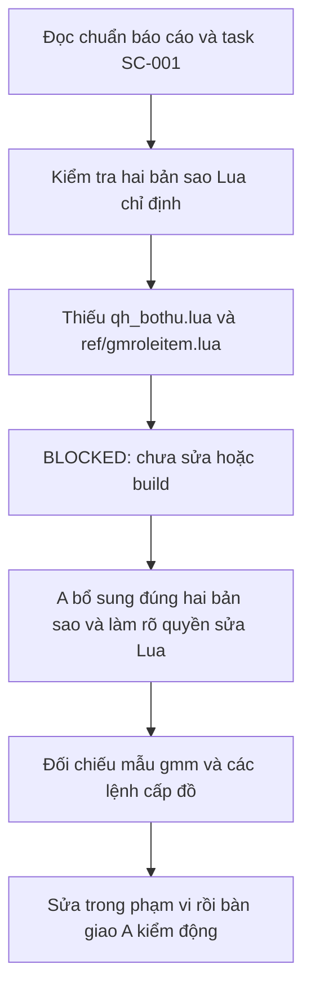

TÓM TẮT 1: [NGUỒN] BLOCKED: thiếu cả hai bản sao Lua bắt buộc; task quy định không đoán khi thiếu nguồn (`JX1_OPS/TASKS/SC-001.md:29`).
TÓM TẮT 2: [NGUỒN] Kiểm tra tồn tại trả về False cho `qh_bothu.lua` và `ref/gmroleitem.lua`; chưa sửa lệnh cấp đồ nào.
TÓM TẮT 3: [NGUỒN] Đầu ra là báo cáo này và mục Kết quả cuối task; giữ nguyên kết luận, số liệu và tài liệu cũ.
TÓM TẮT 4: [CHƯA KIỂM] Chưa xác minh chữ ký AddItem, dữ liệu lưu/nạp hay khả năng giữ đồ; cần A bổ sung hai file trước khi tiếp tục.
TÓM TẮT 5: [CHƯA KIỂM] Không build, chạy exe/VM/mạng, commit/push theo lời giao; Tổng quản bổ sung nguồn và gộp tài liệu, chưa có SHA commit mới.

# SC-001 — Đối chiếu cách cấp đồ từ menu sách TEST-36 với thẻ GM gmm

Loại: khảo sát
Chủ đề: Kiểm tra đầu vào để sửa cách cấp đồ trong qh_bothu.lua theo mẫu gmm, bảo đảm có thể kiểm chứng việc giữ đồ sau đăng nhập lại.
Từ khóa: cấp đồ, đăng nhập lại, TEST-36, gmm, qh_bothu.lua, gmroleitem.lua, AddItem, ReloadScript, LoadPlayerItemList
Trạng thái: BLOCKED — thiếu hai bản sao Lua bắt buộc tại đường dẫn chỉ định.
Độ phủ: đã kiểm tra tồn tại 2/2 nguồn Lua bắt buộc; có mặt 0/2; sửa 0 tệp Lua; tiêu chí chức năng chưa đạt.
Liên quan: `JX1_OPS/TASKS/SC-001.md`; `JX1_OPS/DESIGN/CHUAN-BAO-CAO.md`; `JX1_OPS/DESIGN/TINH-NANG/CUONG-HOA.md`; `JX1_OPS/HIEU-GAME/09-cong-cu-gm/LOADSCRIPT-NAP-LUA-NONG.md`.
Cần tôi quyết định: có — lời giao cấm sửa mã nguồn, trong khi task yêu cầu sửa riêng Lua; cần làm rõ khi đã bổ sung nguồn.

## Phạm vi và độ phủ

Danh sách dưới đây lấy từ mục nguồn/nghi phạm, bằng chứng và đầu ra của task; không quét thư mục lớn hoặc tìm bản thay thế ở repository khác.

| Phần tử / nguồn cần đọc | Đã phủ / chưa phủ | Kết quả và căn cứ |
|---|---|---|
| `JX1_OPS/DESIGN/CHUAN-BAO-CAO.md` | Đã phủ: đọc chuẩn | Áp dụng khuôn và yêu cầu giữ kết luận cũ (`JX1_OPS/DESIGN/CHUAN-BAO-CAO.md:1`). |
| `JX1_OPS/TASKS/SC-001.md` | Đã phủ: đọc task | Mục tiêu, nguồn Lua bắt buộc, vùng sửa, tiêu chí và quyền (`JX1_OPS/TASKS/SC-001.md:20`). |
| `JX1_OPS/DESIGN/QH-B044-deploy/qh_bothu.lua` | Chưa phủ nội dung; đã kiểm tồn tại | `Test-Path -LiteralPath` trả False. Nguồn bắt buộc theo `JX1_OPS/TASKS/SC-001.md:29`. |
| `JX1_OPS/DESIGN/QH-B044-deploy/ref/gmroleitem.lua` | Chưa phủ nội dung; đã kiểm tồn tại | `Test-Path -LiteralPath` trả False. Nguồn bắt buộc theo `JX1_OPS/TASKS/SC-001.md:29`. |
| `JX1_OPS/DESIGN/TINH-NANG/CUONG-HOA.md` | Đã phủ phần liên quan | Đọc các đoạn TN1/TN7, lưu/nạp và TN4 bằng tìm chuỗi giới hạn; nguồn là báo cáo cũ, không phải đo mới (`CUONG-HOA.md:101`, `:114`, `:119`, `:125`). |
| `JX1_OPS/HIEU-GAME/09-cong-cu-gm/LOADSCRIPT-NAP-LUA-NONG.md` | Đã phủ phần liên quan | Đọc đoạn nút GM, `tb_LocalScript` và `ReloadScript` (`LOADSCRIPT-NAP-LUA-NONG.md:12`, `:14`, `:22`, `:23`). |
| `A-B.md`, mục B-058 | Chưa phủ | Chỉ kiểm đường dẫn tương đối `A-B.md`: không có; task không chỉ rõ đường dẫn đầy đủ. Không tìm lan rộng; nhận định vẫn là dẫn lại từ `JX1_OPS/TASKS/SC-001.md:25`. |
| `ScriptFuns.cpp`, `KItemSet.cpp` | Chưa phủ | Chỉ được nêu tên và dòng ước lượng trong task; chưa mở mã vì thiếu cặp Lua quyết định; không nhận các dòng ước lượng là bằng chứng hiện tại (`JX1_OPS/TASKS/SC-001.md:27`). |
| Gói Lua, bản vá và kiểm cú pháp | Chưa phủ | Không có file đầu vào để tạo bản vá hoặc build; không tạo tệp Lua giả. |
| Đo giữ đồ sau đăng nhập/restart | Chưa phủ | Kịch bản dành cho A; worker không chạy VM/exe/mạng (`JX1_OPS/TASKS/SC-001.md:32`, `:35`). |

## Giải mã tên

Chưa đọc được bảng vật phẩm hoặc mã Lua nên chưa có danh sách tên riêng trong game để giải mã. Các cách gọi dưới đây là nhãn có sẵn trong tài liệu UTF-8, không phải tên món đã đối chiếu với dữ liệu game.

| Tên gốc | Mã hóa | Chữ đúng UTF-8 | Nguồn file:dòng |
|---|---|---|---|
| Đồ XANH | UTF-8 của báo cáo; mã hóa dữ liệu game chưa xác minh | Đồ xanh — nhóm trang bị, chưa biết từng món | `JX1_OPS/DESIGN/TINH-NANG/CUONG-HOA.md:125` |
| Thủy tinh TÍM | UTF-8 của báo cáo; mã hóa dữ liệu game chưa xác minh | Thủy tinh tím — chưa đối chiếu tên và ID vật phẩm | `JX1_OPS/DESIGN/TINH-NANG/CUONG-HOA.md:114` |
| Lệnh bài GM / gmm | UTF-8 / ASCII trong tài liệu; mã hóa tên game chưa xác minh | Lệnh bài GM; giữ nguyên định danh gmm của task | `JX1_OPS/HIEU-GAME/09-cong-cu-gm/LOADSCRIPT-NAP-LUA-NONG.md:14`; `JX1_OPS/TASKS/SC-001.md:21` |
| Sách TEST-36 | UTF-8 / ASCII trong task; chưa có tên gốc từ dữ liệu game | Sách mở menu TEST-36; chưa giải mã tên vật phẩm cụ thể vì thiếu Lua | `JX1_OPS/TASKS/SC-001.md:21` |

## Sắp theo cấu trúc game

Phạm vi được xếp theo thao tác của người chơi: dùng sách mở menu → nhận trang bị xanh hoặc vật liệu thủy tinh → lưu nhân vật → đăng nhập lại → kiểm tra vật phẩm. Thẻ GM gmm là nguồn đối chứng cách cấp. Chưa thể liệt kê từng món, nhánh menu hoặc cấp vật liệu vì thiếu hai bản sao Lua; không suy danh mục từ trí nhớ.

## Bảy bước thực hiện và giới hạn

1. **Đọc task:** đã đọc một lần; tiêu chí sau sửa là giữ 2/2 nhóm vật phẩm kiểm thử sau đăng nhập lại và một lần restart, theo `JX1_OPS/TASKS/SC-001.md:32`.
2. **ĐÃ ĐỌC KIẾN THỨC:** phần liên quan trong `JX1_OPS/DESIGN/TINH-NANG/CUONG-HOA.md:101–125` và `JX1_OPS/HIEU-GAME/09-cong-cu-gm/LOADSCRIPT-NAP-LUA-NONG.md:12–23`; chỉ tìm chuỗi trong hai file task dẫn, không đọc toàn bộ nhánh kiến thức.
3. **ĐÃ TRA ĐỒ THỊ:** chưa thực hiện; dừng ở điều kiện thiếu hai file bắt buộc của task. Không dựng lại đồ thị hoặc tìm root khác.
4. **Lần chuỗi:** chưa đủ nguồn để lần; không xác nhận các lời gọi AddItem bằng mô tả gián tiếp.
5. **Sửa:** chưa thực hiện; không sửa Lua, C++ hoặc client. Lời giao còn có mâu thuẫn quyền sửa Lua đã hỏi làm rõ.
6. **Build và kiểm tĩnh:** chưa build hoặc kiểm cú pháp Lua vì thiếu nguồn; không chạy công cụ/game exe.
7. **Bàn giao:** lập báo cáo BLOCKED và cập nhật kết quả cuối task; chưa có gói Lua hay bản vá để A nạp.

## Chuỗi đã lần và bằng chứng gián tiếp

| Mắt xích | Bằng chứng thực đọc | Mức xác minh |
|---|---|---|
| Menu sách cấp trang bị xanh | `JX1_OPS/DESIGN/TINH-NANG/CUONG-HOA.md:102` ghi TN1 mất 10/10 đồ xanh sau đăng nhập lại | Đã đối chiếu nội dung báo cáo; chưa đo lại |
| Menu sách cấp thủy tinh | `JX1_OPS/DESIGN/TINH-NANG/CUONG-HOA.md:114` ghi 3 chồng × 200 thủy tinh mất sau đăng nhập lại | Đã đối chiếu nội dung báo cáo; chưa đo lại |
| Lưu số món | `JX1_OPS/DESIGN/TINH-NANG/CUONG-HOA.md:119` ghi Goddess nhận 12/5/3 món; `:125` ghi lần TN4 lưu 11 món | Dẫn lại báo cáo; chưa đọc log gốc |
| Nạp lại vật phẩm | `JX1_OPS/DESIGN/TINH-NANG/CUONG-HOA.md:108`, `:120` dẫn `LoadPlayerItemList` và các khả năng thất bại | Chưa mở C++/DB, chưa xác minh nguyên nhân |
| Nạp nóng từ thẻ GM | `JX1_OPS/HIEU-GAME/09-cong-cu-gm/LOADSCRIPT-NAP-LUA-NONG.md:12`, `:23` dẫn `tb_LocalScript` | Chưa đọc gmroleitem.lua; không suy chữ ký cấp đồ từ nút nạp nóng |
| Mẫu cấp trang bị/vật liệu của gmm | Nguồn cần có tại `JX1_OPS/DESIGN/QH-B044-deploy/ref/gmroleitem.lua` bị thiếu | CHƯA XÁC MINH |

Những số đo trên giữ nguyên theo báo cáo cũ. Không kết luận việc truyền ngày hoặc IsWhere là nguyên nhân gây mất đồ; đây mới là hướng điều tra task nêu (`JX1_OPS/TASKS/SC-001.md:27`).

## Sổ thông số

| Nhóm | Tên/hằng số | file:dòng | Giá trị | Đơn vị | Ảnh hưởng | Đổi an toàn | Nguồn đo |
|---|---|---|---|---|---|---|---|
| Gọi cấp đồ | Số tham số AddItem hiện tại / mẫu gmm | `JX1_OPS/TASKS/SC-001.md:27` | Task nêu 15 / từ 21; chưa đối chiếu Lua | tham số/lần gọi | Cần thấy mẫu thật trước khi sửa | CẨN THẬN | Nguồn gián tiếp; chưa đọc hai Lua |
| Gọi cấp đồ | Ngày, IsWhere | `JX1_OPS/TASKS/SC-001.md:27` | Chưa xác minh giá trị thực; không điền số thay dữ liệu thiếu | trường/lần gọi | Task nêu là nghi phạm, chưa chứng minh nguyên nhân | CẨN THẬN | Nguồn gián tiếp; chưa đọc C++ |
| Nghiệm thu | Giữ đồ sau đăng nhập lại và restart | `JX1_OPS/TASKS/SC-001.md:32` | Trước: 0/2 theo task; mục tiêu: 2/2; sau sửa: chưa đo | mẫu vật phẩm kiểm thử | Tiêu chí để A nghiệm thu sau khi có bản sửa | KHÔNG — chưa có bản sửa để thử | Chưa đo trong lượt này |

## Thay đổi

- Worktree: `D:\JX-wt\SC-001`; nhánh kiểm tra đầu lượt: `task/SC-001`; commit gốc: `ba697aaa7efbfcbe145ca3ad76121dab086e6e1b`.
- Git ban đầu sạch; báo cáo SC-001 chưa tồn tại nên không có phần làm dở để tiếp tục.
- Chỉ tạo báo cáo này, thêm mục Kết quả cuối task và ghi nhịp tạm trong worktree theo yêu cầu tiến độ.
- File game sửa: không có. Bản vá, công tắc, gói Lua, SHA-256 đầu ra và thay đổi bản sao client/server: chưa có vì thiếu nguồn.
- Không chuẩn hóa báo cáo cũ, không tạo chỉ mục retrofit, không sửa BAI_HOC hoặc tài liệu nguồn.

## Build và kiểm tra thực chạy

| Lệnh / kiểm tra | Kết quả thực |
|---|---|
| `git status --short --branch` | Nhánh `task/SC-001`, không có dòng thay đổi ban đầu |
| `git rev-parse HEAD` | Commit gốc như trên |
| `Test-Path -LiteralPath` với từng file Lua bắt buộc | Cả hai trả False, mỗi đường dẫn kiểm một lần |
| `rg -n` trên hồ sơ tính năng | Không chạy được: CommandNotFoundException; không cài công cụ |
| `Select-String -LiteralPath` trên hai tài liệu nguồn | Thành công, trả các đoạn và dòng được dẫn trong báo cáo |
| Build / kiểm cú pháp Lua | Chưa chạy; không có file nguồn |
| Game, VM, exe, mạng, đăng nhập lại, restart | Không chạy theo giới hạn nhiệm vụ |

## Lỗi, cách thử và kết quả

| Vấn đề | Cách kiểm / xử lý | Kết quả / bước tiếp |
|---|---|---|
| Thiếu hai bản sao Lua | Kiểm chính xác hai đường dẫn bằng Test-Path | False cả hai; BLOCKED theo task. A đặt đúng bản sao tại vị trí đã quy định; không tìm bản thay thế hoặc tạo giả. |
| Không có rg | Một lần gọi thất bại; chuyển sang Select-String giới hạn file | Đọc được bằng chứng tài liệu; không ảnh hưởng xác định blocker nguồn. |
| Nhịp yêu cầu nằm ngoài vùng ghi | Đối chiếu đường dẫn được giao với writable root | Không ghi `D:\JX-wt\SC-001.nhip`; dùng tạm `D:\JX-wt\SC-001\SC-001.nhip`, UTF-8 không BOM. |
| Quyền sửa mã mâu thuẫn | Đã hỏi làm rõ lời giao “không sửa mã nguồn” so với yêu cầu sửa Lua trong task | Chưa có trả lời tại thời điểm lập báo cáo; vẫn chưa sửa mã. Thiếu nguồn là blocker độc lập. |

## Gói cho Sonnet A

Chưa có tệp Lua, bản vá hoặc binary để chép/nạp. A cần đặt đúng hai bản sao đã nêu trong bảng phạm vi. Sau đó làm rõ quyền sửa riêng qh_bothu.lua; worker tiếp tục đối chiếu từng lời gọi với mẫu gmm thật, kiểm chữ ký C++ khi cần và chỉ sửa vùng được giao.

Chưa có thay đổi triển khai nên chưa cần hoàn tác runtime. Khi có bản sửa được duyệt, A giữ bản trước triển khai kèm SHA-256 và bản sao `.bak-SC-001`; đường dẫn đích VM phải lấy từ bản triển khai thật, không suy từ báo cáo này.

## Kịch bản kiểm động — A chạy sau khi có bản sửa được duyệt

Đây là kịch bản bàn giao từ tiêu chí task, chưa phải kết quả đã chạy (`JX1_OPS/TASKS/SC-001.md:32`).

| # | Thao tác | Số trước | Kỳ vọng sau | Bằng chứng cần lưu |
|---|---|---|---|---|
| 1 | A giữ bản cũ rồi nạp bản Lua đã duyệt bằng ReloadScript; mở lại menu sách | Chưa có bản sửa trong lượt này | Menu đang dùng bản được duyệt | SHA-256 Lua và log nạp; không ghi thông tin bí mật |
| 2 | Cấp một món xanh và một mẫu thủy tinh; ghi rõ món/số lượng/vị trí | Theo tiêu chí task: trước đây còn 0/2 mẫu sau đăng nhập lại | Trước thoát có đủ 2/2 mẫu để đối chiếu | Ảnh hành trang trước thoát |
| 3 | Thoát sạch và đăng nhập lại | Có 2/2 mẫu trước thoát | Còn đúng 2/2 mẫu | Ảnh và số lượng sau đăng nhập |
| 4 | A thực hiện thêm một lần restart gs001 trong phạm vi được duyệt, rồi kiểm lại | Có 2/2 mẫu | Còn đúng 2/2 mẫu | Mốc restart, ảnh và số lượng sau vào lại |
| 5 | Nếu vẫn mất, A bật nshowinfo=1 theo task để thu log nạp | Chưa có log kiểm mới | Thu được bằng chứng thất bại sinh/nạp nếu có | Dòng `San xuat[..]:That bai,Muc|:[...]`; chưa có thì ghi chưa có, không suy |

## Đã xác minh / Chưa xác minh

**ĐÃ XÁC MINH:** trạng thái worktree ban đầu, commit gốc, hai đường dẫn Lua không tồn tại tại thời điểm kiểm; đọc được chuẩn, task, các đoạn hồ sơ và hướng dẫn nạp nóng đã dẫn. Đây là xác minh trạng thái file và nội dung tài liệu.

**CHƯA XÁC MINH:** từng lệnh AddItem trong Lua, mẫu cấp thật của gmm, chữ ký C++, nguyên nhân mất đồ, log/DB gốc, dữ liệu client và kết quả runtime. Không có build/test game đã đạt; chưa có thay đổi để nghiệm thu.

## Đề xuất tối ưu

Chỉ đề xuất bổ sung cặp nguồn bắt buộc và tiếp tục đúng nhánh đang giao; chưa đề xuất tối ưu hoặc thay đổi thuật toán cấp đồ khi chưa có nguồn đối chứng.

## Bàn giao

- Trạng thái cuối: **BLOCKED** — thiếu hai bản sao Lua; mục tiêu giữ đồ chưa hoàn thành.
- Không stage, commit hoặc push theo yêu cầu; không có SHA commit mới. Tổng quản gộp tài liệu. Không có lỗi Git/push phát sinh.
- Nhịp tạm: `D:\JX-wt\SC-001\SC-001.nhip`; đường dẫn yêu cầu bên ngoài worktree chưa ghi vì ngoài writable root.
- Bước tiếp theo: A bổ sung đúng hai file; làm rõ quyền sửa Lua; worker tiếp tục từ phần đối chiếu mẫu gmm, không làm lại phần kiểm tra tài liệu đã có bằng chứng.
- Không thêm kết luận tri thức mới; không đề nghị thay kết luận cũ hoặc cập nhật mục lục kiến thức trong lượt bị chặn này.

Kỹ năng đã dùng: đã nạp `jx1-retrofit`, `jx1-read-server`, `jx1-read-client`, `jx1-parameters`, `jx1-knowledge`, `jx1-report` theo lời giao; nạp thêm `jx1-sua-code` và `references/ban-giao.md` theo task. Áp dụng khuôn báo cáo, sổ thông số, sơ đồ và nhãn mức xác minh; các bước đọc mã server/client, đồ thị, sửa và build chưa thực hiện do thiếu đầu vào bắt buộc.
