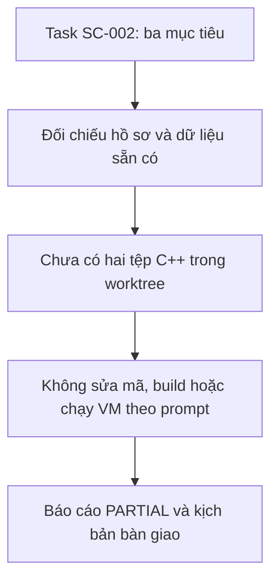

## TÓM TẮT 5 DÒNG
1. [CHƯA KIỂM] Đã rà phạm vi SC-002 trong worktree `task/SC-002`; chưa thực hiện sửa mã.
2. [NGUỒN] Task nêu ba mục tiêu: hệ số cường hóa đồ vàng, thuộc tính Né tránh/Nội lực và con trỏ khi nạp lô đồ.
3. [NGUỒN] Bảng thuộc tính xác nhận loại 30 là `magic_armordefense_v`, tên Việt “Né tránh”.
4. [CHƯA KIỂM] Chưa xác minh thay đổi C++ hoặc chạy build; hai tệp nguồn server không có trong worktree này.
5. [CHƯA KIỂM] Không chạy exe/VM/mạng; không có SHA mới, commit hoặc push; task bàn giao ở trạng thái PARTIAL.

# SC-002 — Gộp sửa cường hóa đồ vàng và nạp danh sách đồ

## Thông tin
- Loại: sửa lỗi
- Chủ đề: Ghi nhận trạng thái và bàn giao phần còn lại của SC-002 mà không thay đổi mã nguồn hay kết luận cũ.
- Từ khóa: cường hóa, đồ vàng, Né tránh, Nội lực, EnChanceRong, JxQhScalable, pItemData, LoadPlayerItemList
- Trạng thái: PARTIAL — báo cáo và chỉ mục đã lập; chưa sửa/build do giới hạn prompt và thiếu tệp C++ trong worktree.
- Độ phủ: 0/3 mục tiêu sửa mã; 3/3 mục tiêu được ghi nhận trong bảng phạm vi. Không thể xác nhận nghiệm thu kỹ thuật.
- Liên quan: `JX1_OPS/TASKS/SC-002.md`; `JX1_OPS/DESIGN/TINH-NANG/CUONG-HOA.md`; `JX1_OPS/HIEU-GAME/01-trang-bi-cuong-hoa/`; `JX1_OPS/DU-LIEU/VAT-PHAM/BANG-LOAI-THUOC-TINH.csv`.
- Cần tôi quyết định: không. Cần bố trí worktree có đúng source server và task cho phép sửa/build để tiếp tục.

## Sơ đồ

## Phạm vi và độ phủ
| Phần tử | Trạng thái | Bằng chứng hiện có / giới hạn |
|---|---|---|
| (1) Đồ vàng: +5% mỗi cấp, thay hiện tượng x1.25 | Chưa phủ phần sửa/kiểm | Task ghi nhận server từng sửa ở commit `b23a81f`, đồng thời client còn x1.25; đây là chứng cứ dẫn lại, chưa đối chiếu source trong worktree (`JX1_OPS/TASKS/SC-002.md:23`). Không có `KItem.cpp` tại đường dẫn task. |
| (2) Nhân thuộc tính Né tránh loại 30 và Nội lực khi cường hóa | Chưa phủ phần sửa/kiểm | CSV có `magic_armordefense_v` ở dòng 32. Task nêu loại 30 vắng khỏi `JxQhScalable` và ID Nội lực chưa được xác nhận; không có source C++ để kiểm độc lập (`JX1_OPS/TASKS/SC-002.md:24`; `JX1_OPS/DU-LIEU/VAT-PHAM/BANG-LOAI-THUOC-TINH.csv:32`). |
| (3) Tránh lệch `pItemData` khi bỏ qua món lỗi lúc nạp | Chưa phủ phần sửa/kiểm | Task dẫn lỗi `continue` thiếu tăng con trỏ và hồ sơ cường hóa ghi nhận giả thuyết bỏ món khi tạo/nạp thất bại; chưa kiểm source hoặc log độc lập (`JX1_OPS/TASKS/SC-002.md:25`; `JX1_OPS/DESIGN/TINH-NANG/CUONG-HOA.md:108-111`). |
| (4) B-060: thu hẹp điều kiện B-049 và bổ sung log khi nạp lỗi | Đã đối chiếu tài liệu; chưa phủ phần sửa/kiểm | Điều kiện và vị trí log theo task; nhận định của B là kết quả đọc mã lịch sử (`JX1_OPS/TASKS/SC-002.md:29`; `JX1_OPS/HOP-THU/A-B.md:650-657`). |
| Điều kiện kỹ thuật nghiệm thu | Chưa phủ | Không sửa source, không build, không có SHA exe mới, không chạy kịch bản game. |

## Giải mã tên
Không có tên riêng kỹ năng, trang bị, quái, NPC hoặc bản đồ mới được trích xuất trong phần công việc này. Tên trường thuộc tính được giữ nguyên theo CSV; encoding dữ liệu gốc trong CSV chưa được kiểm riêng ngoài bản UTF-8 hiển thị.

| Tên gốc | Mã hóa | Chữ đúng | Nguồn |
|---|---|---|---|
| `magic_armordefense_v` | UTF-8 trong CSV (cột tên kỹ thuật) | Né tránh cơ bản của giáp | `JX1_OPS/DU-LIEU/VAT-PHAM/BANG-LOAI-THUOC-TINH.csv:32` |

## Sắp theo cấu trúc game
| Nhóm | Phân loại theo cấu trúc | Trạng thái |
|---|---|---|
| Trang bị | Đồ vàng cường hóa; không có danh sách món cụ thể trong phạm vi báo cáo | Chưa thể sắp theo bộ/món; chưa có nguồn món cụ thể được task yêu cầu. |
| Thuộc tính | Thuộc tính phòng thủ giáp: Né tránh cơ bản (`magic_armordefense_v`, loại 30); thuộc tính Nội lực cần xác nhận ID | Né tránh có dòng dữ liệu; Nội lực chưa xác minh thuộc tính nào phải nhân. |
| Kỹ năng, quái/NPC, bản đồ | Ngoài phạm vi SC-002 | Không áp dụng. |

## Chuỗi đã lần
- Hồ sơ tính năng mô tả chuỗi cường hóa server qua `SetItemEnChance` → `KItem::EnChance`; nhánh vàng dùng `EnChanceRong` theo bản sửa được hồ sơ dẫn lại (`JX1_OPS/DESIGN/TINH-NANG/CUONG-HOA.md:13-16`). Chưa đối chiếu source thực tế của nhánh task.
- Hồ sơ ghi nhận lần thử cường hóa đồ xanh +1 cho kết quả dòng thuộc tính nhân 1,05; đây là số đo lịch sử trong hồ sơ, không phải thử nghiệm SC-002 trong lượt này (`JX1_OPS/DESIGN/TINH-NANG/CUONG-HOA.md:55-59`).
- Hồ sơ ghi đường nạp qua `KPlayer::LoadPlayerItemList`, đồng thời nêu các nhánh tạo lại hoặc thêm món có thể thất bại. Phần này là ghi nhận cũ, không xác nhận trạng thái source hiện tại (`JX1_OPS/DESIGN/TINH-NANG/CUONG-HOA.md:108-111`).

## Thay đổi và bàn giao
- Worktree: `D:\JX-wt\SC-002`; nhánh: `task/SC-002`; Git status lúc bắt đầu sạch.
- Tệp C++ trong `vung_file`: không có tại worktree hiện tại; không sửa.
- Công tắc: chưa triển khai; task yêu cầu công tắc cho phần (2), cần xử lý khi source và quyền sửa/build sẵn sàng.
- Bản sao phía client: không sửa; task ghi nhận phần client còn x1.25 thuộc SC-003 (`JX1_OPS/TASKS/SC-002.md:23`).
- Build: chưa chạy theo yêu cầu prompt; không có lệnh, exit code, binary hoặc SHA256 mới.
- Patch/hoàn tác: không có patch mã nên không có file backup hoặc bước hoàn tác mã.

### Kịch bản kiểm động cho người được giao kiểm thử
| # | Thao tác trong game | Số trước | Kỳ vọng sau | Bằng chứng cần lưu |
|---|---|---|---|---|
| 1 | Đặt đồ vàng +0 vào cường hóa, xác nhận +1; so tooltip từng dòng | Giá trị gốc từng dòng | Mỗi dòng thuộc diện cường hóa tăng khoảng 5%, không phải 25% | Ảnh tooltip +0/+1 và log liên quan |
| 2 | Dùng giáp có Né tránh cơ bản đã biết; đo tại +0 rồi cường hóa +5 | Base Né tránh 100 ở ví dụ task | +0 không đổi; +5 thành 125 theo công thức task nêu | Ảnh +0/+5 và số liệu nhân vật |
| 3 | Ghi số món trong túi, đăng xuất/đăng nhập nhân vật có nhiều món, so lại | Số món lưu trước khi thoát | Số món sau nạp bằng số món lúc lưu | Ảnh trước/sau và log nhánh nạp |

## Mục sổ thông số
| Nhóm | Tên/hằng số | Nguồn | Giá trị | Đơn vị | Ảnh hưởng | Đổi an toàn | Nguồn đo |
|---|---|---|---|---|---|---|---|
| Cường hóa | Mức tăng theo cấp | `JX1_OPS/TASKS/SC-002.md:21,33` | +5% mỗi cấp; ví dụ base 100, +5 thành 125 theo công thức task | % mỗi cấp; điểm ở ví dụ | Giá trị thuộc tính sau cường hóa | CẨN THẬN — chưa kiểm source/biên làm tròn | Tham số yêu cầu trong task; chưa đo lượt này |
| Cường hóa đồ vàng | Hành vi cũ được task nêu | `JX1_OPS/TASKS/SC-002.md:21,23` | x1.25 hiện tại (theo mô tả task) | hệ số | Dòng thuộc tính đồ vàng | CẨN THẬN — chưa xác nhận source/runtime | Bằng chứng gián tiếp trong task |
| Nạp danh sách | Tăng con trỏ khi bỏ qua món | `JX1_OPS/TASKS/SC-002.md:25` | Task nêu `continue` hiện thiếu `pItemData++` | phần tử/lần lặp | Có thể làm đọc sai món tiếp theo trong lô | CẨN THẬN — chưa xác nhận source/runtime | Bằng chứng gián tiếp trong task |

## ĐÃ XÁC MINH / CHƯA XÁC MINH
### Đã xác minh
- Nhánh Git hiện tại là `task/SC-002`; `git status --short --branch` ban đầu không có thay đổi cục bộ.
- Bảng CSV trong worktree ghi loại 30, `magic_armordefense_v`, “Né tránh” tại dòng 32.
- Hồ sơ tính năng có các ghi nhận cũ về chuỗi cường hóa và nạp đồ tại các dòng được dẫn trong báo cáo. Đây là xác minh nội dung hồ sơ, không phải xác minh source hay runtime.
- Các skill đã đọc: `jx1-retrofit`, `jx1-read-server`, `jx1-read-client`, `jx1-parameters`, `jx1-knowledge`, `jx1-report`.

### Chưa xác minh
- Nội dung hiện tại của `KItem.cpp`, `KPlayerDBFuns.cpp`, ID thuộc tính Nội lực và điều kiện/công tắc chính xác: hai tệp C++ không có tại các đường dẫn task trong worktree này.
- Không xác nhận lỗi lệch con trỏ, sửa EnChanceRong, log `nshowinfo`, hành vi `m_ItemList.Add`, build, SHA exe hoặc tiêu chí trong game.
- Không chạy exe, VM, mạng hoặc build theo prompt. Không suy runtime từ tài liệu/source.
- Ghi nhịp tại `D:\JX-wt\SC-002.nhip` thất bại vì quyền ghi ngoài workspace bị từ chối; không thử vượt quyền.
- Không có báo cáo `SC-003.md` ở `JX1_OPS/REPORTS/`. Đã định vị task SC-003 và thư A/B; các nhận định về mã và kết quả trong game ở hai tài liệu này vẫn là nguồn dẫn lại.

## Phát hiện khi chuẩn hóa

- **ĐÃ XÁC MINH nội dung tài liệu:** `JX1_OPS/HOP-THU/A-B.md:641-645` ghi ba nhánh riêng: tạo lại món thất bại, `ItemSet.Add` trả `<= 0` rồi `continue` thiếu bước tăng `pItemData`, và `m_ItemList.Add` thất bại nhưng chưa kiểm kết quả. `JX1_OPS/HOP-THU/A-B.md:650-656` ghi nhận B không thấy căn cứ quy lỗi mất đồ cho B-049: `EnChanceRong` trả `1` và bên gọi không dùng giá trị trả về; `Gen_ExistEquipment` gọi `EnChance`, còn `Gen_Quest` của thủy tinh không đi qua `EnChanceRong`. Chưa có phép so sánh B-039/B-049 cùng điều kiện trong nguồn này.
- **CHƯA XÁC MINH trên worktree:** Thư B ghi SC-002 đã sửa và vẫn ở mức PARTIAL (`JX1_OPS/HOP-THU/A-B.md:657`). Task yêu cầu giữ B-049, thu hẹp xử lý dòng khoanh trắng khi `m_CommonAttrib.nGoldId > 0` hoặc có dòng ron, ghi log khi `nshowinfo=1` ở nhánh tạo thất bại và `Add<=0`, giữ nguyên các hành vi nạp khác (`JX1_OPS/TASKS/SC-002.md:28-29`). Hai tệp C++ theo task không có tại đây, nên chưa thể đối chiếu các thay đổi thư B nêu. GS001 MAP không dẫn đến hai hàm cần kiểm; chưa tra được đồ thị đúng root. Task client SC-003 còn ghi nhận x1.25 (`JX1_OPS/TASKS/SC-003.md:21-26`); khi bàn giao kiểm đồ vàng, cần ghi riêng chỉ số nhân vật và số hiển thị trên tooltip để nhận ra lệch client.
- **ĐÃ XÁC MINH dòng CSV; CHƯA XÁC MINH ID cần nhân:** Bảng phân biệt `89 / magic_manamax_v` (Nội lực tối đa, điểm), `90 / magic_manamax_p` (Nội lực tối đa, %), `91 / magic_mana_v` (Nội lực hiện tại, điểm) và `92 / magic_manareplenish_v` (Phục hồi nội lực mỗi nửa giây, điểm). Chưa có dữ liệu của A để xác định dòng trên món đồ, nên giữ yêu cầu chỉ xét loại 30 cho đến khi A xác nhận (`JX1_OPS/DU-LIEU/VAT-PHAM/BANG-LOAI-THUOC-TINH.csv:91-94`; `JX1_OPS/TASKS/SC-002.md:27`).

## Bàn giao
- Cần worktree chứa đúng hai tệp C++ đã nêu tại `JX1_OPS/TASKS/SC-002.md:15` và quyền task cho phép sửa/build để hoàn thành ba mục tiêu.
- Không commit/push; SHA mới: không có.
- Chỉ mục báo cáo: `JX1_OPS/REPORTS/_CHIMUC/SC-002.tsv`.
- liên quan: `JX1_OPS/TASKS/SC-002.md`; `JX1_OPS/DESIGN/TINH-NANG/CUONG-HOA.md`; `JX1_OPS/HIEU-GAME/01-trang-bi-cuong-hoa/`; `JX1_OPS/DU-LIEU/VAT-PHAM/BANG-LOAI-THUOC-TINH.csv`.
- Kỹ năng đã dùng: `jx1-retrofit`, `jx1-read-server`, `jx1-read-client`, `jx1-parameters`, `jx1-knowledge`, `jx1-report`.
- Trạng thái: PARTIAL.
