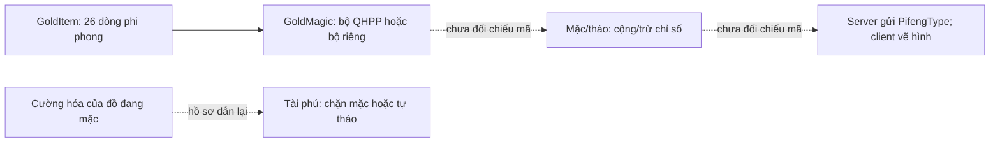

TÓM TẮT 1 [NGUỒN] — BLOCKED theo SC-006: worktree thiếu `KItemList.cpp` và `KItem.cpp`; lượt này chỉ khảo sát và ghi tài liệu.
TÓM TẮT 2 [NGUỒN] — `GoldMagic.txt` có đủ 11 bộ × 5 thuộc tính; cả năm cột đều tăng nghiêm ngặt theo cấp của bộ.
TÓM TẮT 3 [NGUỒN] — Trong 26 dòng phi phong được chỉ định, 25 dòng trỏ đến bộ chuẩn; dòng 3487 dùng bộ riêng.
TÓM TẮT 4 [CHƯA KIỂM] — Chưa xác minh điều kiện tài phú, cộng/trừ khi mặc/tháo, tự tháo hoặc đồng bộ hình từ nguồn của bản giao.
TÓM TẮT 5 [CHƯA KIỂM] — Chưa build, chạy exe hay VM; không có gói/SHA exe để bàn giao, không commit/push theo yêu cầu.

# SC-006 — Đối chiếu tài phú, thuộc tính và hình phi phong

- **Loại:** khảo sát
- **Chủ đề:** Đối chiếu dữ liệu phi phong 11 cấp và xác định phần còn thiếu để nghiệm thu SC-006.
- **Từ khóa:** phi phong, tài phú, cường hóa, 披风, QHPP, Q-90, GoldItem, GoldMagic, PifengType
- **Trạng thái:** BLOCKED — thiếu hai tệp C++ bắt buộc trong worktree; dữ liệu có thể đối chiếu đã được khảo sát.
- **Độ phủ:** 26/26 dòng phi phong được chỉ định; 55/55 dòng thuộc tính QHPP; 6/6 tiêu chí được phân loại theo mức xác minh.
- **Liên quan:** [task SC-006](../TASKS/SC-006.md), [hồ sơ Tài phú + Phi phong](../DESIGN/TINH-NANG/TAI-PHU-PHI-PHONG.md), [Hướng dẫn A](../DESIGN/QH-B035-deploy/phiphong/HUONG-DAN-A.md).
- **Cần tôi quyết định:** có — Tổng quản cần cung cấp đúng bản nguồn và xác nhận phạm vi trước lượt sửa.

## Phạm vi và độ phủ

Trong các dẫn chiếu dưới đây, `GoldItem.txt`, `GoldMagic.txt` và `HUONG-DAN-A.md` nằm tại `JX1_OPS/DESIGN/QH-B035-deploy/phiphong/`; `TAI-PHU-PHI-PHONG.md` nằm tại `JX1_OPS/DESIGN/TINH-NANG/`.

| Mục | Độ phủ | Bằng chứng và giới hạn |
|---|---|---|
| (a) Đủ dòng thuộc tính | Đã phủ dữ liệu | `GoldItem.txt:3467–3492`, `GoldMagic.txt:4362–4416`; 25 dòng dùng bộ QHPP, 1 dòng dùng bộ riêng. |
| (b) Cấp cao có thuộc tính cao hơn | Đã phủ 11 bộ chuẩn | `GoldMagic.txt:4362–4416`; không dùng thứ tự của bộ chuẩn để kết luận về dòng riêng 3487. |
| (c) Tài phú và ngưỡng | Đã phủ đặc tả; chưa phủ mã | `TAI-PHU-PHI-PHONG.md:5,9–12`; thiếu tệp để đối chiếu `magic_special_point` và cách chọn cấp cho từng món. |
| (d) Hình đổi ngay | Chưa phủ mã/tài nguyên | `SC-006.md` (task), dòng 26 và 29, dẫn chuỗi đồng bộ; chưa xác minh lúc tháo, người xung quanh hay hình cấp 11. |
| (e) Mặc tăng thật, tháo mất | Chưa phủ mã/runtime | Dữ liệu có năm tham chiếu `DefMagic` mỗi món; không chứng minh đường cộng/trừ (`SC-006.md` (task), dòng 30). |
| (f) Tự tháo khi thiếu tài phú | Chưa phủ mã/runtime | `SC-006.md` (task), dòng 25 và 28, ghi nhận thiếu đường gọi khi đổi cường hóa; chưa đối chiếu mã bản giao. |

## Giải mã tên

Cột tên gốc giữ dạng byte hiển thị theo Latin-1; tên Việt được đọc theo TCVN3 trong bảng có phần trường tiếng Hán dùng GBK. Giữ nguyên tên trong dữ liệu. Hàng biến thể cùng tên được gộp theo dòng.

| Tên gốc | Mã hóa | Chữ đúng (UTF-8) | Nguồn file:dòng |
|---|---|---|---|
| Phi phong L¨ng V©n | TCVN3 | Phi phong Lăng Vân | `GoldItem.txt:3467` |
| Phi phong TuyÖt ThÕ | TCVN3 | Phi phong Tuyệt Thế | `GoldItem.txt:3468` |
| Phi phong Ph¸ Qu©n | TCVN3 | Phi phong Phá Quân | `GoldItem.txt:3469` |
| Phi phong Ngao tuyÕt | TCVN3 | Phi phong Ngao tuyết | `GoldItem.txt:3470` |
| Phi phong Kinh L«i | TCVN3 | Phi phong Kinh Lôi | `GoldItem.txt:3471` |
| Phi phong Ngù Phong | TCVN3 | Phi phong Ngự Phong | `GoldItem.txt:3472` |
| Phi phong PhÖ Quang; Phi Phong PhÖ Quang | TCVN3 | Phi phong Phệ Quang | `GoldItem.txt:3473,3478–3480` |
| Phi phong KhÊp ThÇn; Phi Phong KhÊp ThÇn | TCVN3 | Phi phong Khấp Thần | `GoldItem.txt:3474,3481–3482` |
| Phi Phong KhÊp ThÇn (träng kÝch) | TCVN3 | Phi phong Khấp Thần (trọng kích) | `GoldItem.txt:3483` |
| Phi phong K×nh Thiªn | TCVN3 | Phi phong Kình Thiên | `GoldItem.txt:3475` |
| Phi phong K×nh Thiªn (dÞch chuyÓn tøc thêi) | TCVN3 | Phi phong Kình Thiên (dịch chuyển tức thời) | `GoldItem.txt:3484` |
| Phi phong K×nh Thiªn (hãa gi¶I s¸t th­¬ng) | TCVN3 | Phi phong Kình Thiên (hóa giải sát thương) | `GoldItem.txt:3485` |
| Phi phong K×nh Thiªn (träng kÝch) | TCVN3 | Phi phong Kình Thiên (trọng kích) | `GoldItem.txt:3486` |
| Phi phong V« Cùc | TCVN3 | Phi phong Vô Cực | `GoldItem.txt:3476` |
| Phi phong V« Cùc (dÞch chuyÓn tøc thêi) | TCVN3 | Phi phong Vô Cực (dịch chuyển tức thời) | `GoldItem.txt:3487` |
| Phi phong V« Cùc (hãa gi¶I s¸t th­¬ng) | TCVN3 | Phi phong Vô Cực (hóa giải sát thương) | `GoldItem.txt:3488` |
| Phi phong V« Cùc (träng kÝch) | TCVN3 | Phi phong Vô Cực (trọng kích) | `GoldItem.txt:3489` |
| Phi phong cao cÊp; Phi Phong cao cÊp | TCVN3 | Phi phong cao cấp | `GoldItem.txt:3477,3490–3492` |

## Sắp theo cấu trúc game

Nhóm trang bị phi phong vàng (`DetailType=12`): theo cấp `k` của bộ thuộc tính, rồi đến món gốc và từng biến thể (tên theo dòng ở bảng trên). Năm số là **sinh lực / nội lực / thể lực / kháng tất cả / tốc chạy** theo `HUONG-DAN-A.md:4–6`. Ngưỡng là đặc tả, độc lập với cột `nLevel` trong bảng món.

| Cấp bộ | Dòng `GoldItem.txt`: gốc; biến thể | `nLevel`: gốc; biến thể | Bộ năm giá trị | Dòng `GoldMagic.txt` | Ngưỡng tài phú |
|---:|---|---|---|---|---:|
| 1 | 3467 | 1 | 200 / 200 / 100 / 4 / 5 | 4362–4366 | 6000 |
| 2 | 3468 | 1 | 400 / 400 / 200 / 8 / 10 | 4367–4371 | 6900 |
| 3 | 3469 | 2 | 600 / 600 / 300 / 12 / 15 | 4372–4376 | 7800 |
| 4 | 3470 | 3 | 800 / 800 / 400 / 16 / 20 | 4377–4381 | 8700 |
| 5 | 3471 | 3 | 1000 / 1000 / 500 / 20 / 25 | 4382–4386 | 9600 |
| 6 | 3472 | 4 | 1200 / 1200 / 600 / 24 / 30 | 4387–4391 | 10500 |
| 7 | 3473; 3478, 3479, 3480 | 4; 7 | 1400 / 1400 / 700 / 28 / 35 | 4392–4396 | 11400 |
| 8 | 3474; 3481, 3482, 3483 | 4; 8 | 1600 / 1600 / 800 / 32 / 40 | 4397–4401 | 12300 |
| 9 | 3475; 3484, 3485, 3486 | 5; 9 | 1800 / 1800 / 900 / 36 / 45 | 4402–4406 | 13200 |
| 10 | 3476; 3487 (bộ riêng), 3488, 3489 | 5; 10 | 2000 / 2000 / 1000 / 40 / 50 | 4407–4411 | 14100 |
| 11 | 3477; 3490, 3491, 3492 | 5; 10 | 2200 / 2200 / 1100 / 44 / 55 | 4412–4416 | 15000 |

## Chuỗi đã lần

- **Đã xác minh dữ liệu:** `GoldItem.txt:3467–3492` có năm cột `DefMagic1–5` được điền trên cả 26 dòng. Theo quy ước ID trong `HUONG-DAN-A.md:10`, ID 4361–4415 nằm ở dòng vật lý 4362–4416 (dòng 1 là tiêu đề). Cách mã server tra bảng theo ID chưa được đối chiếu.
- **Đã xác minh dữ liệu:** năm mã thuộc tính theo thứ tự là 85, 89, 93, 114, 111. Mỗi bộ chuẩn tăng thêm 200, 200, 100, 4, 5 so với bộ trước; min = max ở cả 55 dòng (`GoldMagic.txt:4362–4416`).
- **Đã xác minh dữ liệu:** món dòng 3487 giữ các ID 3814/3824/3834/3844/3854. Theo cùng quy ước, các dòng 3815/3825/3835/3845/3855 có cặp mã/giá trị 233/360, 85/360, 243/18, 269/36, 227/3. Đây là ngoại lệ đã nêu tại `HUONG-DAN-A.md:6`.
- **Nguồn gián tiếp:** `TAI-PHU-PHI-PHONG.md:7–12` dẫn `KItemList::Equip/UnEquip` → `KItem::ApplyMagicAttribToNPC/RemoveMagicAttribFromNPC` → `magic_special_point` → `m_nWealth`; `QhPifengWealthOK` kiểm ngưỡng, `QhCheckPifeng` kiểm tự tháo. Đây là ảnh chụp phân tích QH-B035 cũ; không có đồ thị/mã đúng bản trong worktree để xác nhận lại.
- **Nguồn gián tiếp:** task dòng 25–29 dẫn `LuaSetItemEnChance` và chuỗi `m_PifengType` → `PlayerSync.PifengType` → client `SetPifeng/PaintPifeng`. Không có `ScriptFuns.cpp`, `KNpc.cpp` server trong cây nguồn đã chỉ định; task không chỉ định root client cụ thể. Chưa kiểm tra tài nguyên `Spr_%d` hay đường gửi khi tháo.

## Mục sổ thông số

| Nhóm | Tên/hằng số | File:dòng | Giá trị | Đơn vị | Ảnh hưởng | Đổi an toàn | Nguồn đo |
|---|---|---|---|---|---|---|---|
| Tài phú | Hệ số theo cường hóa | `TAI-PHU-PHI-PHONG.md:5,10` | 100 × N | điểm/món +N | Tổng tài phú của 10 ô đang mặc (0–9) | CẨN THẬN | Đặc tả và hồ sơ dẫn mã; chưa đo |
| Điều kiện | Ngưỡng theo cấp k | `TAI-PHU-PHI-PHONG.md:5` | 6000 + 900(k−1), k=1–11 | điểm | Ngưỡng mặc và tự tháo | CẨN THẬN | Đặc tả Q-90; chưa đo |
| Bộ chuẩn | QHPP01–QHPP11 | `GoldMagic.txt:4362–4416`, `HUONG-DAN-A.md:5` | 200k / 200k / 100k / 4k / 5k | giá trị cấu hình từng dòng | Năm thuộc tính dự kiến cộng khi mặc | CẨN THẬN | Đọc tĩnh dữ liệu; chưa xác nhận đơn vị UI/runtime |

## Đề xuất kiểm tiếp

1. Gắn nguồn đúng phiên bản vào worktree cho lượt được duyệt sửa. Đối chiếu cách `QhPifengWealthOK` lấy cấp, đường cộng/trừ, kiểm khi đổi đồ và khi đổi cường hóa. Task dòng 28 nêu `ScriptFuns.cpp` nhưng `vung_file` ở dòng 15 không cấp quyền sửa tệp đó; Tổng quản cần chốt phạm vi nếu giải pháp đụng đến tệp này.
2. Xác định đúng nguồn client và bộ hình của bản giao; kiểm mã ánh xạ cấp sang hình, xóa hình và gửi lại cho người xung quanh. Nếu có ít hơn 11 bộ hình thì báo B theo task dòng 29.
3. Giữ nguyên các bảng và kết luận cũ ở lượt này. Chỉ kết luận hiệu lực sau khi có mã và phép thử phù hợp.

## Kịch bản kiểm động cho A (chưa chạy)

| # | Kiểm tra | Kết quả mong đợi theo task | Bằng chứng cần lưu |
|---|---|---|---|
| 1 | Mặc cấp 1 ở 5999 rồi 6000 tài phú | 5999 bị từ chối kèm `[QH]\|D`; 6000 mặc được | Điểm, kết quả và thông báo ở cả hai mốc |
| 2 | Đổi cấp 1 → cấp 5, sau đó tháo | Hình cạnh tên đổi ngay, rồi biến mất; người khác thấy ngay, không đổi bản đồ | Hình từ người mặc và người đứng cạnh |
| 3 | So hình cấp 11 với cấp 1 | Hai hình khác nhau | Ảnh cả hai cấp |
| 4 | Đo trước mặc, đang mặc và sau tháo từng cấp | Bộ chuẩn tăng đúng cả năm dòng và trả về số cũ khi tháo | Bảng số và ảnh; ghi riêng mẫu dòng 3487 |
| 5 | Đang mặc cấp 11; hạ +N để tài phú xuống dưới 15000, túi còn chỗ | Phi phong về túi và có thông báo | Tài phú trước/sau, túi và thông báo |
| 6 | Thoát rồi vào lại | Tài phú và phi phong đúng, không nhân đôi | Số trước/sau và trạng thái phi phong |

## Đã xác minh / Chưa xác minh

- **Đã xác minh:** `git status --short --branch` ban đầu cho nhánh `task/SC-006`, worktree sạch; HEAD `46cde3c77203481470566f373507dff8b5e98cdc`. `Test-Path` báo thiếu cả `server/jxOnline/gameserver/Sources/Core/Src/KItemList.cpp` và `KItem.cpp` cùng thư mục; `git ls-files` lọc theo tên tệp không trả bản tracked tương ứng. Task dòng 18 quy định BLOCKED trong trường hợp này.
- **Đã xác minh:** đọc bảng theo vùng dòng bằng PowerShell, đối chiếu tham chiếu và năm dãy giá trị. `rg` không có; chuyển sang PowerShell. Bản đọc UTF-8 ban đầu hiển thị ký tự thay thế; đọc GBK cho bảng thuộc tính và giữ byte tên để giải mã TCVN3.
- **Chưa xác minh:** đường gọi/hiệu lực trong mã bản giao, tài nguyên ngoại hình, gói đồng bộ, build và 6 ca kiểm động. Không chạy exe, VM hay mạng; không có mã sửa, bản vá, công tắc, đầu ra build hoặc SHA exe.

## Bàn giao

Tài liệu: báo cáo này và mục Kết quả trong task. Tổng quản thực hiện commit; lượt này chưa stage, commit hay push. Tệp nhịp `D:\JX-wt\SC-006.nhip` nằm ngoài vùng ghi được cấp; các mốc được báo trong cuộc trò chuyện.

Dòng đề xuất cho chỉ mục (chờ Tổng quản gộp; không tạo tệp ngoài phạm vi prompt):

| File | Loại | Chủ đề | Từ khóa | Trạng thái | Độ phủ | Liên quan |
|---|---|---|---|---|---|---|
| `JX1_OPS/REPORTS/SC-006.md` | khảo sát | Thuộc tính, tài phú, hình phi phong | phi phong; tài phú; QHPP; PifengType; Q-90 | BLOCKED | 26/26 dòng món, 55/55 dòng QHPP; mã/runtime chưa phủ | `01-trang-bi-cuong-hoa`, `TAI-PHU-PHI-PHONG`, `HUONG-DAN-A` |

Kỹ năng đã dùng: `jx1-retrofit`, `jx1-read-server`, `jx1-read-client`, `jx1-parameters`, `jx1-knowledge`, `jx1-report`.

## Phát hiện khi chuẩn hóa

- `HUONG-DAN-A.md:6` ghi “Phá Quang, Khắp Thần”; byte tên trong `GoldItem.txt:3473–3474` giải mã thành “Phệ Quang, Khấp Thần”. Giữ cách ghi cũ trong tài liệu hướng dẫn và ghi nhận chênh lệch ở đây.
- Cấp của bộ QHPP không luôn bằng `nLevel`: món gốc bộ 11 là `nLevel=5`, ba biến thể là `nLevel=10` (`GoldItem.txt:3477,3490–3492`). Giả thuyết `level % 10` trong task không đủ để kết luận lỗi hình ở bản giao; cần đối chiếu giá trị thực mà mã dùng.
