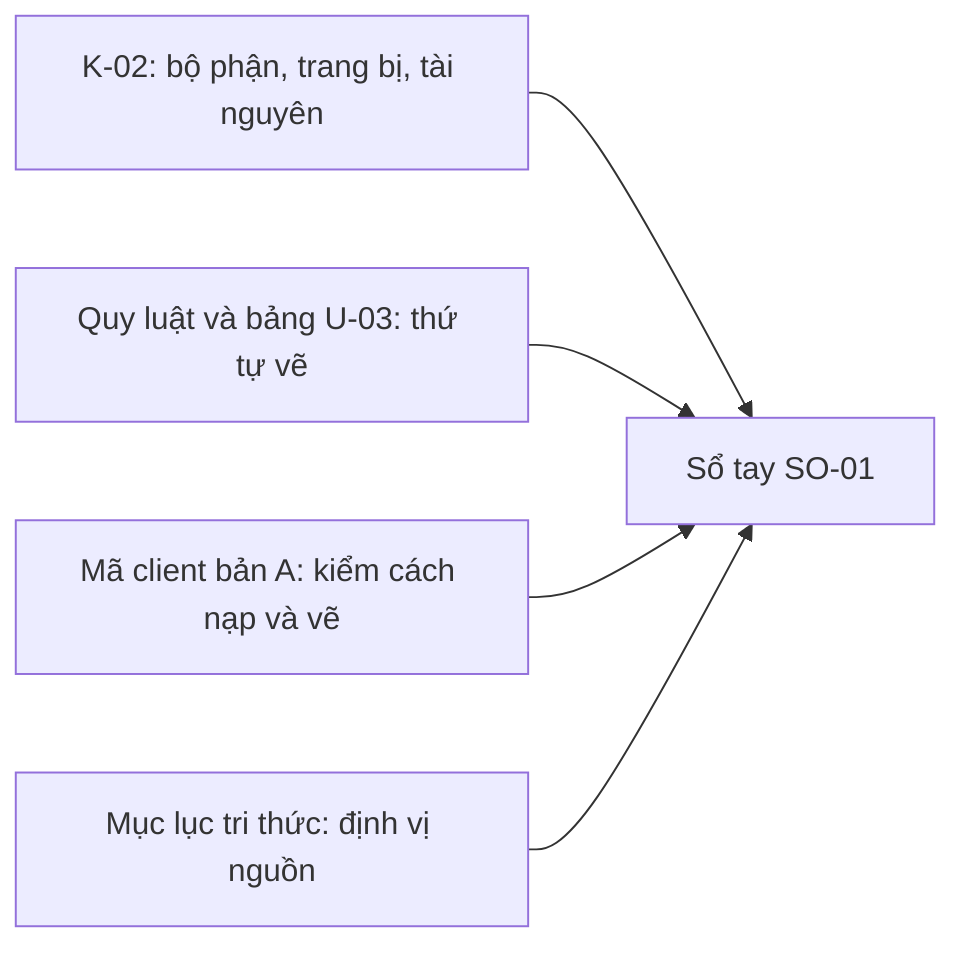

TÓM TẮT 1: [NGUỒN] DONE cho phạm vi tài liệu. Đã tổng hợp 4/4 nguồn chỉ định và đối chiếu mã client bản A cho 3/3 chủ đề.
TÓM TẮT 2: [NGUỒN] Sổ tay giải thích 24 chỗ chứa hình, 5 nhóm được cập nhật, thứ tự theo động tác, hướng, khung và nơi tra dữ liệu.
TÓM TẮT 3: [NGUỒN] Đã viết `DESIGN/SO-TAY-NHAN-VAT.md` và ghi mục Kết quả cuối `TASKS/SO-01.md`. Kết luận của các nguồn được giữ nguyên.
TÓM TẮT 4: [CHƯA KIỂM] Chưa chốt mục INI đang dùng theo từng trang bị, bảng nam hoặc hình thực tế khi chơi. Vùng ghi của phiên từ chối tệp nhịp ngoài worktree.
TÓM TẮT 5: [CHƯA KIỂM] Không chạy build, exe, VM hay mạng. Tổng quan phụ trách commit. Phiên này chưa stage, commit hoặc push.

# SO-01 — Tổng hợp sổ tay nhân vật và bộ phận

Loại: tổng hợp

Chủ đề: Đối chiếu các tài liệu về hình nhân vật, thứ tự vẽ và dữ liệu với mã client bản A.

Từ khóa: nhân vật, bộ phận, sprite, thứ tự vẽ, trang bị, NPCRes, GetSort, 动作贴图顺序表

Trạng thái: DONE cho sổ tay, báo cáo và mục Kết quả. Tệp nhịp ngoài worktree không ghi được.

Độ phủ: 3/3 chủ đề, 4/4 tài liệu chỉ định. Bảng dài U-03 được dùng qua phần tổng kết và các dòng ví dụ cần cho sổ tay.

Liên quan: [Sổ tay nhân vật](../DESIGN/SO-TAY-NHAN-VAT.md), [K-02](K-02-nhan-vat.md), [Quy luật vẽ bộ phận](../DESIGN/QUY-LUAT-VE-BO-PHAN.md), [Bảng thứ tự vẽ](../DESIGN/BANG-THU-TU-VE.md), [Mục lục tri thức](../DESIGN/MUC-LUC-TRI-THUC.md).

Cần tôi quyết định: không.

## Phạm vi và độ phủ

| Phần tử | Độ phủ và bằng chứng |
|---|---|
| Bộ phận, lớp ảnh và cập nhật trang bị | Đã phủ. `G/KNpcResNode.h:23–25`, `G/CoreUseNameDef.h:8–24`, `G/KNpcRes.cpp:1705–1733,1791–1854` |
| Thứ tự vẽ theo động tác, hướng và khung | Đã phủ. `G/KNpcResNode.cpp:1201–1298,1320–1372,1390–1474`, `V:53–70,205–217,460–493` |
| Vị trí bảng và đường tra ảnh | Đã phủ. `G/CoreUseNameDef.h:29–50`, `G/KNpcResNode.cpp:69–82,108–125,144–239,319–369` |
| `JX1_OPS/REPORTS/K-02-nhan-vat.md` | Đã đọc. Dùng nhóm phần, lớp ảnh, luồng lấy tài nguyên và giới hạn kiểm kê ở dòng 29–62, 86–105. |
| `JX1_OPS/DESIGN/QUY-LUAT-VE-BO-PHAN.md` | Đã đọc. Giữ bảng mã phần, mẫu nữ đứng và các ô chưa đo ở dòng 7–46. |
| `JX1_OPS/DESIGN/BANG-THU-TU-VE.md` | Đã đọc các mục tổng kết, quy tắc, bảng nữ mặc định và dòng ví dụ `FreeRun`, dòng 19–209, 768–769. Mục 9 giữ vai trò tra cứu chi tiết. |
| `JX1_OPS/DESIGN/MUC-LUC-TRI-THUC.md` | Đã đọc. Dùng dòng 3 và 8–10 để định vị chủ đề và độ chắc của các ghi nhận cũ. |

`G/` là `D:/JX-build/qh9A/Classes/gamecore/`, `V` là `D:/JX-build/qh9A/Classes/vn/gamecore/KNpcResVN.cpp`. Các dòng mã lấy từ client bản A trên đĩa. Các chuỗi thứ tự nữ và các con số kiểm kê lấy từ tài liệu cũ.

## Giải mã tên

| Tên gốc | Mã hóa | Chữ đúng và nghĩa | Nguồn file:dòng |
|---|---|---|---|
| `人物类型.txt` | GBK (CP936) | 人物类型.txt, bảng loại nhân vật | `G/CoreUseNameDef.h:30` |
| `动作编号表.txt` | GBK (CP936) | 动作编号表.txt, bảng đánh số động tác | `G/CoreUseNameDef.h:50` |
| `动作贴图顺序表` / `人物贴图顺序表` | GBK trong mã / tên Hán trong tài liệu UTF-8 | Cột tên bảng thứ tự vẽ theo mã bản A / theo tài liệu cũ | `G/KNpcResNode.cpp:366`, `JX1_OPS/DESIGN/QUY-LUAT-VE-BO-PHAN.md:44` |
| `女主角贴图顺序表.ini` / `男主角贴图顺序表.ini` | Tên Hán trong tài liệu UTF-8, mã gốc chưa kiểm | Bảng thứ tự vẽ nhân vật nữ / nam | `JX1_OPS/DESIGN/MUC-LUC-TRI-THUC.md:8`, `JX1_OPS/DESIGN/BANG-THU-TU-VE.md:161–167` |

## Sắp theo cấu trúc game

Sổ tay xếp theo bộ phận → phần nhỏ → lớp ảnh, sau đó theo động tác → hướng → khung. Phần tra dữ liệu đi từ loại nhân vật tới bảng trang bị, bảng động tác, tên ảnh và bảng thứ tự. (`G/KNpcResNode.cpp:69–125,319–369,1390–1474`, `G/KNpcRes.cpp:1705–1733`)

## Đã xác minh / Chưa xác minh

- **Đã xác minh.** Hàm `GetActNo` chọn một trong hai bảng vũ khí theo cờ cưỡi. Hàm `GetSort` ưu tiên khung ảnh khớp rồi dùng dòng theo hướng. Bản VN hoán đổi 8 và 9 sau khi tra bảng với các điều kiện nêu trong sổ tay. (`G/KNpcResNode.cpp:592–630,1390–1474`, `V:205–217`)
- **Đã xác minh.** Source có năm nhóm trang bị được cập nhật, mảng chứa tối đa 24 phần và hai lớp ảnh. Hai nhóm trị số mặc định của bảng thông tin và của lời gọi cập nhật được ghi riêng trong sổ thông số bên dưới. (`G/CoreUseNameDef.h:8–24`, `G/KNpcResNode.h:23–25`, `G/KNpcResNode.cpp:232–239`, `G/KNpcRes.cpp:1705–1733`)
- **Chưa xác minh.** Bảng INI của bản đang cài, ánh xạ động tác thực tế, metadata của SPR cụ thể, thành viên PAK, kết quả hình ảnh khi chơi và phiên bản chạy không nằm trong phép đối chiếu này. Đường dẫn server trong K-02 được dùng làm nguồn gián tiếp. (`JX1_OPS/DESIGN/BANG-THU-TU-VE.md:19–25,111,141–167`, `JX1_OPS/REPORTS/K-02-nhan-vat.md:98–105`)

## Mục sổ thông số

| Nhóm | Tên/hằng số | file:dòng | Giá trị | Đơn vị | Ảnh hưởng | Đổi an toàn | Nguồn đo |
|---|---|---|---|---|---|---|---|
| Sức chứa | `MAX_BODY_PART`, `MAX_BODY_PART_SECT`, `MAX_PART` | `G/KNpcResNode.h:23–25` | 6 × 4 = 24 | nhóm × phần/nhóm | Số chỗ trong bảng hình và bảng thứ tự | CẨN THẬN | Đọc tĩnh |
| Cập nhật | `emNPCRES_PART_COUNT`, `emNPCRES_PART_LAYER_COUNT` | `G/CoreUseNameDef.h:8–24`, `G/KNpcRes.cpp:1705–1713` | 5 và 2 | nhóm và lớp/phần | Phạm vi vòng cập nhật trang bị | CẨN THẬN | Đọc tĩnh |
| Thứ tự | `MAX_SORT_DIR` | `G/KNpcResNode.cpp:21,1320–1328,1394–1397` | 16 | dòng hướng tối đa | Miền hướng bộ nạp hỗ trợ | CẨN THẬN | Đọc tĩnh |
| Thông tin ảnh | Ô bảng thông tin ảnh | `G/KNpcResNode.cpp:232–239` | 16, 8, 1 | tổng khung, hướng, khoảng nhịp nội bộ | Mặc định khi đọc ô bảng, chưa quy đổi nhịp ra thời gian | CẨN THẬN | Đọc tĩnh |
| Thông tin ảnh | Tham số mặc định của getter khi cập nhật | `G/KNpcRes.cpp:1719–1720,1732–1733` | 16, 16, 0 | tổng khung, hướng, khoảng nhịp nội bộ | Giá trị dự phòng khi gọi lấy thông tin ảnh | CẨN THẬN | Đọc tĩnh |
| Bảng nữ | DEFAULT, mục riêng, mã phần mỗi dòng | `JX1_OPS/DESIGN/BANG-THU-TU-VE.md:21,39–45,169–209` | 1, 45, 12 | mục mặc định, mục riêng, mã/dòng | Sức chứa của dữ liệu được trích, số ảnh hiện hữu chưa kiểm | CẨN THẬN | Tài liệu U-03, chưa đo khi chạy |

## Phát hiện khi tổng hợp

- Tài liệu quy luật dùng tên cột `人物贴图顺序表`, mã bản A dùng `动作贴图顺序表`. Chưa mở bảng loại nhân vật của bản cài để chốt tiêu đề trong dữ liệu. (`JX1_OPS/DESIGN/QUY-LUAT-VE-BO-PHAN.md:44`, `G/KNpcResNode.cpp:365–369`)
- U-03 mở rộng phần ma trận nữ còn trống trong tài liệu quy luật. Dữ liệu trích và quan sát khi chạy là hai loại bằng chứng. Dẫn chiếu tại dòng 163 của bảng U-03 về mô tả nam chỉ có DEFAULT trỏ tới dòng 4 của tài liệu quy luật, hiện là dòng trống. Sổ tay chỉ ghi mô tả nam ở mức nguồn gián tiếp. (`JX1_OPS/DESIGN/BANG-THU-TU-VE.md:161–167,205–209`, `JX1_OPS/DESIGN/QUY-LUAT-VE-BO-PHAN.md:3–5,20–35`)

## Kiểm tra và nhịp

- PowerShell xác nhận cả ba tệp là UTF-8 không BOM và liên kết tới tệp tồn tại; sổ tay và báo cáo đều có đúng năm dòng tóm tắt và một sơ đồ Mermaid. Đã đối chiếu 8/8 chuỗi mặc định của nữ với các giá trị U-03 đã đọc, và kiểm tra mục Kết quả có bốn dòng. `git diff --check` cho tệp task đạt. Build, test game, exe, VM và mạng ngoài phạm vi.
- Ghi `D:/JX-wt/SO-01.nhip` khi bắt đầu bằng `Add-Content` trả `UnauthorizedAccessException` (Access denied). Đường dẫn nằm ngoài vùng ghi của phiên. Các mốc khả dụng được ghi ở đây theo giờ UTC+7.

| Giờ | Mức ước tính | Việc đã làm |
|---|---:|---|
| Mốc bắt đầu, không lưu được giờ vào tệp nhịp | 5% | Git sạch trên nhánh `task/SO-01`. Đọc chuẩn và task. |
| 2026-11-19 00:11:13 +07:00 | 65% | Đọc bốn tài liệu và đối chiếu các nhánh chính về bộ phận, động tác và thứ tự. |
| 2026-11-19 00:11:30 +07:00 | 75% | Đối chiếu đường tra tên ảnh, bảng thông tin và bộ đọc SPR. |
| 2026-11-19 00:13:54 +07:00 | 90% | Đã viết sổ tay và bắt đầu bàn giao, kiểm tra định dạng. |
| 2026-11-19 00:16:37 +07:00 | 100% phần tài liệu | Hoàn tất sổ tay, báo cáo và mục Kết quả; kiểm tra tài liệu đạt. |

## Bàn giao

Tổng quan phụ trách commit ba tệp SO-01. Chưa có SHA commit hoặc push. Dòng sau dành cho lần gộp mục lục.

| Chủ đề | Báo cáo / tài liệu | File, hàm chính | Độ chắc |
|---|---|---|---|
| Sổ tay nhân vật, bộ phận và thứ tự vẽ | `DESIGN/SO-TAY-NHAN-VAT.md`, SO-01 | `KNpcResNode.cpp` (`GetActNo`, `GetSort`), `KNpcResVN.cpp` (`Draw`) | khảo sát tĩnh client bản A, dữ liệu nữ dẫn lại từ U-03 |

Kỹ năng đã dùng: `jx1-retrofit`, `jx1-read-server` (giới hạn nguồn server ở tài liệu K-02), `jx1-read-client`, `jx1-parameters`, `jx1-knowledge`, `jx1-report`.
