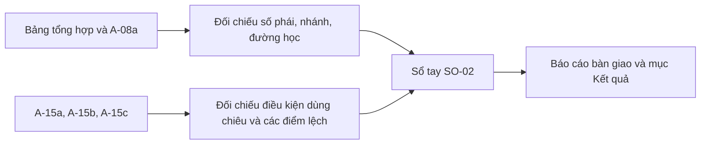

TÓM TẮT 1: [NGUỒN] DONE phần tổng hợp tài liệu SO-02, đối chiếu đủ năm nguồn, 16 mục khai báo, 11 mục có danh mục và 30 lựa chọn nhánh.
TÓM TẮT 2: [NGUỒN] Sổ tay ghi cách học, nâng và dùng chiêu. Các điểm vênh gồm nhóm Võ Đang bị sót, hai cách gọi ID 1363 và chênh số bản ghi Thiên Vương.
TÓM TẮT 3: [NGUỒN] Đầu ra tại `JX1_OPS/DESIGN/SO-TAY-KY-NANG.md`, báo cáo này và mục Kết quả cuối tệp task. Tổng quan phụ trách commit.
TÓM TẮT 4: [CHƯA KIỂM] Còn thiếu bằng chứng về phái chơi được, đường học đầy đủ và hiệu ứng thực tế. Tệp nhịp ngoài vùng ghi nên tiến độ được báo trong cuộc trò chuyện.
TÓM TẮT 5: [CHƯA KIỂM] Chỉ đối chiếu tài liệu và kiểm cấu trúc tệp. Chưa mở mã/dữ liệu game gốc, build, chạy thử game/exe, VM hay mạng.

# SO-02 — Bàn giao sổ tay kỹ năng và môn phái

Loại: tổng hợp
Chủ đề: Tổng hợp số mục môn phái, các nhánh, cách học và dùng chiêu, cùng sai khác giữa các nguồn.
Từ khóa: môn phái, võ công, Võ Đang, wudang, 武当, SkillId, ReqLevel, MaxLevel, Attrib, hảo hữu
Trạng thái: DONE — ba tệp tài liệu đã đủ nội dung yêu cầu. Tệp nhịp ngoài vùng ghi của phiên.
Độ phủ: 5/5 nguồn, 16/16 mục khai báo, 11/16 mục có danh mục, 30/30 lựa chọn nhánh trong 11 nhóm đầu của menu 90.
Liên quan: BANG-KY-NANG-THEO-PHAI, A-08a, A-15a, A-15b, A-15c, CHUAN-BAO-CAO.
Cần tôi quyết định: không.

## Phạm vi và độ phủ

| Phần | Mức phủ | Bằng chứng |
| --- | --- | --- |
| Bảng kỹ năng theo phái | Đã phủ 16 mục, 11 danh mục và 30 lựa chọn. Dẫn về bảng chi tiết 531 bản ghi theo ID. | `JX1_OPS/DESIGN/BANG-KY-NANG-THEO-PHAI.md:29–50,83–91,163–175` |
| A-08a | Đã phủ môn phái, loại chiêu, tầm gốc và giới hạn khi suy số người trúng. | `JX1_OPS/REPORTS/A-08a-mon-phai-ky-nang.md:26–58,87–113` |
| A-15a | Đã phủ nhóm ID 0–3, nguyên tắc chọn 196 bản ghi và điều kiện dùng của NPC hảo hữu. | `JX1_OPS/REPORTS/A-15a-ky-nang-phai-1-4.md:22–57,303` |
| A-15b | Đã phủ nhóm ID 4–7, 149 bản ghi chính và 39 bản ghi phụ, các điều kiện dùng kỹ năng. | `JX1_OPS/REPORTS/A-15b-ky-nang-phai-5-8.md:23–55,308` |
| A-15c | Đã phủ nhóm ID 9–15 ở mức báo cáo cho phép, ghi rõ khoảng trống ID 8 và dấu thay chữ có sẵn trong nguồn. | `JX1_OPS/REPORTS/A-15c-ky-nang-phai-9-cuoi.md:1,7,20–28,55–61,154–155` |
| Danh mục cho năm mục cuối | Chưa phủ bộ chiêu, vai trò và cách học. Cả năm mục có trong bảng phạm vi sổ tay. | `JX1_OPS/DESIGN/BANG-KY-NANG-THEO-PHAI.md:46–50,1252–1275` |

## Giải mã tên

| Tên gốc | Mã hóa | Chữ đúng | Nguồn file:dòng |
| --- | --- | --- | --- |
| 武当派 | GBK | Võ Đang (武当派) | `JX1_OPS/DESIGN/BANG-KY-NANG-THEO-PHAI.md:43` |
| 天王帮 | GBK | Thiên Vương (天王帮) | `JX1_OPS/DESIGN/BANG-KY-NANG-THEO-PHAI.md:36` |
| 华山派 | GBK | Hoa Sơn (华山派) | `JX1_OPS/DESIGN/BANG-KY-NANG-THEO-PHAI.md:45` |
| `Th¸i Nh¹c Tam Thanh Phong` | TCVN3 | Thái Nhạc Tam Thanh Phong (1363) | `JX1_OPS/REPORTS/A-15c-ky-nang-phai-9-cuoi.md:154`, `JX1_OPS/DESIGN/BANG-KY-NANG-THEO-PHAI.md:1152` |
| `§o¹t MÖnh Liªn Hoµn Tam Tiªn KiÕm` | TCVN3 | Đoạt Mệnh Liên Hoàn Tam Tiên Kiếm (1364) | `JX1_OPS/REPORTS/A-15c-ky-nang-phai-9-cuoi.md:155`, `JX1_OPS/DESIGN/BANG-KY-NANG-THEO-PHAI.md:1153` |

Sổ tay ghi bảng tên của đủ 16 mục cùng các ví dụ tên kỹ năng. `JX1_OPS/DESIGN/SO-TAY-KY-NANG.md:59–87`.

## Sắp theo cấu trúc game

Bảng trong sổ tay đi theo phái → nhánh → cấp yêu cầu và cấp tối đa. Phần học và phần dùng chiêu tách đường người chơi và NPC hảo hữu. `JX1_OPS/DESIGN/SO-TAY-KY-NANG.md:89–129`.

## Đối chiếu

- [THẤY] A-15b đếm thứ tự từ 1 và kết thúc ở ID 7. A-15c lấy ID 9 làm hàng đầu. Sổ tay khôi phục phần Võ Đang từ bảng tổng hợp, gồm hai nhánh menu và 45 bản ghi liên hệ. `JX1_OPS/REPORTS/A-15b-ky-nang-phai-5-8.md:25–34`, `JX1_OPS/REPORTS/A-15c-ky-nang-phai-9-cuoi.md:20–28`, `JX1_OPS/DESIGN/BANG-KY-NANG-THEO-PHAI.md:944–945,1190–1202`.
- [THẤY] A-08a dùng tên nút Hoa Sơn cho chiêu con 1363. Bảng tổng hợp và A-15c giữ tên bản ghi 1363, tách nó khỏi nút 1364. Sổ tay ghi cả hai cách gọi và dòng nguồn. `JX1_OPS/REPORTS/A-08a-mon-phai-ky-nang.md:91,94`, `JX1_OPS/REPORTS/A-15c-ky-nang-phai-9-cuoi.md:154–155`, `JX1_OPS/DESIGN/BANG-KY-NANG-THEO-PHAI.md:1152–1153`.
- [THẤY] Ba dòng trong thư mục con làm số bản ghi Thiên Vương tăng từ 52 ở A-15a lên 55 trong bảng tổng hợp. Sổ tay ghi riêng sai khác do tiêu chí chọn dòng, nhãn menu so với nhãn mô tả, và cách phân loại đòn đơn hoặc AOE. `JX1_OPS/REPORTS/A-15a-ky-nang-phai-1-4.md:33,56`, `JX1_OPS/DESIGN/BANG-KY-NANG-THEO-PHAI.md:300–302,938,1031,1041`, `JX1_OPS/DESIGN/SO-TAY-KY-NANG.md:131–140`.

## Sổ thông số

| Nhóm | Tên/hằng số | file:dòng | Giá trị | Đơn vị | Ảnh hưởng | Đổi an toàn | Nguồn đo |
| --- | --- | --- | --- | --- | --- | --- | --- |
| Dữ liệu | Mục khai báo, mục gia nhập | `JX1_OPS/REPORTS/A-08a-mon-phai-ky-nang.md:28–49` | 16 và 11 | mục | Phạm vi khác nhau giữa hai bảng | CẨN THẬN | Dẫn kết quả đọc tĩnh, chưa đo game |
| Danh mục | Bản ghi liên hệ và nhãn Attrib | `JX1_OPS/DESIGN/BANG-KY-NANG-THEO-PHAI.md:1–4,75–91` | 531, có nhãn 307, chưa có nhãn 224 | bản ghi | Tra chiêu và dòng võ công, có cả hiệu ứng và biến thể | CẨN THẬN | Dẫn kết quả đọc tĩnh, chưa đo game |
| Học | `show_kynang90`, `ReqLevel / MaxLevel` | `JX1_OPS/DESIGN/BANG-KY-NANG-THEO-PHAI.md:198–202,944–945,1117–1118` | Menu từ 80. Ví dụ 365 là 80/30 và 1364 là 90/20 | cấp | Ngưỡng mở menu và số trên từng chiêu | CẨN THẬN | Dẫn kết quả đọc tĩnh, chưa đo game |
| Hiển thị | `GetSkillSortList` | `JX1_OPS/DESIGN/BANG-KY-NANG-THEO-PHAI.md:187–194` | Tối đa 50 | mục | Số mục được lấy để dựng bảng ô | CẨN THẬN | Dẫn kết quả đọc tĩnh, chưa đo client |
| Dùng chiêu | `AttackRadius`, `ChildSkillNum`, `DmgRange` của ID 318 | `JX1_OPS/REPORTS/A-08a-mon-phai-ky-nang.md:53–58,67` | 90 / 2 / 3 | đơn vị nội bộ / đạn / tham số vùng mẫu | Tầm chọn mục tiêu, phát đạn và quét va chạm | CẨN THẬN | Dẫn giá trị gốc, chưa đo số mục tiêu |

## Đã xác minh / Chưa xác minh

- Đã xác minh trong tài liệu các số 16/11/531 và 30 lựa chọn nhánh. Các phần về server và client dùng nhãn [TÀI LIỆU] vì bằng chứng là trích dẫn của nguồn được giao. `JX1_OPS/DESIGN/SO-TAY-KY-NANG.md:29–57,89–129`.
- Kiểm tra tài liệu gồm UTF-8 không BOM cho hai tệp mới, đúng năm dòng tóm tắt, 16 hàng phạm vi, tổng 531 bản ghi, 30 lựa chọn nhánh, liên kết và một mục Kết quả ở cuối task.
- Chưa xác minh bản triển khai, dữ liệu trong PAK, cây học thật, lựa chọn của AI, số người trúng và tác dụng khi vận hành. Task giới hạn đọc tài liệu và viết tổng hợp nên chưa build, chạy game/exe, VM hay mạng. `JX1_OPS/TASKS/SO-02.md:23–27`, `JX1_OPS/DESIGN/SO-TAY-KY-NANG.md:142–145`.

## Phát hiện khi chuẩn hóa

- `rg` không có trong phiên. `Select-String` và `Get-Content` tìm đúng tên tệp và đoạn cần dùng. Một lượt trả kết quả bị rút gọn, các đoạn cần thiết được lấy từ kết quả đã lưu hoặc truy vấn hẹp theo dòng.
- A-15c có dấu `?` trong văn bản đã lưu. Đối chiếu các nguồn còn lại để đọc tên phái và giữ nguyên cách ghi của A-15c ở nơi đối chiếu. `JX1_OPS/REPORTS/A-15c-ky-nang-phai-9-cuoi.md:1,7,86–89`, `JX1_OPS/DESIGN/BANG-KY-NANG-THEO-PHAI.md:1310`.
- `D:\JX-wt\SO-02.nhip` nằm ngoài vùng ghi `D:\JX-wt\SO-02` của phiên. Các mốc công việc được cập nhật trong cuộc trò chuyện.

## Bàn giao

Ba tệp bàn giao là [sổ tay](../DESIGN/SO-TAY-KY-NANG.md), báo cáo này và [task SO-02](../TASKS/SO-02.md). Tổng quan nhận ba tệp để commit. Phiên này chưa stage, commit hay push.

Dòng chỉ mục đề xuất để Tổng quan gộp vào mục lục. Phạm vi ghi chỉ gồm ba tệp nêu trên.

| File | Loại | Chủ đề | Từ khóa | Trạng thái | Độ phủ | Liên quan |
| --- | --- | --- | --- | --- | --- | --- |
| `JX1_OPS/DESIGN/SO-TAY-KY-NANG.md` | tổng hợp | Môn phái, nhánh và cách học/dùng chiêu | môn phái, Võ Đang, wudang, 武当, SkillId, ReqLevel, Attrib, hảo hữu | DONE | 16 mục khai báo, 11 có danh mục, 30 lựa chọn | BANG-KY-NANG-THEO-PHAI, A-08a, A-15a/b/c, SO-02 |

Kỹ năng đã dùng: jx1-retrofit, jx1-read-server, jx1-read-client, jx1-parameters, jx1-knowledge, jx1-report. Hai kỹ năng đọc source được áp dụng để phân biệt dữ liệu, client, server và hành vi thực tế trong các trích dẫn. Phạm vi SO-02 chỉ cho đọc năm nguồn đã nêu.
