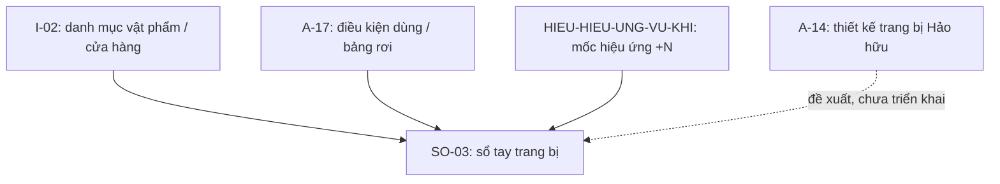

TÓM TẮT 5 DÒNG
1. [NGUỒN] DONE trong phạm vi tổng hợp bốn tài liệu về trang bị, điều kiện dùng, hiệu ứng +N, nguồn rơi, cửa hàng và thiết kế Hảo hữu.
2. [NGUỒN] Đầu ra là sổ tay tiếng Việt có dẫn file:dòng, sơ đồ, phạm vi, giải mã tên và sắp xếp theo nhóm.
3. [CHƯA KIỂM] Nội dung dựa trên bốn báo cáo/tài liệu được giao; chưa đọc trực tiếp bảng dữ liệu gốc để xác nhận lại số liệu.
4. [CHƯA KIỂM] Chưa chạy build, test, exe, VM hay mạng; không có kết quả runtime.
5. [CHƯA KIỂM] Chưa chạy build/exe/VM; không commit/push. PM có thể gộp dòng mục lục và giao đối chiếu dữ liệu gốc sau.

# SO-03 — Sổ tay trang bị và thuộc tính

Loại: tổng hợp
Chủ đề: Gộp tài liệu hiện có về trang bị, điều kiện sử dụng, cường hóa và nguồn rơi.
Từ khóa: SO-03, trang bị, thuộc tính, cường hóa +N, goods, droprate, Hảo hữu, Bảo vật
Trạng thái: DONE, hoàn thành tổng hợp theo bốn nguồn được giao; dữ liệu gốc/runtime được ghi rõ là chưa kiểm.
Độ phủ: Đã tổng hợp 6/6 chủ đề trong bảng phạm vi; nhiều mục chỉ có ví dụ hoặc tài liệu dẫn lại, chưa có danh mục đầy đủ.
Liên quan: [I-02 — Vật phẩm bán](I-02-vat-pham-ban.md), [A-14 — Hảo hữu](A-14-hao-huu-trang-bi-thiet-ke.md), [A-17 — Rơi đồ boss](A-17-roi-do-boss-trang-bi.md), [Hiểu hiệu ứng vũ khí](../DESIGN/HIEU-HIEU-UNG-VU-KHI.md).
Cần tôi quyết định: không.

## Phạm vi và độ phủ

| Phần tử | Độ phủ | Bằng chứng |
|---|---|---|
| Loại trang bị | Đã tổng hợp kiểm kê; chưa lập danh mục từng món | `JX1_OPS/DESIGN/SO-TAY-TRANG-BI.md:43–48` |
| Thuộc tính/điều kiện dùng | Có ví dụ, chưa phủ mọi món | `JX1_OPS/DESIGN/SO-TAY-TRANG-BI.md:50–55` |
| Cường hóa +N | Có mốc hiệu ứng đồ họa, chưa có công thức chỉ số | `JX1_OPS/DESIGN/SO-TAY-TRANG-BI.md:57–62` |
| Nguồn rơi | Có cấu trúc bảng và giới hạn suy luận | `JX1_OPS/DESIGN/SO-TAY-TRANG-BI.md:64–69` |
| Cửa hàng/giá | Có số kiểm kê và lưu ý giá trống | `JX1_OPS/DESIGN/SO-TAY-TRANG-BI.md:71–75` |
| Trang bị Hảo hữu | Có ghi nhận thiết kế riêng, không xác nhận triển khai | `JX1_OPS/DESIGN/SO-TAY-TRANG-BI.md:77–80` |

## Giải mã tên

| Tên trong báo cáo | Mã hóa căn cứ | Chữ đúng | Nguồn |
|---|---|---|---|
| Bảo vật | UTF-8 của báo cáo; mã hóa bảng gốc chưa kiểm | Bảo vật | `JX1_OPS/REPORTS/I-02-vat-pham-ban.md:3–5,37` |
| Kỳ Trân | UTF-8 của báo cáo; mã hóa bảng gốc chưa kiểm | Kỳ Trân | `JX1_OPS/REPORTS/I-02-vat-pham-ban.md:4,37` |
| Hảo hữu | UTF-8 của báo cáo; mã hóa dữ liệu gốc chưa kiểm | Hảo hữu | `JX1_OPS/REPORTS/A-14-hao-huu-trang-bi-thiet-ke.md:7–9` |

## Sắp theo cấu trúc game

Sổ tay xếp theo thứ tự loại vật phẩm → điều kiện sử dụng → hiệu ứng cường hóa → nguồn rơi; thiết kế Hảo hữu để riêng vì chưa triển khai (`JX1_OPS/DESIGN/SO-TAY-TRANG-BI.md:92–102`). Chưa thể sắp từng món theo bộ hoặc vị trí mặc vì nguồn được giao không có danh mục đầy đủ.

## Kết quả thực hiện

- Tạo `JX1_OPS/DESIGN/SO-TAY-TRANG-BI.md` với nhãn TÀI LIỆU/CHƯA KIỂM, sơ đồ Mermaid, phạm vi, giải mã tên, sắp xếp cấu trúc, liên quan và đề xuất dòng mục lục.
- Giữ riêng đề xuất trang bị Hảo hữu khỏi cơ chế hiện hữu; không đổi kết luận trong I-02, A-14, A-17 hoặc tài liệu hiệu ứng vũ khí.
- Không tạo `_CHIMUC/SO-03.tsv` vì task giới hạn vùng sửa vào sổ tay; dòng chỉ mục được đề xuất trong sổ tay để PM gộp.

## Đã xác minh / Chưa xác minh

### Đã đối chiếu trong nguồn được giao

- `JX1_OPS/REPORTS/I-02-vat-pham-ban.md:34–43,70–74` — số nhóm vật phẩm, số trang bị tham chiếu và lưu ý Price trống.
- `JX1_OPS/REPORTS/A-14-hao-huu-trang-bi-thiet-ke.md:1–9,20–22` — đây là khảo sát/đề xuất thiết kế, chưa triển khai.
- `JX1_OPS/REPORTS/A-17-roi-do-boss-trang-bi.md:61–72,115–127,138–159` — ví dụ điều kiện sử dụng, cấu trúc bảng rơi và giới hạn kiểm chứng.
- `JX1_OPS/DESIGN/HIEU-HIEU-UNG-VU-KHI.md:5–10,45–63,80–88` — ngưỡng hiệu ứng client và dữ liệu còn thiếu.

### Chưa xác minh

- Chưa đọc trực tiếp bảng dữ liệu gốc hoặc source code; các thông tin kỹ thuật được dẫn lại từ bốn tài liệu hiện có.
- Chưa kiểm tra runtime, binary, client đóng gói, NPC/boss được gắn bảng rơi, chỉ số thực tế hoặc công thức cường hóa.
- Chưa chạy test/build/exe/VM/mạng theo phạm vi được giao.
- Không có lỗi thao tác khác. Ghi checkpoint tại `D:\JX-wt\SO-03.nhip` thử một lần nhưng bị từ chối quyền ghi ngoài worktree; không đổi quyền và không chuyển sang đường dẫn khác.

## Bàn giao

- Trạng thái: DONE trong phạm vi task — sổ tay tổng hợp đã tạo; những chi tiết không có trong bốn nguồn được ghi CHƯA KIỂM để giao bổ sung nếu cần.
- Test: không chạy; chỉ tổng hợp/đối chiếu tĩnh bốn tài liệu được task nêu.
- Commit/push: không yêu cầu; chưa commit, chưa push, không có SHA.
- Chỉ mục: đề xuất PM gộp hàng SO-03 ở cuối `JX1_OPS/DESIGN/SO-TAY-TRANG-BI.md` vào mục lục tri thức.
- Kỹ năng đã dùng: jx1-retrofit, jx1-read-server, jx1-read-client, jx1-parameters, jx1-knowledge, jx1-report.

liên quan: I-02-vat-pham-ban.md; A-14-hao-huu-trang-bi-thiet-ke.md; A-17-roi-do-boss-trang-bi.md; HIEU-HIEU-UNG-VU-KHI.md.
