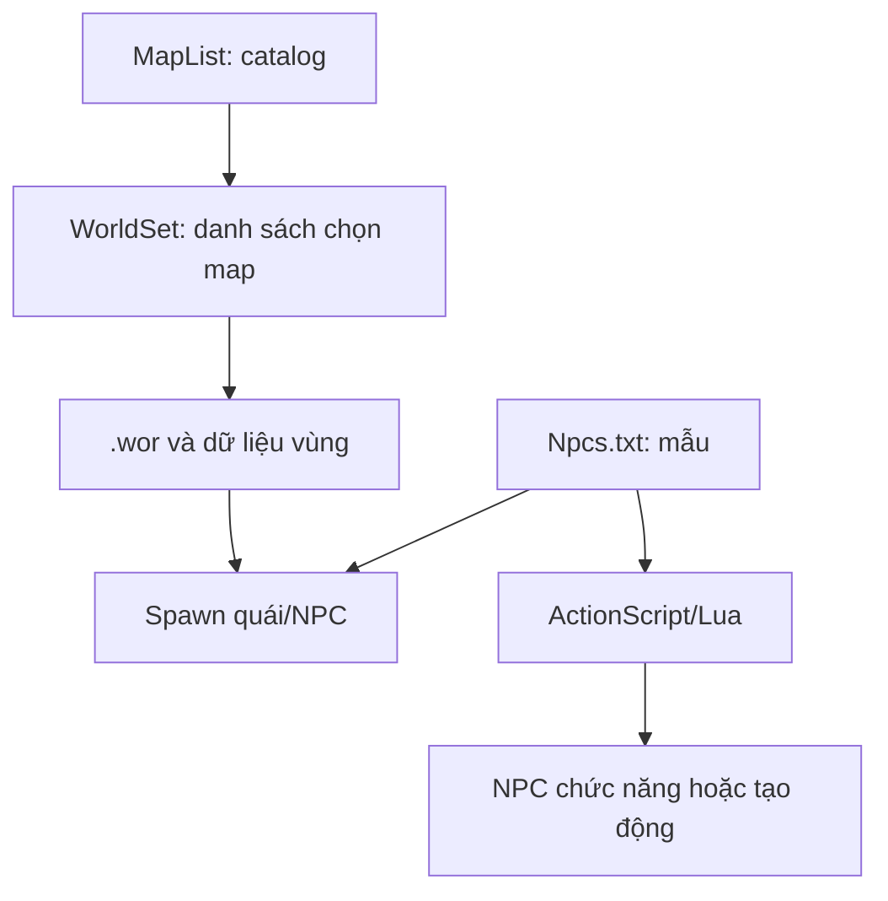

# TÓM TẮT 5 DÒNG
1. [TÀI LIỆU] Hoàn thành sổ tay tĩnh về 993 ID bản đồ, 2.435 mẫu NPC và các báo cáo về quái/NPC chức năng. (`I-04-khao-sat-map.md:13,32`; `I-03-khao-sat-quai-vat.md:31–36`)
2. [TÀI LIỆU] Thống kê 1.412 mẫu Kind=0, 958 mẫu Kind=3, 94.098 bản ghi spawn và 37 ID chưa thấy `.wor` trong nguồn đã kiểm. (`I-03-khao-sat-quai-vat.md:2,40–41`; `I-05-npc-chuc-nang.md:13`; `K-02-ban-do.md:74–88`)
3. [TÀI LIỆU] Đầu ra: `DESIGN/SO-TAY-QUAI-NPC-BAN-DO.md`, có sơ đồ, phạm vi, nơi tra dữ liệu và giới hạn kết luận.
4. [CHƯA KIỂM] Không xác định map nào lỗi nạp runtime hoặc đầy đủ vị trí NPC thường trú; không chạy test/build/exe/VM/game.
5. [TÀI LIỆU] DONE; chưa commit theo chỉ dẫn. Ghi tệp nhịp ngoài worktree bị sandbox từ chối; không push.

# SO-04 — Sổ tay quái, NPC và bản đồ

Loại: tổng hợp
Chủ đề: Gom kết quả khảo sát về số lượng quái, NPC chức năng, bản đồ, dữ liệu vùng và giới hạn nạp map.
Từ khóa: SO-04, quái, NPC, bản đồ, MapList, WorldSet, spawn, Kind, .wor
Trạng thái: DONE, đã tạo sổ tay và báo cáo trên bốn báo cáo nguồn được giao.
Độ phủ: 4/4 báo cáo nguồn; đối chiếu 993 ID catalog, 2.435 mẫu NPC, 94.098 bản ghi spawn và 993 ID khi tổng hợp map.
Liên quan: `I-03-khao-sat-quai-vat.md`, `I-04-khao-sat-map.md`, `I-05-npc-chuc-nang.md`, `K-02-ban-do.md`, `DESIGN/SO-TAY-QUAI-NPC-BAN-DO.md`.
Cần tôi quyết định: không.

## Phạm vi và độ phủ

| Phần tử | Kết quả | Độ phủ / bằng chứng |
|---|---|---|
| Catalog map | Đã phủ | 993/993 ID; `I-04-khao-sat-map.md:13,32` |
| WorldSet gs001 | Đã phủ kiểm kê tĩnh | 872 mục vật lý, `Count=800`; không phải số map runtime; `I-04-khao-sat-map.md:2,38` |
| Tệp `.wor` | Đã đối chiếu nguồn khảo sát | 955 ID khớp trong PAK, thêm một tệp rời; 37 ID thiếu `.wor` ở nguồn đã kiểm; `I-03-khao-sat-quai-vat.md:40–41`, `K-02-ban-do.md:74–88` |
| Mẫu quái | Đã phủ kiểm kê | 1.412 hàng Kind=0 rõ ràng; 19 hàng Kind trống tách riêng; `I-03-khao-sat-quai-vat.md:31–36,67–75` |
| Spawn quái | Đã phủ thống kê tĩnh | 94.098 bản ghi Kind=0 trên 195 map trong hai PAK; `I-03-khao-sat-quai-vat.md:2,40` |
| NPC đối thoại/chức năng | Đã phủ mẫu; một phần luồng chức năng | 958 mẫu Kind=3, có ví dụ cho 6/8 nhóm; vị trí NPC thường trú chưa đủ; `I-05-npc-chuc-nang.md:12–13,28–42` |
| Cấp NPC theo map | Đã phủ thống kê cấu hình | 131 ID có cặp cấp đủ điều kiện; `I-03-khao-sat-quai-vat.md:38,133–150` |

## Giải mã tên

| Tên gốc | Mã hóa | Chữ đúng (UTF-8) | Nguồn file:dòng |
|---|---|---|---|
| `篝火` | GBK | Lửa trại | `I-05-npc-chuc-nang.md:59` |

## Sắp theo cấu trúc game

Catalog `MapList` → danh sách tải `WorldSet` → khung `.wor` → dữ liệu vùng → spawn NPC/quái → hành vi `ActionScript`/Lua. NPC tạo động như lửa trại được xếp dưới luồng script thay vì coi là NPC thường trú. Các báo cáo nguồn xác nhận quan hệ dữ liệu và cấu hình tĩnh, không xác nhận toàn bộ luồng thành công khi chạy. `I-04-khao-sat-map.md:78–80`; `I-03-khao-sat-quai-vat.md:40–41`; `I-05-npc-chuc-nang.md:75–90`; `K-02-ban-do.md:113–128`.

## Đã xác minh

- **TÀI LIỆU** — Catalog gốc có 993 ID; WorldSet gs001 ghi 872 mục trong khi Count=800. `I-04-khao-sat-map.md:2,13,38`.
- **TÀI LIỆU** — Bảng có 2.435 hàng mẫu, trong đó 1.412 Kind=0 rõ ràng và 19 Kind trống; thống kê không gộp hàng trống vào Kind=0. `I-03-khao-sat-quai-vat.md:31–36,67–75`.
- **TÀI LIỆU** — Hai PAK có 94.098 bản ghi spawn Kind=0 trên 195 map; đây không phải số lượng quái đang sống. `I-03-khao-sat-quai-vat.md:2`.
- **TÀI LIỆU** — K-02 khớp 955 ID với `.wor` trong PAK và thấy thêm một `.wor` rời; 37 ID chưa thấy `.wor` trong các nguồn đã kiểm. I-03 chỉ tính hai PAK nên nêu 38 ID không khớp trong phạm vi đó. `I-03-khao-sat-quai-vat.md:40–41`; `K-02-ban-do.md:74–88`.
- **TÀI LIỆU** — I-05 kiểm kê 958 mẫu Kind=3 và tìm ví dụ luồng xử lý cho 6/8 nhóm chức năng. `I-05-npc-chuc-nang.md:12–13,28–42`.

## Chưa xác minh

- Map nào thực sự nạp thành công/thất bại khi chạy; ID thiếu `.wor` có thể được cung cấp từ nguồn nào khác hay không. `I-04-khao-sat-map.md:78–80`; `K-02-ban-do.md:170–174`.
- Số quái/NPC đang sống trong phiên game và đầy đủ vị trí/template/script của NPC chức năng thường trú. `I-03-khao-sat-quai-vat.md:190`; `I-05-npc-chuc-nang.md:35–42,83,92–96`.
- Không chạy test, build, exe, VM hoặc game. Tổng hợp dựa trên báo cáo nguồn, không kiểm tra lại mã hay dữ liệu gốc.

## Bàn giao

Đã tạo `JX1_OPS/DESIGN/SO-TAY-QUAI-NPC-BAN-DO.md`. Hàng đề nghị PM đưa vào mục lục tri thức:

| Chủ đề | Tài liệu | File/quan hệ chính | Độ chắc |
|---|---|---|---|
| Quái, NPC chức năng và bản đồ | `DESIGN/SO-TAY-QUAI-NPC-BAN-DO.md` | MapList, WorldSet, `.wor`, dữ liệu vùng, spawn, ActionScript/Lua | Tổng hợp tĩnh I-03, I-04, I-05, K-02 |

Không stage hoặc commit theo chỉ dẫn. Ghi checkpoint `D:\JX-wt\SO-04.nhip` bị từ chối quyền ghi vì nằm ngoài vùng workspace được phép; đã giữ nguyên tệp ngoài workspace và không thử vượt quyền. Không ghi nhận test/build/VM/exe/game hay mạng được chạy.

Kỹ năng đã dùng: jx1-knowledge, jx1-retrofit, jx1-report; đã nạp hướng dẫn jx1-read-server, jx1-read-client, jx1-parameters nhưng không mở source vì task chỉ giao bốn báo cáo.
