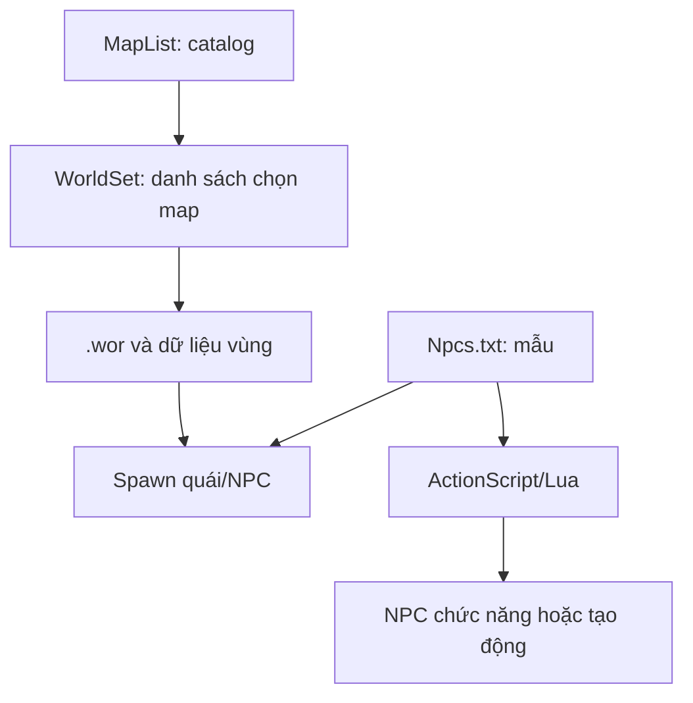

# TÓM TẮT 5 DÒNG
1. [TÀI LIỆU] Hoàn thành sổ tay tĩnh về 993 ID bản đồ, 2.435 mẫu NPC và các báo cáo về quái/NPC chức năng. (`I-04-khao-sat-map.md:13,32`; `I-03-khao-sat-quai-vat.md:31–36`)
2. [TÀI LIỆU] Thống kê 1.412 mẫu Kind=0, 958 mẫu Kind=3, 94.098 bản ghi spawn và 37 ID chưa thấy `.wor` trong nguồn đã kiểm. (`I-03-khao-sat-quai-vat.md:2–3,227–228`; `I-05-npc-chuc-nang.md:13`; `K-02-ban-do.md:74–88`)
3. [TÀI LIỆU] Đầu ra: `DESIGN/SO-TAY-QUAI-NPC-BAN-DO.md`, có sơ đồ, phạm vi, nơi tra dữ liệu và giới hạn kết luận.
4. [CHƯA KIỂM] Không xác định map nào lỗi nạp runtime hoặc đầy đủ vị trí NPC thường trú; không chạy test/build/exe/VM/game.
5. [THẤY] DONE; tiếp tục bản có sẵn, không commit/push theo chỉ dẫn. Nhịp ngoài worktree không thuộc vùng được phép ghi; lưu mốc trong báo cáo để bàn giao Tổng quan.

# SO-04 — Sổ tay quái, NPC và bản đồ

Loại: tổng hợp
Chủ đề: Gom kết quả khảo sát về số lượng quái, NPC chức năng, bản đồ, dữ liệu vùng và giới hạn nạp map.
Từ khóa: SO-04, quái, NPC, bản đồ, MapList, WorldSet, spawn, Kind, .wor
Trạng thái: DONE, đã tạo sổ tay và báo cáo trên bốn báo cáo nguồn được giao.
Độ phủ: 4/4 báo cáo nguồn được đọc; dẫn lại kiểm kê 993 ID map, 2.435 mẫu NPC và 94.098 bản ghi quái. Không đếm lại dữ liệu gốc trong SO-04; đã bổ sung 12 nhóm map, 9 map mẫu và mức phủ đủ 8 nhóm chức năng.
Liên quan: `I-03-khao-sat-quai-vat.md`, `I-04-khao-sat-map.md`, `I-05-npc-chuc-nang.md`, `K-02-ban-do.md`, `DESIGN/SO-TAY-QUAI-NPC-BAN-DO.md`.
Cần tôi quyết định: không.

## Phạm vi và độ phủ

| Phần tử | Kết quả | Độ phủ / bằng chứng |
|---|---|---|
| Catalog map | Đã phủ | 993/993 ID; `I-04-khao-sat-map.md:13,32` |
| WorldSet gs001 | Đã phủ kiểm kê tĩnh | 872 mục vật lý, `Count=800`; không phải số map runtime; `I-04-khao-sat-map.md:2,38` |
| Tệp `.wor` | Đã đối chiếu nguồn khảo sát | 955 ID khớp trong PAK, thêm một tệp rời; 37 ID thiếu `.wor` ở nguồn đã kiểm; `I-03-khao-sat-quai-vat.md:40–41`, `K-02-ban-do.md:74–88` |
| Mẫu quái | Đã phủ kiểm kê | 1.412 hàng Kind=0 rõ ràng; 19 hàng Kind trống tách riêng; `I-03-khao-sat-quai-vat.md:31–36,67–75` |
| Spawn quái | Đã phủ thống kê tĩnh | 94.098 bản ghi Kind=0 trên 195 map trong hai PAK; `I-03-khao-sat-quai-vat.md:3,227–228` |
| NPC đối thoại/chức năng | Đã phủ mẫu; một phần luồng chức năng | 958 mẫu Kind=3, có ví dụ cho 6/8 nhóm; vị trí NPC thường trú chưa đủ; `I-05-npc-chuc-nang.md:12–13,28–42` |
| Cấp NPC theo map | Đã phủ thống kê cấu hình | 131 ID có cặp cấp đủ điều kiện; `I-03-khao-sat-quai-vat.md:38,133–150` |
| Map theo vùng | Đã bổ sung đủ 12/12 nhóm trong K-02 | Giữ khóa gốc, số ID và danh sách 37 ID chưa thấy `.wor`; `K-02-ban-do.md:74–88` |
| Quái/NPC theo map và chức năng | Đã bổ sung 9 map mẫu; đủ 8 nhóm chức năng và giới hạn | 6/8 nhóm có ví dụ xử lý; nhiệm vụ/hảo hữu và tổng NPC thường trú chưa xác minh; `I-03-khao-sat-quai-vat.md:230–240`; `I-05-npc-chuc-nang.md:28–42,95–97` |
| Đường dẫn và nguồn client | Đã tách số ID/tệp và bản client | 324 đường dẫn, 296 có `.wor`; client A khác client gốc; `K-02-ban-do.md:33–46`; `I-03-khao-sat-quai-vat.md:48–51` |

## Giải mã tên

| Tên gốc | Mã hóa | Chữ đúng (UTF-8) | Nguồn file:dòng |
|---|---|---|---|
| `篝火` | GBK | Lửa trại | `I-05-npc-chuc-nang.md:59` |

## Sắp theo cấu trúc game

Catalog `MapList` → danh sách tải `WorldSet` → khung `.wor` → dữ liệu vùng → spawn NPC/quái → hành vi `ActionScript`/Lua. NPC tạo động như lửa trại được xếp dưới luồng script thay vì coi là NPC thường trú. Các báo cáo nguồn xác nhận quan hệ dữ liệu và cấu hình tĩnh, không xác nhận toàn bộ luồng thành công khi chạy. `I-04-khao-sat-map.md:78–80`; `I-03-khao-sat-quai-vat.md:40–41`; `I-05-npc-chuc-nang.md:75–90`; `K-02-ban-do.md:113–128`.

## Đã xác minh

- **TÀI LIỆU** — Catalog gốc có 993 ID; WorldSet gs001 ghi 872 mục trong khi Count=800. `I-04-khao-sat-map.md:2,13,38`.
- **TÀI LIỆU** — Bảng có 2.435 hàng mẫu, trong đó 1.412 Kind=0 rõ ràng và 19 Kind trống; thống kê không gộp hàng trống vào Kind=0. `I-03-khao-sat-quai-vat.md:31–36,67–75`.
- **TÀI LIỆU** — Hai PAK có 94.098 bản ghi spawn Kind=0 trên 195 map; đây không phải số lượng quái đang sống. `I-03-khao-sat-quai-vat.md:3,227–228`.
- **TÀI LIỆU** — K-02 khớp 955 ID với `.wor` trong PAK và thấy thêm một `.wor` rời; 37 ID chưa thấy `.wor` trong các nguồn đã kiểm. I-03 chỉ tính hai PAK nên nêu 38 ID không khớp trong phạm vi đó. `I-03-khao-sat-quai-vat.md:40–41`; `K-02-ban-do.md:74–88`.
- **TÀI LIỆU** — I-05 kiểm kê 958 mẫu Kind=3 và tìm ví dụ luồng xử lý cho 6/8 nhóm chức năng. `I-05-npc-chuc-nang.md:12–13,28–42`.

## Chưa xác minh

- Map nào thực sự nạp thành công/thất bại khi chạy; ID thiếu `.wor` có thể được cung cấp từ nguồn nào khác hay không. `I-04-khao-sat-map.md:78–80`; `K-02-ban-do.md:170–174`.
- Số quái/NPC đang sống trong phiên game và đầy đủ vị trí/template/script của NPC chức năng thường trú. `I-03-khao-sat-quai-vat.md:190`; `I-05-npc-chuc-nang.md:35–42,83,92–96`.
- Không chạy test, build, exe, VM hoặc game. Tổng hợp dựa trên báo cáo nguồn, không kiểm tra lại mã hay dữ liệu gốc.

## Bàn giao

### Phần hoàn thiện trong lượt tiếp tục 19/11/2026

- [THẤY] Git status đầu lượt sạch, đúng `task/SO-04`; task đã có mục Kết quả và hai đầu ra có sẵn. Giữ phần đã hoàn thành, chỉ bổ sung thiếu sót trong sổ tay và bàn giao.
- [TÀI LIỆU] Đã bổ sung khối thông tin, mục lục, 12 nhóm map kèm 37 ID chưa thấy `.wor`, 9 map mẫu có quái, tám nhóm chức năng NPC, bảng giải mã tên và sổ thông số. Phân biệt 993 ID/324 đường dẫn; 1.412 mẫu/172 mẫu được tham chiếu; 958 mẫu đối thoại/1.854 bản ghi đối thoại; không gán thành số NPC chức năng thực tế. `K-02-ban-do.md:41–46,74–88`; `I-03-khao-sat-quai-vat.md:69–77,227–240`; `I-05-npc-chuc-nang.md:28–42`.
- [TÀI LIỆU] Giữ trạng thái PARTIAL của I-04/I-05, hai phạm vi `.wor` 955/38 và 956/37, cùng chú thích 48/49 Cave do cách đếm khóa. Không sửa bốn báo cáo nguồn. `I-04-khao-sat-map.md:12,237–239`; `I-05-npc-chuc-nang.md:12`; `I-03-khao-sat-quai-vat.md:227`; `K-02-ban-do.md:41–43`.
- Không tạo chỉ mục `_CHIMUC/SO-04.tsv` hoặc sửa mục lục chung vì ngoài vùng được giao; hàng bàn giao bên dưới để Tổng quan gộp. Không stage/commit/push theo yêu cầu.

### Mục sổ thông số

Sổ đầy đủ nằm tại mục cùng tên trong `JX1_OPS/DESIGN/SO-TAY-QUAI-NPC-BAN-DO.md`: `MapList Count=1000` là khai báo, catalog có 993 ID; `WorldSet Count=800` giới hạn vòng đọc; Kind 0/3 là mã loại; ID mẫu bằng STT−1. Tất cả là nguồn gián tiếp, không được chỉnh cấu hình trong SO-04. `I-04-khao-sat-map.md:68–80`; `I-03-khao-sat-quai-vat.md:65,69–77`; `I-05-npc-chuc-nang.md:57–59`.

### Đề xuất tối ưu

Khi có task kiểm tra riêng, ưu tiên 28 ID chưa thấy `.wor` trong 800 mục WorldSet, rồi bổ sung ánh xạ NPC thường trú với map/tọa độ/script. Đây là bước đề xuất, chưa thực hiện và không phải quyền chạy thử trong SO-04. `K-02-ban-do.md:43,178`; `I-05-npc-chuc-nang.md:95–101`.

### Kiểm tra tĩnh và lỗi xử lý

- Đầu lượt PowerShell hiển thị sai dấu khi dùng bảng mã mặc định; đã đặt đầu ra console và đọc Markdown bằng UTF-8. Không chuyển mã hay ghi lại các tệp nguồn.
- Một lần `apply_patch` không khớp dòng ngữ cảnh do thiếu trích dẫn I-04 ở cuối đoạn; công cụ báo `Failed to find expected lines`. Đã đọc lại đúng đoạn, xác nhận sổ tay vẫn 87 dòng và chưa có khối thêm; đổi sang neo theo tiêu đề, các lần ghi sau thành công. Không thử lại mù hoặc sửa kết luận nguồn.
- Hai phép kiểm ban đầu dùng phạm vi quá rộng: đếm tóm tắt lẫn dòng đánh số ở phần cấu trúc game; trích mục Kết quả lẫn câu hướng dẫn có cùng chuỗi trong task. Đã giới hạn tóm tắt vào sáu dòng đầu và neo mục Kết quả ở đầu dòng tiêu đề. Phép kiểm tóm tắt chạy lại đạt; kiểm task được thực hiện khi đọc lại cuối lượt. Đây là lỗi phạm vi phép kiểm, không sửa nội dung đúng để chiều phép kiểm.
- Kiểm tra tài liệu đã chạy bằng PowerShell: hai tệp UTF-8 không BOM, không U+FFFD; mỗi tệp đủ năm dòng tóm tắt, một sơ đồ Mermaid và các mục bắt buộc. Tổng 12 nhóm đúng `993 = 955 + 1 + 37`; danh sách thiếu có đúng 37 ID khác nhau; đủ 9 map mẫu và 8 nhóm NPC. Đã đọc lại bảng map/NPC và tiêu đề sau ghi; 135 dẫn chứng sổ tay và 45 dẫn chứng báo cáo đều nằm trong số dòng của bốn nguồn đã đọc. Đây là kiểm tra tài liệu, không phải đối chiếu lại dữ liệu game.
- Không chạy unit test, build, game, exe dự án, VM hoặc mạng. Chưa kiểm map nạp lúc chạy hoặc vị trí NPC thường trú; Tổng quan nhận ba tệp bàn giao để commit. Không có SHA mới.

### Nhịp lượt tiếp tục

Tệp `D:\JX-wt\SO-04.nhip` nằm ngoài writable root `D:\JX-wt\SO-04`. Checkpoint cũ đã ghi nhận sandbox từ chối; lượt này không thử vượt rào chắn hoặc ghi lại đường ngoài phạm vi. Dùng bảng trong chính báo cáo để lưu mốc có giờ thực.

| Giờ địa phương (UTC+07:00) | Bước | Tiến độ ước tính |
|---|---|---:|
| 19/11/2026 03:54:31 | Hoàn tất đối chiếu checkpoint, bốn nguồn và phần còn thiếu | 70% |
| 19/11/2026 03:58:39 | Đã bổ sung các phần thiếu; kiểm UTF-8, cấu trúc, tổng map và giới hạn dòng dẫn chứng đạt; chốt bàn giao | 95% |

Đã tạo `JX1_OPS/DESIGN/SO-TAY-QUAI-NPC-BAN-DO.md`. Hàng đề nghị PM đưa vào mục lục tri thức:

| Chủ đề | Tài liệu | File/quan hệ chính | Độ chắc |
|---|---|---|---|
| Quái, NPC chức năng và bản đồ | `DESIGN/SO-TAY-QUAI-NPC-BAN-DO.md` | MapList, WorldSet, `.wor`, dữ liệu vùng, spawn, ActionScript/Lua | Tổng hợp tĩnh I-03, I-04, I-05, K-02 |

Không stage hoặc commit theo chỉ dẫn. Ghi checkpoint `D:\JX-wt\SO-04.nhip` bị từ chối quyền ghi vì nằm ngoài vùng workspace được phép; đã giữ nguyên tệp ngoài workspace và không thử vượt quyền. Không ghi nhận test/build/VM/exe/game hay mạng được chạy.

Kỹ năng đã dùng: jx1-knowledge, jx1-retrofit, jx1-parameters, jx1-report; đã nạp jx1-read-server và jx1-read-client để giữ ranh giới nguồn/phiên bản. Chỉ đọc bốn báo cáo nguồn được giao, chuẩn, task, skill và đầu ra có sẵn; không mở source hoặc dữ liệu game.
