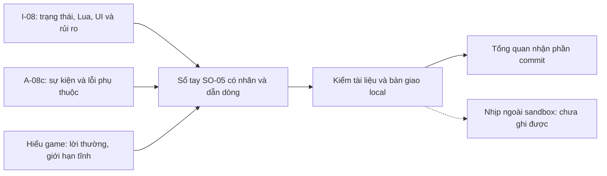

TÓM TẮT 1: [NGUỒN][THẤY] PARTIAL cho toàn bộ yêu cầu: nội dung sổ tay đã xong; tệp nhịp ngoài sandbox chưa ghi được; xem phần Lỗi và giới hạn trong báo cáo này.
TÓM TẮT 2: [NGUỒN][THẤY] Đã tổng hợp 3/3 nguồn thành 8/8 phần về lưu trạng thái, Lua, đọc script, sự kiện và lỗi nạp (`JX1_OPS/DESIGN/SO-TAY-NHIEM-VU-LUA.md:38–51`).
TÓM TẮT 3: [NGUỒN][THẤY] Đầu ra là sổ tay mới, báo cáo SO-05 và mục Kết quả cuối task; không sửa ba tài liệu nguồn (`JX1_OPS/DESIGN/SO-TAY-NHIEM-VU-LUA.md:1–15`; `JX1_OPS/TASKS/SO-05.md:31–36`).
TÓM TẮT 4: [CHƯA KIỂM] Các kết luận về game là dẫn lại; không đọc lại source/PAK, không kiểm binding, DB/ABI hay runtime (`JX1_OPS/DESIGN/SO-TAY-NHIEM-VU-LUA.md:217–221`).
TÓM TẮT 5: [NGUỒN][THẤY] Chỉ kiểm tài liệu; không build, chạy test game, exe, VM, mạng, stage/commit/push; chưa có SHA, Tổng quan nhận bàn giao local để commit.

# SO-05 — Bàn giao sổ tay nhiệm vụ và Lua

Loại: tổng hợp
Chủ đề: Gộp ba nguồn được giao thành hướng dẫn có nhãn bằng chứng cho người không lập trình.
Từ khóa: nhiệm vụ, Lua, TASKSYS, GetTask, callback, daily, nạp script, SO-05
Trạng thái: PARTIAL — phần tài liệu hoàn tất; chưa thực hiện được nhịp tại đường dẫn ngoài vùng ghi.
Độ phủ: 3/3 nguồn, 8/8 phần sổ tay, 3/3 tệp bàn giao; 0/1 tệp nhịp ngoài worktree.
Liên quan: `JX1_OPS/TASKS/SO-05.md`; `JX1_OPS/DESIGN/CHUAN-BAO-CAO.md`; `JX1_OPS/DESIGN/SO-TAY-NHIEM-VU-LUA.md`; ba nguồn trong bảng bên dưới.
Cần tôi quyết định: không về nội dung; PM có thể tiếp nhận local và xử lý kênh nhịp trong phạm vi được phép.

## Phạm vi và độ phủ

| Phần tử được giao | Kết quả | Mức và nguồn |
|---|---|---|
| `JX1_OPS/REPORTS/I-08-he-thong-nhiem-vu.md` | Đã đọc, giữ nguyên; làm nguồn kho task, trạng thái, API và UI | THẤY/TÀI LIỆU — `JX1_OPS/REPORTS/I-08-he-thong-nhiem-vu.md:114–179,369–374` |
| `JX1_OPS/REPORTS/A-08c-lua-trai-nuong-ca.md` | Đã đọc, giữ nguyên; làm ví dụ sự kiện, callback và vướng mắc nạp | THẤY/TÀI LIỆU — `JX1_OPS/REPORTS/A-08c-lua-trai-nuong-ca.md:18–36,38–117` |
| `JX1_OPS/DESIGN/HIEU-GAME-CHO-NGUOI-KHONG-LAP-TRINH.md` | Đã đọc, giữ nguyên; dùng cách giải thích cho người không lập trình | THẤY — `JX1_OPS/DESIGN/HIEU-GAME-CHO-NGUOI-KHONG-LAP-TRINH.md:3–8,50–56` |
| Sổ tay `JX1_OPS/DESIGN/SO-TAY-NHIEM-VU-LUA.md` | Đã tạo đủ 8 phần, nhãn, Mermaid, giải mã tên và sổ thông số | THẤY — `JX1_OPS/DESIGN/SO-TAY-NHIEM-VU-LUA.md:1–232` |
| Báo cáo `JX1_OPS/REPORTS/SO-05.md` | Đã tạo theo yêu cầu trực tiếp | THẤY — báo cáo này |
| Mục Kết quả trong task | Đã bổ sung 5 dòng; giữ nguyên metadata và nội dung giao việc | THẤY — `JX1_OPS/TASKS/SO-05.md:31–36` |
| `D:\JX-wt\SO-05.nhip` | Chưa ghi — nằm ngoài root được phép ghi `D:\JX-wt\SO-05` | CHƯA KIỂM thao tác ghi; không thử vượt sandbox |

## Giải mã tên

**THẤY:** báo cáo bàn giao không thêm tên riêng kỹ năng, vật phẩm, NPC hoặc bản đồ. Bảng tên legacy được dẫn lại trong sổ tay, có nguyên dạng, encoding CP936/GBK và chữ Hán; chưa kiểm byte gốc ở SO-05 (`JX1_OPS/DESIGN/SO-TAY-NHIEM-VU-LUA.md:53–61`).

## Sắp theo cấu trúc game

**THẤY:** sổ tay sắp theo vòng tiến độ → nhóm nội dung → nhận/làm/trả → sự kiện → lỗi nạp → UI. Không chép nối báo cáo theo thứ tự file; không đổi kết luận khảo sát cũ (`JX1_OPS/DESIGN/SO-TAY-NHIEM-VU-LUA.md:63–105,107–197`).

## Kết quả nội dung

- **THẤY:** giải thích kho bền/tạm, bốn loại ID và rủi ro count BYTE có điều kiện; không gọi 10.000 khóa là 10.000 nhiệm vụ (`JX1_OPS/DESIGN/SO-TAY-NHIEM-VU-LUA.md:76–90`).
- **THẤY:** đủ tám nhóm nội dung; tách mẫu TASKSYS 0→1→2→3 khỏi trạng thái chính tuyến/random (`JX1_OPS/DESIGN/SO-TAY-NHIEM-VU-LUA.md:92–105`).
- **THẤY:** có bảng lời gọi Lua, hướng dẫn tám bước đọc, ví dụ daily, câu cá/lửa trại/nướng cá; chỉ dẫn tới callback, nhánh return và comment (`JX1_OPS/DESIGN/SO-TAY-NHIEM-VU-LUA.md:107–172`).
- **THẤY:** có tám vướng mắc nạp/phụ thuộc/hiển thị; phân biệt lỗi đọc file đã ghi nhận với nghi vấn runtime (`JX1_OPS/DESIGN/SO-TAY-NHIEM-VU-LUA.md:174–189`).
- **THẤY:** bảng 11 dòng thông số ghi đơn vị, ảnh hưởng, mức đổi và nguồn gián tiếp; không đề nghị giá trị mới (`JX1_OPS/DESIGN/SO-TAY-NHIEM-VU-LUA.md:199–215`).

## Đã xác minh

- **THẤY:** Git đầu lượt trả `## task/SO-05`, không có thay đổi local; sổ tay và báo cáo chưa tồn tại. Không làm lại sản phẩm cũ, không đổi nhánh.
- **THẤY:** đã đọc chuẩn báo cáo, task và sáu skill local được chỉ định; danh sách nguồn nghiệp vụ chỉ gồm đúng ba tệp ở mục Nguồn của task (`JX1_OPS/TASKS/SO-05.md:22–29`).
- **THẤY:** đã đọc lại đầu ra và thực hiện kiểm tài liệu cục bộ: UTF-8 không BOM, đúng năm dòng tóm tắt đầu file, đủ mục bắt buộc, hàng bảng, khối Mermaid, đích mục lục và dải dòng dẫn tới nguồn. Kết quả cụ thể ghi trong phần Kiểm tra bên dưới.
- **TÀI LIỆU:** bằng chứng game vẫn dẫn gián tiếp qua ba nguồn; không nhận đã mở lại source server/client (`JX1_OPS/DESIGN/SO-TAY-NHIEM-VU-LUA.md:17–23,217–221`).

## Chưa xác minh

- **CHƯA KIỂM:** chưa build, compile Lua, test game, DB round-trip, ABI, PAK, binding hay bản triển khai; chưa chạy VM/exe/mạng. Những phần này nằm ngoài quyền task (`JX1_OPS/TASKS/SO-05.md:25–29`; `JX1_OPS/DESIGN/SO-TAY-NHIEM-VU-LUA.md:217–221`).
- **CHƯA KIỂM:** không xem toàn bộ kho script hoặc đếm nhiệm vụ hoạt động; không mở Graphify/GS001-MAP hay root source vì task Q-51 giới hạn ba nguồn. Skill đọc server/client được áp dụng ở ranh giới bằng chứng, không mở rộng quyền đọc.
- **CHƯA KIỂM:** tệp nhịp ngoài worktree chưa được ghi; không có commit SHA hoặc bằng chứng push vì không thực hiện các thao tác đó.

## Kiểm tra tài liệu thực chạy

| Phép kiểm | Kết quả | Giới hạn |
|---|---|---|
| Đọc lại tệp mới bằng UTF-8; kiểm BOM và U+FFFD | Đạt ở 3 tệp bàn giao | Không kiểm mã hóa byte source game |
| Tóm tắt đầu file, metadata, Mermaid và mục bắt buộc | Đạt ở sổ tay và báo cáo | Kiểm cấu trúc Markdown, chưa render Mermaid bằng trình duyệt |
| Đếm độ phủ và bảng | Sổ tay: 8 phần phạm vi, 8 nhóm nội dung, 12 nhóm lời gọi, 8 bước đọc, 8 vướng mắc, 11 dòng thông số | Số hàng hướng dẫn, không phải số nhiệm vụ |
| Kiểm file và dải dòng tham chiếu | Đạt; chỉ dùng ba nguồn đã đọc và ba tệp bàn giao | Không đối chiếu lại source được báo cáo dẫn |
| Kiểm mục lục nội bộ | Đạt: đủ 8 đích theo tiêu đề | Chưa mở trình xem Markdown |
| Đọc diff cuối | Đúng 3 tệp: 2 tệp mới và 1 mục Kết quả task | Không stage/commit/push |
| Build/test game/VM/exe/mạng | Chưa chạy theo quyền task | Không công bố PASS runtime |

## Lỗi, cách thử và kết quả

| Lỗi/giới hạn | Cách xử lý trong lượt | Kết quả và bước tiếp |
|---|---|---|
| Lần đọc đầu PowerShell dùng encoding mặc định làm lỗi dấu | Đọc lại chuẩn/task bằng UTF-8 và đặt đầu ra console UTF-8 | Đọc được dấu; không sửa file nguồn để chữa hiển thị |
| Đầu ra ba lệnh gộp bị cắt | Thu nhỏ đoạn I-08 chưa nhận đủ xuống 130–180 dòng/lượt | Đã nhận đủ nội dung I-08 tới dòng 374; không dựa đoạn bị cắt để viết |
| `rg` không được nhận diện | Thử một lần, chuyển Select-String/Get-Content trên tên tệp cụ thể | Định vị và kiểm tra hoàn tất; không cài công cụ |
| Lần kiểm dẫn dòng đầu phát hiện dải 33–38 vượt task chỉ có 36 dòng | Đọc đoạn Kết quả thực tế, sửa hai dẫn chiếu thành 31–36 | Đã sửa tại chỗ; kiểm lại toàn bộ dẫn dòng trước bàn giao |
| Đường nhịp nằm ngoài sandbox cho phép ghi | Đối chiếu root quyền đã cấp; không thử lách hoặc đổi sandbox | Chưa ghi được nhịp; ghi rõ tại đây để PM tiếp nhận |
| Chuẩn chung yêu cầu `REPORTS/_CHIMUC/SO-05.tsv`, nhưng ngoài vùng tệp giao riêng | Không tạo tệp chỉ mục ngoài phạm vi; đặt hàng đề xuất ngay trong báo cáo | PM gộp vào mục lục/chỉ mục khi được phép; không chặn phần sổ tay |

### Mốc tiến độ thay cho tệp nhịp bị chặn

| Mốc lớn | Giờ ghi nhận | Ước tính | Trạng thái |
|---|---|---|---|
| Bắt đầu, kiểm Git và đọc chuẩn/task | Không lưu giờ tại mốc này | 5% | Đã thông báo ngay khi bắt đầu; chưa ghi `.nhip` |
| Đọc xong ba nguồn và sáu skill | Không lưu giờ tại mốc này | 40% | Đã thông báo; chưa ghi `.nhip` |
| Xong bản thảo sổ tay | 2026-11-19 00:32:37 +07:00 | 80% | Giờ lấy bằng Get-Date; sổ tay có 232 dòng |
| Sắp xong, ghi báo cáo và kiểm cuối | 2026-11-19 00:35:08 +07:00 | 95% | Giờ lấy bằng Get-Date; đang kiểm dẫn dòng và phạm vi bàn giao; chưa ghi `.nhip` |

## Bàn giao

**THẤY:** chỉ tạo sổ tay và báo cáo, bổ sung mục Kết quả task theo yêu cầu trực tiếp. Không đổi metadata task, không sửa nguồn hoặc `docs-analysis/BAI_HOC.md`; không tạo chỉ mục ngoài phạm vi. Phần nội dung đạt DONE; toàn yêu cầu giữ PARTIAL chỉ vì kênh nhịp chưa thực hiện được.

Commit SHA: chưa có; không stage/commit theo yêu cầu “Tổng quan commit hộ”. Push: chưa thực hiện; không có bằng chứng GitHub. Git không gặp lỗi ghi/commit vì không thử commit; hạn chế sandbox nêu trên chỉ liên quan tệp nhịp.

**TÀI LIỆU — bước tiếp theo:** Tổng quan tiếp nhận ba tệp local để kiểm và commit; kiểm runtime chỉ khi có task riêng. Các ca count DB, binding, thưởng/túi và gói tin đã được I-08 đề nghị, chưa chạy trong SO-05 (`JX1_OPS/DESIGN/SO-TAY-NHIEM-VU-LUA.md:223–226`).

Hàng đề xuất cho PM gộp `JX1_OPS/DESIGN/MUC-LUC-TRI-THUC.md` và chỉ mục (chưa sửa hai đích):

| file | loại | chủ đề | từ khóa | trạng thái | độ phủ | liên quan |
|---|---|---|---|---|---|---|
| `JX1_OPS/DESIGN/SO-TAY-NHIEM-VU-LUA.md` | tổng hợp | Sổ tay nhiệm vụ và Lua | nhiệm vụ; Lua; TASKSYS; GetTask; callback; daily; nạp script | DONE phần tài liệu | 3/3 nguồn; 8/8 phần; runtime chưa kiểm | I-08; A-08c; HIEU-GAME-CHO-NGUOI-KHONG-LAP-TRINH |

Kỹ năng đã dùng: jx1-retrofit, jx1-read-server, jx1-read-client, jx1-parameters, jx1-knowledge, jx1-report — đã nạp từ `.agents/skills`; các bước đọc source/mục lục ngoài ba nguồn được giao không thực hiện theo phạm vi task.
