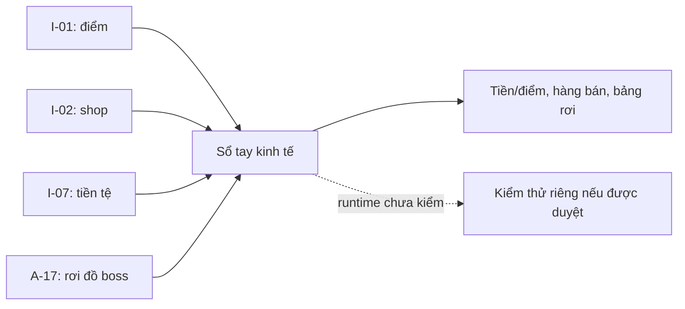

TÓM TẮT 1/5 — [NGUỒN] Đã gộp bốn báo cáo nguồn thành sổ tay tĩnh về tiền/điểm, cửa hàng và rơi đồ boss.
TÓM TẮT 2/5 — [NGUỒN] Đầu ra chính: `JX1_OPS/DESIGN/SO-TAY-KINH-TE.md`; các kết luận cũ được giữ và dẫn nguồn theo `file:dòng`.
TÓM TẮT 3/5 — [NGUỒN] Đã phân biệt các số dư, thống kê nhóm shop và bảng rơi; ghi riêng các điểm chưa xác minh.
TÓM TẮT 4/5 — [CHƯA KIỂM] Dữ liệu runtime và ghi chú Goddess/Berkeley DB chưa kiểm chứng độc lập.
TÓM TẮT 5/5 — [CHƯA KIỂM] Không build/exe/VM/game/mạng; chưa commit/push; không ghi được `D:\JX-wt\SO-06.nhip` do bị từ chối quyền ghi ngoài worktree.

# SO-06 — Sổ tay hiểu game: kinh tế

Loại: tổng hợp
Chủ đề: Gộp tài liệu về tiền/điểm, cửa hàng và bảng rơi đồ boss cho người đọc không lập trình.
Từ khóa: kinh tế, tiền tệ, XU, bạc, Kỳ Trân, cửa hàng, rơi đồ boss, Goddess
Trạng thái: DONE — hoàn tất tổng hợp tĩnh theo phạm vi task.
Độ phủ: đã phủ 4 trên 4 báo cáo nguồn và đủ 3 chủ đề task yêu cầu; runtime chưa xác minh.
Liên quan: I-01, I-02, I-07, A-17, `JX1_OPS/DESIGN/SO-TAY-KINH-TE.md`.
Cần tôi quyết định: không.

## Phạm vi và độ phủ

| Nguồn/phần tử | Trạng thái | Nội dung đã đưa vào sổ tay |
|---|---|---|
| `I-01-cac-loai-diem.md` | Đã phủ | Các nhóm điểm và giới hạn ghi nhận; điểm hoạt động/HuoYueDu vẫn chưa xác định đầy đủ. |
| `I-02-vat-pham-ban.md` | Đã phủ | Số liệu hàng hóa/shop, bốn loại shop Bảo vật, ví dụ giá và điều kiện mua. |
| `I-07-cac-loai-tien-te.md` | Đã phủ | Bạc túi/rương, XU, điểm nạp, danh vọng, phúc duyên, vinh dự, Tống Kim và các mục chưa định danh. |
| `A-17-roi-do-boss-trang-bi.md` | Đã phủ | Số lượng bảng, ví dụ Count/RandRate và giới hạn việc suy ra rơi đồ runtime. |
| Goddess dùng Berkeley DB | Chưa kiểm độc lập | Ghi chú được giữ theo yêu cầu task; báo cáo I-07 chỉ nêu chưa lần luồng lưu qua PaySys/Goddess. |

## Giải mã tên

Các tên dưới đây được giữ theo chính tả UTF-8 trong báo cáo nguồn. Chưa mở lại dữ liệu nhị phân/legacy để kiểm encoding gốc; tên tiếng Anh và mã shop giữ nguyên.

| Tên gốc trong báo cáo | Mã hóa ghi nhận | Chữ đúng / cách hiểu | Nguồn file:dòng |
|---|---|---|---|
| Goddess | ASCII trong task/báo cáo | Goddess; nền tảng được nhắc trong task | `JX1_OPS/TASKS/SO-06.md:19`; `I-07-cac-loai-tien-te.md:146` |
| Berkeley DB | ASCII | Berkeley DB; task yêu cầu ghi nhận như công nghệ lưu dữ liệu, chưa kiểm độc lập | `JX1_OPS/TASKS/SO-06.md:19` |
| Kỳ Trân | UTF-8 trong báo cáo | Kỳ Trân | `I-02-vat-pham-ban.md:84` |
| Hoạt Động | UTF-8 trong báo cáo | Hoạt Động | `I-02-vat-pham-ban.md:85` |
| Thư Tịch | UTF-8 trong báo cáo | Thư Tịch | `I-02-vat-pham-ban.md:86` |
| Chiến Mã | UTF-8 trong báo cáo | Chiến Mã | `I-02-vat-pham-ban.md:87` |
| Kim Nguyên Bảo | UTF-8 trong báo cáo | Kim Nguyên Bảo | `I-07-cac-loai-tien-te.md:100` |
| HuoYueDu | ASCII trong báo cáo | Tên/nhãn kỹ thuật của điểm hoạt động chưa xác định đầy đủ | `I-01-cac-loai-diem.md:91–99`; `I-07-cac-loai-tien-te.md:43` |
| Tống Kim | UTF-8 trong báo cáo | Tên hệ điểm/hoạt động; nguồn thưởng chưa xác minh đầy đủ | `I-07-cac-loai-tien-te.md:101; 211–212` |
| Kim Sáng Dược (tiểu) | UTF-8 trong báo cáo; encoding gốc chưa kiểm | Tên hàng ghi trong báo cáo | `I-02-vat-pham-ban.md:95` |
| Bạch Câu Hoàn | UTF-8 trong báo cáo; encoding gốc chưa kiểm | Tên hàng ghi trong báo cáo | `I-02-vat-pham-ban.md:96` |
| Phù vô hạn | UTF-8 trong báo cáo; encoding gốc chưa kiểm | Tên hàng ghi trong báo cáo | `I-02-vat-pham-ban.md:97` |
| Lam Thủy Tinh | UTF-8 trong báo cáo; encoding gốc chưa kiểm | Tên hàng ghi trong báo cáo | `I-02-vat-pham-ban.md:98` |
| Lệnh bài Phong Lăng Độ | UTF-8 trong báo cáo; encoding gốc chưa kiểm | Tên hàng ghi trong báo cáo | `I-02-vat-pham-ban.md:99` |
| Đạt Ma Độ Giang | UTF-8 trong báo cáo; encoding gốc chưa kiểm | Tên mẫu của bí kíp được nêu | `I-02-vat-pham-ban.md:100` |
| Tống Kim Chiến Cổ | UTF-8 trong báo cáo; encoding gốc chưa kiểm | Tên hàng đổi bằng điểm Tống Kim | `I-02-vat-pham-ban.md:101` |
| Bạch Mã | UTF-8 trong báo cáo; encoding gốc chưa kiểm | Tên hàng trong ví dụ shop ngựa | `I-02-vat-pham-ban.md:102` |
| `boss_tieu` | Tên mã ASCII | Tên script/nhóm boss giữ nguyên | `A-17-roi-do-boss-trang-bi.md:76–78` |

## Sắp theo cấu trúc game

Phạm vi này không chia theo phái/bản đồ. Dữ liệu được sắp theo luồng kinh tế: (1) số dư và điểm, (2) cửa hàng và hàng hóa, (3) bảng rơi đồ boss, sau đó là giới hạn/chưa kiểm. Cấu trúc này giúp tách nguồn nhận/lưu khỏi nơi tiêu và vật phẩm nhận được.

| Thứ tự game | Nhánh | Nội dung đã sắp | Nguồn |
|---:|---|---|---|
| 1 | Ví và số dư | Bạc túi → bạc rương; XU; `ExtPoint`; danh vọng; phúc duyên; vinh dự/task 2051; Tống Kim/task 192; điểm chưa định danh. | `I-07-cac-loai-tien-te.md:79–88; 211–212` |
| 2 | Cửa hàng | Shop NPC và bốn danh mục Bảo vật → nhóm hàng → ví dụ hàng hóa/giá/loại tiền. | `I-02-vat-pham-ban.md:78–121` |
| 3 | Rơi đồ | Tập tệp INI và số slot → ví dụ bảng → đường gắn bảng hoặc death script riêng. | `A-17-roi-do-boss-trang-bi.md:37–78` |
| 4 | Giới hạn | Những mục CHƯA KIỂM: runtime, giá hiệu lực, giới hạn mua, số dư hoạt động và bảng boss thật sự dùng. | `I-01-cac-loai-diem.md:158–166; I-02-vat-pham-ban.md:180–186; I-07-cac-loai-tien-te.md:138–146; A-17-roi-do-boss-trang-bi.md:18; 138–155` |

## Nội dung tổng hợp và bằng chứng

Sổ tay chính ở `JX1_OPS/DESIGN/SO-TAY-KINH-TE.md`. Trong đó mọi nhóm tiền/điểm, ví dụ shop và số liệu bảng rơi đều có nhãn và dẫn chiếu về báo cáo nguồn. Các số liệu gốc gồm 1.464 hàng goods, 474 ID tham chiếu duy nhất và phân bố loại tiền 334/115/25; bảng rơi có 201 tệp INI, 194 bảng có Count dương và 7 bảng Count bằng 0. [I-02:65–73; A-17:43–47]

### MỤC SỔ THÔNG SỐ

| Nhóm | Tên/thông số | Nguồn file:dòng | Giá trị | Đơn vị | Ảnh hưởng/ghi chú | Đổi an toàn | Nguồn đo |
|---|---|---|---:|---|---|---|---|
| Cửa hàng | Hàng goods | `I-02-vat-pham-ban.md:65` | 1.464 | dòng | Số hàng dữ liệu; không phải số hàng được shop tham chiếu. | CẨN THẬN | Báo cáo khảo sát tĩnh |
| Cửa hàng | ID được tham chiếu | `I-02-vat-pham-ban.md:68` | 474 | ID duy nhất | 2.644 ô tham chiếu trong cấu hình shop. | CẨN THẬN | Báo cáo khảo sát tĩnh |
| Cửa hàng | Giá để trống | `I-02-vat-pham-ban.md:71–73` | 312 | ID | Không đồng nghĩa miễn phí; cần xem template/giá kế thừa. | CẨN THẬN | Báo cáo khảo sát tĩnh |
| Cửa hàng | Shop Bảo vật | `I-02-vat-pham-ban.md:82–87` | 4 shop / 62 | shop / món tham chiếu | Bốn danh mục: Kỳ Trân, Hoạt Động, Thư Tịch, Chiến Mã. | CẨN THẬN | Báo cáo khảo sát tĩnh |
| Rơi đồ | Tệp INI | `A-17-roi-do-boss-trang-bi.md:43–45` | 201 | tệp | Gồm bảng thường, boss và sự kiện. | CẨN THẬN | Báo cáo khảo sát tĩnh |
| Rơi đồ | `Main.Count` | `A-17-roi-do-boss-trang-bi.md:44–45` | 194 / 7; tổng 10.734 | tệp / slot | Slot khai báo không đồng nghĩa món hợp lệ hoặc rơi ra. | CẨN THẬN | Báo cáo khảo sát tĩnh |

### ĐỀ XUẤT TỐI ƯU

- Giữ nhãn từng đơn vị tiền/điểm tách biệt trong tài liệu và khi kiểm thử; đặc biệt không gộp XU với `ExtPoint` hoặc vinh dự.
- Nếu cần xác nhận runtime, tester dùng bản thử được duyệt để ghi số dư trước/sau khi mua, nạp/rút, giao dịch và khi nhận vật phẩm; ghi rõ phiên bản dữ liệu.
- Kiểm tra riêng bảng rơi thực sự được từng boss gắn và callback death script; không đổi `RandRate` thành tỷ lệ thực nghiệm nếu chưa đo.

## ĐÃ XÁC MINH

- Đã đối chiếu đủ bốn báo cáo do task chỉ định và ghi lại phạm vi/giới hạn tương ứng; bằng chứng gián tiếp được dẫn theo `file:dòng` trong sổ tay.
- Đã phân biệt XU, `ExtPoint`, bạc túi/rương, danh vọng, phúc duyên, vinh dự/task 2051, Tống Kim/task 192 và các khoản chưa xác minh theo ma trận I-07. [I-07:79–88; 211–212]
- Đã ghi rõ danh mục Bảo vật và thống kê tĩnh các bảng rơi, không suy ra hoạt động runtime từ tên tệp hoặc cấu hình. [I-02:82–87; A-17:43–57]

## CHƯA XÁC MINH

- Chưa xác minh runtime, binary/dữ liệu đang triển khai, giá hiệu lực cho các hàng có giá trống, giới hạn mua toàn hệ thống, số dư điểm hoạt động, và bảng rơi thực tế của từng boss.
- Ghi chú Goddess/Berkeley DB được đưa vào theo yêu cầu task nhưng chưa có bằng chứng độc lập trong bốn báo cáo nguồn. [SO-06:19; I-07:146]
- Không chạy build, exe, VM, game, test runtime hay mạng theo phạm vi đã duyệt.

## Bàn giao

- Đã tạo `JX1_OPS/DESIGN/SO-TAY-KINH-TE.md`, báo cáo này, chỉ mục `JX1_OPS/REPORTS/_CHIMUC/SO-06.tsv` và mục kết quả ở cuối task.
- Chưa commit/push; task không yêu cầu commit và người dùng cấm mạng. Không có SHA.
- Checkpoint ngoài worktree `D:\JX-wt\SO-06.nhip` không ghi được: hệ thống từ chối quyền ghi. Không thử vượt giới hạn bằng đường dẫn/công cụ khác.
- `jx1-retrofit`, `jx1-parameters`, `jx1-knowledge`, `jx1-report` đã áp dụng; `jx1-read-server`, `jx1-read-client` đã đọc và không dùng để mở rộng nguồn sang mã vì task giao bốn báo cáo tĩnh.
- Kỹ năng đã dùng: jx1-retrofit, jx1-read-server, jx1-read-client, jx1-parameters, jx1-knowledge, jx1-report.

## Trạng thái

DONE — hoàn tất tài liệu tĩnh; không xác nhận hành vi runtime.
