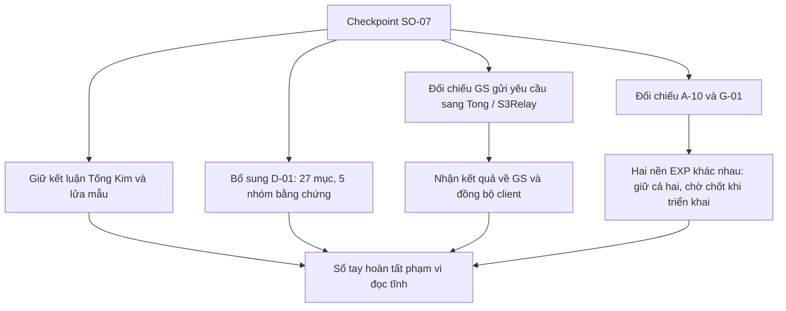

TÓM TẮT 5 DÒNG
1. [NGUỒN] DONE phạm vi tài liệu SO-07: tiếp tục checkpoint, trả lời đủ 4/4 nhóm câu hỏi; giữ nguyên bốn báo cáo nền (`JX1_OPS/TASKS/SO-07.md:19–30`).
2. [NGUỒN] Đã đối chiếu 27 mục/nhánh và năm nhóm bằng chứng 0/24/1/1/1; bổ sung đường GS ↔ Tong/S3Relay (`JX1_OPS/REPORTS/D-01-bang-hoat-dong.md:29–35,62–88`; `MS/KSOServer.cpp:6084–6120,2163–2179`).
3. [NGUỒN] Đầu ra `JX1_OPS/DESIGN/SO-TAY-TONG-KIM-BANG-HOI.md`; giữ riêng hai đề xuất nền EXP A-10/G-01, không chốt thay chủ dự án (`JX1_OPS/REPORTS/A-10-lua-trai-boss.md:69`; `JX1_OPS/REPORTS/G-01-campfire-design.md:58`).
4. [CHƯA KIỂM] Chưa commit/push theo yêu cầu; PM tổng hợp. File nhịp ở ngoài vùng ghi nên chưa ghi trong lượt này; không đổi quyền hay tạo file thay thế.
5. [CHƯA KIỂM] Không build, chạy exe, VM, mạng, test game hay đo runtime; chỉ đọc tĩnh và kiểm tra tài liệu (`JX1_OPS/TASKS/SO-07.md:27–30`).

# SO-07 — Báo cáo tổng hợp Tống Kim, bang hội và hoạt động

Loại: tổng hợp
Chủ đề: Hoàn thiện sổ tay Tống Kim, bang hội, hoạt động và lửa trại/boss từ checkpoint có sẵn.
Từ khóa: Tống Kim, battlesongjin, bang hội, S3Relay, Tong, hoạt động, campfire, boss, SO-07
Trạng thái: DONE — đủ phạm vi sổ tay đọc tĩnh; nhịp ngoài worktree chưa ghi được theo giới hạn vùng ghi.
Độ phủ: trả lời 4/4 nhóm câu hỏi, đọc đủ 4/4 báo cáo nguồn, dẫn đủ 27/27 mục D-01; số hoạt động chạy được chưa đếm được vì không thử game.
Liên quan: `JX1_OPS/REPORTS/A-16-tong-kim.md`, `JX1_OPS/REPORTS/D-01-bang-hoat-dong.md`, `JX1_OPS/REPORTS/G-01-campfire-design.md`, `JX1_OPS/REPORTS/A-10-lua-trai-boss.md`, `JX1_OPS/DESIGN/SO-TAY-TONG-KIM-BANG-HOI.md`.
Cần tôi quyết định: có — trước triển khai lửa trại cần chốt nền tính EXP, nghĩa x2, người nhận và nguồn kích hoạt; không chặn hoàn tất tài liệu.



## Phạm vi và độ phủ

| Phần tử | Độ phủ | Mức chắc / bằng chứng |
|---|---|---|
| Tống Kim — A-16 | Đã phủ, giữ kết luận cũ | [TÀI LIỆU] mission 11/TNL, 100 người/phe, chênh quân 2, nhánh cũ khác giới hạn; [THẤY] 10 hạng giao diện (`JX1_OPS/REPORTS/A-16-tong-kim.md:40–56,74–90`; `C/gamecore/GameDataDef.h:428`). |
| Bang hội — đối chiếu source GS | Đã phủ đường giao tiếp | [THẤY] GS kiểm điều kiện, gửi tạo bang sang Tong/S3Relay, nhận phản hồi về core; chưa xác nhận lưu bền (`MS/KSOServer.cpp:6084–6120,2163–2179`; `S/CoreServerShell.cpp:1972–1998`; `S/KPlayer.cpp:10923–10927`; `S/KPlayerTong.cpp:264–292,305–317`). |
| Hoạt động — D-01 | Đã phủ 27/27 mục | [TÀI LIỆU] năm nhóm bằng chứng 0/24/1/1/1; bảng sổ tay giữ ID và xếp theo cách chơi (`JX1_OPS/REPORTS/D-01-bang-hoat-dong.md:29–35,60–88`). |
| Lửa trại/boss — A-10 | Đã phủ ở mức khảo sát nền | [THẤY] điểm móc C++ khi chết; [TÀI LIỆU] lửa mẫu và các mắt xích thiếu, không nhận boss đã sinh lửa (`S/KNpc.cpp:2590–2635`; `JX1_OPS/REPORTS/A-10-lua-trai-boss.md:41–73`). |
| Lửa trại — G-01 | Đã phủ thiết kế và khác biệt | [TÀI LIỆU] 120 giây logic, tối đa 120 lượt, x2 combat, EXP tiến độ cấp; khác A-10 dùng ngưỡng cấp (`JX1_OPS/REPORTS/G-01-campfire-design.md:54–79`; `JX1_OPS/REPORTS/A-10-lua-trai-boss.md:69,73`). |

## Giải mã tên

| Tên gốc / định danh | Mã hóa | Chữ đúng / giới hạn | Nguồn file:dòng |
|---|---|---|---|
| `battlesongjin` | ASCII | [TÀI LIỆU] Tống Kim | `JX1_OPS/REPORTS/A-16-tong-kim.md:40` |
| `S3relay`, `Tong` | ASCII | [THẤY] Đường dịch vụ bang hội S3Relay/Tong; chưa xác nhận lưu bền | `MS/KSOServer.cpp:1162–1170,6118–6120` |
| `OnGoldDeath` | ASCII tên hàm | [THẤY] Callback khi quái chết trong nhánh người chơi hạ | `S/KNpc.cpp:2618–2623` |
| `2078`, `1705`, `1706` | ID số | [CHƯA KIỂM] NPC lửa/skill lửa theo A-10; tên hiển thị gốc chưa giải mã | `JX1_OPS/REPORTS/A-10-lua-trai-boss.md:50,65,85` |
| `óô»ð.lua` / `篝火.lua` | Tên vật lý lỗi mã hóa / tên Hán logic GBK theo A-10 | [TÀI LIỆU] Lửa trại; giữ nguyên tên, loader chưa kiểm | `JX1_OPS/REPORTS/A-10-lua-trai-boss.md:25,31` |

[TÀI LIỆU] Bảng tên đầy đủ của 27 mục đặt trong sổ tay; không tái giải mã byte script trong SO-07. Markdown UTF-8, source server legacy CP936/GBK; không suy TCVN3 từ chữ Việt chưa có byte gốc (`JX1_OPS/REPORTS/D-01-bang-hoat-dong.md:25–27`; `JX1_OPS/REPORTS/A-10-lua-trai-boss.md:31`).

## Sắp theo cấu trúc game

[TÀI LIỆU] Sổ tay đi từ chiến trường Tống Kim → bang hội → hoạt động theo cách chơi → boss/lửa. Bảng hoạt động nhóm chiến trường, hành trình/cửa ải, sự kiện/boss, sinh hoạt/thưởng và nhánh chưa nối được; giữ ID gốc để kiểm độ phủ. Đây là cách trình bày, không đổi phân loại nguồn (`JX1_OPS/REPORTS/D-01-bang-hoat-dong.md:60–88`).

## Nguồn đã dùng và giới hạn

- Danh sách đọc chính được chốt từ mục Nguồn của task: A-16, D-01, G-01, A-10; không đọc tràn các báo cáo khác (`JX1_OPS/TASKS/SO-07.md:23–25`). Chuẩn báo cáo và sáu skill được đọc theo yêu cầu. Mục lục tri thức và GS001-MAP chỉ tra dòng theo chủ đề để định vị theo skill, không dùng thay source.
- `S/` = `C:/Jx1CocoV3/SwordOnline/SwordOnline/jxOnline/gameserver/Sources/Core/Src/`; `MS/` = cùng gốc `Sources/MultiServer/GameServer/`; `C/` = `C:/Jx1CocoV3/Folder/Client2912-20260116T044348Z-3-001/Client2912/Client/Classes/`. Đây là các gốc đọc được task cho phép (`JX1_OPS/TASKS/SO-07.md:25`).
- Chỉ mở/search có mục tiêu các file KPlayerTong.cpp/.h, KCore.cpp/.h, CoreServerShell.cpp, KPlayer.cpp, KNpc.cpp, KSOServer.cpp/.h, GameServer.cpp, GameDataDef.h và KuiCometoMapVN.cpp. Không đọc toàn cây, không dùng Graphify exe.
- [TÀI LIỆU] Các script/settings GS dẫn trong sổ tay là kết quả của báo cáo nền, không phải lượt đọc trực tiếp SO-07. Root source G-01/A-16 khác root S; không tự coi offset hoặc binary là tương đương (`JX1_OPS/REPORTS/A-16-tong-kim.md:11–14`; `JX1_OPS/REPORTS/G-01-campfire-design.md:18–27`).

## ĐÃ XÁC MINH / TÀI LIỆU

- [THẤY] `MISSION_STATNUM=10` và vòng vẽ dùng hằng số đó; chỉ là số hạng hiển thị (`C/gamecore/GameDataDef.h:428`; `C/vn/gameui/KuiCometoMapVN.cpp:1396–1405`).
- [THẤY] GS kiểm yêu cầu tạo bang, gửi `pf_tong/enumC2S_TONG_CREATE` qua Tong và nhận phản hồi thành công. Chữ “S3relay” nằm trong câu log source; chưa chạy để thu log (`MS/KSOServer.cpp:6084–6120,2163–2179`).
- [THẤY] Kết quả tạo bang được core kiểm nhân vật rồi gọi `CreateTong`; phần bang hội có dữ liệu nhân vật và gói đồng bộ client (`S/CoreServerShell.cpp:1972–1998`; `S/KPlayer.cpp:10923–10927`; `S/KPlayerTong.cpp:264–292,305–317`).
- [THẤY] C++ có nhánh gọi `OnGoldDeath` khi người chơi hạ quái; nhánh đồng bạn gọi script khác. Không tự suy có lửa từ điểm móc (`S/KNpc.cpp:2590–2635`).
- [TÀI LIỆU] Đếm trực tiếp bảng Markdown D-01: 27 dòng, 27 ID khác nhau; phân bố 24/1/1/1 ở bốn nhóm có phần tử, cộng nhóm đầy đủ 0 thành năm nhóm. Đây là kiểm đếm tài liệu, không phải chạy 27 hoạt động (`JX1_OPS/REPORTS/D-01-bang-hoat-dong.md:29–35,62–88`).

## CHƯA XÁC MINH

- [CHƯA KIỂM] Binary/script thực nạp, lịch/map Tống Kim đang dùng; tổng hoạt động toàn game và số chơi được (`JX1_OPS/REPORTS/A-16-tong-kim.md:92–98`; `JX1_OPS/REPORTS/D-01-bang-hoat-dong.md:90–97`).
- [CHƯA KIỂM] Triển khai phía tiến trình S3Relay, nơi lưu bền, phục hồi và thao tác bang hội thực tế; lượt này chỉ đọc phía GS (`MS/KSOServer.cpp:6118–6120,2163–2179`; `JX1_OPS/TASKS/SO-07.md:25,27–30`).
- [TÀI LIỆU] A-10 đề xuất thưởng theo `GetNextExp()`; G-01 theo `m_nExp/GetExp()`. Nghĩa x2 và luật người nhận/nguồn kích hoạt cũng chưa có quyết định chung. SO-07 ghi cả hai, không sửa kết luận nguồn (`JX1_OPS/REPORTS/A-10-lua-trai-boss.md:46,69,73,87`; `JX1_OPS/REPORTS/G-01-campfire-design.md:57–63,111`).
- [TÀI LIỆU] A-10 tìm thấy lửa mẫu; G-01 không tìm thấy bằng từ khóa ở khảo sát khác. Chênh lệch phạm vi tìm/root được ghi rõ, không chuyển thành khẳng định game không có lửa (`JX1_OPS/REPORTS/A-10-lua-trai-boss.md:22–31,50–65`; `JX1_OPS/REPORTS/G-01-campfire-design.md:18–27`).
- [CHƯA KIỂM] Không build/test game, benchmark, Lua compiler, exe/VM/mạng theo task (`JX1_OPS/TASKS/SO-07.md:27–30`).

## MỤC SỔ THÔNG SỐ

| Nhóm | Tên/hằng số | file:dòng | Giá trị | Đơn vị | Ảnh hưởng | Đổi an toàn | Nguồn đo |
|---|---|---|---|---|---|---|---|
| Tống Kim TNL | Trần phe / chênh quân | `JX1_OPS/REPORTS/A-16-tong-kim.md:44–46` | 100 / 2 | người/phe / người chênh trước khi vào | Chặn đăng ký | CẨN THẬN | [TÀI LIỆU] Đọc A-16; chưa đọc lại script/runtime |
| Chiến báo | MISSION_STATNUM | `C/gamecore/GameDataDef.h:428`; `C/vn/gameui/KuiCometoMapVN.cpp:1396` | 10 | hạng hiển thị | Dung lượng/vòng vẽ chiến báo | CẨN THẬN | [THẤY] Đọc source client, không phải trần người tham chiến |
| Kiểm kê | Số mục/nhánh D-01 | `JX1_OPS/REPORTS/D-01-bang-hoat-dong.md:62–88` | 27 | mục khảo sát | Độ phủ tài liệu, không phải cấu hình | KHÔNG áp dụng | [TÀI LIỆU] Đếm lại bảng Markdown; chưa đo game |
| Kiểm kê | Năm nhóm theo thứ tự D-01 | `JX1_OPS/REPORTS/D-01-bang-hoat-dong.md:31–35` | 0 / 24 / 1 / 1 / 1 | mục mỗi nhóm | Phân loại mức bằng chứng | KHÔNG áp dụng | [TÀI LIỆU] Đối chiếu bảng |
| Lửa mẫu | NPC / skill | `JX1_OPS/REPORTS/A-10-lua-trai-boss.md:50,65` | 2078 / 1705, 1706 | ID | Liên kết hiệu ứng còn thiếu | CẨN THẬN | [TÀI LIỆU] Khảo sát A-10; chưa đối chiếu bảng gốc/runtime |
| Lửa mẫu | Thời hạn item / task | `JX1_OPS/REPORTS/A-10-lua-trai-boss.md:56–58` | 1800 / 3600 | giây theo nhịp game | Khác nhau theo đường tạo; có gia hạn | CẨN THẬN | [TÀI LIỆU] Giá trị khảo sát cũ, không phải thời hạn lửa boss |
| Lửa mới G-01 | Thời hạn / chu kỳ / số lượt tối đa | `JX1_OPS/REPORTS/G-01-campfire-design.md:56,59,69–76` | 120 / 1 / 120 | giây logic / giây logic / lượt | Thiết kế vòng đời và chống trùng | CẨN THẬN | [TÀI LIỆU] Đề xuất, chưa triển khai/đo đồng hồ |
| Lửa mới | Nền thưởng 0,5% | `JX1_OPS/REPORTS/A-10-lua-trai-boss.md:69`; `JX1_OPS/REPORTS/G-01-campfire-design.md:58` | A-10: floor(GetNextExp()/200); G-01: floor(max(0,m_nExp)/200) | EXP/lượt theo hai đề xuất | Kết quả khác nhau; chưa chốt | CẨN THẬN | [TÀI LIỆU] Không đo, không thay dữ liệu thiếu bằng 0 |

## ĐỀ XUẤT TỐI ƯU

[TÀI LIỆU] Trước task triển khai riêng, PM chốt nền EXP, nghĩa x2 và người nhận/nguồn kích hoạt theo khác biệt đã nêu. G-01 đề xuất bộ điều phối riêng, chống nhận trùng và xét cùng khu vực bản đồ; chưa có benchmark để nhận tối ưu đã đạt (`JX1_OPS/REPORTS/G-01-campfire-design.md:54–79,111,127–146`). Không sửa cấu hình/source trong SO-07.

## Phát hiện khi chuẩn hóa và lỗi/cách thử/kết quả

| Lỗi hoặc thiếu ở checkpoint/lượt tiếp tục | Cách xử lý và kết quả |
|---|---|
| Checkpoint để bang hội, 27 mục và G-01 ở CHƯA KIỂM do chưa trích nguồn | Đọc đúng bốn báo cáo; bổ sung đường GS/Tong từ source thật, bảng 27 mục và khác biệt A-10/G-01; không đọc lại khảo sát toàn cây. |
| Dẫn task `:18` không có nội dung kỹ thuật | Thay bằng `MS/KSOServer.cpp:6084–6120`; task chỉ dùng xác nhận mục tiêu/quyền. |
| `rg` không được nhận diện | Thử một lần; chuyển Select-String/Get-ChildItem giới hạn và đọc file trực tiếp. Không cài công cụ. |
| Get-Content mặc định hiển thị sai dấu; output dài bị rút gọn | Dùng UTF-8 cho Markdown, thu hẹp đúng đoạn chưa nhận đủ; không sửa mã hóa file nguồn. |
| Select-String trên PowerShell này không nhận đối tượng CP936 ở tham số Encoding | Dừng cách gọi đó; đọc legacy bằng .NET ReadLines với GetEncoding(936), giữ dòng/token. Đã đọc được đoạn cần. |
| apply_patch báo “Failed to write file” | Đọc lại xác nhận file không đổi, thuộc tính không ReadOnly; dùng WriteAllText UTF-8 không BOM vào đúng file đã duyệt, ghi thành công. Không thay ACL/credential/config. |
| Điểm chèn Kết quả khớp nhầm chữ trong câu hướng dẫn task | Đọc lại phát hiện ngay; khôi phục nguyên câu hướng dẫn, neo đúng tiêu đề đầu dòng và kiểm đúng một mục Kết quả, năm dòng bàn giao. |
| Git diff --check phát hiện CR cuối hai dòng ở phần task vừa khôi phục | Chuẩn hóa xuống dòng task về LF, giữ nguyên nội dung hướng dẫn; kiểm lại khoảng trắng của đúng ba file. |
| Ban đầu coi exit 1 của git diff --no-index --check là lỗi kiểm tra | Kiểm lại không có chẩn đoán; exit 1 biểu thị file mới khác NUL. Kết hợp kiểm khoảng trắng trực tiếp và exit 0 của task, xác nhận PASS; không nhận nhầm là lỗi nội dung. |
| Nhịp `D:/JX-wt/SO-07.nhip` ngoài writable root | Không thử ghi hoặc lách giới hạn trong lượt tiếp tục. Checkpoint trước có ghi bị từ chối; đó không phải phép thử mới. Tiến độ đã báo qua hội thoại tại các mốc. PM cần vùng ghi phù hợp nếu muốn lưu nhịp ngoài worktree. |

## Kiểm chứng tài liệu và bàn giao

- Đã chạy kiểm tra tài liệu bằng PowerShell/.NET: PASS UTF-8 nghiêm ngặt không BOM/ký tự thay thế; đúng 5 dòng tóm tắt, một Mermaid và fence đóng; đủ mục bắt buộc; 27 ID duy nhất và phân nhóm 24/1/1/1 đúng D-01 (nhóm đầy đủ 0); các file Markdown được dẫn có tồn tại; không khoảng trắng cuối dòng. Các đoạn source/dòng quan trọng đã mở trực tiếp như mục ĐÃ XÁC MINH. Đây là kiểm tra tài liệu, không phải test game.
- Kiểm tra khoảng trắng Git: PASS; task git diff --check exit 0; hai tài liệu mới git diff --no-index --check không có chẩn đoán, exit 1 vì có khác biệt với NUL (không phải lỗi khoảng trắng). Đã xem diff. Test game/build/exe/VM/mạng chưa chạy theo phạm vi; không có kết quả runtime đạt.
- Chỉ ghi sổ tay, báo cáo SO-07 và mục Kết quả cuối task theo yêu cầu trực tiếp. Không tạo TSV ngoài vùng file; nội dung chỉ mục đề nghị để PM gộp ở dưới. Không sửa mã nguồn, báo cáo nền hay BAI_HOC.
- Commit/push: không thực hiện theo yêu cầu “Tổng quan commit hộ”; chưa có SHA mới. Đây không phải lỗi Git trong lượt tiếp tục.
- Bước tiếp theo: PM gộp tài liệu/chỉ mục và commit. Việc triển khai hay thử game cần task riêng chốt các điểm chưa kiểm, không phải phần còn thiếu của sổ tay tĩnh.
- Kỹ năng đã dùng: jx1-retrofit, jx1-read-server, jx1-read-client, jx1-parameters, jx1-knowledge, jx1-report; đã đọc đúng sáu SKILL.md trong `.agents/skills`.

### Nội dung chỉ mục đề nghị — chưa ghi file ngoài vùng

Dành cho PM gộp `JX1_OPS/REPORTS/_CHIMUC/SO-07.tsv` và mục lục tri thức; các cột cách nhau bằng tab:

```tsv
file	loại	chủ đề	từ khóa	trạng thái	độ phủ	liên quan
JX1_OPS/DESIGN/SO-TAY-TONG-KIM-BANG-HOI.md	tổng hợp	Tống Kim, bang hội và hoạt động	Tống Kim; battlesongjin; S3Relay; Tong; campfire; boss	DONE tài liệu tĩnh	4/4 nhóm câu hỏi; 27/27 mục D-01; runtime chưa kiểm	A-16; D-01; G-01; A-10; SO-07
JX1_OPS/REPORTS/SO-07.md	tổng hợp	Bàn giao sổ tay Tống Kim, bang hội và hoạt động	SO-07; S3Relay; hoạt động; campfire	DONE tài liệu tĩnh	4/4 báo cáo nguồn; nhịp ngoài vùng ghi chưa thực hiện	SO-TAY-TONG-KIM-BANG-HOI; A-16; D-01; G-01; A-10
```

liên quan: `JX1_OPS/REPORTS/A-16-tong-kim.md`, `JX1_OPS/REPORTS/D-01-bang-hoat-dong.md`, `JX1_OPS/REPORTS/G-01-campfire-design.md`, `JX1_OPS/REPORTS/A-10-lua-trai-boss.md`, `JX1_OPS/DESIGN/SO-TAY-TONG-KIM-BANG-HOI.md`.
