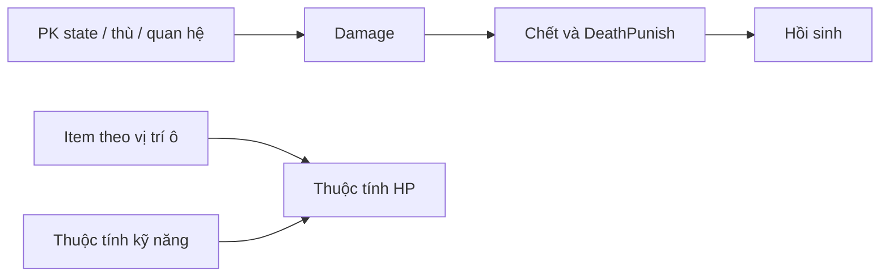

# TÓM TẮT 5 DÒNG
1. [TÀI LIỆU] PARTIAL: hoàn tất khảo sát tĩnh PK/thù, chết, hồi sinh, hồi máu trong phạm vi SO-08; không chạy runtime.
2. [TÀI LIỆU] Đã tạo sổ tay tiếng Việt, có nhãn TÀI LIỆU/CHƯA KIỂM và nguồn file:dòng.
3. [TÀI LIỆU] Đầu ra: JX1_OPS/DESIGN/SO-TAY-PK-CHET-HOI-SINH.md; bổ sung kết quả vào task SO-08.
4. CHƯA KIỂM: phiên bản server chạy, luật/cấu hình hiệu lực, skill hồi máu cụ thể và mọi test/build.
5. [CHƯA KIỂM] Không commit theo yêu cầu; ghi nhịp D:\JX-wt\SO-08.nhip bị chặn bởi quyền ghi ngoài worktree.

# SO-08 — Sổ tay PK, chết, hồi sinh và hồi máu

Loại: tổng hợp
Chủ đề: Đường xử lý PK/thù, chết, hồi sinh và hồi HP trong source JX1 được giao.
Từ khóa: PK, thù, EnmityPKOpen, DeathCalcPKValue, DeathPunish, hồi sinh, Revive, LifeV, LifePotionV
Trạng thái: PARTIAL — nội dung chính hoàn tất; tệp nhịp ngoài worktree không ghi được.
Độ phủ: đã phủ 5/5 hạng mục câu hỏi ở mức source tĩnh; skill cụ thể/runtime chưa phủ.
Liên quan: `JX1_OPS/REPORTS/E-11-hoi-mau-vat-pham-doi-ban-do.md`; `JX1_OPS/REPORTS/A-05-diem-tuong-tac-gs001.md`; `JX1_OPS/REPORTS/H-12-tu-dong-chien-dau.md`; `JX1_OPS/DESIGN/CHUAN-BAO-CAO.md`.
Cần tôi quyết định: không.

## Sơ đồ

## Phạm vi và độ phủ
| Phần tử | Kết quả | Nguồn |
|---|---|---|
| PK/thù và quan hệ | Đã phủ tĩnh | KPlayerPK.cpp:55-85,128-228; KProtocolProcess.cpp:6211-6238; KNpcSet.cpp:1951-2042. |
| Chết và hình phạt | Đã phủ entry point, mode và nhánh | KNpc.cpp:2571-2589,11429-11550,14144-14208. |
| Hồi sinh | Đã phủ command, player và NPC | KProtocolProcess.cpp:6178-6204; KPlayer.cpp:7248-7308; KNpc.cpp:3375-3435,13900-13937. |
| Hồi HP bằng item | Đã phủ request, chọn ô và modifier | Client KPlayer.cpp:1964-2007; server KItemList.cpp:2709-2736,8053-8092; KNpcAttribModify.cpp:1644-1651,2407-2424. |
| Hồi HP bằng skill | Đã phủ tuyến thuộc tính tổng quát | KMissle.cpp:1531-1537; KNpc.cpp:5960-5975; KNpcAttribModify.cpp:322-333. |

## ĐÃ XÁC MINH
- [TÀI LIỆU] Client gửi cờ PK thường; server cập nhật và đồng bộ. Lệnh thù nhắm mục tiêu có handler riêng. Client KPlayerPK.cpp:468-477; server KProtocolProcess.cpp:6211-6238, KPlayerPK.cpp:55-85,128-228.
- [TÀI LIỆU] Quan hệ địch/bạn xét fight mode, camp, PK state, team và bang hội. KNpcSet.cpp:1951-2042.
- [TÀI LIỆU] Player death có hook/script; DeathCalcPKValue và DeathPunish chọn nhánh xử lý. KNpc.cpp:2571-2589,11429-11550,14144-14208.
- [TÀI LIỆU] Player revive có sync, có thể đổi world và khôi phục HP/mana/thể lực; NPC có luồng riêng. KPlayer.cpp:7248-7308; KNpc.cpp:3375-3435,13900-13937.
- [TÀI LIỆU] Thuốc chọn theo vị trí ô; LifeV cộng HP, LifePotionV hồi theo thời gian. KPlayer.cpp:5909-5914; KItemList.cpp:8053-8092; KNpcAttribModify.cpp:1644-1651,2407-2424; KNpc.cpp:2133-2143.
- [TÀI LIỆU] Missile skill áp thuộc tính tức thời/trạng thái sau khi damage thành công; bộ xử lý có magic_life_v. KMissle.cpp:1531-1537; KNpc.cpp:5960-5975; KNpcAttribModify.cpp:42,322-333.

## CHƯA XÁC MINH
- [CHƯA KIỂM] Cây source có khớp commit/binary server đang chạy không; luật PK và cấu hình hiệu lực theo map.
- [CHƯA KIỂM] Giá trị dữ liệu thuốc/kỹ năng, danh sách skill hồi HP theo phái → nhánh → cấp, tên Hán/TCVN3.
- [CHƯA KIỂM] Thời gian thực/cooldown, ABI và runtime. Không build/test/VM/exe/mạng.

## MỤC SỔ THÔNG SỐ
| Nhóm | Tên/hằng số | file:dòng | Giá trị | Đơn vị | Ảnh hưởng | Đổi an toàn | Nguồn đo |
|---|---|---|---|---|---|---|---|
| PK | PK_NORMAL_CLOSE_TIME | KPlayerPK.cpp:75-76,379-380 | Giá trị định nghĩa chưa đọc | Bộ đếm nội bộ; giây chưa xác minh | Thời gian trước đóng PK | CẨN THẬN | Đọc tĩnh; chưa đo. |
| Thù | PK_ANMITY_TIME, PK_ANMITY_CLOSE_TIME | KPlayerPK.cpp:206-212,382-406 | Giá trị định nghĩa chưa đọc | Bộ đếm; giây chưa xác minh | Thời gian trạng thái thù | CẨN THẬN | Đọc tĩnh; chưa đo. |
| Hồi NPC | m_ReviveFrame | KNpc.cpp:405,3395-3399 | 1080 | Frame; giây chưa xác minh | Trạng thái hồi NPC | CẨN THẬN | Đọc tĩnh; chưa chạy. |
| Hồi thuốc | m_LifeState.nValue[0], nTime, GAME_UPDATE_TIME | KNpc.cpp:2133-2143; KNpcAttribModify.cpp:2407-2424 | Giá trị/hằng số chưa đọc | Counter nội bộ | HP hồi theo thời gian, giới hạn max HP | CẨN THẬN | Chưa đọc bảng thuốc/đo runtime. |

## ĐỀ XUẤT TỐI ƯU
PM có thể giao lượt chỉ đọc để ánh xạ hằng số/cấu hình và danh sách skill theo phái → nhánh → cấp cùng dữ liệu thuốc. Xác nhận runtime cần task kiểm thử riêng; báo cáo này không suy runtime từ source.

## Phát hiện, lỗi công cụ và kiểm chứng
- rg không có trong môi trường; dùng Select-String và tìm file theo tên trong hai root task chỉ định, không cài công cụ.
- Hai lượt ghi qua bộ mã hóa trong functions.exec dừng trước khi tạo tệp do TextEncoder/btoa không được hỗ trợ; chuyển sang ghi UTF-8 bằng .NET và thành công.
- Ghi D:\JX-wt\SO-08.nhip bị Access is denied vì nằm ngoài workspace ghi được; không thử vượt quyền. Tổng trạng thái PARTIAL dù nội dung hai đầu ra đã tạo.
- Kiểm chứng: đọc tĩnh các dòng source nêu trên và ba báo cáo task chỉ định; không chạy test/build/runtime. Không sửa source game.

## Bàn giao
- Không stage/commit/push theo yêu cầu; chưa có SHA.
- Hàng mục lục tri thức đề xuất để PM gộp: SO-08 | Sổ tay PK, chết, hồi sinh và hồi máu | PK, EnmityPKOpen, DeathCalcPKValue, LifeV, LifePotionV | DONE source tĩnh; skill cụ thể CHƯA KIỂM | PK, chết, hồi sinh, hồi máu | E-11, A-05, H-12.
- Kỹ năng đã dùng: jx1-retrofit, jx1-read-server, jx1-read-client, jx1-parameters, jx1-knowledge, jx1-report.

## Kết quả cuối cùng
DONE phần nội dung; PARTIAL tổng trạng thái vì không ghi được tệp nhịp ngoài worktree. Không đổi kết luận các báo cáo nguồn.
