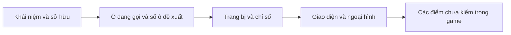

TÓM TẮT 1: [NGUỒN] DONE cho phần tài liệu SO-09. Sổ tay tổng hợp 5/5 báo cáo nền về đồng bạn (`JX1_OPS/DESIGN/SO-TAY-DONG-BAN.md:53`).
TÓM TẮT 2: [NGUỒN] Sổ tay giải thích NPC đồng bạn, số ô, đồ và chỉ số legacy, cùng giao diện đội và trang nhân vật (`JX1_OPS/DESIGN/SO-TAY-DONG-BAN.md:64`).
TÓM TẮT 3: [NGUỒN] Bàn giao sổ tay, báo cáo này và mục Kết quả trong task. Tổng quan phụ trách commit.
TÓM TẮT 4: [CHƯA KIỂM] Chưa khảo sát riêng hệ thống thú cưỡi. Tệp nhịp ngoài worktree bị từ chối quyền ghi (`JX1_OPS/DESIGN/SO-TAY-DONG-BAN.md:61`).
TÓM TẮT 5: [CHƯA KIỂM] Chưa chạy build, exe, VM, DB hoặc mạng. Chưa xác nhận hành vi trong game, lưu và tải DB trọn vòng, gói đồng bộ và ngoại hình.

# SO-09 — Bàn giao sổ tay đồng bạn

Loại: tổng hợp  
Chủ đề: Đồng bạn, ô trang bị, chỉ số và giao diện JX1  
Từ khóa: đồng bạn, hảo hữu, 同伴, companion, kind_partner, m_TongBanNum, pos_dazao, KuiTeam, CompanionId  
Trạng thái: DONE — đủ đầu ra tài liệu. Tệp nhịp ngoài worktree bị chặn quyền ghi.  
Độ phủ: 5/5 báo cáo nền và toàn bộ câu hỏi về đồng bạn trong mục tiêu.  
Liên quan: [Sổ tay đồng bạn](../DESIGN/SO-TAY-DONG-BAN.md), [task SO-09](../TASKS/SO-09.md), A-08b, A-09, A-12, A-14, F-01.  
Cần tôi quyết định: không

## Phạm vi và độ phủ

| Câu hỏi | Kết quả và bằng chứng trong sổ tay |
|---|---|
| Đồng bạn là gì? | Đã phủ. [THẤY] Server tạo NPC kiểu `kind_partner` và gắn với chủ. A-08b (`JX1_OPS/DESIGN/SO-TAY-DONG-BAN.md:57`). |
| Có mấy ô? | Đã phủ. [THẤY] Trên chủ có một trường lưu DWID NPC đang gọi. Vùng đồ legacy có 25 vị trí, chia năm nhóm và mỗi lần tính lại quét một nhóm năm ô. [TÀI LIỆU] `active[4]` và danh sách 10 con với 10 ô đồ mỗi con thuộc các đề xuất A-09 và A-14 (`JX1_OPS/DESIGN/SO-TAY-DONG-BAN.md:78`, `:79`, `:80`). |
| Trang bị và chỉ số ra sao? | Đã phủ. [THẤY] Nhánh mặc đồ tìm NPC theo DWID, ghi vị trí `pos_dazao`, áp thuộc tính đồ rồi tính lại chỉ số. Sổ tay nêu ví dụ thuộc tính áp được và nhóm chỉ số dành cho người chơi. A-12 (`JX1_OPS/DESIGN/SO-TAY-DONG-BAN.md:86`, `:88`). |
| Client hiển thị gì? | Đã phủ. [THẤY] Có danh sách đội người chơi và trang trang bị nhân vật. [CHƯA KIỂM] Màn hình quản lý từng đồng bạn và ngoại hình theo đồ. F-01 (`JX1_OPS/DESIGN/SO-TAY-DONG-BAN.md:94`, `:96`, `:98`, `:100`). |
| Còn điều gì chưa kiểm? | Đã ghi giới hạn về hành vi trong game, lưu và tải DB, màn hình riêng, gói đồng bộ và ngoại hình (`JX1_OPS/DESIGN/SO-TAY-DONG-BAN.md:141`). |
| Thú cưỡi | Chưa khảo sát riêng. Tiêu đề task có thú cưỡi, còn mục tiêu cụ thể và năm báo cáo nền tập trung vào đồng bạn (`JX1_OPS/DESIGN/SO-TAY-DONG-BAN.md:61`). |

## Giải mã tên

| Tên gốc | Mã hóa | Chữ đúng hoặc ý nghĩa | Nguồn |
|---|---|---|---|
| 同伴 | UTF-8 trong sổ tay. Sổ tay ghi GBK cho nguồn tên Hoa ngữ. | Đồng bạn | `JX1_OPS/DESIGN/SO-TAY-DONG-BAN.md:106` |
| `kind_partner`, `m_TongBanNum`, `DWID`, `pos_dazao`, `KuiTeam`, `CompanionId`, `active[4]` | ASCII | Tên kiểu NPC, trường/mã nhận diện, vị trí đồ, lớp giao diện và ký hiệu thiết kế | `JX1_OPS/DESIGN/SO-TAY-DONG-BAN.md:102` |

## Sắp theo cấu trúc game

Sổ tay đi theo người chơi sở hữu → NPC đồng bạn đang gọi → kho và vị trí đồ legacy → chỉ số NPC → giao diện client. Đề xuất danh sách đồng bạn và bộ đồ riêng có nhãn tài liệu ngay tại phần tương ứng. Xem `JX1_OPS/DESIGN/SO-TAY-DONG-BAN.md:125`.

## Mục sổ thông số

| Nhóm | Tên | file:dòng | Giá trị | Đơn vị | Ảnh hưởng | Đổi an toàn | Nguồn đo |
|---|---|---|---|---|---|---|---|
| Đồng bạn đang gọi | `m_TongBanNum` | `JX1_OPS/DESIGN/SO-TAY-DONG-BAN.md:137` | 1 | trường chứa DWID | Tra NPC đang gọi | CẨN THẬN | Kết quả đọc tĩnh đã ghi trong sổ tay |
| Đồ legacy | X của `pos_dazao` | `JX1_OPS/DESIGN/SO-TAY-DONG-BAN.md:138` | 53–77, năm nhóm × năm ô | vị trí | Chọn nhóm đồ để tính chỉ số | CẨN THẬN | Kết quả đọc tĩnh đã ghi trong sổ tay |
| Thiết kế | `CompanionId` và ô đồ | `JX1_OPS/DESIGN/SO-TAY-DONG-BAN.md:139` | 10 con × 10 ô/con, tối đa 100 vị trí đồ | vị trí đề xuất | Dung lượng đồ riêng theo từng con | CẨN THẬN | Đề xuất trong A-14 |

## Đã xác minh / Chưa xác minh

- **Đã xác minh trong lượt bàn giao.** Sổ tay đã có trên nhánh `task/SO-09`. Các mục về đồng bạn, số ô, đồ, chỉ số, UI và giới hạn đều có dẫn chiếu. Cả năm báo cáo nền tồn tại tại các đường dẫn sổ tay dẫn. Các kết quả đọc mã server và client được dẫn lại từ sổ tay, với hai gốc nguồn ghi tại `JX1_OPS/DESIGN/SO-TAY-DONG-BAN.md:19` và các chứng cứ tại `:141`.
- **Chưa xác minh.** Chưa chạy build, exe, VM, DB hoặc mạng. Các điểm cần kiểm trong game gồm giới hạn gọi đồng thời, lưu và tải đồ hoặc chỉ số trọn vòng, gói đồng bộ và ngoại hình theo đồ. Xem `JX1_OPS/DESIGN/SO-TAY-DONG-BAN.md:141`.
- **Lỗi và cách xử lý.** `rg` không có trong phiên PowerShell. Đã dùng `Select-String` trên các tệp chỉ định. Lệnh `Add-Content` tại mốc bắt đầu bị `UnauthorizedAccessException` với `D:\JX-wt\SO-09.nhip`. Tệp nằm ngoài vùng ghi được cấp nên các mốc còn lại của tệp nhịp cũng chưa ghi được.

## Đề xuất tối ưu

Nếu mở task triển khai, ưu tiên chốt danh sách đồng bạn lưu bền, quy tắc gọi và ánh xạ trang bị theo từng ID trước khi nối UI. Đây là đề xuất đã có trong sổ tay (`JX1_OPS/DESIGN/SO-TAY-DONG-BAN.md:129`).

## Bàn giao

- Đầu ra chính tại `JX1_OPS/DESIGN/SO-TAY-DONG-BAN.md`. Kết quả bàn giao ghi cuối `JX1_OPS/TASKS/SO-09.md`.
- Tổng quan phụ trách commit theo yêu cầu. Lượt này chưa stage, commit hoặc push.
- Dòng đề xuất cho mục lục tri thức của PM nằm bên dưới.

| Tài liệu | Loại | Chủ đề | Từ khóa | Trạng thái | Độ phủ | Liên quan |
|---|---|---|---|---|---|---|
| `JX1_OPS/DESIGN/SO-TAY-DONG-BAN.md` | tổng hợp | Đồng bạn, số ô, đồ, chỉ số và UI | đồng bạn, 同伴, pos_dazao, CompanionId | DONE | 5/5 báo cáo nền | A-08b, A-09, A-12, A-14, F-01 |

Kỹ năng đã dùng: jx1-retrofit, jx1-read-server, jx1-read-client, jx1-parameters, jx1-knowledge, jx1-report.
