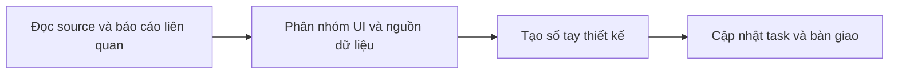

## TÓM TẮT 5 DÒNG
1. DONE — hoàn thành sổ tay giao diện client qua khảo sát source tĩnh trong phạm vi task.
2. Đã nhóm màn hình, hộp thoại, luồng dữ liệu và phần riêng/chung của nhánh VN.
3. Đầu ra chính: JX1_OPS/DESIGN/SO-TAY-GIAO-DIEN.md; cập nhật kết quả task.
4. Chưa chạy build, exe, VM, mạng hoặc UI thực; các giới hạn runtime được ghi trong thiết kế.
5. Không stage/commit/push theo yêu cầu; chưa có SHA. Không ghi được tệp nhịp ngoài workspace do sandbox từ chối.

# SO-11 — Báo cáo hoàn tất

## Khối thông tin
- Loại: tổng hợp
- Chủ đề: Sổ tay nhóm giao diện client JX1, tác dụng tĩnh, nguồn dữ liệu và khác biệt nhánh Việt.
- Từ khóa: giao diện client, UI, hộp thoại, gameui, VN, KgameWorld, CoreShell, script
- Trạng thái: DONE — đầu ra tĩnh hoàn thành; hành vi runtime chưa xác minh.
- Độ phủ: đã liệt kê 87 tệp .cpp trong gameui và 53 trong vn/gameui, tìm chữ ký/call site; không quy số tệp thành số cửa sổ.
- Liên quan: JX1_OPS/DESIGN/SO-TAY-GIAO-DIEN.md; K-02-giao-dien.md; H-05-ui-cuong-hoa.md; H-10-phim-tat-thanh-nut.md; H-11-nut-he-thong-cai-dat.md.
- Cần tôi quyết định: không

## Phạm vi và độ phủ
| Phần tử | Kết quả | Bằng chứng |
|---|---|---|
| Chuẩn báo cáo | Đã đọc trước khi bắt đầu sửa | JX1_OPS/DESIGN/CHUAN-BAO-CAO.md |
| Báo cáo nguồn task | Đã tìm và dùng làm ngữ cảnh | JX1_OPS/REPORTS/K-02-giao-dien.md; H-05-ui-cuong-hoa.md; H-10-phim-tat-thanh-nut.md; H-11-nut-he-thong-cai-dat.md |
| Client/gameui và nhánh Việt | Đã đếm 87 + 53 tệp .cpp; đã tìm lớp/điểm gọi cho các nhóm được mô tả | C/gameui; C/vn/gameui; C/gamescene/KgameWorld.cpp; C/vn/gamescence/KgameWorldVN.cpp |
| Luồng hộp thoại và dữ liệu server | Đã tra đoạn source liên quan | C/gamecore/KPlayer.cpp:3878–3902, 4043–4046; S/Core/Src/ScriptFuns.cpp:24266–24308 |
| Đầu ra được giao | Đã tạo | JX1_OPS/DESIGN/SO-TAY-GIAO-DIEN.md |
| Runtime/build/test/exe/VM/mạng | Chưa thực hiện theo task | Chưa chạy |

## Giải mã tên
| Tên gốc | Mã hóa | Chữ đúng UTF-8 | Nguồn |
|---|---|---|---|
| Tiếu Ngạo Giang Hồ Lục | UTF-8 | Tiếu Ngạo Giang Hồ Lục; chuỗi được ghi trong thông báo nút nhiệm vụ | C/vn/gamescence/KgameWorldVN.cpp:705 |
| Chưa xác định tên kỹ năng, trang bị, quái, NPC hoặc bản đồ cụ thể trong phần UI đã khảo sát | — | Chưa áp dụng; task không đọc danh mục game/tài nguyên tên riêng | JX1_OPS/DESIGN/SO-TAY-GIAO-DIEN.md |

## Sắp theo cấu trúc game
Khởi chạy/cập nhật → đăng nhập/chọn nhân vật → cảnh chơi → nút giao diện và cửa sổ gameplay → hộp thoại/thông báo trả kết quả. Bằng chứng và sơ đồ chi tiết nằm trong sổ tay.  
liên quan: JX1_OPS/DESIGN/SO-TAY-GIAO-DIEN.md; K-02-giao-dien.md; H-05-ui-cuong-hoa.md; H-10-phim-tat-thanh-nut.md; H-11-nut-he-thong-cai-dat.md.

## Đã xác minh
- Git status ban đầu là nhánh task/SO-11, không có thay đổi cục bộ.
- Client root theo task có các thư mục gameui, vn/gameui, gamescene và gamecore; server root theo task có thật.
- Đã đọc chuẩn báo cáo và sáu skill được yêu cầu; đã xem task và truy vấn bốn báo cáo nguồn theo danh sách của task.
- Scene cập nhật và cảnh VN: C/AppDelegate.cpp:183–185; C/vn/gamescence/KUpdateLayerVN.cpp:83–90, 381–390; C/vn/gameui/KTranSenceVN.cpp:12–33; C/vn/gamescence/KgameWorldVN.h:19–20.
- Nguồn trạng thái/hoạt động: C/gamecore/CoreShell.cpp:1723–1743, 2276–2298, 2373–2378; C/gamecore/KProtocolProcess.cpp:246–260; S/Core/Src/ScriptFuns.cpp:24266–24308.
- Đã chạy các lệnh PowerShell chỉ đọc Get-Content, Get-ChildItem và Select-String trên đường dẫn giới hạn. Không chạy build hay kiểm thử runtime.

## Chưa xác minh, lỗi và cách xử lý
- Chưa kiểm tra giao diện nhìn thấy, thứ tự/điều kiện hiển thị, mọi callback, mọi script hoặc tài nguyên trong bản cài đặt.
- rg không có trong môi trường; dùng Select-String/Get-ChildItem trong các thư mục/file mục tiêu, không cài công cụ.
- Một lệnh tìm chữ ký gặp kết quả trống ở một số helper; kết luận chỉ dựa trên call site/dòng có bằng chứng.
- Không ghi được D:\JX-wt\SO-11.nhip: sandbox từ chối ghi vì vị trí ngoài workspace. Đã ghi giới hạn này trong sổ tay và task; không thử vượt sandbox.
- Không ghi mật khẩu, khóa hoặc dữ liệu tài khoản.

## Bàn giao
- Sổ tay: JX1_OPS/DESIGN/SO-TAY-GIAO-DIEN.md.
- Báo cáo: JX1_OPS/REPORTS/SO-11.md.
- Task: đã thêm mục Kết quả gồm 4 dòng ở cuối JX1_OPS/TASKS/SO-11.md.
- Chỉ mục TSV chưa tạo do task giới hạn vùng sửa ở đầu ra chính; đề xuất một hàng để PM gộp được ghi trong sổ tay.
- Không stage/commit/push theo yêu cầu; chưa có SHA.
- Kỹ năng đã dùng: jx1-retrofit, jx1-read-server, jx1-read-client, jx1-parameters, jx1-knowledge, jx1-report.

## Trạng thái
DONE — phần tài liệu hoàn thành; kiểm chứng runtime không thuộc phạm vi được duyệt.
