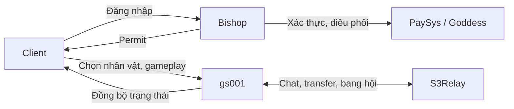

TÓM TẮT 1/5: [NGUỒN] Hoàn thành tài liệu cho 4 nhóm gói tin: đăng nhập, di chuyển, chiến đấu và đồng bộ vật phẩm.
TÓM TẮT 2/5: [NGUỒN] Bảng có 10 opcode, hướng gửi/nhận, giải thích thường và bằng chứng file:dòng.
TÓM TẮT 3/5: [NGUỒN] Đã đối chiếu báo cáo A-06, E-12, K-01 cùng các đoạn client/server được task cho phép đọc.
TÓM TẮT 4/5: [CHƯA KIỂM] Không chạy build, test, exe, VM hoặc mạng; chưa xác nhận runtime/binary.
TÓM TẮT 5/5: [NGUỒN] Không commit theo yêu cầu; bàn giao cho PM gộp tổng quan và chỉ mục khi phù hợp.

# SO-12 — Sổ tay gói tin client–server
Loại: tổng hợp
Chủ đề: Giải thích cho người không lập trình luồng gói tin client–server và 10 opcode tiêu biểu.
Từ khóa: gói tin, opcode, client-server, KProtocolDef.h, c2s, s2c, Bishop, gs001
Trạng thái: DONE — hoàn thành phạm vi tài liệu tĩnh; runtime chưa kiểm.
Độ phủ: 4/4 nhóm, 10/10 ví dụ; không kiểm kê toàn bộ enum.
Liên quan: A-06-bang-goi-tin.md; E-12-khao-sat-goi-tuong-tac.md; K-01-ban-do-truyen-tin-hieu.md; DESIGN/SO-TAY-GOI-TIN.md.
Cần tôi quyết định: không

## Sơ đồ chính

[TÀI LIỆU] Sơ đồ tóm tắt source và báo cáo, không khẳng định runtime (K-01-ban-do-truyen-tin-hieu.md:49-60, 66-80, 110-121).

## Phạm vi và độ phủ

| Phần tử | Độ phủ | Bằng chứng |
|---|---|---|
| Đọc chuẩn báo cáo trước task | Đã phủ | JX1_OPS/DESIGN/CHUAN-BAO-CAO.md |
| Báo cáo nguồn được nêu trong task | Đã phủ 3/3, đọc theo phần liên quan | A-06-bang-goi-tin.md:194-251, 257-283, 389-520; E-12-khao-sat-goi-tuong-tac.md:77-184; K-01-ban-do-truyen-tin-hieu.md:45-60, 92-149 |
| Source client/server trong phạm vi đọc tĩnh | Đã phủ đoạn liên quan | C/KProtocolDef.h:84, 106, 110, 249-283; C/KProtocol.cpp:186-250, 645-671; C/KProtocolProcess.cpp:57-102; S/KProtocolProcess.cpp:211-237, 5436-5449, 5581-5606, 5713-5734 |
| Tài liệu sổ tay và ví dụ | Đã phủ 10/10 | JX1_OPS/DESIGN/SO-TAY-GOI-TIN.md |
| Runtime, binary, latency, test/build | Chưa phủ theo quyền task | Không chạy theo phạm vi task; K-01-ban-do-truyen-tin-hieu.md:96-104, 108-109 |

## Giải mã tên

| Tên gốc | Mã hóa | Chữ đúng | Nguồn file:dòng |
|---|---|---|---|
| `c2s_login` | ASCII identifier; không phải GBK/TCVN3 | Client gửi đăng nhập lên server | C/KProtocolDef.h:249 |
| `c2s_dbplayerselect` | ASCII identifier; không phải GBK/TCVN3 | Client báo chọn nhân vật | C/KProtocolDef.h:292 |
| `c2s_syncclientend` | ASCII identifier; không phải GBK/TCVN3 | Client báo kết thúc chặng đồng bộ | C/KProtocolDef.h:251 |
| `c2s_npcwalk` | ASCII identifier; không phải GBK/TCVN3 | Client gửi lệnh đi bộ | C/KProtocolDef.h:259 |
| `c2s_npcskill` | ASCII identifier; không phải GBK/TCVN3 | Client gửi lệnh kỹ năng | C/KProtocolDef.h:261 |
| `s2c_skillcast` | ASCII identifier; không phải GBK/TCVN3 | Server báo động tác thi triển | C/KProtocolDef.h:84 |
| `c2s_playerpickupitem` | ASCII identifier; không phải GBK/TCVN3 | Client yêu cầu nhặt vật phẩm | C/KProtocolDef.h:282 |
| `c2s_playermoveitem` | ASCII identifier; không phải GBK/TCVN3 | Client gửi yêu cầu chuyển vật phẩm | C/KProtocolDef.h:283 |
| `s2c_syncitem` | ASCII identifier; không phải GBK/TCVN3 | Server đồng bộ dữ liệu vật phẩm | C/KProtocolDef.h:106 |
| `s2c_playermoveitem` | ASCII identifier; không phải GBK/TCVN3 | Server đồng bộ vị trí vật phẩm | C/KProtocolDef.h:110 |
| `Bishop`, `PaySys`, `Goddess`, `S3Relay`, `gs001` | Tên dịch vụ/tiến trình ASCII | Gateway, dịch vụ tài khoản/nhân vật/relay, máy chủ thế giới | K-01-ban-do-truyen-tin-hieu.md:52-56 |

[TÀI LIỆU] Không có tên kỹ năng, trang bị, quái, NPC hoặc bản đồ đa ngôn ngữ trong báo cáo này; xem bảng giải mã đầy đủ 10 hằng tại `DESIGN/SO-TAY-GOI-TIN.md`.

## Sắp theo cấu trúc game

1. [TÀI LIỆU] Đăng nhập → chọn nhân vật → đồng bộ vào thế giới (K-01-ban-do-truyen-tin-hieu.md:110-121).
2. [THẤY] Gameplay di chuyển/chiến đấu: client dựng lệnh → server dispatch → client nhận đồng bộ (C/KProtocol.cpp:214-250; S/KProtocolProcess.cpp:213-215, 5436-5449, 5581-5606; C/KProtocolProcess.cpp:76).
3. [THẤY] Vật phẩm: client gửi thao tác → server xử lý → client có handler nhận đồng bộ vật phẩm (C/KProtocol.cpp:645-671; S/KProtocolProcess.cpp:236-237, 5713-5734; C/KProtocolProcess.cpp:98-102).

## Kết quả

[THẤY] Hoàn thành tài liệu `JX1_OPS/DESIGN/SO-TAY-GOI-TIN.md` với bảng 10 gói, sơ đồ Mermaid, bảng phạm vi, giải mã tên và sắp xếp theo chặng game.

[THẤY] Đã đối chiếu trực tiếp các đoạn source client/server được trích trong báo cáo; phần đăng nhập và luồng tiến trình dùng chứng cứ từ K-01.

[CHƯA KIỂM] Chưa kiểm runtime, ABI, binary đang chạy, độ trễ hay tần suất thật; không build/test/chạy VM/exe/mạng theo task.

## MỤC SỔ THÔNG SỐ

| Nhóm | Tên/hằng số | File:dòng | Giá trị | Đơn vị | Ảnh hưởng | Đổi an toàn | Nguồn đo |
|---|---|---|---:|---|---|---|---|
| [TÀI LIỆU] Đăng nhập | `c2s_login` | C/KProtocolDef.h:249; A-06:418-419 | 65 | BYTE ID | Giao thức đăng nhập | KHÔNG — phải khớp hai đầu | Đọc tĩnh |
| [TÀI LIỆU] Chọn nhân vật | `c2s_dbplayerselect` | C/KProtocolDef.h:292; A-06:462 | 108 | BYTE ID | Tải nhân vật được chọn | KHÔNG — phải khớp hai đầu | Đọc tĩnh |
| [TÀI LIỆU] Đồng bộ vào game | `c2s_syncclientend` | C/KProtocolDef.h:251; A-06:421 | 67 | BYTE ID | Chặng đồng bộ client | KHÔNG — phải khớp payload/handler | Đọc tĩnh |
| [THẤY] Đi bộ | `c2s_npcwalk` | C/KProtocol.cpp:214-223; S/KProtocolProcess.cpp:5436-5449; A-06:429 | 75 | BYTE ID | Điều khiển di chuyển | KHÔNG — phải khớp schema/handler | Đọc tĩnh |
| [THẤY] Dùng kỹ năng | `c2s_npcskill` | C/KProtocol.cpp:237-250; S/KProtocolProcess.cpp:5581-5606; A-06:431 | 77 | BYTE ID | Đưa lệnh kỹ năng vào xử lý | KHÔNG — phải khớp schema/handler | Đọc tĩnh |
| [THẤY] Báo thi triển kỹ năng | `s2c_skillcast` | C/KProtocolProcess.cpp:76; A-06:257 | 96 | BYTE ID | Client nhận động tác kỹ năng | KHÔNG — phải khớp schema/handler | Đọc tĩnh |
| [THẤY] Nhặt vật phẩm | `c2s_playerpickupitem` | S/KProtocolProcess.cpp:5713-5721; A-06:452 | 98 | BYTE ID | Yêu cầu server nhặt vật phẩm | KHÔNG — phải khớp schema/handler | Đọc tĩnh |
| [THẤY] Chuyển vật phẩm | `c2s_playermoveitem` | C/KProtocol.cpp:645-671; S/KProtocolProcess.cpp:5724-5734; A-06:453 | 99 | BYTE ID | Yêu cầu server chuyển vật phẩm | KHÔNG — phải khớp schema/handler | Đọc tĩnh |
| [THẤY] Đồng bộ vật phẩm | `s2c_syncitem` | C/KProtocolProcess.cpp:98; A-06:279 | 118 | BYTE ID | Client nhận dữ liệu vật phẩm | KHÔNG — phải khớp schema/handler | Đọc tĩnh |
| [THẤY] Đồng bộ vị trí vật phẩm | `s2c_playermoveitem` | C/KProtocolProcess.cpp:102; A-06:283 | 122 | BYTE ID | Client nhận kết quả chuyển vật phẩm | KHÔNG — phải khớp schema/handler | Đọc tĩnh |

## Đã xác minh / Chưa xác minh

- [THẤY] Hàm client dựng lệnh walk, skill và move-item rồi gửi buffer tới server (C/KProtocol.cpp:214-223, 237-250, 645-671).
- [THẤY] Server map các ID walk, skill, pickup và move-item tới handler tương ứng (S/KProtocolProcess.cpp:213-237, 5436-5449, 5581-5606, 5713-5734).
- [THẤY] Client ánh xạ các gói skill/item sync tới hàm nhận (C/KProtocolProcess.cpp:76, 98-102).
- [TÀI LIỆU] Đường đăng nhập/role/permit và giới hạn runtime được nêu ở K-01-ban-do-truyen-tin-hieu.md:96-121.
- [CHƯA KIỂM] Không chạy test/build/exe/VM/mạng; chưa xác minh endpoint/listener hiện hành, giao thức trên binary, payload ABI hoặc độ trễ.

## Bàn giao

- Đầu ra chính: `JX1_OPS/DESIGN/SO-TAY-GOI-TIN.md`.
- Không commit theo yêu cầu; chưa có SHA.
- Đề xuất PM gộp chỉ mục tri thức: `U-01/SO-12 | tổng hợp | Gói tin client–server cho người không lập trình | gói tin, opcode, KProtocolDef.h, c2s, s2c, Bishop, gs001 | DONE | 4 nhóm, 10 ví dụ | A-06, E-12, K-01`.
- Kỹ năng đã dùng: jx1-retrofit, jx1-read-server, jx1-read-client, jx1-parameters, jx1-knowledge, jx1-report.
