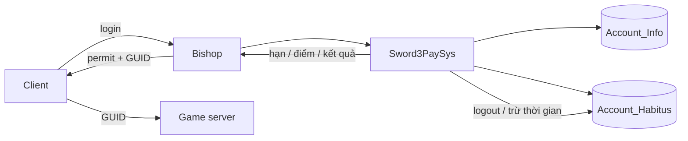

TÓM TẮT 1: [NGUỒN] PARTIAL — sổ tay và báo cáo hoàn tất; thiếu file nhịp do quyền ghi bị từ chối.
TÓM TẮT 2: [NGUỒN] Đã đối chiếu luồng login, trạng thái account, hạn/điểm và bảng SQL trong source.
TÓM TẮT 3: [NGUỒN] Đầu ra gồm sổ tay, báo cáo, chỉ mục và mục Kết quả task; không sửa source.
TÓM TẮT 4: [CHƯA KIỂM] Cách tạo account, schema SQL và runtime chưa được chứng minh; không chạy build, exe, VM, SQL hay mạng.
TÓM TẮT 5: [NGUỒN] Không commit theo yêu cầu nên không có SHA; cần khả năng ghi file nhịp nếu tiếp tục yêu cầu đó.

# SO-13 — Tài khoản và thanh toán (Sword3PaySys)

Loại: tổng hợp
Chủ đề: Tạo tài khoản, xác thực, khóa/mở khóa phiên, hạn/điểm và vai trò PaySys.
Từ khóa: tài khoản, account, Sword3PaySys, PaySys, Account_Info, Account_Habitus, S3PAccount, iFlag
Trạng thái: PARTIAL — nội dung đọc tĩnh hoàn tất; file nhịp không ghi được.
Độ phủ: đã phủ tĩnh 5 trên 7 hạng mục; tạo account và schema/runtime còn CHƯA KIỂM.
Liên quan: JX1_OPS/REPORTS/A-02-luong-dang-nhap.md; JX1_OPS/REPORTS/A-01-ban-do-tien-trinh.md; JX1_OPS/DESIGN/CHUAN-BAO-CAO.md.
Cần tôi quyết định: không.
## Gốc nguồn

- PAY/ = C:/Jx1CocoV3/SwordOnline/SwordOnline/jxOnline/gateway/Sources/Sword3PaySys/S3AccServer/
- REG/ = C:/Jx1CocoV3/SwordOnline/SwordOnline/jxOnline/gateway/Sources/Sword3PaySys/S3DBClient/
- CLIENT/ = C:/Jx1CocoV3/Folder/Client2912-20260116T044348Z-3-001/Client2912/Client/Classes/
- GS/ = C:/Jx1CocoV3/SwordOnline/SwordOnline/jxOnline/gameserver/Sources/

Các bằng chứng là source đọc tĩnh, không xác nhận binary hoặc runtime.

## Sơ đồ

## Phạm vi và độ phủ

| Hạng mục | Kết quả | Bằng chứng |
|---|---|---|
| Vai trò PaySys | Đã phủ tĩnh | PAY/main.cpp:198-211; PAY/S3PDBSocketPool.cpp:377-380 |
| Tạo tài khoản | Chưa phủ bước ghi DB | CLIENT/gameui/Klogin_f.cpp:1521-1527; REG/Page1.cpp:289-353 |
| Trạng thái account | Đã phủ tĩnh | PAY/S3PAccount.cpp:50-100,524-535 |
| Tính hạn và điểm | Đã phủ tĩnh | PAY/S3PAccount.cpp:593-640,104-114,167-265 |
| Các bảng/view SQL | Đã phủ theo truy vấn source | PAY/S3PAccount.cpp:50-99,260-265,409-451,593-640 |
| Luồng client vào game | Đã phủ phía client | CLIENT/gameui/Klogin.cpp:471-495; CLIENT/gameui/KSelPlayer.cpp:1083-1149 |
| Schema/runtime thật | Chưa phủ | Không đọc SQL sống, cấu hình hay dữ liệu account |

## Giải mã tên

| Tên gốc | Mã hóa | Chữ đúng | Nguồn file:dòng |
|---|---|---|---|
| Sword3PaySys | ASCII | Sword3PaySys, dịch vụ tài khoản/thanh toán | PAY/main.cpp:198-211 |
| PaySys | ASCII, tên rút gọn | PaySys, tên gọi ngắn của Sword3PaySys | JX1_OPS/REPORTS/A-02-luong-dang-nhap.md:50-51 |
| Account_Info | ASCII, tên bảng | Account_Info, bảng được truy vấn trong login | PAY/S3PAccount.cpp:50-99 |
| Account_Habitus | ASCII, tên bảng | Account_Habitus, bảng có thông tin hạn/điểm theo source | PAY/S3PAccount.cpp:593-640 |
| ServerList | ASCII, tên bảng | ServerList, xác thực dịch vụ | PAY/S3PAccount.cpp:409-451 |
| GUID | ASCII, viết tắt | Mã GUID chuyển sang game server | CLIENT/gameui/KSelPlayer.cpp:1128-1134 |
| MD5 | ASCII, tên thuật toán | MD5 client dùng trước khi gửi login | CLIENT/gameui/Klogin.cpp:476-495 |
| Bishop | ASCII, tên dịch vụ | Cổng trung gian trong luồng login | CLIENT/gameui/KSelPlayer.cpp:1083-1129 |
| S3DBClient | ASCII, tên công cụ | Tiện ích quản trị gửi lệnh tạo account | REG/Page1.cpp:289-353 |
| DBLOGIN_A_CREATEACCOUNT | ASCII, tên protocol/hằng | Mã lệnh tạo account mà S3DBClient gửi | REG/Page1.cpp:306-353 |

## Sắp theo cấu trúc game

Thứ tự theo luồng tài khoản: giao diện đăng ký → gateway/PaySys → bảng account → kiểm tra hạn/điểm → cấp quyền và GUID → game server. Không có kỹ năng, trang bị, quái hoặc NPC trong phạm vi nên không áp dụng cấu trúc theo loại thực thể.

## Kết quả khảo sát

- [THẤY] PaySys mở pool DB theo section account, khởi động socket pool và listener; điều này cho thấy vai trò dịch vụ theo source, không chứng minh DB/listener hiện đang chạy (PAY/main.cpp:198-211).
- [THẤY] Login truy vấn Account_Info, kiểm tra thông tin xác thực, rồi gọi kiểm tra quyền chơi trong Account_Habitus (PAY/S3PAccount.cpp:35-100).
- [THẤY] Account_Habitus cung cấp iFlag, số giây đến dEndDate, iLeftSecond và nExtPoint. Nhánh iFlag=0 kiểm tra hạn; iFlag=1 kiểm tra điểm (PAY/S3PAccount.cpp:593-640,64-114).
- [THẤY] Client mở URL từ khóa CLIENT_UI_URL_DANGKY khi chọn đăng ký. Tiện ích S3DBClient phát lệnh DBLOGIN_A_CREATEACCOUNT, nhưng chưa thấy handler ghi SQL trong PaySys hoặc gameserver/Sources (CLIENT/gameui/Klogin_f.cpp:1521-1527; REG/Page1.cpp:289-353; PAY/S3PDBSocketPool.cpp:377-380).
- [THẤY] Account_Info.iClientID khác 0 khiến login trả trạng thái đã dùng hoặc đóng băng tùy GMID; gateway xác minh lại gọi UnlockAll để đặt về 0 và ghi ngày logout (PAY/S3PAccount.cpp:58-100,524-535; PAY/S3PDBSocketPool.cpp:623-631).
- [THẤY] Client gửi login qua c2s_login; sau phản hồi cho phép, kết nối tới IP/cổng được trả và gửi tagLogicLogin mang GUID (CLIENT/gameui/Klogin.cpp:471-495; CLIENT/gameui/KSelPlayer.cpp:1083-1134).
- [TÀI LIỆU] A-02 ghi lại tuyến đăng nhập lịch sử qua Bishop, PaySys và Goddess; dùng để định vị, không thay bằng chứng source (JX1_OPS/REPORTS/A-02-luong-dang-nhap.md:50-51).
- [CHƯA KIỂM] Chưa thấy handler tạo account, lệnh insert, schema đầy đủ hoặc default hạn/điểm trong code đọc; chưa kết luận dịch vụ nào tạo tài khoản.
- [CHƯA KIỂM] Chưa kiểm tra cấu hình, DB thực tế, transaction, timeout, binary, phiên đăng nhập, timezone hay quy đổi điểm.

## Các bảng/view SQL đã thấy

| Tên | Vai trò theo các câu SQL trong source | Giới hạn |
|---|---|---|
| Account_Info | Tên account, trạng thái iClientID và ngày login/logout trong luồng xác thực/phiên | PAY/S3PAccount.cpp:50-99,150,301-321,532,561 |
| Account_Habitus | Loại tính phí, hạn, thời gian còn lại và điểm | PAY/S3PAccount.cpp:593-640,104-124,167-258,334-352 |
| ServerList | Xác thực riêng cho dịch vụ/gateway và lấy game ID | PAY/S3PAccount.cpp:409-451 |
| View_AccountMoney | Nhánh logout cập nhật điểm mở rộng | PAY/S3PAccount.cpp:260-265 |

Tên được lấy từ truy vấn source, không khẳng định schema đang chạy, khóa, trigger hay cấu hình DB. Không đọc dữ liệu dòng thật.

## Mục sổ thông số

| Nhóm | Tên | File:dòng | Giá trị | Đơn vị | Ảnh hưởng | Đổi an toàn | Nguồn |
|---|---|---|---|---|---|---|---|
| Hình thức quyền | iFlag | PAY/S3PAccount.cpp:593-640 | 0 hoặc 1 theo nhánh source | loại quyền | Chọn kiểm tra thời gian hoặc điểm | KHÔNG | đọc tĩnh |
| Hạn | dEndDate | PAY/S3PAccount.cpp:593-625 | ngày hết hạn | thời gian SQL | Quyết định còn quyền theo giây | KHÔNG | đọc tĩnh |
| Thời gian | iLeftSecond | PAY/S3PAccount.cpp:593-625,334-352 | giây còn lại theo source | giây | Theo dõi thời gian chơi | CẨN THẬN | đọc tĩnh |
| Điểm | nExtPoint | PAY/S3PAccount.cpp:593-635 | số điểm | điểm | Kiểm tra/trừ điểm | CẨN THẬN | đọc tĩnh |
| Trạng thái | iClientID | PAY/S3PAccount.cpp:50-100,524-535 | 0/khác 0 được phân nhánh | trạng thái/ID | Login và mở khóa account | KHÔNG | đọc tĩnh |

## Đề xuất tối ưu

[ĐỀ XUẤT] Để xác nhận tạo account, cần định vị handler tương ứng DBLOGIN_A_CREATEACCOUNT hoặc backend URL đăng ký và đối chiếu schema được phép đọc. Task này không sửa source hay DB.

## Đã xác minh / Chưa xác minh

**ĐÃ XÁC MINH:** Đã đọc chuẩn báo cáo trước khi soạn và đối chiếu các dòng PaySys/client ghi trong từng mục. Tìm symbol giới hạn trong gameserver/Sources không trả kết quả cho Account_Info, Account_Habitus và DBLOGIN_A_CREATEACCOUNT. rg không có trong PATH; dùng Select-String. Không thay đổi kết luận trong A-01/A-02.

**CHƯA XÁC MINH:** Cách tạo row, schema sống, trigger, default, dữ liệu account, cấu hình và runtime. Không chạy build, exe, VM, SQL hay mạng theo yêu cầu.

## Bàn giao

- Đầu ra chính: JX1_OPS/DESIGN/SO-TAY-TAI-KHOAN-PAYSYS.md
- Báo cáo: JX1_OPS/REPORTS/SO-13.md
- Chỉ mục: JX1_OPS/REPORTS/_CHIMUC/SO-13.tsv
- File nhịp D:/JX-wt/SO-13.nhip không ghi được: lệnh tạo mốc bắt đầu trả Access denied.
- Commit/push: không thực hiện theo yêu cầu; không có SHA.
- Trạng thái: PARTIAL — nội dung hoàn thành, nhưng yêu cầu ghi file nhịp bị chặn.
- Kỹ năng đã dùng: jx1-retrofit, jx1-read-server, jx1-read-client, jx1-parameters, jx1-knowledge, jx1-report.
