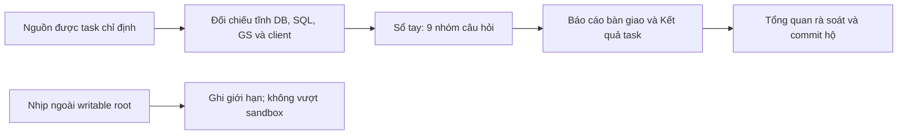

TÓM TẮT 1: [NGUỒN] PARTIAL về bàn giao toàn yêu cầu: sổ tay khảo sát tĩnh đã hoàn tất; còn tệp nhịp ngoài vùng sandbox cho phép ghi (`JX1_OPS/TASKS/SO-14.md:20-31`).
TÓM TẮT 2: [NGUỒN][THẤY] Đã làm rõ kho Berkeley DB/SQLite, đường nạp, các thời điểm lưu và giới hạn ACK/độ bền (`G/DBTable.cpp:40-42,107-128,199-234`; `G/sqlitel_db.cpp:81-105,557-564`; `G/ClientNode.cpp:469-503`).
TÓM TẮT 3: [NGUỒN] Đầu ra chính là `JX1_OPS/DESIGN/SO-TAY-GODDESS-LUU-NHAN-VAT.md`; bổ sung Kết quả cuối task SO-14, không sửa source hoặc báo cáo cũ (`JX1_OPS/TASKS/SO-14.md:13,21,28-31`).
TÓM TẮT 4: [CHƯA KIỂM] Không build, test game, chạy exe/VM/mạng, mở DB/dump/tài khoản; chưa xác minh binary/backend hiện hành hay mất dữ liệu thực tế (`JX1_OPS/TASKS/SO-14.md:27-30`).
TÓM TẮT 5: [CHƯA KIỂM] Không build/exe/VM/mạng; chưa stage/commit/push theo yêu cầu, không có SHA mới. Tổng quan commit hộ và ghi nhịp tại đường đã chỉ định bằng phiên có quyền ghi phù hợp.

# SO-14 — Bàn giao sổ tay Goddess lưu nhân vật

Loại: tổng hợp
Chủ đề: Bàn giao kết quả đọc tĩnh vòng đời hồ sơ nhân vật và các khoảng hở lưu dữ liệu.
Từ khóa: SO-14, lưu nhân vật, Goddess, DBTable, IDBRoleServer, Berkeley DB, SQLite, roledb, role_Blob, ACK
Trạng thái: PARTIAL — nội dung sổ tay DONE; yêu cầu ghi nhịp `D:/JX-wt/SO-14.nhip` nằm ngoài writable root nên chưa thực hiện.
Độ phủ: đã phủ 9/9 nhóm nội dung trong sổ tay; 0 phép thử vận hành.
Liên quan: `JX1_OPS/DESIGN/SO-TAY-GODDESS-LUU-NHAN-VAT.md`; `JX1_OPS/REPORTS/A-02-luong-dang-nhap.md`; `JX1_OPS/REPORTS/E-07-goi-tao-nhan-vat-logout.md`; `JX1_OPS/REPORTS/N-05.md`; `JX1_OPS/REPORTS/SO-06.md`.
Cần tôi quyết định: không đối với nội dung; PM xử lý tệp nhịp bằng quyền hiện có, không cần đổi quyền/config trong task.



## Phạm vi và độ phủ

| Phần việc | Kết quả | Bằng chứng / giới hạn |
|---|---|---|
| Chuẩn và sáu skill được yêu cầu | Đã áp dụng | `JX1_OPS/DESIGN/CHUAN-BAO-CAO.md:6-33`; `.agents/skills/jx1-retrofit/SKILL.md:6-14`; `.agents/skills/jx1-read-server/SKILL.md:6-16`; `.agents/skills/jx1-read-client/SKILL.md:6-17`; `.agents/skills/jx1-parameters/SKILL.md:6-16`; `.agents/skills/jx1-knowledge/SKILL.md:6-11`; `.agents/skills/jx1-report/SKILL.md:6-20`. |
| Kho/bảng, cấu trúc và đường nạp | Đã phủ tĩnh | [THẤY] `G/IDBRoleServer.cpp:65-74,191-207,334-343,486-559,923-962`; `G/sqlitel_db.cpp:81-105,557-564`. |
| Thời điểm lưu, tự lưu và ACK | Đã phủ tĩnh | [THẤY] `S/Core/Src/KPlayer.cpp:927-952,7027-7036`; `S/Core/Src/KSubWorldSet.cpp:610`; `G/ClientNode.cpp:469-503`; `S/MultiServer/GameServer/KSOServer.cpp:2916-2948,4938-4955`. |
| Nguy cơ rớt dữ liệu, checkpoint, backup | Đã phủ tĩnh | [THẤY] `G/DBTable.cpp:40-42,194-234,513-543`; `G/sqlitel_db.cpp:1078-1099`; `G/DBBackup.cpp:307-324,353-424`. Chưa thử sự cố/phục hồi. |
| Sổ tay, báo cáo, Kết quả task | Hoàn tất nội dung | Ba tệp thuộc nhiệm vụ được nêu tại mục Bàn giao. |
| Nhịp ngoài worktree | Chưa thực hiện | Sandbox chỉ cho ghi `D:/JX-wt/SO-14`; đích `D:/JX-wt/SO-14.nhip` là tệp cùng cấp, nằm ngoài root. Không thử vượt quyền. |
| Tệp chỉ mục riêng | Không tạo ngoài phạm vi | Chuẩn có yêu cầu TSV; prompt giới hạn vùng sửa. Hàng TSV và hàng mục lục được bàn giao ngay trong báo cáo này để PM gộp. |

## Giải mã tên

[THẤY] Không xử lý tên nhân vật thật hoặc danh mục kỹ năng/đồ/NPC/bản đồ. `Goddess`, `DBTable`, `IDBRoleServer`, `roledb`, `role_Blob`, `StudentBlob` là tên ASCII, giữ nguyên. Bảng giải thích đầy đủ nằm trong mục Giải mã tên của sổ tay; bằng chứng kỹ thuật ở `G/DBTable.cpp:107-128,199-218`, `G/IDBRoleServer.h:43-55`, `G/sqlitel_db.cpp:539-564`.

| Tên gốc | Mã hóa phần tên | Chữ đúng / cách hiểu | Nguồn file:dòng |
|---|---|---|---|
| Goddess, ClientNode, IDBRoleServer | ASCII | Bộ nhận yêu cầu và giao tiếp hồ sơ | [THẤY] `G/ClientNode.cpp:469-503`; `G/IDBRoleServer.h:43-55`. |
| Bishop, GS, KPlayerDBFuns, KSOServer | ASCII | Tuyến đăng nhập và máy chủ chơi | [THẤY] `B/GamePlayer.cpp:1903-1918`; `S/Core/Src/KPlayerDBFuns.cpp:44-118`; `S/MultiServer/GameServer/KSOServer.cpp:2916-2948`. |
| DBTable, Berkeley DB, roledb, roledb.0 | ASCII | Lớp bọc, kho B-tree và chỉ mục | [THẤY] `G/DBTable.cpp:107-128`; `G/IDBRoleServer.cpp:334-343`. |
| SQLite, role.db, role_bak.db, role_Blob, StudentBlob | ASCII | Nhánh SQL, kho chính/backup, bảng và cột hồ sơ | [THẤY] `G/sqlitel_db.cpp:81-105,539-564`. |
| AutoSave, ACK, dataOpenModel, dwDataLen | ASCII | Tự lưu, phản hồi, chế độ kho và độ dài hồ sơ | [THẤY] `S/Core/Src/KPlayerSet.cpp:1774-1795`; `G/ClientNode.cpp:495-503`; `G/Goddess.cpp:1539`; `G/IDBRoleServer.cpp:602-607`. |

## Sắp theo cấu trúc game

[THẤY] Nội dung được tổ chức theo chọn/nạp → chơi → yêu cầu lưu → ghi/ACK → backup. Source legacy có chú thích lỗi chữ; số dòng được đối chiếu với dòng vật lý và symbol ASCII, không đoán lại tên riêng từ chữ lỗi (`C/gameui/KSelPlayer.cpp:1184-1189`; `G/ClientNode.cpp:469-503,705-743`). Tài liệu đầu ra dùng UTF-8 không BOM.

## Nguồn đã đọc có giới hạn

Quy ước gốc `G/`, `B/`, `S/`, `C/` được ghi đầy đủ trong sổ tay. Mục tiêu task thiếu tầng `MultiServer`; chỉ dùng vị trí thực đã được báo cáo A-02 chỉ ra, không dò ổ đĩa hay đổi sang bản source khác (`JX1_OPS/TASKS/SO-14.md:20`; `JX1_OPS/REPORTS/A-02-luong-dang-nhap.md:70-74`).

- Tài liệu điều hướng: chuẩn báo cáo; task SO-14; phần đầu/mục liên quan của `JX1_OPS/DESIGN/MUC-LUC-TRI-THUC.md` và `JX1_OPS/CONTEXT-PACK/GS001-MAP.md`; sáu skill được yêu cầu. Map không cung cấp bằng chứng Goddess nên không dùng thay source.
- Báo cáo nền được lọc theo từ khóa trong `JX1_OPS/REPORTS`: đọc các đoạn liên quan của A-02, E-07, N-04, N-05, SO-06 và C-02; không mở toàn bộ báo cáo của thư mục.
- Goddess: `DBTable.cpp`, `DBTable.h`, `IDBRoleServer.cpp`, `IDBRoleServer.h`, `ClientNode.cpp`, `sqlitel_db.cpp`, `Goddess.cpp`, `DBBackup.cpp`, `DBDumpLoad.cpp`; chỉ tra định nghĩa cờ trong `db.h`.
- Bishop: chỉ các đoạn yêu cầu danh sách/hồ sơ và chuyển tiếp ở `GamePlayer.cpp`.
- GS: các đoạn liên quan của `Core/Src/KPlayer.cpp`, `KPlayerDBFuns.cpp`, `KPlayerSet.cpp`, `KSubWorldSet.cpp`, `CoreServerShell.cpp`, `MultiServer/GameServer/KSOServer.cpp`; tra mặc định tham số ở `KSOServer.h`.
- Client: chỉ đường chọn nhân vật/kết nối GS của `C/gameui/KSelPlayer.cpp`; không đọc engine/Cocos và không chạy client.

## Kết quả chính

1. [THẤY] “SQL” ở đường này là SQLite: `role.db`, bảng `role_Blob`, cột blob `StudentBlob`; nhánh DB dùng B-tree `roledb`, chỉ mục tài khoản `roledb.0`. Chưa biết instance hiện hành chọn nhánh nào (`G/IDBRoleServer.cpp:191-207,334-343`; `G/DBTable.cpp:107-128`; `G/sqlitel_db.cpp:81-105,557-564`).
2. [THẤY] Tạo nhân vật, đóng kết nối đủ điều kiện, chuẩn bị chuyển GS và sau trao đổi đồ có đường gọi lưu. Ngưỡng trong AutoSave không chứng minh lịch tự lưu active, vì điểm gọi tìm thấy đang bị chú thích (`G/ClientNode.cpp:440`; `S/MultiServer/GameServer/KSOServer.cpp:175-176,4938-4955`; `S/Core/Src/KPlayerSet.cpp:1064-1086,1774-1795`; `S/Core/Src/KPlayer.cpp:7027-7036`; `S/Core/Src/KSubWorldSet.cpp:610`).
3. [THẤY] Nhánh Berkeley DB kiểm lỗi `put` và truyền 0/1; nhánh SQL bỏ qua kết quả cập nhật, thiếu kiểm tra số hàng đổi. Đường nhận ACK ở GS không kiểm byte kết quả. Vì vậy phải phân biệt kết quả ở từng lớp (`G/DBTable.cpp:218-234`; `G/IDBRoleServer.cpp:760-787,876-920`; `G/sqlitel_db.cpp:1078-1099`; `S/MultiServer/GameServer/KSOServer.cpp:2916-2948`).
4. [THẤY] Có cờ `DB_TXN_NOSYNC`, sync sau put bị chú thích; SQLite mở với synchronous OFF. [CHƯA KIỂM] Chưa thử mất điện/crash hoặc xác nhận thư viện/binary nên không lượng hóa mất dữ liệu (`G/DBTable.cpp:40-42,232-234`; `G/IDBRoleServer.cpp:196`; `G/sqlitel_db.cpp:28-29,118-126`).
5. [TÀI LIỆU] Giữ nguyên kết luận A-02/E-07/N-05/SO-06. Sổ tay nêu riêng phần xác minh mới; không thay hồi tố giới hạn của báo cáo cũ (`JX1_OPS/REPORTS/A-02-luong-dang-nhap.md:130-150`; `JX1_OPS/REPORTS/E-07-goi-tao-nhan-vat-logout.md:193-199`; `JX1_OPS/REPORTS/N-05.md:125-128`; `JX1_OPS/REPORTS/SO-06.md:100-103`).

## MỤC SỔ THÔNG SỐ

| Nhóm | Tên/hằng số | file:dòng | Giá trị | Đơn vị | Ảnh hưởng | Đổi an toàn (CÓ/CẨN THẬN/KHÔNG) | Nguồn đo |
|---|---|---|---|---|---|---|---|
| Giới hạn ghi | dwDataLen | `G/IDBRoleServer.cpp:602-607` | Từ chối từ 131.072 trở lên | Byte | Hồ sơ quá lớn không được nhận ghi | KHÔNG | [THẤY] Đọc tĩnh; không mở hồ sơ thật |
| Tự lưu | Ngưỡng AutoSave | `S/Core/Src/KPlayerSet.cpp:1782`; `S/Core/Src/KSubWorldSet.cpp:610` | 5.400 | Nhịp game | Ngưỡng nội bộ hàm; chưa biết có chạy | CẨN THẬN | [THẤY] Đọc tĩnh; chưa đo |
| ACK | nDataLen | `G/ClientNode.cpp:500`; `S/MultiServer/GameServer/KSOServer.cpp:2920` | 791030 | Mã đánh dấu | Nhận diện phản hồi, không phải độ dài hồ sơ | KHÔNG | [THẤY] Đọc tĩnh; chưa bắt gói |

Các thông số backend, đồng bộ, dọn log và lịch backup nằm ở sổ thông số của sổ tay, kèm nguồn và giới hạn riêng.

## ĐÃ XÁC MINH

- Git trước khi ghi: `git status --short --branch` trả `## task/SO-14`, không có thay đổi. Chưa có sổ tay/báo cáo SO-14 nên không có phần làm dở phải làm lại; không đổi branch hoặc dữ liệu có sẵn.
- [THẤY] Đã mở và đối chiếu các đoạn source của 9 nhóm phạm vi. Ví dụ bằng chứng trực tiếp: `G/DBTable.cpp:199-234`; `G/IDBRoleServer.cpp:486-559,591-920`; `G/ClientNode.cpp:469-503`; `S/MultiServer/GameServer/KSOServer.cpp:2916-2948`.
- Kiểm tra tài liệu thực chạy: đọc lại ba đầu ra, kiểm UTF-8 không BOM, năm dòng tóm tắt ở mỗi tài liệu, khối thông tin, Mermaid, mục phạm vi/giải mã tên/cấu trúc/thông số/xác minh/bàn giao, mục Kết quả task có 4 dòng; kết quả ghi ở Bàn giao.

## CHƯA XÁC MINH

- [CHƯA KIỂM] Không có phép thử build/game/DB/mạng/VM/exe, không thử phục hồi hoặc tái hiện mất dữ liệu. Chưa đối chiếu source với binary triển khai. Đó là giới hạn được task quy định, không phải test đạt (`JX1_OPS/TASKS/SO-14.md:27-30`).
- [CHƯA KIỂM] Giá trị cấu hình thật, mọi điểm gọi tự lưu khác, trạng thái/lần backup thật, lượng dữ liệu có thể mất và tính nguyên khối toàn hệ thống chưa đo (`G/Goddess.cpp:1533,1539`; `S/Core/Src/KSubWorldSet.cpp:610`; `G/DBTable.cpp:40-42`).
- Chưa ghi tệp nhịp ngoài root và không có commit/push; không đổi quyền, credential, config hoặc dùng vị trí khác để giả lập tệp nhịp đã yêu cầu.

## Lỗi, cách xử lý và kết quả

| Vấn đề thực gặp | Cách xử lý trong lượt | Kết quả |
|---|---|---|
| PowerShell xuất chữ UTF-8 thành mojibake ở lượt đọc chuẩn/task đầu | Đặt UTF-8 cho đầu ra và đọc rõ `-Encoding UTF8` một lần để sửa lượt đọc lỗi | Đọc đúng tiếng Việt; không sửa các tệp đầu vào. |
| Không có lệnh `rg` | Báo một lần; chuyển sang `Get-ChildItem -File` trong thư mục được chỉ định và `Select-String` có giới hạn | Tìm được nguồn liên quan; không cài công cụ. |
| `gateway/Sources/Goddess` không tồn tại | Dùng đường được báo cáo A-02/N-05 dẫn; kiểm thư mục chính xác `gateway/Sources/MultiServer/Goddess` | Có source; không dò đệ quy các root lớn. |
| Một lượt lấy ngữ cảnh báo cáo bị dài/cắt đầu ra | Chuyển các lượt tiếp sang `file:dòng`, đoạn hẹp và danh sách symbol có giới hạn | Không dùng phần bị cắt làm bằng chứng; các kết luận chính kiểm lại bằng source thật. |
| Giải mã legacy làm lệch vị trí đoạn client so với kết quả tìm symbol | Đếm theo LF của byte gốc, giải mã từng dòng và đối chiếu `c2s_dbplayerselect` tại 1185 | Dẫn đúng dòng vật lý; không dùng chú thích lỗi chữ làm căn cứ. |
| Đích nhịp nằm ngoài writable root | Đối chiếu đích với chính sách sandbox; không thực hiện ghi ngoài root và không yêu cầu vượt quyền | Chưa có tệp nhịp do worker tạo; đây là phần bàn giao còn thiếu. |

## ĐỀ XUẤT TỐI ƯU

[CHƯA KIỂM — ĐỀ XUẤT] Giao task riêng kiểm đường phản hồi lỗi SQL/ACK trước, rồi mới quyết định chu kỳ tự lưu hoặc chính sách đồng bộ. Nếu cần thử sự cố/phục hồi thì chỉ làm trên bản sao khi được duyệt; không triển khai bất kỳ thay đổi nào trong SO-14 (`G/sqlitel_db.cpp:1078-1099`; `S/MultiServer/GameServer/KSOServer.cpp:2916-2948`; `JX1_OPS/TASKS/SO-14.md:29`).

## Bàn giao

- Ba tệp ghi trong worktree: `JX1_OPS/DESIGN/SO-TAY-GODDESS-LUU-NHAN-VAT.md`, `JX1_OPS/REPORTS/SO-14.md`, và mục `## Kết quả` bổ sung vào `JX1_OPS/TASKS/SO-14.md`. Không sửa front matter task, mã nguồn, cấu hình hoặc báo cáo cũ.
- Kết quả kiểm tra tài liệu: PASS — UTF-8 không BOM, đúng 5 dòng tóm tắt/tài liệu, đủ mục bắt buộc, có Mermaid, đủ 4 dòng Kết quả task. Đã xem diff một lần sau khi hoàn tất.
- Không stage/commit/push theo yêu cầu; không có SHA mới. Không ghi “đã push” hoặc lỗi Git giả; Tổng quan commit hộ.
- Nhịp `D:/JX-wt/SO-14.nhip`: chưa ghi do nằm ngoài writable root, cần PM thực hiện bằng phiên có quyền phù hợp. Không mở rộng quyền hay ghi một tệp thay thế ngoài phạm vi.
- Chuẩn yêu cầu `REPORTS/_CHIMUC/SO-14.tsv`, nhưng tệp này không thuộc `vung_file`/ba tệp được prompt chỉ định. Bàn giao hàng dưới đây để PM gộp, không tự tạo thêm tệp.

Hàng chỉ mục TSV đề nghị (tab giữa các cột):

```tsv
file	loại	chủ đề	từ khóa	trạng thái	độ phủ	liên quan
JX1_OPS/DESIGN/SO-TAY-GODDESS-LUU-NHAN-VAT.md	tổng hợp	Goddess nạp và lưu nhân vật	lưu nhân vật;Goddess;DBTable;IDBRoleServer;roledb;role_Blob;SQLite;ACK	DONE khảo sát tĩnh	9/9 nhóm câu hỏi;runtime chưa kiểm	JX1_OPS/REPORTS/SO-14.md;A-02;E-07;N-05;SO-06
```

Hàng đề nghị cho `MUC-LUC-TRI-THUC.md` (PM gộp):

| Chủ đề | Báo cáo / tài liệu | File, hàm chính | Độ chắc |
|---|---|---|---|
| Goddess nạp/lưu nhân vật; DB/SQLite; thời điểm lưu; giới hạn ACK và độ bền | SO-14; `DESIGN/SO-TAY-GODDESS-LUU-NHAN-VAT.md` | DBTable, IDBRoleServer, ClientNode, KPlayerDBFuns, KSOServer | Khảo sát tĩnh; backend/binary/runtime và mất dữ liệu thật chưa kiểm |

Kỹ năng đã dùng: jx1-retrofit (giữ nguyên kết luận cũ và ghi phát hiện riêng), jx1-read-server, jx1-read-client, jx1-parameters, jx1-knowledge, jx1-report.
