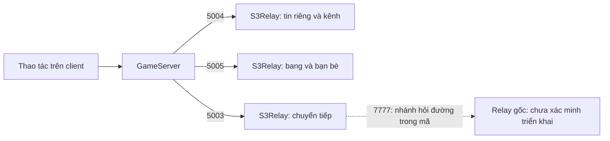

TÓM TẮT 1: [NGUỒN] [THẤY] DONE phần khảo sát tĩnh; đã trả lời 5/5 nhóm yêu cầu về S3Relay (`JX1_OPS/TASKS/SO-15.md:19-21`).
TÓM TẮT 2: [NGUỒN] [THẤY] Chat 5004 xử lý tin riêng và tin kênh; Tong 5005 xử lý bang, bạn bè; Transfer 5003 hỗ trợ tìm đường giữa các GameServer (`R/Global.cpp:464-491`; `R/ChatConnect.cpp:132-183`; `R/TongConnect.cpp:88-95`; `R/HostConnect.cpp:261-278`).
TÓM TẮT 3: [NGUỒN] [THẤY] Bàn giao sổ tay, báo cáo có sổ thông số và mục Kết quả trong task; Tổng quan nhận bản local để commit (`JX1_OPS/DESIGN/SO-TAY-S3RELAY.md:7`; `JX1_OPS/TASKS/SO-15.md:33`).
TÓM TẮT 4: [CHƯA KIỂM] Ai thực sự nghe 7777, ảnh hưởng khi thiếu relay gốc, kết nối trực tiếp đến PaySys, cổng hiệu lực và bản dựng đang chạy (`JX1_OPS/REPORTS/K-01-ban-do-truyen-tin-hieu.md:90`; `JX1_OPS/REPORTS/N-06.md:123-124`).
TÓM TẮT 5: [NGUỒN] [THẤY] Không build, chạy exe, VM hay kiểm tra mạng theo phạm vi; thao tác ghi nhịp bên ngoài worktree bị từ chối (`JX1_OPS/TASKS/SO-15.md:27-31`; mục Lỗi và cách xử lý bên dưới).

# SO-15 — Khảo sát S3Relay cho sổ tay hiểu game

Loại: khảo sát\
Chủ đề: S3Relay xử lý chuyển tiếp, tin nhắn, bạn bè, bang hội và kết nối với những tiến trình nào.\
Từ khóa: S3Relay, GameServer, chat, tin riêng, bạn bè, bang hội, Tong, Transfer, 7777\
Trạng thái: DONE cho phạm vi tài liệu và đọc tĩnh; tệp nhịp ngoài worktree bị chặn.\
Độ phủ: Đã phủ 5/5 nhóm câu hỏi của task; chưa khảo sát lúc chạy.\
Liên quan: [Sổ tay](../DESIGN/SO-TAY-S3RELAY.md), [K-01](K-01-ban-do-truyen-tin-hieu.md), [N-06](N-06.md), [A-01](A-01-ban-do-tien-trinh.md), [A-02](A-02-luong-dang-nhap.md).\
Cần tôi quyết định: không.

## Phạm vi và độ phủ

| Phần tử | Độ phủ | Bằng chứng |
|---|---|---|
| Tin riêng và kênh | Đã phủ tĩnh | `C/gamescene/KgameWorld.cpp:3016-3024,3065-3073`; `S/MultiServer/GameServer/KSOServer.cpp:3615-3622`; `R/ChatConnect.cpp:132-183` |
| Bạn bè | Đã phủ tĩnh | `R/TongConnect.cpp:832-860,951-977,1089-1101`; `R/HostConnect.cpp:108,133` |
| Bang hội | Đã phủ tĩnh | `C/gamecore/KPlayerTong.cpp:160-168`; `R/TongConnect.cpp:512-574,671-675` |
| Cổng | Đã phủ tĩnh | `H/ServerPort.h:5-13`; `R/Global.cpp:395-491` |
| Tiến trình và chiều nối | Đã phủ tĩnh | `R/Global.cpp:395-491,677-678`; `G/Sources/Sword3PaySys/S3RELAYSERVER/main.cpp:100-109,197` |
| Cấu hình triển khai, bản dựng và hoạt động thực tế | Chưa phủ | Ngoài phạm vi cấp quyền (`JX1_OPS/TASKS/SO-15.md:27-31`) |

## Giải mã tên

| Tên gốc | Mã hóa | Chữ đúng / nghĩa | Nguồn file:dòng |
|---|---|---|---|
| `帮派`, `Tong` | GBK / ASCII | Bang hội (帮派) | `R/ChannelMgr.cpp:503`; `R/TongConnect.cpp:512` |
| `S3Relay`, `gs001`, `Goddess`, `Bishop`, `Sword3PaySys` | ASCII | Giữ nguyên tên tiến trình | `JX1_OPS/REPORTS/A-01-ban-do-tien-trinh.md:47,60-62` |
| `S3RelayServer.exe` | ASCII | Tên đầu ra dự án mã nguồn ứng viên relay gốc | `G/Sources/Sword3PaySys/S3RELAYSERVER/S3RelayServer.vcxproj:159` |

Không có tên riêng của kỹ năng, trang bị, quái, NPC hoặc bản đồ trong báo cáo này. Sổ tay có bảng tên nhóm kênh. Ký hiệu gốc nguồn `C`, `S`, `G`, `H`, `R` dùng theo [sổ tay](../DESIGN/SO-TAY-S3RELAY.md), mục Đã xác minh / Chưa xác minh; chưa ghép các cây nguồn đó với bản thực thi.

## Sắp theo cấu trúc game

| Nhóm trong game | Kết quả chính |
|---|---|
| Tin nhắn → riêng / kênh | [THẤY] Cùng vào Chat 5004; kênh bang có nhánh riêng trong bộ quản lý kênh (`R/ChatConnect.cpp:132-183`; `R/ChannelMgr.cpp:1115-1126`). |
| Quan hệ → bạn bè | [THẤY] Tong nhận lời mời/trả lời, đồng bộ danh sách và xóa bạn; Transfer báo vào/rời game cho bộ quản lý bạn bè (`R/TongConnect.cpp:832-860,1089-1101`; `R/HostConnect.cpp:108,133`). |
| Bang hội → quản lý | [THẤY] GameServer gửi yêu cầu tạo bang qua Tong; cùng dịch vụ có xử lý thêm và trục xuất thành viên (`S/MultiServer/GameServer/KSOServer.cpp:6102-6119`; `R/TongConnect.cpp:512-574,671-675`). |
| Thế giới → tìm đường giữa GameServer | [THẤY] Transfer phân nhánh tìm theo nhân vật hoặc bản đồ; nhánh theo bản đồ gọi Bishop (`R/HostConnect.cpp:261-278,419-424`). |

## Mục sổ thông số

| Nhóm | Tên/hằng số | file:dòng | Giá trị | Đơn vị | Ảnh hưởng | Đổi an toàn | Nguồn đo |
|---|---|---|---:|---|---|---|---|
| Transfer | `RELAY_GAMESVR_SERVICE_PORT` | `H/ServerPort.h:9`; `R/Global.cpp:464-466`; `S/MultiServer/GameServer/KSOServer.cpp:732,1057` | 5003 | Cổng TCP | GameServer nối đầu Transfer | CẨN THẬN | Đọc tĩnh: hằng đầu nghe và mặc định đầu nối |
| Chat | `RELAY_GAMESVR_CHATSERVICE_PORT` | `H/ServerPort.h:10`; `R/Global.cpp:489-491`; `S/MultiServer/GameServer/KSOServer.cpp:734,1111` | 5004 | Cổng TCP | Tin kênh và tin riêng | CẨN THẬN | Đọc tĩnh: hằng đầu nghe và mặc định đầu nối |
| Bang / bạn bè | `RELAY_GAMESVR_TONGSERVICE_PORT` | `H/ServerPort.h:11`; `R/Global.cpp:476-478`; `S/MultiServer/GameServer/KSOServer.cpp:736,1162` | 5005 | Cổng TCP | GameServer nối đầu Tong | CẨN THẬN | Đọc tĩnh: hằng đầu nghe và mặc định đầu nối |
| Dữ liệu nhân vật | `ROLEDBSVR_ROLEDB_PORT` | `H/ServerPort.h:5`; `R/Global.cpp:428-435` | 5001 | Cổng TCP | Relay nối Goddess | CẨN THẬN | Đọc tĩnh: hằng cổng đích |
| Gateway | `GATEWAY_GAMESVR_SERVICE_PORT` | `H/ServerPort.h:7`; `R/Global.cpp:445-453` | 56732 | Cổng TCP | Relay nối Bishop | CẨN THẬN | Đọc tĩnh: hằng cổng đích |
| Relay ngang hàng | `RELAY_SIBLING_PORT` | `H/ServerPort.h:12`; `R/Global.cpp:395-402,677-678` | 7776 | Cổng TCP | Đầu nghe và đầu nối relay ngang hàng | CẨN THẬN | Đọc tĩnh: hằng cổng |
| Relay gốc | `RELAY_ROUTE_PORT` | `H/ServerPort.h:13`; `R/Global.cpp:411-418`; `G/Sources/Sword3PaySys/S3RELAYSERVER/main.cpp:100-109,197` | 7777 | Cổng TCP | Đích của S3Relay; cũng là mặc định phía dự án ứng viên, có thể bị cấu hình ghi đè ở đầu nghe đó | CẨN THẬN | Đọc tĩnh: hằng cổng đích và mặc định ở dự án riêng |

Chưa đo cổng hiệu lực. `CẨN THẬN` nghĩa là chưa có đủ căn cứ để đổi an toàn; các đầu nối phụ thuộc cùng giá trị.

## Đã xác minh / Chưa xác minh

- **[THẤY] Đã xác minh tĩnh:** `PlayerFschatProcess` chọn Transfer/Chat/Tong theo nhóm yêu cầu (`S/MultiServer/GameServer/KSOServer.cpp:3592,3615-3622,3683-3688`); `CChatConnect::RecvPackage` chuyển tin tới `SomeoneChat` hoặc `ChannelChat` (`R/ChatConnect.cpp:132-183`); `CTongConnect::RecvPackage` tách bang và bạn bè (`R/TongConnect.cpp:88-95`); `Global.cpp:395-491` cho biết chiều nối và cổng. Mã nguồn Hán được đọc với GBK (CP936) ở các đoạn dẫn tên; tài liệu viết UTF-8.
- **[TÀI LIỆU] Đã đối chiếu báo cáo cũ:** A-01 ghi lần khảo sát cũ chưa thấy tiến trình nghe 7777; N-06 nêu ứng viên `S3RelayServer.exe` trong mã. A-02 và K-01 có mức kết luận khác nhau về đường S3Relay → PaySys. Không sửa báo cáo cũ (`JX1_OPS/REPORTS/A-01-ban-do-tien-trinh.md:50,91`; `JX1_OPS/REPORTS/N-06.md:123-124`; `JX1_OPS/REPORTS/A-02-luong-dang-nhap.md:114`; `JX1_OPS/REPORTS/K-01-ban-do-truyen-tin-hieu.md:90`).
- **[CHƯA KIỂM]** Tiến trình thật nghe 7777/7776, phiên bản và cấu hình triển khai, ảnh hưởng khi thiếu relay gốc, kết nối trực tiếp PaySys và tin riêng khi người nhận vắng mặt. Không chạy build, thử nghiệm game, VM, exe hay mạng vì chỉ được đọc tĩnh (`JX1_OPS/TASKS/SO-15.md:27-31`).

## Lỗi và cách xử lý

| Lỗi / dấu hiệu | Cách thử và kết quả | Việc còn lại |
|---|---|---|
| Đường dẫn `gateway/Sources/S3Relay` trong mục tiêu không tồn tại | `Test-Path` trả `False`; kiểm đúng thư mục `gateway/Sources/MultiServer` và mở được mã S3Relay trong cùng cây nguồn | Dùng gốc đã xác nhận trong sổ tay |
| `rg` không có trong PowerShell | Lệnh trả `CommandNotFoundException`; chuyển sang `Select-String` và `Get-ChildItem` trong phạm vi đã lọc | Không cần cài |
| Không ghi được `D:\JX-wt\SO-15.nhip` | `Add-Content` tại mốc bắt đầu trả `Access to the path ... is denied` (`UnauthorizedAccessException`); đường dẫn nằm ngoài vùng ghi của worktree. Các mốc tiếp theo được báo trong phiên làm việc | Chưa tạo tệp `.nhip`; Tổng quan có thể ghi nhận từ báo cáo nếu cần |

## Đề xuất tối ưu

Giữ hai phép kiểm nghiệp vụ riêng nếu sau này có task chạy thử: một tin trong kênh bang (Chat 5004) và một thao tác quản lý thành viên (Tong 5005). Xác định bản dựng, tiến trình nghe và hành vi với 7777 bằng một phép kiểm riêng trước khi đưa 7777 vào hướng dẫn vận hành. Căn cứ: `R/ChannelMgr.cpp:1115-1126`; `R/TongConnect.cpp:561-574`; `R/Global.cpp:411-418`.

## Bàn giao

Tổng quan nhận ba tệp local: sổ tay, báo cáo và task có mục Kết quả. Không stage, commit hay push theo yêu cầu; chưa có SHA. Đề xuất thêm vào `JX1_OPS/DESIGN/MUC-LUC-TRI-THUC.md` (Tổng quan gộp):

| Chủ đề | Tài liệu | Từ khóa | Mức xác minh |
|---|---|---|---|
| S3Relay: tin nhắn, bạn bè, bang hội | `SO-TAY-S3RELAY.md`, `SO-15`, `K-01`, `N-06` | S3Relay, Chat 5004, Tong 5005, Transfer 5003, 7777 | Đọc tĩnh; triển khai chưa kiểm |

Kỹ năng đã dùng: `jx1-retrofit` (giữ nguyên kết luận cũ, dùng khuôn và bảng phạm vi khi tổng hợp), `jx1-read-server`, `jx1-read-client`, `jx1-parameters`, `jx1-knowledge`, `jx1-report`.
