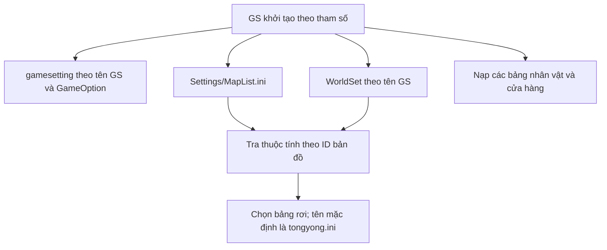

TÓM TẮT 1: [NGUỒN] PARTIAL — đã lập danh mục tệp cấu hình GS trọng yếu, điểm đọc và mức thận trọng khi sửa.
TÓM TẮT 2: [NGUỒN] Đối chiếu 34 đường dẫn của bản A với mã server; bổ sung 9 tệp và lần được bộ đọc `tongyong.ini`.
TÓM TẮT 3: [NGUỒN] Kết quả chi tiết nằm trong `JX1_OPS/DESIGN/SO-TAY-TEP-CAU-HINH-GS.md`.
TÓM TẮT 4: [CHƯA KIỂM] Chưa xác nhận toàn bộ tệp con, schema, runtime hoặc tệp nào sửa an toàn.
TÓM TẮT 5: [CHƯA KIỂM] Lượt tiếp tục không build, chạy exe, VM hay dùng mạng; không commit theo yêu cầu; PM có thể gộp bản bàn giao.

# SO-16 — Danh mục tệp cấu hình gs/Settings
Loại: tổng hợp
Chủ đề: Sổ tay nhận diện tệp cấu hình GS, công dụng, người đọc trong source và giới hạn an toàn chỉnh sửa.
Từ khóa: SO-16, cấu hình, Settings, gamesetting_gs001.ini, MapList, WorldSet, kỹ năng, Missles, gs001
Trạng thái: PARTIAL — đã kiểm tra nhóm tệp trọng yếu; chưa đủ bằng chứng để kết luận tệp nào sửa an toàn.
Độ phủ: 34/34 đường dẫn trọng yếu hiện diện và có điểm đọc tĩnh (25 từ mốc trước, thêm 9); chưa kiểm kê toàn cây Settings.
Liên quan: `JX1_OPS/DESIGN/SO-TAY-TEP-CAU-HINH-GS.md`; `JX1_OPS/REPORTS/A-03-kiem-ke-cau-hinh.md`; `JX1_OPS/REPORTS/I-04-khao-sat-map.md`; `JX1_OPS/REPORTS/K-02-ban-do.md`; `JX1_OPS/REPORTS/K-02-du-lieu-ini.md`; `JX1_OPS/REPORTS/A-08d-kinh-nghiem.md`; `JX1_OPS/REPORTS/I-02-vat-pham-ban.md`; `JX1_OPS/REPORTS/A-17-roi-do-boss-trang-bi.md`
Cần tôi quyết định: không

## Sơ đồ chính

## Phạm vi và độ phủ

Các đường dẫn sau tồn tại trong bản A `C:\Jx1CocoV3\Folder\ServerNew-20260116T043145Z-3-001\ServerNew\_bin_v2_\gs\Settings` (`Settings/`). “Đã phủ” là đã kiểm sự hiện diện và điểm đọc tĩnh. Tên tệp `.cpp` trong bảng tính từ `C:/Jx1CocoV3/SwordOnline/SwordOnline/jxOnline/gameserver/Sources/Core/Src/`; `CoreUseNameDef.h` ở `jxOnline/header/`. Đồng bộ với bản chạy chưa xác minh.

| Tệp | Độ phủ | Bằng chứng đọc tĩnh |
|---|---|---|
| `gamesetting_gs001.ini` | Đã phủ | `KCore.cpp:262–293` |
| `GameOption.ini` | Đã phủ, bổ sung | `CoreUseNameDef.h:164`; `KCore.cpp:317–325`; `KPlayerSet.cpp:127–156` |
| `GameData.ini` | Đã phủ, bổ sung; mã có đường ghi | `CoreUseNameDef.h:163`; `KCore.cpp:699–702`; `KCoreData.cpp:168–208,217–247` |
| `MapList.ini` | Đã phủ | `CoreUseNameDef.h:161`; `KCore.cpp:609–610`; `KSubWorld.cpp:811–925` |
| `mapdroprate/tongyong.ini` | Đã phủ; xác định đường đọc có điều kiện | `KSubWorld.cpp:886–901`; `KRegion.cpp:417–425,772–778`; `KNpcSet.cpp:595–616`; `KNpcTemplate.cpp:129–143,512–558` |
| `RevivePos.ini` | Đã phủ | `KSubWorldSet.cpp:683–721` |
| `npc/player/level_exp.txt` | Đã phủ, bổ sung | `CoreUseNameDef.h:110`; `KPlayerSet.cpp:1291–1299` |
| `npc/player/level_add.txt` | Đã phủ, bổ sung | `CoreUseNameDef.h:111`; `KPlayerSet.cpp:1303–1319` |
| `npc/player/level_lead_exp.txt` | Đã phủ, bổ sung | `CoreUseNameDef.h:112`; `KPlayerSet.cpp:1481–1494` |
| `npc/player/NewPlayerBaseAttribute.ini` | Đã phủ, bổ sung | `CoreUseNameDef.h:113`; `KPlayerSet.cpp:76,1568–1585` |
| `npc/player/BaseValue.ini` | Đã phủ, bổ sung | `CoreUseNameDef.h:115`; `KNpcSet.cpp:91,135–153` |
| `Skills.txt` | Đã phủ | `CoreUseNameDef.h:139`; `KCore.cpp:623–630` |
| `Missles.txt` | Đã phủ | `CoreUseNameDef.h:140`; `KCore.cpp:625,629` |
| `NpcS.txt` (`Npcs.txt` trên đĩa) | Đã phủ | `CoreUseNameDef.h:141`; `KCore.cpp:626,630` |
| `item/AbradeRate.ini` | Đã phủ | `CoreUseNameDef.h:135`; `KItemSet.cpp:73–125` |
| `buysell.txt` | Đã phủ, bổ sung | `CoreUseNameDef.h:123`; `KCore.cpp:760–762`; `KBuySell.cpp:83–90,223–234` |
| `goods.txt` | Đã phủ, bổ sung | `CoreUseNameDef.h:124`; `KBuySell.cpp:83–93,110–125` |
| `item/004/questkey.txt` | Đã phủ | `CoreUseNameDef.h:93`; `KCore.cpp:824–830` |
| `item/004/mine.txt` | Đã phủ | `CoreUseNameDef.h:94`; `KCore.cpp:837–840` |
| `item/004/fusion.txt` | Đã phủ | `CoreUseNameDef.h:95`; `KCore.cpp:832–835` |
| `task/missions.txt` | Đã phủ | `CoreUseNameDef.h:97`; `KCore.cpp:908–910` |
| `WayPoint.txt` | Đã phủ | `CoreUseNameDef.h:86`; `KCore.cpp:841–844` |
| `Station.txt` | Đã phủ | `CoreUseNameDef.h:87`; `KCore.cpp:846–849` |
| `StationPrice.txt` | Đã phủ | `CoreUseNameDef.h:88`; `KCore.cpp:851–853,871–888` |
| `WayPointPrice.txt` | Đã phủ | `CoreUseNameDef.h:89`; `KCore.cpp:856–859,871–894` |
| `Wharf.txt` | Đã phủ | `CoreUseNameDef.h:90`; `KCore.cpp:861–864` |
| `WharfPrice.txt` | Đã phủ | `CoreUseNameDef.h:91`; `KCore.cpp:866–869,875–881,897–900` |
| `ReBorn/rebornsetting.txt` | Đã phủ | `CoreUseNameDef.h:101`; `KCore.cpp:678–681` |
| `RoleVip/rolevipsetting.txt` | Đã phủ | `CoreUseNameDef.h:102`; `KCore.cpp:683–685` |
| `gmgamelist.txt` | Đã phủ; không đọc nội dung quyền | `KCore.cpp:596–597` |
| `ForbititWaiGua.txt` | Đã phủ | `CoreUseNameDef.h:168`; `KCore.cpp:599–600` |
| `ForbititMap.txt` | Đã phủ | `CoreUseNameDef.h:167`; `KCore.cpp:602–603` |
| `meridian/meridian_level.txt` | Đã phủ | `CoreUseNameDef.h:166`; `KCore.cpp:604–605` |
| `playertitle.txt` | Đã phủ | `KCore.cpp:607` |

## Đã xác minh / Chưa xác minh

[TÀI LIỆU] Bản A được xác định qua `JX1_OPS/REPORTS/A-03-kiem-ke-cau-hinh.md:35–42`; cây dữ liệu hiện tại được kiểm tra tên tệp và thư mục có giới hạn. `D:/JX-build/qh9A/gs/Settings` và `D:/JX-build/qh9A/_bin_v2_/gs/Settings` không tồn tại tại các đường dẫn đã kiểm. Không gán cấu hình của bản A cho `qh9A`.

[ĐÃ XÁC MINH — ĐỌC TĨNH] Server tạo tên tệp gamesetting theo tham số tại `C:/Jx1CocoV3/SwordOnline/SwordOnline/jxOnline/gameserver/Sources/Core/Src/KCore.cpp:262–293`; nạp danh mục bản đồ tại `:609–610`; và nạp danh sách thế giới từ `maps/WorldSet_<tên>.ini` tại `:653–656`. Hàm `LoadSerMaps` đọc `Count`, `World%02d` rồi gọi nạp map tại `KSubWorldSet.cpp:441–464`.

[ĐÃ XÁC MINH — ĐỌC TĨNH] `Settings/mapdroprate/tongyong.ini:2–3,25` có `Main.Count=0` và mục đánh số `[1]`. `g_GenItemDropRate` trả về rỗng nếu mở tệp có `Count <= 0` (`KNpcTemplate.cpp:135–143`). Đây là kết quả đối chiếu tệp rời với mã, chưa đo hành vi rơi đồ. `KGameData::Save` ghi lại `GameData.ini` (`KCoreData.cpp:217–247`); sổ tay xếp tệp này vào mức KHÔNG sửa tay như bảng cấu hình, 33 tệp còn lại ở mức CẨN THẬN.

[CHƯA KIỂM] Chưa đọc toàn bộ nội dung và cấu trúc 34 tệp; chưa biết dữ liệu rời hay gói dữ liệu nào được tiến trình dùng; chưa có tệp đạt mức CÓ vì chưa kiểm thử thay đổi. Lượt tiếp tục không chỉnh cấu hình, build, chạy exe, VM hay dùng mạng.

## Mục sổ thông số

| Nhóm | Tên/hằng số | file:dòng | Giá trị | Đơn vị | Ảnh hưởng | Đổi an toàn | Nguồn đo |
|---|---|---|---|---|---|---|---|
| Rơi đồ | `Main.Count` | `Settings/mapdroprate/tongyong.ini:2–3`; `KNpcTemplate.cpp:135–143` | 0 trên đĩa | số mục rơi | Bộ đọc từ chối nếu mở đúng bản rời này | CẨN THẬN | Đọc tĩnh tệp bản A và mã |
| Lên cấp | Ngưỡng kinh nghiệm cấp 1 | `Settings/npc/player/level_exp.txt:2`; `KPlayerSet.cpp:1295–1299` | 100 trên đĩa | điểm kinh nghiệm | Ngưỡng kinh nghiệm cho cấp 1 | CẨN THẬN | Đọc tĩnh tệp bản A, cột 2 |
| Di chuyển | `RunSpeed`, `WalkSpeed` | `Settings/npc/player/BaseValue.ini:3–4`; `KNpcSet.cpp:139–144` | 10 và 5 trên đĩa; trùng mặc định trong mã | chưa quy đổi | Tốc độ chạy và đi bộ | CẨN THẬN | Đọc tĩnh tệp bản A và mã |

## Giải mã tên

| Tên gốc | Mã hóa | Chữ đúng / cách hiểu | Nguồn |
|---|---|---|---|
| `gs001` | ASCII | Tên tham số server, giữ nguyên | `KCore.cpp:262,653–656` |
| `MapList.ini` | ASCII | Tên file danh mục bản đồ, giữ nguyên | `CoreUseNameDef.h:161` |
| `WorldSet_<tên>.ini` | ASCII | Mẫu tên file chọn danh sách bản đồ, giữ nguyên | `KCore.cpp:653–656` |
| `Missles.txt` | ASCII | Chính tả được source dùng, giữ nguyên | `CoreUseNameDef.h:140` |
| `NpcS.txt` / `Npcs.txt` | ASCII | Tên trong source và đĩa khác hoa thường trên Windows | `CoreUseNameDef.h:141`; filesystem bản A |

[CHƯA KIỂM] Không trích tên riêng từ nội dung dữ liệu GBK/TCVN3; tài liệu nguồn chính không cung cấp các chuỗi ấy cho sổ tay này.

## Sắp theo cấu trúc game

Các tệp được nhóm theo vai trò trong game: khởi tạo và dữ liệu lưu → bản đồ và hồi sinh → nhân vật, kỹ năng và NPC → vật phẩm, cửa hàng, di chuyển và nhiệm vụ → tái sinh, VIP và các luật chơi khác.

## Phát hiện và giới hạn

- `CLAUDE.md` không có ở gốc worktree nên mục “Bản đồ code” không thể kiểm. Đã đọc báo cáo A-03, I-04, K-02 và các dòng source cần thiết.
- `rg` không khả dụng; dùng PowerShell với các file/thư mục giới hạn, không cài công cụ.
- Lượt trước đã gọi Graphify một lần trái với giới hạn không chạy exe; lệnh không trả nội dung. Lượt tiếp tục không gọi lại và không dùng làm bằng chứng.
- Tầng gốc Settings có 90 tệp: 33 `.ini`, 49 `.txt`, 8 phần mở rộng khác; chưa đếm các thư mục con. Danh mục 34 tệp là nhóm trọng yếu.
- `MapTraffic.ini` có điểm đọc ở client2912 (`Classes/gamecore/KCore.cpp:409–413`), phù hợp với nhánh `#ifndef _SERVER` ở mã server (`KCore.cpp:710–711`). Chưa xác minh GS có đường nạp khác. `Task/tasklist.ini` có lời gọi nạp bị chú thích (`KCore.cpp:688–692`).
- `D:\JX-wt\SO-16.nhip` nằm ngoài vùng ghi. Lần ghi đầu lượt tiếp tục trả `Access to the path is denied`; không thử ghi lại ở các mốc sau.
- Không tạo `_CHIMUC/SO-16.tsv` vì ngoài phạm vi tệp được phép.

## Đề xuất tối ưu

Ưu tiên kiểm các phụ thuộc trước khi đổi: đối chiếu hàng được tham chiếu giữa hai bảng cửa hàng; kiểm điều kiện chọn bảng rơi theo ID bản đồ; xác nhận tệp hiệu lực, mã hóa và bản hoàn tác. Với `GameData.ini`, dùng quy trình bảo trì dữ liệu riêng nếu có yêu cầu đổi. Các bước kiểm thử thuộc công việc riêng có cấp quyền.

## Bàn giao

Không commit theo yêu cầu. Giữ trạng thái `PARTIAL`: đã bổ sung bằng chứng tĩnh cho danh mục chính; chưa xác nhận tệp nào sửa an toàn. Nếu cần kết luận đó, PM chọn bản GS và khóa cụ thể cần kiểm, thử trên bản sao có thể hoàn tác.

Hàng đề nghị để PM gộp vào `JX1_OPS/DESIGN/MUC-LUC-TRI-THUC.md`: `JX1_OPS/DESIGN/SO-TAY-TEP-CAU-HINH-GS.md | khảo sát | Công dụng và bộ đọc tệp gs/Settings | SO-16, Settings, MapList, WorldSet, tongyong, cửa hàng | PARTIAL | 34 tệp chính, đọc tĩnh | A-03, I-04, K-02, A-08d, I-02, A-17`.

Kỹ năng đã dùng: jx1-retrofit, jx1-read-server, jx1-read-client (đối chiếu `MapTraffic.ini`), jx1-parameters, jx1-knowledge, jx1-report.
