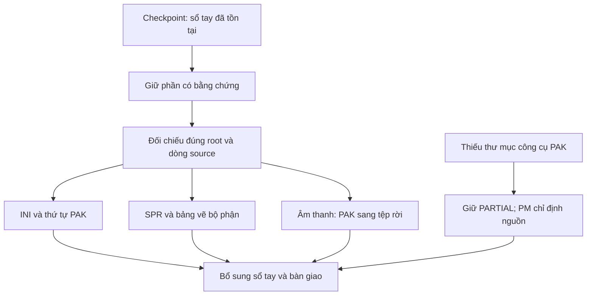

TÓM TẮT 1/5: [NGUỒN] PARTIAL — tiếp tục SO-17 trên nhánh task/SO-17; giữ kết luận cũ và bổ sung phần còn thiếu của sổ tay tài nguyên client.
TÓM TẮT 2/5: [NGUỒN] Đối chiếu tĩnh hai danh sách INI, thứ tự tìm PAK, metadata SPR, thứ tự bộ phận và cầu nối âm thanh từ PAK ra tệp rời.
TÓM TẮT 3/5: [NGUỒN] Đầu ra chính là JX1_OPS/DESIGN/SO-TAY-TAI-NGUYEN-CLIENT.md; báo cáo bàn giao này ghi nguồn, giới hạn và việc PM cần tiếp tục.
TÓM TẮT 4/5: [CHƯA KIỂM] docs-analysis/tools không có trong worktree; chưa kiểm công cụ PAK, asset thực nạp hoặc runtime. Tệp nhịp ở thư mục cha nằm ngoài vùng được phép ghi.
TÓM TẮT 5/5: [NGUỒN] Không chạy build, test game, exe game/công cụ, VM hoặc mạng; không stage/commit/push theo yêu cầu. PM cần chỉ định nguồn công cụ PAK và tổng hợp commit.

# SO-17 — Bàn giao sổ tay tài nguyên client

Loại: tổng hợp
Chủ đề: Tiếp tục sổ tay PAK, SPR, INI, ảnh bộ phận và âm thanh từ checkpoint đã có.
Từ khóa: SO-17, tài nguyên client, PAK, SPR, INI, paklist, package, thứ tự vẽ, âm thanh, g_StrCopy
Trạng thái: PARTIAL — phần đọc mã có bằng chứng; phần công cụ PAK còn thiếu nguồn, chưa xác minh runtime.
Độ phủ: 4/5 nhóm chủ đề đã đối chiếu mã; công cụ PAK 0/1 nhóm vì thư mục chỉ định không tồn tại. Đây là độ phủ chủ đề, không phải tỷ lệ asset đã đọc.
Liên quan: JX1_OPS/TASKS/SO-17.md; JX1_OPS/DESIGN/CHUAN-BAO-CAO.md; JX1_OPS/DESIGN/SO-TAY-TAI-NGUYEN-CLIENT.md; JX1_OPS/DESIGN/QUY-LUAT-VE-BO-PHAN.md; JX1_OPS/REPORTS/K-02-giao-dien.md; JX1_OPS/REPORTS/K-02-am-thanh.md; JX1_OPS/REPORTS/J-01-animation-nhan-vat-tran.md
Cần tôi quyết định: có — PM chỉ định nguồn công cụ PAK nếu muốn hoàn tất nhóm còn thiếu; không cần mở quyền chạy game cho kết quả đọc tĩnh này.

## Phạm vi và độ phủ

| Nhóm thuộc mục tiêu task | Đã phủ / chưa phủ | Bằng chứng và giới hạn |
|---|---|---|
| PAK và INI | Đã phủ luồng source | C/gamescene/KUpdateLayer.cpp:40,762–830; C/engine/KPakList.cpp:66–77,136–205; C/engine/KPakFile.cpp:19–31,256–305; C/engine/KIniFile.cpp:71–119. Chưa đọc INI triển khai hoặc PAK thực. |
| SPR và ảnh | Đã phủ schema/nhánh đọc | C/engine/KbugInfo.h:238–291; C/engine/Kgetinidata.cpp:100–153. Không đo frame, palette hoặc chất lượng ảnh thực. |
| Ảnh bộ phận, sai thứ tự vẽ | Đã phủ lời gọi và giới hạn tài liệu | C/gamecore/KNpcRes.cpp:422; C/gamecore/KNpcResNode.cpp:547–630; JX1_OPS/DESIGN/QUY-LUAT-VE-BO-PHAN.md:18–46. Không điền ma trận còn thiếu bằng suy đoán. |
| Âm thanh | Đã phủ thêm nhánh PAK → tệp rời → trình phát | C/engine/KStrBase.cpp:829–873; C/gamecore/KNpcRes.cpp:2512–2551; C/manager/SoundManager.cpp:126–168; C/gamecore/KMapMusic.cpp:261–283. Chưa gọi hàm hoặc phát âm. |
| Công cụ PAK trong docs-analysis/tools | Chưa phủ nội dung công cụ | Test-Path đúng đường dẫn trả False; JX1_OPS/REPORTS/K-02.md:29 chỉ dẫn nơi cần công cụ, không cung cấp mã hoặc phiên bản công cụ. |

## Nguồn đã chọn và cách đọc

[NGUỒN] Bắt đầu bằng chuẩn báo cáo và task; kiểm Git một lần cho thấy nhánh `task/SO-17`, không có thay đổi local được liệt kê. Sổ tay đã có sẵn, báo cáo bàn giao chưa có. Chỉ tiếp tục các mục thiếu; không khảo sát lại toàn bộ phần đã có bằng chứng.

| Ký hiệu / nhóm | Đường dẫn hoặc tập tệp đã đọc có giới hạn | Mục đích |
|---|---|---|
| C | C:/Jx1CocoV3/Folder/Client2912-20260116T044348Z-3-001/Client2912/Client/Classes | Root client đúng task, không thay bằng qh9A. |
| S | C:/Jx1CocoV3/SwordOnline/SwordOnline/jxOnline/gameserver/Sources | Root server đúng task. |
| DESIGN | CHUAN-BAO-CAO.md; SO-TAY-TAI-NGUYEN-CLIENT.md; QUY-LUAT-VE-BO-PHAN.md; mục liên quan trong MUC-LUC-TRI-THUC.md | Chuẩn, checkpoint, giới hạn bảng vẽ và định vị tri thức. |
| Báo cáo theo từ khóa PAK/SPR/paklist | K-02-giao-dien.md:1–154; K-02-am-thanh.md:1–130 và các dòng định vị lời gọi âm; J-01-animation-nhan-vat-tran.md: các dòng khớp header/PAK; K-02.md:29 | Chỉ dùng nội dung liên quan; số liệu asset của root khác không nhập thành số đo SO-17. |
| Engine client | KPakList.cpp, KPakList.h, KPakFile.cpp, KbugInfo.h, Kgetinidata.cpp, KIniFile.cpp, KStrBase.cpp | Chỉ đoạn hàm/khai báo cần cho bảng trên và sổ thông số. |
| Khởi tạo, nhân vật, âm thanh client | gamescene/KUpdateLayer.cpp; gamecore/KNpcRes.cpp, KNpcResNode.cpp, KMapMusic.cpp; manager/SoundManager.cpp | Phân biệt hai INI, sort và đường phát âm. |
| Server | S/Engine/Src/KPakList.cpp:121–188; S/Engine/Src/KPakFile.cpp:245–305 | Đối chiếu lớp đọc gói đã nêu trong sổ tay, không dùng để suy đường client. |

[NGUỒN] Đã nạp sáu SKILL.md trong `.agents/skills` theo yêu cầu. GS001-MAP được tìm đúng từ khóa lớp đọc gói nhưng không có mục phù hợp; không mở graph/source toàn cây. Tìm bằng Select-String/Get-ChildItem giới hạn tên và thư mục, không quét đệ quy Folder/, SwordOnline/ hoặc D:/JX-wt/. Không chạy Graphify vì task cấm exe. Không mở INI nguyên tệp, tài khoản, dump, log hoặc dữ liệu khóa.

## Giải mã tên

| Tên gốc | Mã hóa | Chữ đúng UTF-8 | Nguồn file:dòng |
|---|---|---|---|
| PAK, PACK, SPR, INI | ASCII; tên kỹ thuật và dấu nhận diện | Giữ nguyên | C/engine/KbugInfo.h:238–291; C/engine/KIniFile.cpp:71–119 |
| package.ini / paklist.ini | ASCII; tên tệp khác nhau | Giữ nguyên, không gộp hai tên | C/gamescene/KUpdateLayer.cpp:40,762–830 |
| KPakList, KPakFile, g_StrCopy, SoundManager | ASCII; tên lớp/hàm | Giữ nguyên | C/engine/KPakList.cpp:66–77; C/engine/KPakFile.cpp:256–305; C/engine/KStrBase.cpp:829–873; C/manager/SoundManager.cpp:126–168 |
| Tên thực thể kỹ năng, trang bị, NPC, bản đồ | Không thêm tên riêng thực thể trong phần bổ sung | Không áp dụng; không tự dịch hoặc đoán tên | Phạm vi task JX1_OPS/TASKS/SO-17.md:19–30 |

[NGUỒN] Markdown đầu ra là UTF-8 không BOM. Source legacy có comment dùng GBK/CP936 hoặc trộn mã; kết luận dựa trên symbol, biểu thức và chuỗi ASCII. Với KStrBase.cpp, số dòng được chốt lại bằng tách byte LF, tránh lệch do giải mã toàn tệp sai encoding. Không chuyển mã hoặc sửa source.

## Sắp theo cấu trúc game

[TÀI LIỆU] Trình tự giải thích là: cấu hình và kho tài nguyên → ảnh/khung → nhân vật ghép bộ phận → âm hiệu/nhạc. Trong nhóm nhân vật, giữ hành động → hướng → khung → bảng sort, không áp một thứ tự che cho mọi tư thế. Nguồn: C/engine/KPakList.cpp:136–205; C/engine/Kgetinidata.cpp:100–153; C/gamecore/KNpcRes.cpp:422; C/gamecore/KNpcResNode.cpp:612–630; C/gamecore/KNpcRes.cpp:2512–2551.

## Mục sổ thông số

[THẤY] Đây là khai báo/mặc định source, không phải giá trị đo từ gói hoặc bản game đang chạy. Đánh giá mức đổi không cấp quyền chỉnh mã/cấu hình.

| Nhóm | Tên/hằng số | file:dòng | Giá trị | Đơn vị | Ảnh hưởng | Đổi an toàn (CÓ/CẨN THẬN/KHÔNG) | Nguồn đo |
|---|---|---|---|---|---|---|---|
| Ưu tiên đọc | m_nPakFileMode | C/engine/KPakFile.cpp:19–31,262–275 | Mặc định source 1; nhánh 0 thử đĩa trước, nhánh khác thử PAK trước | Mã chế độ | Quyết định nơi thử đọc đầu tiên | CẨN THẬN — chưa kiểm mode runtime và tài nguyên trùng | Đọc tĩnh, chưa đo runtime |
| Danh sách gói | MAX_PAK | C/engine/KPakList.h:44–46; C/engine/KPakList.cpp:171–198 | 50; vòng xét khóa 0..49 | Vị trí gói/khóa | Giới hạn danh sách trong lớp này; không phải số PAK đang có | CẨN THẬN — chưa kiểm nơi phụ thuộc | Đọc tĩnh |
| Hoạt ảnh | SPRHEAD.Frames | C/engine/KbugInfo.h:245; C/engine/Kgetinidata.cpp:142,153 | Theo asset; chưa đọc giá trị | Khung ảnh | Tổng số khung từ header | KHÔNG — chưa có asset/cặp đối chiếu | Đọc schema, chưa đo |
| Hướng | SPRHEAD.Directions | C/engine/KbugInfo.h:247 | Theo asset; chưa đọc giá trị | Hướng | Số hướng được khai báo, không mặc định bằng ma trận tám hướng của tài liệu cũ | KHÔNG — chưa có asset/cặp đối chiếu | Đọc schema, chưa đo |

## Đã xác minh / Chưa xác minh

### Đã xác minh

- [THẤY] `package.ini` được truyền cho bộ mở gói; `paklist.ini` được nhánh chuẩn bị tải đọc theo mục `list`. Đây là hai vai trò thấy trong source, không phải xác nhận nội dung cấu hình triển khai: C/gamescene/KUpdateLayer.cpp:40,762–830; C/engine/KPakList.cpp:136–205.
- [THẤY] Vòng tìm PAK dừng ở gói đầu tiên tìm thấy mã tài nguyên, theo danh sách gói mở được: C/engine/KPakList.cpp:66–77,171–198.
- [THẤY] Source có nhánh sao dữ liệu âm từ PAK ra tệp khi đích chưa tồn tại; nhân vật gọi nhánh đó trước khi phát: C/engine/KStrBase.cpp:829–873; C/gamecore/KNpcRes.cpp:2512–2551.
- [THẤY] Lời gọi sort dùng action, hướng, frame: C/gamecore/KNpcRes.cpp:422; C/gamecore/KNpcResNode.cpp:612–630. Không sửa kết luận hoặc điền thêm số đo trong DESIGN cũ.

### Chưa xác minh

- Công cụ PAK: tên, phiên bản, mã, tham số, nén hỗ trợ và kết quả kiểm an toàn; thư mục task chỉ định đang vắng.
- Gói/INI/SPR thật, hash và ánh xạ asset đúng bản, tài nguyên trùng, mã hóa tên của từng asset, mode và nhánh âm hiệu lực trong binary.
- Build, unit/integration test của game, phát âm, FPS, thiết bị, exe công cụ/game, VM và mạng đều không chạy vì ngoài quyền task. Không tuyên bố test game đạt.

## Kiểm tra tài liệu, lỗi và cách xử lý

- Mở đầu: Git status/branch sạch trên `task/SO-17`; giữ nguyên sổ tay đã có và chỉ bổ sung, không stage hoặc commit.
- Encoding: lần đọc mở đầu dùng mặc định khiến console hiển thị mojibake. Các lượt tiếp theo đặt console UTF-8 và đọc Markdown UTF-8; không sửa nội dung nguồn vì lỗi hiển thị.
- Ghi tệp: công cụ apply_patch báo `Failed to write file` cho sổ tay. Đọc lại xác nhận chưa có nội dung bổ sung và tệp không mang thuộc tính ReadOnly. Chuyển sang thao tác tệp UTF-8 trực tiếp, trong cùng worktree; không đổi quyền hay cấu hình.
- Định vị Kết quả: lần đầu kiểm chuỗi thấy cả câu hướng dẫn có trích tên mục và tiêu đề thật nên guard dừng trước khi sửa task; sổ tay đã được nối thêm, nội dung gốc đã được kiểm giữ nguyên byte. Đọc lại task rồi đổi sang khớp tiêu đề độc lập đầu dòng; chỉ cập nhật phần cuối, không lặp phần sổ tay đã ghi.
- Nhịp: checkpoint cũ đã ghi nhận từ chối `D:/JX-wt/SO-17.nhip`; lần tiếp tục này đường dẫn vẫn ngoài writable root được cấp. Không thử vượt sandbox hoặc tạo tệp thay thế ngoài vùng_file. Chưa ghi được các mốc nhịp theo yêu cầu.
- Công cụ PAK: Test-Path đúng đường dẫn trả False; không tự tìm repo/cây nguồn khác, tải hoặc chạy công cụ thay thế.
- Kiểm tra tài liệu đã chạy: 3/3 tệp giải mã UTF-8 nghiêm ngặt, không BOM/ký tự thay thế; hai tài liệu đều đủ 5 dòng tóm tắt và khối Mermaid có fence cân bằng; mục Kết quả task có 5 dòng; 11/11 liên kết Markdown nội bộ được trích kiểm có tệp tồn tại. Đã xác nhận phần sổ tay trước khi bổ sung giữ nguyên từng byte. Chưa render sơ đồ hoặc chạy test game.

## Đề xuất tối ưu

[CHƯA KIỂM] Chưa có số đo để đề nghị chỉnh hiệu năng, nén gói, đổi cache hoặc sửa asset. Bước kế tiếp phù hợp là PM cung cấp nguồn công cụ và cặp tài nguyên đúng bản; task riêng mới quyết định phép kiểm metadata, giải gói hay thử game. Trước khi điều tra một ca sai ảnh, cần đủ cấu hình gói, mode, tên part, action, hướng và frame; không quy lỗi cho SPR chỉ từ ảnh bị che.

## Bàn giao

Chỉ sửa sổ tay trong vùng_file, tạo báo cáo này và cập nhật mục Kết quả cuối task theo prompt trực tiếp. Không tạo TSV riêng tại REPORTS/_CHIMUC vì nằm ngoài tập tệp được giao; PM có thể lấy hàng đề xuất dưới đây để gộp mục lục/chỉ mục.

| file | loại | chủ đề | từ khóa | trạng thái | độ phủ | liên quan |
|---|---|---|---|---|---|---|
| JX1_OPS/DESIGN/SO-TAY-TAI-NGUYEN-CLIENT.md | tổng hợp | PAK, SPR, INI, ảnh bộ phận và âm thanh client | SO-17; PAK; SPR; INI; paklist; package; g_StrCopy; thứ tự vẽ | PARTIAL | 4/5 nhóm có đối chiếu source; công cụ PAK còn thiếu | JX1_OPS/REPORTS/SO-17.md; JX1_OPS/DESIGN/QUY-LUAT-VE-BO-PHAN.md |

Không commit/push theo yêu cầu; không có SHA. PM tổng hợp commit sau khi xem phần bổ sung và chỉ định nguồn công cụ PAK. Không có lỗi Git/push; không gán trạng thái “đã push”.

liên quan: JX1_OPS/TASKS/SO-17.md; JX1_OPS/DESIGN/SO-TAY-TAI-NGUYEN-CLIENT.md; JX1_OPS/DESIGN/QUY-LUAT-VE-BO-PHAN.md; JX1_OPS/REPORTS/K-02-giao-dien.md; JX1_OPS/REPORTS/K-02-am-thanh.md; JX1_OPS/REPORTS/J-01-animation-nhan-vat-tran.md

Kỹ năng đã dùng: jx1-retrofit, jx1-read-server, jx1-read-client, jx1-parameters, jx1-knowledge, jx1-report.
