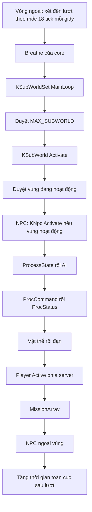

# TÓM TẮT 5 DÒNG
1. [NGUỒN] SO-18 khảo sát tĩnh vòng server từ Breathe đến vùng, NPC, Player và AI; nội dung chính đã hoàn tất.
2. [NGUỒN] Vòng ngoài xét đến lượt theo mốc danh nghĩa 18 tick/giây. Tần số gọi thực tế chưa đo. (KSOServer.cpp:90,1441-1451,4360-4373)
3. [NGUỒN] Sổ tay được tạo tại JX1_OPS/DESIGN/SO-TAY-VONG-LAP-SERVER.md.
4. [CHƯA KIỂM] Chưa tìm thấy B-04 và E-06. Đã đối chiếu P-02, B-04a và H-13. Tệp SO-18.nhip nằm ngoài vùng được phép ghi.
5. [CHƯA KIỂM] Không chạy build/exe game/VM; không commit theo yêu cầu. PM có thể ghi nhịp ngoài worktree nếu cần.

# SO-18 — Vòng lặp server (tick, Activate, AI quái)

Loại: khảo sát
Chủ đề: Thứ tự vòng cập nhật server, Activate của NPC/Player và nhịp AI quái.
Từ khóa: vòng lặp, tick, Activate, KSubWorld, KNpc, KNpcSet, KRegion, AI quái
Trạng thái: PARTIAL — nội dung khảo sát đã hoàn tất; tệp nhịp ngoài worktree không ghi được.
Độ phủ: 5/5 câu hỏi source tĩnh; chưa đo nhịp runtime.
Liên quan: [Mục lục tri thức](../DESIGN/MUC-LUC-TRI-THUC.md), [Bản đồ GS001](../CONTEXT-PACK/GS001-MAP.md), [Chuẩn báo cáo](../DESIGN/CHUAN-BAO-CAO.md), [P-02](P-02-bench.md), [B-04a](B-04a-bo-do-tick-bang-thong.md), [H-13](H-13-tick-do-tre-don.md).
Cần tôi quyết định: không
Nguồn server: C:/Jx1CocoV3/SwordOnline/SwordOnline/jxOnline/gameserver/Sources
Nguồn client đối chiếu: C:/Jx1CocoV3/Folder/Client2912-20260116T044348Z-3-001/Client2912/Client/Classes
Phiên bản: [CHƯA KIỂM] Task không pin SHA/commit cho các root source; kết luận gắn với nội dung hiện có tại các đường dẫn trên.

## Sơ đồ luồng



## Phạm vi và độ phủ

| Phần tử | Trạng thái | Bằng chứng |
|---|---|---|
| Nhịp tick | Đã phủ mốc danh nghĩa và điều kiện gọi. Tần số thực tế chưa đo. | MultiServer/GameServer/KSOServer.cpp:90,1441-1451,4360-4373; Core/Src/CoreServerShell.cpp:2227-2251 |
| KSubWorldSet/MainLoop | Đã phủ | Core/Src/KSubWorldSet.cpp:505-507,601-612 |
| KSubWorld, thứ tự bản đồ | Đã phủ | Core/Src/KSubWorld.cpp:269-345 |
| Vùng, NPC, vật thể, đạn, Player | Đã phủ | Core/Src/KRegion.cpp:1100-1195 |
| Activate và trạng thái NPC | Đã phủ | Core/Src/KNpc.cpp:939-1004 |
| Rẽ nhánh AI Player/NPC và hạn AI | Đã phủ | Core/Src/KNpcAI.cpp:48-134 |
| Tập chỉ số KNpcSet và cờ/balance | Đã phủ; reset cờ và CheckBalance không thuộc nhánh server | Core/Src/KNpcSet.cpp:1600-1613,1330-1365; Core/Src/KSubWorld.cpp:295-319; Core/Src/KSubWorldSet.cpp:601-607 |
| Client đối chiếu | Đã phủ để tách biệt, không dùng làm kết luận server | Client/Classes/gamecore/KSubWorld.cpp:143-160 |

## Giải mã tên

| Tên gốc | Mã hóa | Chữ đúng | Nguồn |
|---|---|---|---|
| Không có tên riêng trong game trong phạm vi này; KSubWorld, KNpc, KNpcSet và Activate là định danh mã nguồn. | Không áp dụng | Không áp dụng | Core/Src/KSubWorld.cpp:269; Core/Src/KNpc.cpp:939; Core/Src/KNpcSet.cpp:1603 |

## Sắp theo cấu trúc game

| Thứ tự | Phần cập nhật |
|---|---|
| 1 | Vòng ngoài xét đến lượt rồi gọi `Breathe` của core qua `KSwordOnLineSever::MainLoop`. `Breathe` gọi `KSubWorldSet::MainLoop`. |
| 2 | MainLoop duyệt danh sách SubWorld; mỗi SubWorld hợp lệ chạy Activate. |
| 3 | KSubWorld chạy các vùng được đánh dấu hoạt động. |
| 4 | Trong vùng: NPC nếu IsActiveAll, sau đó vật thể, đạn và Player server. |
| 5 | Sau vùng: mission array rồi NPC ngoài vùng; KNpc::Activate lần lượt chạy trạng thái, AI, lệnh và trạng thái hành động. |

## Đã xác minh

- Vòng ngoài dùng `GAME_FPS = 18` khi so bộ đếm lượt với thời gian đã trôi qua. Khi đến lượt và `GetGo()` thành công, `KSwordOnLineSever::MainLoop` gọi `Breathe` của core, sau đó core gọi vòng cập nhật bản đồ. (MultiServer/GameServer/KSOServer.cpp:90,1425-1451,4360-4373; Core/Src/CoreServerShell.cpp:2227-2251)
- MainLoop tăng m_nLoopRate, duyệt MAX_SUBWORLD, gọi Activate rồi tăng m_dwCurrentTime toàn cục. (Core/Src/KSubWorldSet.cpp:505-507,601-612)
- Server KSubWorld duyệt vùng hoạt động, chạy mission array rồi NPC ngoài vùng. (Core/Src/KSubWorld.cpp:301-333)
- KRegion cập nhật NPC, vật thể, đạn rồi Player server; NPC chỉ chạy trong nhánh IsActiveAll. (Core/Src/KRegion.cpp:1100-1128,1130-1195)
- KNpc::Activate xử lý state → AI → command → status; KNpcAI phân nhánh Player và NPC, giới hạn lần chạy AI theo m_NextAITime. (Core/Src/KNpc.cpp:939-1004; Core/Src/KNpcAI.cpp:48-134)
- KNpcSet duyệt chỉ số NPC đang dùng để xóa cờ Activate; các lời gọi ClearActivateFlagOfAllNpc và CheckBalance được đối chiếu trong nhánh client, còn server cập nhật NPC theo danh sách vùng. (Core/Src/KNpcSet.cpp:1600-1613,1330-1365; Core/Src/KSubWorld.cpp:295-319; Core/Src/KSubWorldSet.cpp:601-607)
- P-02 kiểm công cụ phân tích với dữ liệu giả lập. B-04a kiểm cú pháp và phân biệt thời lượng xử lý mỗi lượt với khoảng cách giữa các lượt. H-13 dẫn bộ mã server ở gốc khác và ghi nhận tùy chọn 18/36. Các nguồn này đều ghi chưa đo nhịp chạy thật. (P-02-bench.md:26,96-102; B-04a-bo-do-tick-bang-thong.md:50-59,71-76; H-13-tick-do-tre-don.md:52-59,65-67,138-141)

## Chưa xác minh

- Tần số thực tế của `Breathe` trong core, bộ mã tương ứng với bản chạy và số đo tải hoặc độ trễ.
- Chưa tìm thấy báo cáo B-04 và E-06 khi lọc theo tiền tố trong thư mục `JX1_OPS/REPORTS/` của worktree. Đã đối chiếu B-04a theo mục lục tri thức. (JX1_OPS/DESIGN/MUC-LUC-TRI-THUC.md:14)
- Không build/chạy game executable, VM hay mạng theo phạm vi chỉ đọc tĩnh.

## MỤC SỔ THÔNG SỐ

| Nhóm | Tên/hằng số | file:dòng | Giá trị | Đơn vị | Ảnh hưởng | Đổi an toàn | Nguồn đo |
|---|---|---|---|---|---|---|---|
| Nhịp | GAME_FPS | MultiServer/GameServer/KSOServer.cpp:90,1441-1451; Core/Src/CoreServerShell.cpp:2227 | 18 | tick/giây danh nghĩa | Điều kiện đến lượt. Nếu đều, khoảng cách danh nghĩa giữa hai lượt là `1000 ms ÷ 18 ≈ 55,6 ms`. | CẨN THẬN | Đọc tĩnh, chưa đo tần số thực tế |
| Đồng hồ bản đồ | m_dwCurrentTime | Core/Src/KSubWorld.cpp:269-293 | tăng 1 mỗi lần Activate bản đồ hợp lệ | tick/frame logic | Mốc thời gian của bản đồ | CẨN THẬN | Đọc tĩnh |
| Đồng hồ vòng tổng | m_nLoopRate | Core/Src/KSubWorldSet.cpp:24-28,505-507 | tăng 1 mỗi lần MainLoop | lượt gọi | Bộ đếm vòng tổng | CẨN THẬN | Đọc tĩnh; tần số gọi chưa đo |
| AI thường | m_NextAITime và m_AIMAXTime | Core/Src/KNpcAI.cpp:91-96 | Lần kế tiếp = thời gian bản đồ hiện tại + m_AIMAXTime; chưa xác minh giá trị của từng quái | tick logic của bản đồ | Giãn thời điểm chọn hành vi trong nhánh AI thường; các nhánh thoát sớm đứng trước cổng này | CẨN THẬN | Đọc tĩnh; không phải số đo runtime |

## Đề xuất tối ưu

Không đề xuất đổi mã hoặc thông số vì chưa có phép đo runtime. Nếu có task sau cho phép đo, đo khoảng cách giữa các lần Breathe và đối chiếu với GAME_FPS trước khi kết luận về tick thực tế.

## Bàn giao

Đã tạo JX1_OPS/DESIGN/SO-TAY-VONG-LAP-SERVER.md. Không commit theo yêu cầu của task; không có SHA.

Lượt trước, `WriteAllText` trả `Access denied` khi ghi `D:\JX-wt\SO-18.nhip`. Lượt tiếp tục thử `Add-Content` tại mốc bắt đầu và nhận `UnauthorizedAccessException` vì đường dẫn nằm ngoài worktree được phép ghi. Các mốc sau cũng bị giới hạn này. Truy vấn Graphify ở lượt trước không trả kết quả. Lượt tiếp tục dùng PowerShell lọc tên báo cáo sau khi `rg` báo không có lệnh.

Hai hàng dưới đây để PM gộp sổ tay và báo cáo vào `JX1_OPS/DESIGN/MUC-LUC-TRI-THUC.md`, theo thứ tự cột của `REPORTS/_CHIMUC/`. Tệp chỉ mục riêng nằm ngoài danh sách tệp được sửa trong SO-18.

```tsv
file	loại	chủ đề	từ khóa	trạng thái	độ phủ	liên quan
JX1_OPS/DESIGN/SO-TAY-VONG-LAP-SERVER.md	tổng hợp	Sổ tay vòng lặp server, tick, Activate và AI quái	vòng lặp, tick, Activate, KSubWorld, KNpc, KNpcSet, KRegion, AI quái	Hoàn tất nội dung	5/5 câu hỏi đọc tĩnh	SO-18, H-13, B-04a, P-02
JX1_OPS/REPORTS/SO-18.md	khảo sát	Vòng lặp server và thứ tự cập nhật NPC, Player, AI quái	vòng lặp, tick, Activate, KSubWorld, KNpc, KNpcSet, KRegion, AI quái	PARTIAL — thiếu tệp nhịp	5/5 câu hỏi đọc tĩnh	JX1_OPS/DESIGN/SO-TAY-VONG-LAP-SERVER.md, H-13, B-04a, P-02
```

## Phát hiện khi chuẩn hóa và tiếp tục

- Lượt tiếp tục giữ nguyên phần khảo sát đã có; chỉ bổ sung các mục chuẩn còn thiếu ở sổ tay: khối thông tin, giải mã tên, sắp theo cấu trúc game và phần đã/chưa xác minh. Không đổi kết luận hoặc sửa báo cáo nguồn. Căn cứ: JX1_OPS/DESIGN/CHUAN-BAO-CAO.md:8-35.
- [THẤY] Đọc bổ sung Core/Src/KNpcAI.cpp:48-134 xác nhận các nhánh Player và nhánh đặc biệt thoát trước cổng m_NextAITime. Cổng này chỉ giới hạn nhánh AI thường phía sau; switch hiện hoạt động với kiểu 0–6, còn 7–10 nằm trong comment. Sổ tay đã ghi rõ cách hiểu này tại mục phát hiện, không thay lặng đoạn cũ.
- [THẤY] Đọc bổ sung Core/Src/KPlayer.cpp:257-315 để giải thích ví dụ bộ đếm m_nPlayerTime và điều kiện thoát sớm. Chưa khảo sát toàn bộ KPlayer::Active, toàn bộ sáu kiểu AI hoặc giá trị m_AIMAXTime của từng quái; độ phủ 5/5 là theo câu hỏi của task, không phải toàn bộ hành vi game.
- Mã hóa: tài liệu bàn giao dùng UTF-8 không BOM. Một số comment Hán của các đoạn source bổ sung hiển thị lỗi dưới UTF-8; chưa xác minh mã hóa toàn tệp. Chỉ dùng câu lệnh và định danh ASCII cho các bổ sung, không lấy comment lỗi làm bằng chứng. Nguồn: Core/Src/KNpcAI.cpp:48-134; Core/Src/KPlayer.cpp:257-315.
- Nhịp sống vẫn chưa ghi được: đường dẫn D:\JX-wt\SO-18.nhip nằm ngoài vùng được phép ghi. Không lặp lại hai cách ghi đã thất bại ở lượt trước, không đổi quyền và không tạo tệp thay thế ngoài phạm vi. PM ghi các mốc còn thiếu nếu cần; trạng thái bàn giao giữ PARTIAL vì yêu cầu này.
- Kiểm tra thực chạy ở lượt tiếp tục: đối chiếu Git status/branch một lần lúc đầu; đọc sáu skill được giao; đọc hai đoạn source bổ sung; kiểm tra tồn tại các liên kết báo cáo. Không build, chạy game/exe, VM, mạng hoặc Graphify; không stage/commit/push.
- Kiểm tra tài liệu thực chạy: `git diff --check` trên ba tệp được giao trả mã 0; giải mã UTF-8 nghiêm ngặt thành công, không BOM ở cả ba tệp; hàng rào khối mã cân bằng (sổ tay: 2, báo cáo: 4); mục Kết quả của task có đúng 5 dòng. Đã xem diff một lần, giữ nguyên phần sửa có sẵn và chỉ bổ sung phần thiếu.

Kỹ năng đã dùng: jx1-retrofit (quy tắc không đổi kết luận và khuôn báo cáo); jx1-read-server; jx1-read-client; jx1-parameters; jx1-knowledge; jx1-report.
