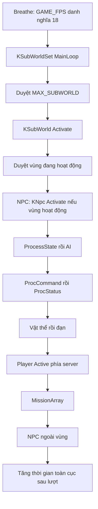

# TÓM TẮT 5 DÒNG
1. [NGUỒN] SO-18 khảo sát tĩnh vòng server từ Breathe đến vùng, NPC, Player và AI; nội dung chính đã hoàn tất.
2. [NGUỒN] Source khai báo nhịp danh nghĩa 18 tick/giây; tần số gọi thực tế chưa được đo. (CoreServerShell.cpp:2227-2251)
3. [NGUỒN] Sổ tay được tạo tại JX1_OPS/DESIGN/SO-TAY-VONG-LAP-SERVER.md.
4. [CHƯA KIỂM] B-04, P-02, E-06 không có trong worktree; SO-18.nhip bị sandbox từ chối ghi.
5. [CHƯA KIỂM] Không chạy build/exe game/VM; không commit theo yêu cầu. PM có thể ghi nhịp ngoài worktree nếu cần.

# SO-18 — Vòng lặp server (tick, Activate, AI quái)

Loại: khảo sát
Chủ đề: Thứ tự vòng cập nhật server, Activate của NPC/Player và nhịp AI quái.
Từ khóa: vòng lặp, tick, Activate, KSubWorld, KNpc, KNpcSet, KRegion, AI quái
Trạng thái: PARTIAL — nội dung khảo sát đã hoàn tất; tệp nhịp ngoài worktree không ghi được.
Độ phủ: 5/5 câu hỏi source tĩnh; chưa đo nhịp runtime.
Liên quan: JX1_OPS/DESIGN/MUC-LUC-TRI-THUC.md; JX1_OPS/CONTEXT-PACK/GS001-MAP.md; JX1_OPS/DESIGN/CHUAN-BAO-CAO.md.
Cần tôi quyết định: không
Nguồn server: C:/Jx1CocoV3/SwordOnline/SwordOnline/jxOnline/gameserver/Sources
Nguồn client đối chiếu: C:/Jx1CocoV3/Folder/Client2912-20260116T044348Z-3-001/Client2912/Client/Classes
Phiên bản: [CHƯA KIỂM] Task không pin SHA/commit cho các root source; kết luận gắn với nội dung hiện có tại các đường dẫn trên.

## Sơ đồ luồng

## Phạm vi và độ phủ

| Phần tử | Trạng thái | Bằng chứng |
|---|---|---|
| Nhịp tick | Đã phủ source; runtime chưa đo | Core/Src/CoreServerShell.cpp:2227-2251; Core/Src/KSubWorldSet.cpp:24-28 |
| KSubWorldSet/MainLoop | Đã phủ | Core/Src/KSubWorldSet.cpp:505-507,601-612 |
| KSubWorld, thứ tự bản đồ | Đã phủ | Core/Src/KSubWorld.cpp:269-345 |
| Vùng, NPC, vật thể, đạn, Player | Đã phủ | Core/Src/KRegion.cpp:1100-1195 |
| Activate và trạng thái NPC | Đã phủ | Core/Src/KNpc.cpp:939-1004 |
| Rẽ nhánh AI Player/NPC và hạn AI | Đã phủ | Core/Src/KNpcAI.cpp:48-134 |
| Tập chỉ số KNpcSet và cờ/balance | Đã phủ; reset cờ và CheckBalance không thuộc nhánh server | Core/Src/KNpcSet.cpp:1600-1613,1330-1365; Core/Src/KSubWorld.cpp:295-319; Core/Src/KSubWorldSet.cpp:601-607 |
| Client đối chiếu | Đã phủ để tách biệt, không dùng làm kết luận server | Client/Classes/gamecore/KSubWorld.cpp:143-160 |

## Giải mã tên

| Tên gốc | Mã hóa | Chữ đúng | Nguồn |
|---|---|---|---|
| Không có tên riêng trong game trong phạm vi này; KSubWorld, KNpc, KNpcSet và Activate là định danh mã nguồn. | Không áp dụng | Không áp dụng | Core/Src/KSubWorld.cpp:269; Core/Src/KNpc.cpp:939; Core/Src/KNpcSet.cpp:1603 |

## Sắp theo cấu trúc game

| Thứ tự | Phần cập nhật |
|---|---|
| 1 | CoreServerShell::Breathe gọi KSubWorldSet::MainLoop. |
| 2 | MainLoop duyệt danh sách SubWorld; mỗi SubWorld hợp lệ chạy Activate. |
| 3 | KSubWorld chạy các vùng được đánh dấu hoạt động. |
| 4 | Trong vùng: NPC nếu IsActiveAll, sau đó vật thể, đạn và Player server. |
| 5 | Sau vùng: mission array rồi NPC ngoài vùng; KNpc::Activate lần lượt chạy trạng thái, AI, lệnh và trạng thái hành động. |

## Đã xác minh

- CoreServerShell::Breathe gọi MainLoop và định nghĩa GAME_FPS=18. Đây là nhịp danh nghĩa của mã, không phải số đo runtime. (Core/Src/CoreServerShell.cpp:2227-2251)
- MainLoop tăng m_nLoopRate, duyệt MAX_SUBWORLD, gọi Activate rồi tăng m_dwCurrentTime toàn cục. (Core/Src/KSubWorldSet.cpp:505-507,601-612)
- Server KSubWorld duyệt vùng hoạt động, chạy mission array rồi NPC ngoài vùng. (Core/Src/KSubWorld.cpp:301-333)
- KRegion cập nhật NPC, vật thể, đạn rồi Player server; NPC chỉ chạy trong nhánh IsActiveAll. (Core/Src/KRegion.cpp:1100-1128,1130-1195)
- KNpc::Activate xử lý state → AI → command → status; KNpcAI phân nhánh Player và NPC, giới hạn lần chạy AI theo m_NextAITime. (Core/Src/KNpc.cpp:939-1004; Core/Src/KNpcAI.cpp:48-134)
- KNpcSet duyệt chỉ số NPC đang dùng để xóa cờ Activate; các lời gọi ClearActivateFlagOfAllNpc và CheckBalance được đối chiếu trong nhánh client, còn server cập nhật NPC theo danh sách vùng. (Core/Src/KNpcSet.cpp:1600-1613,1330-1365; Core/Src/KSubWorld.cpp:295-319; Core/Src/KSubWorldSet.cpp:601-607)

## Chưa xác minh

- Tần số runtime của CoreServerShell::Breathe; source đặt GAME_FPS=18 nhưng không đo lịch gọi callback. Không có phép đo tải/độ trễ.
- Báo cáo B-04, P-02, E-06 và tham chiếu H-13, B-04a không tồn tại trong worktree. Mục lục tri thức ghi tick liên quan H-13 và B-04a, nhưng không thay cho source. (JX1_OPS/DESIGN/MUC-LUC-TRI-THUC.md:14)
- Không build/chạy game executable, VM hay mạng theo phạm vi chỉ đọc tĩnh.

## MỤC SỔ THÔNG SỐ

| Nhóm | Tên/hằng số | file:dòng | Giá trị | Đơn vị | Ảnh hưởng | Đổi an toàn | Nguồn đo |
|---|---|---|---|---|---|---|---|
| Nhịp | GAME_FPS | Core/Src/CoreServerShell.cpp:2227 | 18 | tick/giây danh nghĩa | Chu kỳ logic dùng trong mã | CẨN THẬN | Đọc tĩnh; không đo runtime |
| Đồng hồ bản đồ | m_dwCurrentTime | Core/Src/KSubWorld.cpp:269-293 | tăng 1 mỗi lần Activate bản đồ hợp lệ | tick/frame logic | Mốc thời gian của bản đồ | CẨN THẬN | Đọc tĩnh |
| Đồng hồ vòng tổng | m_nLoopRate | Core/Src/KSubWorldSet.cpp:24-28,505-507 | tăng 1 mỗi lần MainLoop | lượt gọi | Bộ đếm vòng tổng | CẨN THẬN | Đọc tĩnh; tần số gọi chưa đo |

## Đề xuất tối ưu

Không đề xuất đổi mã hoặc thông số vì chưa có phép đo runtime. Nếu có task sau cho phép đo, đo khoảng cách giữa các lần Breathe và đối chiếu với GAME_FPS trước khi kết luận về tick thực tế.

## Bàn giao

Đã tạo JX1_OPS/DESIGN/SO-TAY-VONG-LAP-SERVER.md. Không commit theo yêu cầu của task; không có SHA.

Không ghi được D:\JX-wt\SO-18.nhip vì sandbox từ chối quyền ghi ra ngoài worktree. Lỗi/cách thử/kết quả: WriteAllText trả Access denied; không thử vượt quyền. Truy vấn Graphify được phép trong task nhưng không trả kết quả, đã dừng và hoàn tất bằng đối chiếu source trực tiếp.

Đề xuất chỉ mục cho PM (không sửa index ngoài phạm vi): SO-TAY-VONG-LAP-SERVER.md | tổng hợp | vòng lặp server, tick, Activate, AI NPC/Player | PARTIAL — sidecar nhịp bị chặn, nội dung khảo sát hoàn tất | độ phủ 5/5 câu hỏi source tĩnh | H-13, B-04a, xem MUC-LUC-TRI-THUC.md:14

Kỹ năng đã dùng: jx1-retrofit (quy tắc không đổi kết luận và khuôn báo cáo); jx1-read-server; jx1-read-client; jx1-parameters; jx1-knowledge; jx1-report.
