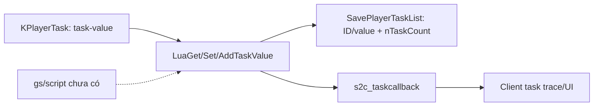

TÓM TẮT 1 [NGUỒN] PARTIAL: đã khảo sát tĩnh task-value, nTaskCount, API Lua và UI client.
TÓM TẮT 2 [NGUỒN] Đã tạo sổ tay có 5 dòng đầu, Mermaid, phạm vi và hơn 10 dẫn file:dòng.
TÓM TẮT 3 [CHƯA KIỂM] Thiếu script gs\\script để xác minh nhận/trả và hai quest NPC cụ thể.
TÓM TẮT 4 [CHƯA KIỂM] Không build/test/runtime/VM/mạng; Graphify query lỗi do thiếu graph ở worktree; rg không có.
TÓM TẮT 5 [CHƯA KIỂM] Không commit; không ghi được tệp nhịp ngoài workspace được phép; PM cần root script.
# SO-19 — Sổ tay hệ thống nhiệm vụ

Loại: tổng hợp
Chủ đề: Task-value, nTaskCount, API Lua và giao diện nhiệm vụ.
Từ khóa: nhiệm vụ, task, KPlayerTask, nTaskCount, Lua, gs\\script, Kuitasktrace, SO-19
Trạng thái: PARTIAL — thiếu script quest cụ thể để xác minh nhận/trả.
Độ phủ: 2/7 phần xác minh hoàn toàn; 2 phần một phần; 3 phần chưa xác minh.
Liên quan: JX1_OPS/DESIGN/SO-TAY-NHIEM-VU.md; JX1_OPS/DESIGN/MUC-LUC-TRI-THUC.md.
Cần tôi quyết định: có — cần root/file script task để hoàn tất nhận/trả và hai quest.
Nguồn client: C:/Jx1CocoV3/Folder/Client2912-20260116T044348Z-3-001/Client2912/Client/Classes
Nguồn server: C:/Jx1CocoV3/SwordOnline/SwordOnline/jxOnline/gameserver/Sources

## Sơ đồ

## Đã xác minh

- [THẤY] Server đặt MAX_TASK và MAX_TEMP_TASK là 10000, giữ map task-value lưu/tạm; client giữ cấu trúc danh sách task (server/Sources/Core/Src/KPlayerTask.h:13-14, 39-65).
- [THẤY] GetSaveVal/SetSaveVal đọc, ghi task-value; server gửi s2c_taskcallback khi bật đồng bộ (server/Sources/Core/Src/KPlayerTask.cpp:84-125).
- [THẤY] LoadPlayerTaskList đọc nTaskCount và từng cặp m_nTaskId/m_nTaskValue; SavePlayerTaskList ghi lại các giá trị khác 0 rồi đặt nTaskCount bằng số bản ghi (server/Sources/Core/Src/KPlayerDBFuns.cpp:1314-1383, 1795-1865).
- [THẤY] Có thân hàm LuaGetTaskValue, LuaSetTaskValue, LuaAddTaskValue và API task tạm; đăng ký Lua/callsite chưa xác minh (server/Sources/Core/Src/ScriptFuns.cpp:4001-4067, 4125-4217).
- [THẤY] Hai slot task-value có thật: điểm Tống Kim 192 và điểm vinh dự 2051; đây chưa phải hai quest NPC (server/Sources/Core/Src/ScriptFuns.cpp:544-564, 569-599).
- [THẤY] Mission server tra script theo ID và gọi Init/Join/Run/End (server/Sources/Core/Src/ScriptFuns.cpp:22692-22810; server/Sources/Core/Src/KMission.cpp:86-189).
- [THẤY] Client cập nhật task trace khi task value đổi; UI tiếng Việt dựng danh sách, nội dung, nút theo dõi/bỏ theo dõi (client/Classes/gamecore/KPlayerTask.cpp:66-95; client/Classes/vn/gameui/KuiTaskInfoVN.cpp:70-113, 200-226; client/Classes/gameui/Kuitasktrace.cpp:1206-1243).
- [TÀI LIỆU] Ghi chú server mô tả StartTask, StartMapTask, ShowMapTaskList, GetMapTask, SetMapTask (server/Sources/Core/Src/任务系统设计文档.txt:14-24).

## Chưa xác minh

- [CHƯA KIỂM] Chưa có file gs/script cụ thể ở các root được giao; chưa xác định điều kiện nhận, mục tiêu, hoàn thành hay trả thưởng.
- [CHƯA KIỂM] Hai ví dụ 192/2051 là task-value, chưa thể gọi là hai quest NPC.
- [CHƯA KIỂM] Chưa xác minh đăng ký Lua, handler callback end-to-end, runtime, build hay bản đang chạy.
- [CHƯA KIỂM] rg không khả dụng; chuyển sang PowerShell. Một lần gọi Graphify.exe trả lỗi thiếu D:/JX-wt/SO-19/graphify-out/graph.json; không gọi lại. Một lượt dò đệ quy ban đầu cho lỗi regex, không ghi dữ liệu.
- [CHƯA KIỂM] Đã lỡ gọi Graphify.exe một lần; công cụ không tìm thấy graph và không có kết quả dùng được.
- [CHƯA KIỂM] Không ghi được D:/JX-wt/SO-19.nhip vì ngoài workspace được phép ghi D:/JX-wt/SO-19.

## Phạm vi và độ phủ

| Phần tử | Trạng thái | Bằng chứng / giới hạn |
|---|---|---|
| Định nghĩa/kích hoạt task | Một phần | Ghi chú StartTask/StartMapTask, chưa có mã/script (server/Sources/Core/Src/任务系统设计文档.txt:14-24). |
| Nhận task | Chưa xác minh | Thiếu script NPC và điều kiện nhận. |
| Task-value và nTaskCount | Đã xác minh tĩnh | KPlayerTask/KPlayerDBFuns có các dòng dẫn ở trên. |
| API Lua | Một phần | Có thân hàm; chưa xác minh đăng ký/callsite (server/Sources/Core/Src/ScriptFuns.cpp:4001-4067, 4125-4217). |
| UI danh sách/theo dõi | Đã xác minh tĩnh | KuiTaskInfoVN/Kuitasktrace có các dòng dẫn ở trên. |
| Trả task/nhận thưởng | Chưa xác minh | Thiếu script kết thúc và thưởng. |
| Hai quest cụ thể | Chưa xác minh | Chỉ có hai ví dụ task-value, chưa có quest NPC. |

## Giải mã tên

Không xác nhận tên NPC, quái, kỹ năng hoặc bản đồ. Giữ nguyên định danh ASCII; ghi chú tiếng Hoa 任务系统设计文档.txt đọc theo GBK và chỉ dùng định hướng.

| Tên gốc | Mã hóa/loại | Diễn giải | Nguồn |
|---|---|---|---|
| nTaskCount | ASCII | Số bản ghi task lưu | server/Sources/Core/Src/KPlayerDBFuns.cpp:1344-1383, 1803-1865 |
| m_nTaskId | ASCII | Mã task trong một bản ghi | server/Sources/Core/Src/KPlayerDBFuns.cpp:1373-1383, 1852-1859 |
| m_nTaskValue | ASCII | Giá trị gắn với mã task | server/Sources/Core/Src/KPlayerDBFuns.cpp:1373-1383, 1852-1859 |
| KPlayerTask | Tên lớp | Bộ đọc/ghi task-value | server/Sources/Core/Src/KPlayerTask.cpp:84-159 |

## Sắp theo cấu trúc game

[TÀI LIỆU/THẤY/CHƯA KIỂM] Theo vòng đời: kích hoạt theo bản đồ → API Lua → lưu ID/value và nTaskCount → callback → UI trace. Không xếp theo từng quest vì thiếu script (server/Sources/Core/Src/任务系统设计文档.txt:14-24; server/Sources/Core/Src/ScriptFuns.cpp:4001-4067; client/Classes/vn/gameui/KuiTaskInfoVN.cpp:70-113).

## Mục sổ thông số

| Nhóm | Tên/hằng số | File:dòng | Giá trị | Đơn vị | Ảnh hưởng | Đổi an toàn | Nguồn đo |
|---|---|---|---:|---|---|---|---|
| Task lưu | MAX_TASK | server/Sources/Core/Src/KPlayerTask.h:13 | 10000 | ID | Giới hạn ID | CẨN THẬN | Đọc tĩnh |
| Task tạm | MAX_TEMP_TASK | server/Sources/Core/Src/KPlayerTask.h:14 | 10000 | ID | Giới hạn vùng tạm | CẨN THẬN | Đọc tĩnh |
| Slot điểm | Tống Kim | server/Sources/Core/Src/ScriptFuns.cpp:544-564 | 192 | ID slot | Lưu điểm | CẨN THẬN | Đọc tĩnh |
| Slot điểm | Vinh dự | server/Sources/Core/Src/ScriptFuns.cpp:569-599 | 2051 | ID slot | Lưu điểm | CẨN THẬN | Đọc tĩnh |

## Đề xuất tối ưu

Không đổi giới hạn hoặc slot khi chưa có bảng phân bổ và script gọi. PM cung cấp root gs/script rồi bổ sung hai quest có tên, điều kiện, hoàn thành và trả thưởng.

## Hàng mục lục đề xuất

| File | Loại | Chủ đề | Từ khóa | Trạng thái | Độ phủ | Liên quan |
|---|---|---|---|---|---|---|
| JX1_OPS/DESIGN/SO-TAY-NHIEM-VU.md | tổng hợp | Nhiệm vụ và task-value | nhiệm vụ; task; nTaskCount; Lua; Kuitasktrace | PARTIAL | 2/7 đầy đủ; 2/7 một phần; thiếu nhận/trả và hai quest | SO-19; MUC-LUC-TRI-THUC.md |

## Bàn giao

Không commit theo yêu cầu; không có SHA/push. Tài liệu và báo cáo đã ghi local.

Kỹ năng đã dùng: jx1-retrofit, jx1-read-server, jx1-read-client, jx1-parameters, jx1-knowledge, jx1-report.
