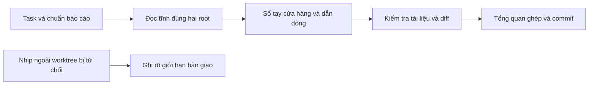

TÓM TẮT 1: [NGUỒN] PARTIAL ở yêu cầu vận hành: phần tài liệu SO-20 hoàn tất; riêng tệp nhịp ngoài worktree bị từ chối quyền ghi.
TÓM TẮT 2: [NGUỒN] Đã mô tả bảng hàng, mở cửa hàng client, giá mua/bán, bảy nhánh tiền/điểm và gói mở/mua/bán; nguồn S/KBuySell.cpp:83, S/KBuySell.cpp:392, C/gamecore/KProtocol.cpp:264.
TÓM TẮT 3: [NGUỒN] Đầu ra là JX1_OPS/DESIGN/SO-TAY-CUA-HANG.md; đã bổ sung Kết quả trong JX1_OPS/TASKS/SO-20.md.
TÓM TẮT 4: [CHƯA KIỂM] Chưa xác nhận dữ liệu settings, NPC cụ thể hoặc giao dịch thực; không build, không chạy game/exe/VM hay mạng.
TÓM TẮT 5: [NGUỒN] Không stage/commit/push theo yêu cầu; chưa có SHA, Tổng quan commit hộ; cần ghi nhịp bằng môi trường có quyền ngoài worktree.

# SO-20 — Báo cáo sổ tay cửa hàng NPC và giá

Loại: khảo sát
Chủ đề: Bàn giao tài liệu hiểu cơ chế cửa hàng NPC từ hai root source task giao.
Từ khóa: SO-20, cửa hàng NPC, shop, buysell, giá mua, giá bán, ngân lượng, tiền tệ, gói tin
Trạng thái: PARTIAL — tài liệu đạt tiêu chí; thiếu nhịp sống do quyền ghi đường dẫn ngoài worktree.
Độ phủ: tài liệu phủ 7/9 nhóm; hai nhóm chưa phủ là danh mục triển khai và vận hành thực tế; xem bảng phạm vi trong sổ tay.
Liên quan: JX1_OPS/TASKS/SO-20.md; JX1_OPS/DESIGN/SO-TAY-CUA-HANG.md; JX1_OPS/DESIGN/CHUAN-BAO-CAO.md
Cần tôi quyết định: không

## Sơ đồ bàn giao

## Phạm vi và độ phủ

| Phần được giao | Kết quả |
|---|---|
| Sổ tay `JX1_OPS/DESIGN/SO-TAY-CUA-HANG.md` | Đã hoàn tất phần đọc tĩnh; đầu tệp đủ 5 dòng, có sơ đồ, bảng phạm vi, giải mã tên, sổ thông số và Chưa kiểm. |
| Báo cáo `JX1_OPS/REPORTS/SO-20.md` | Tệp này, ghi bằng chứng, kiểm tra và giới hạn thực hiện. |
| `## Kết quả` cuối task | Đã thêm 4 dòng, giữ metadata và nội dung cũ. |
| Tệp nhịp `D:\JX-wt\SO-20.nhip` | BỊ CHẶN: lần ghi mốc bắt đầu báo Access denied; không đổi quyền hoặc thử đường vòng. Các mốc tiếp theo được trao đổi trong phiên, không được ghi vào tệp nhịp. |
| Chỉ mục tri thức / TSV / mã game | Không sửa; chỉ đề xuất hàng chỉ mục ở dưới vì nằm ngoài vùng ghi được giao. |

## Giải mã tên và sắp theo cấu trúc game

- [THẤY] Bảng giải mã trong sổ tay giữ chuỗi gốc ASCII của ngân lượng, Xu, Phúc duyên, Danh vọng, Vinh dự và Tống Kim; nguồn `S/KBuySell.cpp:515`, `S/KBuySell.cpp:542`. Chưa có bảng tên NPC/vật phẩm gốc để giải mã GBK/TCVN3.
- [THẤY] Sổ tay xếp theo hàng bán → mở cửa hàng → mua/tiền tệ → bán → gói tin, có bảng riêng 9 nhóm phạm vi; căn cứ `S/KBuySell.cpp:83`, `S/KBuySell.cpp:754`, `S/KBuySell.cpp:601`.

## Đã xác minh

`S/` và `C/` được mở rộng đầy đủ ở mục Cách đọc nguồn của sổ tay, đúng hai root trong `JX1_OPS/TASKS/SO-20.md:24`.

| Nguồn đã khoanh / đọc đoạn liên quan | Kết quả tĩnh và symbol |
|---|---|
| `S/KBuySell.cpp:83`, `S/KBuySell.cpp:225`; `C/gamecore/CoreUseNameDef.h:116`; `C/gamecore/KBuySell.cpp:77` | `Init`: hai lớp bảng shop/hàng mẫu; tên bảng client; đổi chỉ số hàng dương trừ 1. |
| `S/KBuySell.cpp:281`, `S/KBuySell.cpp:390`, `S/KBuySell.cpp:512` | `Buy`: giá, số lượng, thuế, kiểm và trừ loại tiền, thêm vật phẩm. |
| `S/KBuySell.h:4`, `S/KBuySell.cpp:601`, `S/KItem.h:271` | `Sell`: giá vật phẩm chia 4, tối thiểu 1, nhánh cờ được bán/ràng buộc. |
| `S/KPlayer.cpp:1525`, `S/KPlayer.cpp:7334`, `S/KPlayer.cpp:7381` | Tìm ID đồ bán; phân biệt Pay, PayXu và Earn. |
| `S/KProtocolProcess.cpp:238`, `S/KProtocolProcess.cpp:5736` | Điều phối mua/bán và chặn khi `CheckTrading()`. |
| `S/KBuySell.cpp:754`; `C/gamecore/KProtocolProcess.cpp:757`; `C/gamecore/KBuySell.cpp:325` | `s2c_opensalebox` → `OpenSaleBox` → `OpenCSale`. |
| `C/gameui/GameSpaceChangedNotify.cpp:285`; `C/gamescene/KgameWorld.cpp:13762`; `C/gameui/KuiShop.cpp:734` | `GDCNI_NPC_TRADE` → bảng shop/hành trang → lấy hàng. |
| `C/gameui/KuiShop.cpp:288`; `C/gamecore/CoreShell.cpp:2648`, `C/gamecore/CoreShell.cpp:3971`, `C/gamecore/CoreShell.cpp:4341` | Số lượng, danh sách, xử lý mua và bán phía client. |
| `C/gamecore/KProtocol.cpp:264`; `C/gamecore/KProtocol.h:523`, `C/gamecore/KProtocol.h:1014`; `C/gamecore/KProtocolDef.h:284` | Tên gói, trường mở/mua/bán và mã client mobile bằng 1. |
| `C/gamecore/GameDataDef.h:231`; `C/gamecore/KItem.h:236`; `C/gamecore/KBuySell.h:4`; `C/gameui/KuiItemdesc.cpp:174` | Enum tiền client, giá lưu, hệ số chia và tra hàng mẫu để xem chi tiết. |

Không dùng Graphify hoặc báo cáo gián tiếp làm kết luận. Hai tài liệu định vị được tìm đúng chủ đề là `JX1_OPS/CONTEXT-PACK/GS001-MAP.md` và `JX1_OPS/DESIGN/MUC-LUC-TRI-THUC.md`; không đọc lan các báo cáo khác. Các lần đọc đoạn nguồn được giới hạn khoảng 400 dòng trở xuống, không tạo parser hay script phụ.

## Mục sổ thông số

| Nhóm | Tên/hằng số | file:dòng | Giá trị | Đơn vị | Ảnh hưởng | Đổi an toàn | Nguồn đo |
|---|---|---|---|---|---|---|---|
| Bán lại | `BUY_SELL_SCALE` | `S/KBuySell.h:4` | 4 | Hệ số | Giá bán chia 4 | CẨN THẬN | Đọc tĩnh, chưa đo |
| Bán lại | Sàn tiền bán | `S/KBuySell.cpp:630` | 1 | Tiền thường | Giá tối thiểu nhánh bán | CẨN THẬN | Đọc tĩnh, chưa đo |
| Số lượng | UI / lớp xử lý | `C/gameui/KuiShop.cpp:345`, `C/gamecore/CoreShell.cpp:4025` | UI hạ về 150; xử lý chặn từ 100 | Món | Hai giới hạn khác nhau | CẨN THẬN | Đọc tĩnh, chưa thử mua |
| Loại tiền | `MONEYUNIT` phía client | `C/gamecore/GameDataDef.h:231` | 0–6, suy từ enum bắt đầu 0 | Mã loại | Bảy nhánh tiền/điểm | CẨN THẬN | Đọc tĩnh; chưa đối chiếu enum server |

## Kiểm tra thực chạy / chưa chạy

- Đã chạy: kiểm tra Git status/branch một lần trước ghi; kết quả `task/SO-20`, sạch; kiểm tồn tại đầu ra trước làm, cả sổ tay và báo cáo đều chưa có nên không có phần cũ phải làm lại.
- Đã chạy: tìm tên/symbol có giới hạn bằng PowerShell sau khi `rg` không có; đọc đoạn nguồn, phân biệt code/chú thích và kiểm ranh giới dòng client theo UTF-8.
- Kiểm tra cuối: đọc lại ba tệp đầu ra; kiểm 5 dòng tóm tắt, Mermaid, mục Chưa kiểm, số dẫn nguồn, UTF-8 không BOM, đích nguồn tồn tại; các dòng dẫn đã đối chiếu trong lượt đọc nguồn; xem diff một lần sau ghi. Kết quả được chốt ở phần Bàn giao.
- Chưa chạy theo phạm vi: build, test game, test giao dịch, VM, game exe, Graphify, kết nối mạng và bắt gói. Không có kết luận đạt runtime.

## Lỗi / cách thử / kết quả

| Lỗi hoặc điểm cần hiệu chỉnh | Cách xử lý | Kết quả |
|---|---|---|
| `rg` không được nhận diện | Chuyển một lần sang `Get-ChildItem -Filter`, `Select-String`, đọc đoạn qua PowerShell; không cài công cụ. | Đọc nguồn tiếp được. |
| Ghi `D:\JX-wt\SO-20.nhip` | Thử `Set-Content` ở mốc bắt đầu trong môi trường hiện tại. | `Access to the path 'D:\JX-wt\SO-20.nhip' is denied.` Không thử lại/đổi quyền; đường dẫn nằm ngoài worktree được phép ghi. |
| Chú thích nguồn GBK, client có nội dung pha mã hóa | Một lượt trích client bằng decoder GBK cho số dòng khác kết quả tìm symbol; chuyển sang đọc dòng UTF-8 tại đúng symbol. | Dẫn client dùng số dòng từ UTF-8, ví dụ `KgameWorld.cpp:13762`, `KProtocolProcess.cpp:757`; không sửa nguồn hoặc kết luận cũ. |
| Khuôn chung yêu cầu thêm chỉ mục TSV | Đối chiếu phạm vi chỉ ghi sổ tay, báo cáo, phần Kết quả task. | Không tạo TSV ngoài phạm vi; đề xuất một hàng chỉ mục cho PM ghép. |

## Chưa xác minh

- Danh mục NPC/shop/món/giá triển khai và giải mã tên thật trong settings/script ngoài root đọc được giao; `C/gamecore/CoreUseNameDef.h:116` chỉ chứng minh tên bảng tham chiếu.
- Header server ngoài `Sources`, ABI/opcode hai bản build, dữ liệu đang chạy, thuế thực, phản hồi mạng, giá hiển thị và bán cả chồng đồ; chưa có kiểm thử theo `JX1_OPS/TASKS/SO-20.md:27`.
- Nhánh client có break trước gửi mua không đồng nghĩa mọi đường mua đều lỗi; ghi đúng đoạn và giới hạn ở sổ tay, nguồn `C/gamecore/CoreShell.cpp:4079`.

## Đề xuất tối ưu

- Đợt riêng: đọc settings/script trên bản copy được duyệt để lập bảng NPC/bản đồ → shop → món → giá → loại tiền.
- Đợt riêng: đối chiếu giới hạn số lượng và ba nhánh tiền kết thúc trước gửi mua; chưa sửa mã trong SO-20.
- Hàng đề xuất cho `JX1_OPS/DESIGN/MUC-LUC-TRI-THUC.md` / chỉ mục PM ghép: `JX1_OPS/DESIGN/SO-TAY-CUA-HANG.md | khảo sát | Cửa hàng NPC và giá | shop, buysell, goods, ngân lượng, Xu, gói tin | DONE (đọc tĩnh) | 7/9 nhóm; chưa dữ liệu triển khai/runtime | TASKS/SO-20.md, REPORTS/SO-20.md`.

## Bàn giao

- Tài liệu chuyên môn: DONE. Toàn yêu cầu: PARTIAL chỉ vì nhịp ngoài worktree bị chặn; không còn phần viết sổ tay dang dở.
- Không có SHA mới; không stage, commit hoặc push theo chỉ đạo Tổng quan commit hộ. Đây không phải lỗi Git/push.
- Kết quả kiểm tra cuối: PASS — sổ tay đủ 5 dòng tóm tắt, 1 sơ đồ Mermaid, mục Chưa kiểm; 112 vị trí nguồn game khác nhau trên 15 tệp. Báo cáo có 40 vị trí trên 19 tệp; mọi đích nguồn tồn tại. Hai tài liệu UTF-8 không BOM, không ký tự U+FFFD/space cuối dòng. Đã đối chiếu các dòng nguồn khi đọc; diff cuối chỉ có hai tệp mới và phần Kết quả nối thêm, không sửa nội dung task cũ.
- Tổng quan có thể ghép ba tệp thuộc task và bổ sung chỉ mục; cần môi trường có quyền đúng đường dẫn nếu muốn ghi tệp nhịp ngoài worktree. Không yêu cầu sửa quyền hệ thống trong task này.

Kỹ năng đã dùng: jx1-retrofit, jx1-read-server, jx1-read-client, jx1-parameters, jx1-knowledge, jx1-report. Không có kết luận cũ bị thay đổi vì hai đầu ra chưa tồn tại khi bắt đầu.
