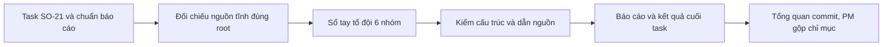

TÓM TẮT 1: [NGUỒN] DONE phần tài liệu tĩnh SO-21: đã phủ 6/6 nhóm mục tiêu, có bảng phạm vi và giới hạn từng nhóm. Nguồn: JX1_OPS/DESIGN/SO-TAY-TO-DOI.md:61–70.
TÓM TẮT 2: [NGUỒN] Làm rõ hai bước lọc khoảng cách EXP, chia theo cấp và quyền nhặt đồ của người cùng đội; tách nhánh tiền mobile. Nguồn: JX1_OPS/DESIGN/SO-TAY-TO-DOI.md:111–140.
TÓM TẮT 3: [NGUỒN] Đầu ra chính 205 dòng, 5 dòng tóm tắt, 1 Mermaid, 139 lượt dẫn nguồn/89 điểm bắt đầu khác nhau thuộc 12 tệp nguồn. Nguồn: JX1_OPS/DESIGN/SO-TAY-TO-DOI.md:1–205; kiểm tra PowerShell ở mục 6 báo cáo này.
TÓM TẮT 4: [CHƯA KIỂM] Không build/test game/exe/VM/mạng; chưa chốt header server, bảng thống lĩnh hay hành vi bản vận hành; không ghi được nhịp ngoài writable root. Nguồn: JX1_OPS/DESIGN/SO-TAY-TO-DOI.md:182–196.
TÓM TẮT 5: [NGUỒN] Không stage/commit/push theo yêu cầu; chưa có SHA mới, Tổng quan thực hiện commit. Chỉ mục đề xuất nằm trong báo cáo để PM gộp. Nguồn: JX1_OPS/DESIGN/SO-TAY-TO-DOI.md:192–196.

# SO-21 — Bàn giao sổ tay tổ đội và chia kinh nghiệm/đồ

Loại: tổng hợp
Chủ đề: Bàn giao tài liệu giải thích tổ đội từ nguồn server/client chỉ đọc của task SO-21.
Từ khóa: tổ đội, đội trưởng, thống lĩnh, chia EXP, nhặt đồ, KPlayerTeam, AddExp, MAX_TEAM_MEMBER, đồng bộ client
Trạng thái: DONE — đạt tiêu chí tài liệu của task; riêng yêu cầu ghi nhịp ngoài worktree không thực hiện được do giới hạn quyền ghi.
Độ phủ: đã phủ 6 trên tổng 6 nhóm mục tiêu ở mức đọc tĩnh; không tính các phần chưa kiểm là đã xác minh runtime.
Liên quan: JX1_OPS/TASKS/SO-21.md; JX1_OPS/DESIGN/SO-TAY-TO-DOI.md; JX1_OPS/DESIGN/CHUAN-BAO-CAO.md; JX1_OPS/DESIGN/MUC-LUC-TRI-THUC.md
Cần tôi quyết định: không — Tổng quan/PM nhận commit và việc ghi nhịp bên ngoài; xác minh runtime cần task riêng.

## 1. Luồng bàn giao



## 2. Phạm vi và độ phủ

| Phần được giao | Kết quả | Nguồn file:dòng | Chưa phủ |
|---|---|---|---|
| Lập đội, xin vào, mời người | Đã phủ tĩnh | Core/Src/KPlayerTeam.cpp:310–364; Core/Src/KPlayer.cpp:1904–1958 | Thao tác game thực tế |
| Rời đội | Đã phủ tĩnh | Core/Src/KPlayer.cpp:2026–2056; Core/Src/KPlayerTeam.cpp:814–879 | Mất kết nối, đổi server |
| Đội trưởng | Đã phủ tĩnh | Core/Src/KPlayer.cpp:2064–2077; Core/Src/KPlayer.cpp:2116–2187 | Tình huống đồng thời |
| Chia EXP | Đã phủ tĩnh | Core/Src/KNpcDeathCalcExp.cpp:146–190; Core/Src/KPlayer.cpp:2936–3056 | Cấu hình/hệ số runtime |
| Đồ rơi, tiền | Đã phủ quyền nhặt và người nhận ở nhánh đọc | Core/Src/KPlayer.cpp:5671–5896; Core/Src/KNpc.cpp:11974–11998 | Nội dung script và hết thời gian bảo vệ |
| MAX_TEAM_MEMBER, đồng bộ client | Đã phủ tĩnh, ghi rõ chỗ chưa chốt server | gamecore/GameDataDef.h:23; Core/Src/KPlayerTeam.cpp:747–750; gamecore/KProtocolProcess.cpp:2014–2064 | Header build server, bảng thống lĩnh, APK/gói tin thực |

Quy ước root cho các đường dẫn source ở báo cáo này được ghi tại JX1_OPS/DESIGN/SO-TAY-TO-DOI.md:21–26; không dùng một bản nguồn khác để thay thế.

## 3. Giải mã tên và sắp theo cấu trúc game

- Không đưa tên riêng kỹ năng, trang bị, quái, NPC hay bản đồ cụ thể vào tài liệu. Bảng giải nghĩa giữ nguyên các ID ASCII; không tự đoán GBK/TCVN3 khi chú thích lỗi mã hóa. Nguồn: JX1_OPS/DESIGN/SO-TAY-TO-DOI.md:72–83.
- Trình bày theo vòng đời chơi: lập đội → vai trò/sức chứa → EXP → đồ/tiền → màn hình client. Nguồn: JX1_OPS/DESIGN/SO-TAY-TO-DOI.md:85–157.

## 4. Kết quả đáng chú ý

1. [THẤY] Đội trưởng rời đội dẫn tới giải tán trong nhánh đọc; nhường trưởng là thao tác riêng và phải kiểm sức chứa của người nhận. Nguồn: Core/Src/KPlayerTeam.cpp:819–848; Core/Src/KPlayer.cpp:2116–2158.
2. [THẤY] EXP quái chết chọn đại diện gần quái, sau đó `AddExp` lọc người gần đại diện; hai bước có khác biệt `<` và `<=` tại biên. Nguồn: Core/Src/KNpcDeathCalcExp.cpp:151–190; Core/Src/KPlayer.cpp:2965–3008.
3. [THẤY] Với ít nhất hai người qua bộ lọc, `k = 100 + 15 × N` rồi chia theo cấp; EXP cuối vẫn qua trạng thái chết/hồi sinh, hệ số và giới hạn riêng. Nguồn: Core/Src/KPlayer.cpp:3026–3056; Core/Src/KPlayer.cpp:3099–3154.
4. [THẤY] Đồ nằm đất được kiểm quyền theo đội nhưng nhánh nhặt thường đưa đồ/tiền cho người nhặt; nhánh mobile có thể nhận tiền trực tiếp. Nguồn: Core/Src/KPlayer.cpp:5671–5724; Core/Src/KPlayer.cpp:5870–5896; Core/Src/KNpc.cpp:11974–11998.
5. [THẤY / CHƯA KIỂM] Có số 7 và 768 trong header cây client, nhưng 768 nằm trong nhánh `_SERVER`; không dùng hai giá trị này để chứng nhận giới hạn bản server đang chạy. Nguồn: gamecore/GameDataDef.h:23; gamecore/GameDataDef.h:591–594; JX1_OPS/DESIGN/SO-TAY-TO-DOI.md:107–118.

## 5. Mục sổ thông số và đề xuất tối ưu

- Sổ tay có 9 hàng thông số liên quan, ghi giá trị/đơn vị/ảnh hưởng/nguồn đọc và đánh giá CẨN THẬN; không sửa cấu hình. Nguồn: JX1_OPS/DESIGN/SO-TAY-TO-DOI.md:159–173.
- Đề xuất task riêng: đối chiếu header server và bảng thống lĩnh, sau đó kiểm hai người cùng/khác cấp, biên khoảng cách, người chết, túi đầy và số hiện trên client. Chưa thực hiện đề xuất này. Nguồn: JX1_OPS/DESIGN/SO-TAY-TO-DOI.md:188–190.

## 6. Đã xác minh

- Git được kiểm một lần trước ghi bằng `git status --short --branch`: nhánh `task/SO-21`, không có thay đổi local lúc bắt đầu. Hai tệp đầu ra chưa tồn tại; không có nội dung SO-21 cũ để làm lại hoặc thay kết luận.
- Đã đọc các đoạn source có liên quan trong 12 tệp làm bằng chứng tại JX1_OPS/DESIGN/SO-TAY-TO-DOI.md:30–35. Bốn tệp định vị bổ sung là `Core/Src/KCore.h`, `Core/Src/KCoreData.h`, `Core/Src/KPlayerDef.h`, `gamecore/KPlayerTeam.h`; không dùng chúng để tự suy giá trị server chưa thấy.
- Kiểm tra PowerShell thực chạy sau khi ghi sổ tay: 205 dòng; 5 dòng `TÓM TẮT 1..5` ở đầu; có Mermaid với 2 dấu hàng rào đóng/mở; có tiêu đề `Chưa kiểm`; 139 lượt dẫn source, 89 cặp tệp:dòng bắt đầu khác nhau, 12 đường dẫn source đều tồn tại; UTF-8 không BOM; không có U+FFFD.
- Phép kiểm tự động trên kiểm đếm cấu trúc và đường dẫn, không phải test game và không tự chứng minh ý nghĩa từng câu. Nội dung được đối chiếu thủ công với các đoạn hàm thật đã đọc; không tuyên bố đã chạy build/runtime.
- Phép tính minh họa đã thay số: 2 người cấp 50, EXP đầu vào 1.000 → `k = 130`, mỗi phần trước xử lý riêng là 650. Đây là minh họa công thức, không phải dữ liệu đo. Nguồn: Core/Src/KPlayer.cpp:3027–3056; JX1_OPS/DESIGN/SO-TAY-TO-DOI.md:122–124.

## 7. Chưa xác minh / Chưa kiểm

- Chưa build, chạy test game, exe, VM, mở kết nối hay dùng mạng; task cấm những thao tác đó. Nguồn: JX1_OPS/TASKS/SO-21.md:27–29.
- Chưa chốt macro/header server khi biên dịch, bảng sức chứa theo cấp thống lĩnh, cấu hình/hệ số EXP thực tế, nội dung script rơi/nhặt, ACK/độ trễ và nguồn ứng với bản cài. Nguồn: JX1_OPS/DESIGN/SO-TAY-TO-DOI.md:182–186.
- Không tạo `D:/JX-wt/SO-21.nhip`: đường dẫn là tệp cạnh worktree, không nằm trong writable root `D:/JX-wt/SO-21`. Đây là hạn chế quyền ghi đã khai báo của phiên, không phải lỗi ghi I/O đã thử. Không thử vượt sandbox hoặc đổi quyền.

## 8. Lỗi, cách xử lý và nhịp công việc

| Vấn đề / mốc | Cách xử lý thực tế | Kết quả |
|---|---|---|
| Bắt đầu, khoảng 0% | Kiểm Git/nhánh và sự tồn tại đầu ra; nhận biết đường nhịp ngoài writable root | Bắt đầu mới; không ghi được tệp nhịp, không tạo tệp thay thế ngoài vùng giao |
| Không có `rg` | Lệnh trả `CommandNotFoundException`; chuyển sang `Select-String`/`Get-ChildItem` giới hạn tên | Tiếp tục được; không cài công cụ |
| Bộ lọc tên trả nhiều hơn dự kiến | `-LiteralPath` kết hợp `-Include` trả danh sách tràn; đổi sang `-Path` + `-Filter` theo tên | Định vị đúng tệp; không dùng đầu ra tràn làm bằng chứng và không lặp lại cách lỗi |
| Hiển thị tiếng Việt sai dấu ở lệnh đầu | Đặt console/output và các lần đọc tài liệu sau thành UTF-8 | Đầu ra tài liệu mới đọc được, không BOM; chú thích source lỗi không dùng để suy nghĩa |
| Hoàn tất đối chiếu nguồn, khoảng 75% | Mốc giờ thực đọc từ máy: 2026-11-19 02:23:41 +07:00 | Đủ dữ liệu viết sáu nhóm; giữ phần thiếu header/cấu hình ở Chưa kiểm |
| Hoàn tất sổ tay, khoảng 90% | Mốc kiểm thực: 2026-11-19 02:26:38 +07:00 | Các chỉ tiêu cấu trúc sổ tay đạt; tiếp tục báo cáo và kết quả task |
| Sắp xong | Đọc lại kết quả ghi, kiểm tiêu chí và xem diff một lần sau khi ghi đủ các tệp | Bàn giao nội dung local; Tổng quan nhận commit |

Không có lỗi build/test game để báo vì không chạy. Các mốc trên ghi trong báo cáo để lưu dấu; không thay thế tệp nhịp bên ngoài mà người giao yêu cầu.

## 9. Bàn giao

- Tệp bàn giao: `JX1_OPS/DESIGN/SO-TAY-TO-DOI.md`, báo cáo này, và mục `Kết quả` cuối `JX1_OPS/TASKS/SO-21.md` theo yêu cầu trực tiếp của người giao.
- Không thay mã nguồn, cấu hình, báo cáo cũ, `docs-analysis/BAI_HOC.md` hoặc mục lục chung. Không stage/commit/push theo chỉ định; chưa có SHA mới và không tuyên bố đã push. Đây không phải lỗi Git bị chặn.
- Không tạo riêng `REPORTS/_CHIMUC/SO-21.tsv` vì giới hạn chỉ sửa vùng giao cùng hai ngoại lệ báo cáo/task đã được yêu cầu. Dòng TSV đề xuất dưới đây để PM gộp, không tự mở rộng quyền từ skill:

```tsv
file	loại	chủ đề	từ khóa	trạng thái	độ phủ	liên quan
JX1_OPS/DESIGN/SO-TAY-TO-DOI.md	tổng hợp	Tổ đội và chia kinh nghiệm/đồ	tổ đội, đội trưởng, thống lĩnh, KPlayerTeam, AddExp, MAX_TEAM_MEMBER	DONE	6/6 nhóm mục tiêu ở mức đọc tĩnh; chưa runtime/header server/bảng thống lĩnh	JX1_OPS/TASKS/SO-21.md; JX1_OPS/REPORTS/SO-21.md
```

Dòng đề xuất cho `JX1_OPS/DESIGN/MUC-LUC-TRI-THUC.md` (PM gộp):

| Chủ đề | Tài liệu | Từ khóa | Mức xác minh |
|---|---|---|---|
| Tổ đội, đội trưởng, chia EXP và đồ/tiền | SO-21; DESIGN/SO-TAY-TO-DOI.md | KPlayerTeam, AddExp, MAX_TEAM_MEMBER, s2c_teamselfinfo | Đã đối chiếu tĩnh; chưa kiểm runtime, header server, bảng thống lĩnh |

## 10. Phát hiện khi chuẩn hóa

- Đây là tài liệu tạo mới theo khuôn; không đổi kết luận cũ. Các điểm chưa chắc đã gắn nhãn ngay tại câu và ở bảng phạm vi, không chuyển thành khẳng định vận hành.
- Giữ nguyên tên ID ASCII; không sao chép đoạn chú thích lỗi mã hóa thành tên game hoặc suy chúng là dữ liệu UTF-8 hợp lệ. Nguồn: JX1_OPS/DESIGN/SO-TAY-TO-DOI.md:72–83; JX1_OPS/DESIGN/SO-TAY-TO-DOI.md:199–203.

Kỹ năng đã dùng: jx1-retrofit, jx1-read-server, jx1-read-client, jx1-parameters, jx1-knowledge, jx1-report; đã nạp trực tiếp từ `.agents/skills` trong worktree. Không áp dụng phần commit/tạo chỉ mục riêng trái với phạm vi người giao.
