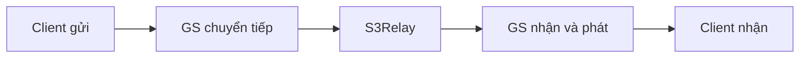

**TÓM TẮT 5 DÒNG**
1. **[NGUỒN]** DONE: khảo sát tĩnh 4 kênh, độ dài và ký tự, đường chuyển tin và giới hạn tần suất.
2. **[NGUỒN]** Phân biệt hàng chờ theo kênh, đường gửi Thì thầm và bộ đếm riêng của đường chat cũ.
3. **[NGUỒN]** Đã viết `JX1_OPS/DESIGN/SO-TAY-CHAT.md` và ghi Kết quả cuối tệp task.
4. **[CHƯA KIỂM]** Chưa xác nhận cấu hình bản chạy và xử lý nội bộ Relay; sandbox từ chối ghi tệp nhịp ở ngoài worktree.
5. **[CHƯA KIỂM]** Không build, chạy exe, VM hay kết nối mạng. Không commit theo yêu cầu; Tổng quan nhận bàn giao để commit.

# SO-22 — Báo cáo sổ tay kênh chat và tin nhắn

Loại: khảo sát  
Chủ đề: Luồng chat JX1 từ giao diện đến máy chủ game, trạm chuyển tiếp và người nhận.  
Từ khóa: Thế giới, Tổ đội, Bang hội, Thì thầm, S3Relay, c2s_extendchat, SendMsgInterval  
Trạng thái: DONE — đủ tiêu chí sổ tay và kết quả task; riêng tệp nhịp bị chặn ghi.  
Độ phủ: 7/7 hạng mục được khảo sát tĩnh, có ghi riêng phần chưa kiểm.  
Liên quan: [Sổ tay chat](../DESIGN/SO-TAY-CHAT.md), [Truyền tải và exe server](../DESIGN/TRUYEN-TAI-VA-EXE-SERVER.md), [Task SO-22](../TASKS/SO-22.md).  
Cần tôi quyết định: không.

## Phạm vi và độ phủ

`CL/` và `GS/` là hai cây nguồn định danh trong `JX1_OPS/TASKS/SO-22.md:24`. Bảng ghi phần đã đối chiếu; mục Chưa xác minh nêu phần còn mở.

| Hạng mục | Độ phủ | Nguồn |
|---|---|---|
| Thế giới | Đã phủ | `CL/gameui/Kuiplayerfun.cpp:808`; `GS/MultiServer/GameServer/KSOServer.cpp:1697–1699` |
| Tổ đội | Đã phủ | `CL/gameui/Kuiplayerfun.cpp:922`; `GS/Core/Src/CoreServerShell.cpp:2782–2812` |
| Bang hội | Đã phủ | `CL/gameui/Kuiplayerfun.cpp:1036`; `GS/MultiServer/GameServer/KSOServer.cpp:1697–1699`, `:2814–2833` |
| Thì thầm | Đã phủ | `CL/gamescene/KgameWorld.cpp:3931`; `GS/MultiServer/GameServer/KSOServer.cpp:2848–2876` |
| Độ dài và ký tự | Đã phủ | `CL/engine/Text.cpp:610–727`; `CL/gamecore/KProtocol.h:2439–2452`; `GS/Core/Src/KPlayerChat.cpp:423–438` |
| Chuyển tin | Đã phủ ở hai đầu GS và client | `GS/MultiServer/GameServer/KSOServer.cpp:1553–1556`, `:3683–3688`; `CL/gamecore/KProtocolProcess.cpp:4292–4312` |
| Tần suất | Đã phủ cơ chế trong mã đã đọc | `CL/gameui/Kuiplayerfun.cpp:224–232`, `:2920–3021`; `GS/Core/Src/KPlayerChat.h:21` |

## Giải mã tên

| Tên gốc | Mã hóa | Chữ đúng (UTF-8) | Nguồn file:dòng |
|---|---|---|---|
| `CH_WORLD` | ASCII | Thế giới | `CL/gameui/Kuiplayerfun.cpp:360`, `:808` |
| `CH_TEAM` | ASCII | Tổ đội | `CL/gameui/Kuiplayerfun.cpp:373`, `:922` |
| `CH_TONG` | ASCII | Bang hội | `CL/gameui/Kuiplayerfun.cpp:399`, `:1036` |
| `CH_JABBER` | ASCII | Thì thầm | `CL/gameui/Kuiplayerfun.cpp:386`, `:979` |
| `S3Relay` | ASCII | Trạm chuyển tiếp chat | `JX1_OPS/DESIGN/TRUYEN-TAI-VA-EXE-SERVER.md:33` |

## Sắp theo cấu trúc game

Sổ tay xếp theo người nhận: Thế giới → Tổ đội → Bang hội → Thì thầm. Sau đó là các bước chung: gửi, nhận, kiểm tra nội dung và điều tiết tần suất.

## Mục sổ thông số

| Nhóm | Tên/hằng số | File:dòng | Giá trị | Đơn vị | Ảnh hưởng | Đổi an toàn | Nguồn đo |
|---|---|---|---|---|---|---|---|
| Ô nhập | `setMaxLength` | `CL/gamescene/KgameWorld.cpp:1620` | 256 | Đơn vị đếm của ô nhập | Mức giao cho ô nhập; chưa đo theo chữ có dấu | CẨN THẬN | Đọc tĩnh |
| Gói tin | `sentlen` | `CL/gamecore/KProtocol.h:2439`, `:2451` | 1; dải 0–255 | Byte cho trường độ dài | Khả năng biểu diễn độ dài; chưa đo mức tin thực nhận | KHÔNG đổi riêng một đầu | Đọc tĩnh, theo kiểu trường |
| Hàng chờ | `SendMsgInterval` | `CL/gameui/Kuiplayerfun.cpp:224`, `:2935–2942`; `CL/gameui/Kuiplayerfun.h:71` | Mặc định đọc 0; từng kênh chưa rõ | Mili giây | Tham gia tính thời điểm gửi | CẨN THẬN | Mặc định trong source; chưa đo |
| Hàng chờ | `SendMsgNum` | `CL/gameui/Kuiplayerfun.cpp:225–232`, `:2932–2934` | Mặc định đọc 0; sau khi cộng một thì chặn trong khoảng 1–10 | Tin chờ mỗi kênh | Hết chỗ thì không xếp thêm tin | CẨN THẬN | Đọc tĩnh; chưa đo |
| Chat cũ | `CHAT_SPEED` | `GS/Core/Src/KPlayerChat.h:21`; `GS/Core/Src/KPlayerChat.cpp:449–451`, `:1540–1542` | 20 | Lần tăng bộ đếm | Ngưỡng của một số nhánh chat cũ | CẨN THẬN | Đọc tĩnh; không quy đổi ra giây |

## Đã xác minh

- Nút gửi theo kênh đưa tin vào hàng chờ; nút gửi Thì thầm gọi `OnSendSomeoneMessage`. Client người gửi có thể hiện tin Thì thầm trước khi gửi gói. `CL/gamescene/KgameWorld.cpp:3129–3169`, `:3872`, `:3931`, `:3114–3124`.
- GS nối hai phía của đường chat mở rộng qua `m_pChatClient`; lọc danh sách chặn ở đầu nhận khi phát tin nhóm, đội và tin riêng. `GS/MultiServer/GameServer/KSOServer.cpp:1553–1556`, `:2820–2833`, `:2856–2876`, `:3617–3619`, `:3683–3688`; `GS/Core/Src/CoreServerShell.cpp:2799–2812`.
- Đối chiếu cú pháp và nội dung tài liệu: 5 dòng tóm tắt ở đầu sổ tay, sơ đồ Mermaid, dẫn chứng file:dòng, mục Chưa kiểm và 4 dòng Kết quả cuối task. Không sửa nội dung báo cáo cũ.

## Chưa xác minh

- Chưa build, chạy game, exe, VM hoặc kết nối mạng. Chưa đo độ dài thực nhận, tốc độ gửi, nội dung từ cấm, cách Relay chọn người nhận hay phản hồi khi người nhận không trực tuyến. Chưa xác nhận dữ liệu cấu hình đang được nạp.
- Không chạy Graphify vì task cấm chạy exe; không thấy đầu ra Graphify tại hai root được giao. `rg` không có trong phiên PowerShell; dùng `Select-String` và các khoảng dòng của tệp thật để đối chiếu. Không lấy header ngoài cây nguồn làm bằng chứng trực tiếp.
- Lần ghi nhịp đầu tiên bằng `Add-Content` cho `D:/JX-wt/SO-22.nhip` trả lỗi `UnauthorizedAccessException`. Đường dẫn là tệp cùng cấp worktree, ngoài vùng ghi; không thử lại cùng đường dẫn hay tạo bản thay thế trong vùng bàn giao.

## Đề xuất tối ưu

Khi có quyền kiểm thử, ưu tiên đối chiếu cấu hình kênh của bản cài và mã Relay cùng phiên bản. Sau đó thử tin tiếng Việt ở giới hạn nhập, gửi liên tiếp theo từng kênh và Thì thầm khi người nhận ngoại tuyến. Chưa có cơ sở đề xuất đổi thông số.

## Bàn giao

Không stage, commit hay push theo yêu cầu. Tổng quan có thể commit ba tài liệu. Phạm vi ghi chỉ gồm sổ tay, báo cáo và mục Kết quả trong task; hàng chỉ mục được đề xuất để Tổng quan thêm khi gộp.

| File | Loại | Chủ đề | Từ khóa | Trạng thái | Độ phủ | Liên quan |
|---|---|---|---|---|---|---|
| `JX1_OPS/DESIGN/SO-TAY-CHAT.md` | khảo sát | Kênh chat và tin nhắn | Thế giới, Tổ đội, Bang hội, Thì thầm, S3Relay, c2s_extendchat, SendMsgInterval | DONE | 7/7 khảo sát tĩnh | SO-22, Truyền tải và exe server |

Kỹ năng đã dùng: jx1-retrofit (khuôn và chỉ mục đề xuất), jx1-read-server, jx1-read-client, jx1-parameters, jx1-knowledge, jx1-report.
