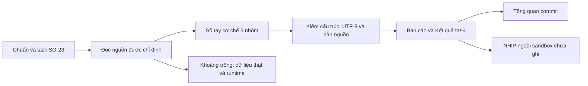

TÓM TẮT 1 — [NGUỒN] Đã hoàn tất sổ tay khảo sát tĩnh SO-23 cho 5/5 nhóm trang bị; bàn giao PARTIAL vì không ghi được NHỊP ngoài vùng ghi của phiên.
TÓM TẮT 2 — [NGUỒN] Đã nối khai báo, ô đeo, thuộc tính/tốc độ, mã ngoại hình, thứ tự lớp và ba đường nhận chung; mỗi kết luận có dẫn nguồn trong sổ tay.
TÓM TẮT 3 — [NGUỒN] Đầu ra chính: JX1_OPS/DESIGN/SO-TAY-NGUA-PHI-PHONG.md; đã ghi mục Kết quả ở task.
TÓM TẮT 4 — [CHƯA KIỂM] Chưa xác minh danh mục từng món, nơi nhận/tỉ lệ cụ thể, hình thực tế hoặc tính tương thích hai bộ nguồn.
TÓM TẮT 5 — [CHƯA KIỂM] Không chạy build, exe, VM, mạng; không commit/push theo yêu cầu, chưa có SHA mới; Tổng quan nhận commit và xử lý NHỊP.

# SO-23 — Bàn giao sổ tay ngựa, phi phong và đồ trang trí

Loại: khảo sát
Chủ đề: Hoàn thành tài liệu cơ chế năm nhóm trang bị từ hai cây nguồn được task cho phép.
Từ khóa: SO-23, ngựa, horse, phi phong, pifeng, mask, yinjian, shiping, lớp vẽ
Trạng thái: PARTIAL — tài liệu đạt tiêu chí; riêng tệp NHỊP được yêu cầu ở ngoài sandbox chưa được ghi.
Độ phủ: cơ chế 5/5 nhóm; 3/3 đường nhận chung được định vị; danh mục từng món chưa đếm được vì Settings/script vận hành ngoài nguồn task.
Liên quan: JX1_OPS/TASKS/SO-23.md; JX1_OPS/DESIGN/SO-TAY-NGUA-PHI-PHONG.md; JX1_OPS/DESIGN/CHUAN-BAO-CAO.md.
Cần tôi quyết định: không — Tổng quan có thể nhận tài liệu và commit; mở task mới nếu cần mở rộng dữ liệu/runtime.

## Sơ đồ bàn giao



## Phạm vi và độ phủ

Quy ước `S/`, `C/` dùng đúng hai gốc tuyệt đối được ghi trong mục “Cách đọc bằng chứng và nguồn” của sổ tay; không phải nguồn runtime. Phạm vi nguồn lấy từ `JX1_OPS/TASKS/SO-23.md:23–30`.

| Phần | Kết quả | Bằng chứng |
|---|---|---|
| Ngựa | [THẤY] Đã phủ loại, ô, dữ liệu, ngoại hình, điều kiện cưỡi khi tính lại thuộc tính | S/KItem.h:97; S/KItemList.cpp:1633–1659; S/KPlayer.cpp:3732 |
| Phi phong | [THẤY] Đã phủ loại/ô, cách chọn hình và đường thuộc tính | S/KItemList.cpp:1673–1699; S/KItemList.cpp:1755–1766 |
| Mặt nạ | [THẤY] Đã phủ loại/ô, dữ liệu và mã ngoại hình | S/KBasPropTbl.CPP:37; C/gamecore/KItemList.cpp:1280–1287 |
| Ấn giám | [THẤY] Đã phủ loại/ô, dữ liệu và nhánh đổi hình áo | S/KBasPropTbl.CPP:39; S/KItemList.cpp:1710–1715 |
| Trang sức | [THẤY] Đã phủ loại/ô, dữ liệu và nhánh đổi hình vũ khí | S/KBasPropTbl.CPP:40; S/KItemList.cpp:1704–1708 |
| Lớp vẽ | [THẤY] Đã phủ bảng thứ tự và nền/hiệu ứng của từng mảnh; phân biệt đoạn đang hoạt động/chú thích | C/gamecore/KNpcRes.cpp:663–695; C/gamecore/KNpcRes.cpp:846–909 |
| Nguồn nhận | [THẤY] Định vị script, cửa hàng và gọi script rơi đồ; [CHƯA KIỂM] từng món | S/ScriptFuns.cpp:9053–9059; S/KBuySell.cpp:478–493; S/KNpc.cpp:2483–2488 |
| NHỊP | Chưa phủ — đường dẫn ngoài vùng ghi sandbox | Đường người dùng yêu cầu: D:\JX-wt\SO-23.nhip; vùng ghi: D:\JX-wt\SO-23 |

## Giải mã tên và cách sắp

[TÀI LIỆU] Giữ bảng giải mã đầy đủ tại sổ tay: ngựa `马/horse`, phi phong `披风/pifeng/mantle`, mặt nạ `面具/mask`, ấn giám `印鉴/yinjian`, trang sức `饰品/shiping`, tên bảng `Shipin.txt`. Không thay tên gốc hoặc đặt tên cho món chưa đọc. Chú thích Hán được đọc GBK/CP936 hoặc UTF-8 theo tệp: S/KBasPropTbl.CPP:32–40; C/gamecore/KItemList.cpp:1280–1326.

| Tên gốc giữ nguyên | Mã hóa | Chữ đúng / tên giải nghĩa | Nguồn file:dòng |
|---|---|---|---|
| `马 / horse` | GBK, định danh ASCII | [THẤY] Ngựa (马) | C/gamecore/CoreUseNameDef.h:13; S/KBasPropTbl.CPP:32 |
| `披风 / pifeng / mantle` | GBK, định danh ASCII | [THẤY] Phi phong (披风) | S/KBasPropTbl.CPP:38; C/gamecore/CoreUseNameDef.h:14 |
| `面具 / mask` | UTF-8 trong đoạn client, ASCII | [THẤY] Mặt nạ (面具) | C/gamecore/KItemList.cpp:1280 |
| `印鉴 / yinjian` | GBK, ASCII | [THẤY] Ấn giám (印鉴); chưa xác nhận tên giao diện Việt | S/KBasPropTbl.CPP:39 |
| `饰品 / shiping / Shipin.txt` | GBK, ASCII | [THẤY] Trang sức (饰品) | S/KBasPropTbl.CPP:40 |

[TÀI LIỆU] Sổ tay xếp theo nhóm trong cấu trúc game, sau đó đến thuộc tính, lớp vẽ và nguồn nhận chung. Chưa xếp theo bộ/từng món vì không có các hàng dữ liệu được đọc trong phạm vi; cấu trúc nguồn chỉ cho biết nơi nạp: S/KBasPropTbl.CPP:57–74; S/KBasPropTbl.CPP:801.

## Nguồn đã giới hạn trước khi đọc sâu

- Gốc server: `C:/Jx1CocoV3/SwordOnline/SwordOnline/jxOnline/gameserver/Sources/Core/Src`. Tệp đọc theo symbol: `KItem.h`, `KItemList.h/.cpp`, `KItemGenerator.h/.CPP`, `KBasPropTbl.h/.CPP`, `KItem.cpp`, `KPlayer.cpp`, `KNpc.cpp`, `KNpcAttribModify.cpp`, `ScriptFuns.cpp`, `KBuySell.cpp`; chỉ tìm điểm rơi đồ trong `KDropScript.h/.cpp`.
- Gốc client: `C:/Jx1CocoV3/Folder/Client2912-20260116T044348Z-3-001/Client2912/Client/Classes`. Tệp đọc theo symbol: `gamecore/KItem.h`, `KItemList.h/.cpp`, `KPlayerDef.h`, `GameDataDef.h`, `CoreUseNameDef.h`, `KItemChangeRes.cpp`, `KNpc.cpp`, `KNpcRes.h/.cpp`, `KNpcResNode.h/.cpp`; tìm điểm nạp trong `KItemGenerator.CPP`, `KItemSet.cpp`; lần phần vẽ vào `gamescene/KgameWorld.cpp`.
- Đã đọc chuẩn trước, task và đúng sáu skill được yêu cầu. Không đọc toàn REPORTS, workflow/STATE, toàn graph hay cây source. Các danh sách tên tệp được lọc theo chủ đề; các đoạn đọc hiển thị dưới khoảng 400 dòng/lần.
- Không chạy Graphify vì task cấm exe. Không đọc Settings, Lua nhiệm vụ thực, tài khoản, khóa/mật khẩu hoặc log/dump. Không sửa mã nguồn hoặc kết luận của tài liệu cũ.

## Đã xác minh / ĐÃ XÁC MINH

- [THẤY] Git ban đầu sạch, đúng nhánh `task/SO-23`; hai tệp đầu ra chưa tồn tại, nên không có phần cũ phải làm lại. Lệnh thực chạy: `git status --short --branch` và kiểm tồn tại các đường dẫn cụ thể.
- [THẤY] Nguồn server và client cùng có năm loại/ô tương ứng; bản ghi, đổi hình và thuộc tính đã được đối chiếu trực tiếp. Dẫn tiêu biểu: S/KItem.h:97–101; S/KItemGenerator.CPP:704–717; C/gamecore/KItemList.cpp:1883–1896.
- [THẤY] Ngựa có điều kiện cưỡi tại `ReCalcEquip`; không suy cộng tốc độ chỉ từ hình ngựa: S/KPlayer.cpp:3732; S/KNpc.cpp:7784–7796.
- [THẤY] Luồng hiện tại của client đi qua `ChangeFeature`/`SetPartInfo` và danh sách vẽ đã sắp, có phân biệt mã cũ bị chú thích: C/gamecore/KNpc.cpp:695–710; C/gamecore/KNpcRes.cpp:1718–1722; C/gamecore/KNpcRes.cpp:663–695; C/gamecore/KNpcRes.cpp:846–909.
- Kiểm tài liệu thực chạy sau ghi: số dòng tóm tắt đầu tệp, Mermaid, mục “Chưa kiểm”, UTF-8 không BOM và dẫn nguồn tồn tại/trong giới hạn dòng. Kết quả ở mục kiểm tra bên dưới.

## Mục sổ thông số

| Nhóm | Tên/hằng số | file:dòng | Giá trị | Đơn vị | Ảnh hưởng | Đổi an toàn | Nguồn đo |
|---|---|---|---|---|---|---|---|
| Trang bị | [THẤY] Năm mã nhóm | S/KItem.h:97–101 | 10–14 | Mã loại từ 0 | Phân loại ngựa và nhóm trang trí | KHÔNG — chỉ khảo sát | Đọc tĩnh |
| Ghép ảnh | [THẤY] Mảnh/nhóm; lớp/mảnh | C/gamecore/KNpcResNode.h:24; C/gamecore/CoreUseNameDef.h:20–24 | 4; 2 | Mảnh; lớp | Cấu trúc ghép hình | CẨN THẬN | Đọc tĩnh |
| Tốc độ | [THẤY] Chặn trong `FastWalkRunP` | S/KNpcAttribModify.cpp:1515–1519 | Chạy 10; đi 5 | Điểm nội bộ, tối thiểu của hàm | Chặn kết quả sửa tốc độ | CẨN THẬN | Đọc tĩnh; không đo runtime |

Bảng chi tiết hơn nằm trong sổ tay; không tạo sổ thông số ngoài vùng giao.

## Chưa xác minh / CHƯA XÁC MINH

- Danh mục, tên từng món, bộ trang bị, trị số thực tế, bảng đổi hình và bảng thứ tự triển khai. Các tệp dữ liệu chỉ được nhận diện từ lệnh nạp, chưa mở ngoài cây nguồn: S/KBasPropTbl.CPP:16–40; C/gamecore/CoreUseNameDef.h:123–128.
- Nguồn nhận và tỉ lệ cụ thể; chỉ xác nhận điểm cấp/mua/gọi script chung. Không nhận có món rơi ở một quái/nhiệm vụ nào: S/ScriptFuns.cpp:9053; S/KBuySell.cpp:113–118; S/KNpc.cpp:2485–2487.
- Mã nguồn client và server có khác biệt ở bảng kích hoạt: client hai phần tử tường minh, server ba, kích thước khai báo đều ba. Chưa xác minh tác động runtime hoặc coi đó là lỗi game: C/gamecore/KItemList.cpp:31–67; C/gamecore/KItemList.h:6; S/KItemList.cpp:34–70; S/KItemList.h:6.
- Chưa build, chạy game, VM, exe, kiểm hình/đo tốc độ, thử mạng hay kiểm bản đang triển khai; các việc này không được task cấp quyền.

## Lỗi, cách thử và kết quả

| Vấn đề | Cách xử lý thực tế | Kết quả / bước tiếp |
|---|---|---|
| `rg` không có trong phiên | Đã thử tra tệp theo tên; lệnh báo không nhận diện. Chuyển sang `Get-ChildItem` có lọc và `Select-String`. | Đọc nguồn tiếp được; không cài công cụ. |
| Hiển thị sai dấu ở lần đọc đầu | Đặt mã hóa console UTF-8; đọc chuẩn/task bằng UTF-8. Kiểm byte nguồn khi gặp tệp dùng mã hóa khác nhau. | Tài liệu đọc đúng dấu; tệp nguồn GBK không bị sửa. Một số chú thích nguồn vốn lỗi chữ được ghi nhận, không dùng làm chứng cứ. |
| Ghép đối số đường dẫn `gamescene` sai | Một lệnh liệt kê có lọc bị lỗi đối số; sửa thành đường dẫn đầy đủ được task cấp. | Đã tìm đúng `KgameWorld.cpp`; không quét thêm root. |
| Đọc `KgameWorld.cpp` bằng GBK gây lệch hiển thị/dòng | Kiểm byte thấy UTF-8 hợp lệ; đọc lại đúng mã hóa đoạn cần dùng. | Dẫn cuối dùng dòng UTF-8 đúng; các kết quả đọc sai không đưa vào kết luận. |
| NHỊP ở ngoài sandbox | Đối chiếu `D:\JX-wt\SO-23.nhip` với vùng ghi `D:\JX-wt\SO-23`. Không thử vượt quyền, không ghi tệp thay thế ngoài phạm vi. | Chưa ghi NHỊP. Đây là giới hạn quyền của phiên, không phải lỗi I/O đã thử; Tổng quan cần tiếp nhận. |

## Đề xuất tối ưu

1. [TÀI LIỆU] Nếu cần sổ tay đến từng món, giao riêng việc đọc đúng năm bảng đã nhận diện và các script/bảng hàng có tham chiếu. Chỉ nối dữ liệu có bằng chứng: S/KBasPropTbl.CPP:32–40; S/ScriptFuns.cpp:8994–8999.
2. [TÀI LIỆU] Nếu cần kiểm lớp vẽ, chọn trước một ngựa và một phi phong có mã rõ, rồi giao task kiểm thử được duyệt; chưa chạy trong lượt này. Điểm quan sát: C/gamecore/KNpcRes.cpp:422–423; C/gamecore/KNpcRes.cpp:663–695.
3. Không đề xuất chỉnh mã/cấu hình hoặc cân bằng tốc độ khi chưa có dữ liệu món và số đo thực tế.

## Kiểm tra tài liệu

- ĐẠT: hai tài liệu mới có đúng năm dòng `TÓM TẮT 1` đến `TÓM TẮT 5` ngay đầu tệp, có Mermaid; sổ tay có mục `Chưa kiểm`.
- ĐẠT: sổ tay, báo cáo và task đều đọc được bằng bộ giải mã UTF-8 nghiêm ngặt, không BOM.
- ĐẠT: bộ kiểm dẫn nguồn sau ghi tìm được hơn 10 dẫn nguồn riêng biệt; đã kiểm 22 tệp nguồn được dẫn, không có tệp thiếu, khoảng dòng ngoài giới hạn hoặc điểm bắt đầu trống. Các dẫn được dùng cũng đã đọc theo đoạn trong lúc khảo sát; kiểm tồn tại/dòng không thay thế kiểm nội dung.
- ĐẠT: sổ tay có 112 dẫn nguồn khác nhau; kiểm riêng 23 điểm neo nội dung bằng tên symbol/lệnh mong đợi cho kết quả 23/23 khớp. Khối mã Markdown đóng đủ, không còn chỗ chờ bổ sung kết quả kiểm.
- Đã sửa hai dẫn gốc nguồn trong sổ tay từ dòng trống 25 của task về dòng 24 có nội dung thật; không đổi task gốc.
- Mục `Kết quả` của task có bốn dòng bàn giao. Đây là kiểm chất lượng Markdown/dẫn chứng, không phải build/test game.

## Bàn giao

- Đã tạo sổ tay và báo cáo này; chỉ nối mục `## Kết quả` vào cuối task, không đổi mục tiêu hay trạng thái metadata cũ.
- Không stage, commit hoặc push theo yêu cầu; không có SHA mới để báo. Tổng quan commit hộ. Không có thao tác Git bị chặn nên không ghi nhận giả lỗi push.
- Không tạo `REPORTS/_CHIMUC/SO-23.tsv` hay sửa mục lục vì chúng ngoài `vung_file` và các tệp bổ sung người dùng cho phép. Hàng đề nghị PM gộp vào mục lục/chỉ mục:

```tsv
file	loại	chủ đề	từ khóa	trạng thái	độ phủ	liên quan
JX1_OPS/DESIGN/SO-TAY-NGUA-PHI-PHONG.md	khảo sát	Ngựa, phi phong và đồ trang trí	ngựa,horse,phi phong,pifeng,mantle,mask,yinjian,shiping	DONE	5/5 nhóm cơ chế tĩnh; 3/3 đường nhận chung; chưa kiểm từng món	JX1_OPS/TASKS/SO-23.md;JX1_OPS/REPORTS/SO-23.md
```

Tài liệu chính DONE theo tiêu chí tĩnh; bàn giao tổng thể PARTIAL do NHỊP ngoài sandbox chưa ghi. Không có tác vụ nguồn/runtime đang chạy hoặc tệp mã nguồn sửa dở.

Kỹ năng đã dùng: jx1-retrofit (khuôn và giữ nguyên kết luận cũ, không có báo cáo cũ để retrofit), jx1-read-server, jx1-read-client, jx1-parameters, jx1-knowledge, jx1-report.
