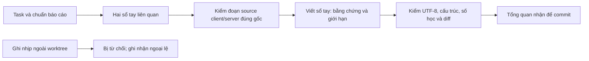

TÓM TẮT 1: [NGUỒN] [THẤY] Đầu ra tài liệu SO-24 đã xong; bàn giao chung PARTIAL vì tệp nhịp ngoài sandbox bị từ chối. Phạm vi chỉ đọc tĩnh client/server và viết ba tệp được giao. `JX1_OPS/TASKS/SO-24.md:19–30`.
TÓM TẮT 2: [NGUỒN] [THẤY] Đã giải thích học chiêu, điểm/cấp, cửa kiểm nâng, bị động/hỗ trợ và đường Settings → script → sát thương. `JX1_OPS/DESIGN/SO-TAY-KY-NANG-CAP.md:36–47,87–155`.
TÓM TẮT 3: [NGUỒN] [THẤY] Sổ tay có đúng 5 dòng tóm tắt, 144 lượt dẫn dạng file:dòng theo phép đếm kiểm tra, Mermaid và mục Chưa kiểm. `JX1_OPS/DESIGN/SO-TAY-KY-NANG-CAP.md:1–5,17–34,192–196`.
TÓM TẮT 4: [CHƯA KIỂM] Chưa có bảng số thật từng cấp, nội dung script ngoài gốc được giao hay kết quả game; không build, chạy exe, VM hoặc mạng. `JX1_OPS/DESIGN/SO-TAY-KY-NANG-CAP.md:155,192–196`.
TÓM TẮT 5: [NGUỒN] [THẤY] Không stage/commit/push theo yêu cầu; chưa có SHA mới. Tổng quan nhận tài liệu để commit và xử lý ngoại lệ nhịp, không cần sửa quyền hay credential trong task. `JX1_OPS/DESIGN/SO-TAY-KY-NANG-CAP.md:202–203`.

# SO-24 — Bàn giao sổ tay cấp kỹ năng, điểm kỹ năng và khí công

Loại: tổng hợp
Chủ đề: Kết quả khảo sát tĩnh và kiểm tra đầu ra của sổ tay SO-24.
Từ khóa: SO-24, cấp kỹ năng, điểm kỹ năng, khí công, bị động, AddMagic, AddSkillPoint, LvlSetScript, bàn giao
Trạng thái: PARTIAL — nội dung tài liệu đạt DONE; thao tác ghi `D:/JX-wt/SO-24.nhip` bị sandbox từ chối truy cập.
Độ phủ: 8/8 chủ đề cơ chế có phần giải thích và giới hạn; 2/2 sổ tay cũ được đối chiếu; 0 phép chạy game và 0 tệp source được sửa.
Liên quan: [task SO-24](../TASKS/SO-24.md), [sổ tay đầu ra](../DESIGN/SO-TAY-KY-NANG-CAP.md), [sổ tay kỹ năng cũ](../DESIGN/SO-TAY-KY-NANG.md), [công thức sát thương](../DESIGN/HIEU-CONG-THUC-SAT-THUONG.md).
Cần tôi quyết định: không đối với phần tài liệu đã hoàn tất; ngoại lệ nhịp được bàn giao để Tổng quan nắm, không tự vượt sandbox.



## Phạm vi và độ phủ

| Phần được giao | Kết quả | Bằng chứng |
|---|---|---|
| Đọc chuẩn trước, đọc task và tiếp tục phần còn thiếu | Đã thực hiện; Git ban đầu sạch trên `task/SO-24`, hai tệp đầu ra chưa có | Lệnh đầu `git status --short --branch` trả `## task/SO-24`; kiểm tồn tại trả False cho sổ tay mới và báo cáo |
| Dùng sáu skill local được chỉ định | Đã đọc đầy đủ từng `SKILL.md`; áp dụng trong phạm vi user cho phép | `.agents/skills/jx1-retrofit/SKILL.md:6–14`, `.agents/skills/jx1-read-server/SKILL.md:6–15`, `.agents/skills/jx1-read-client/SKILL.md:6–15`, `.agents/skills/jx1-parameters/SKILL.md:6–16`, `.agents/skills/jx1-knowledge/SKILL.md:6–11`, `.agents/skills/jx1-report/SKILL.md:6–23` |
| Học, nâng, điểm, bị động/khí công, thuộc tính theo cấp và sát thương | Đã giải thích 8 nhóm cơ chế; nêu rõ dữ liệu chưa đọc | `JX1_OPS/DESIGN/SO-TAY-KY-NANG-CAP.md:36–47,87–155` |
| Đối chiếu tài liệu cũ, giữ kết luận | Đã đối chiếu 2/2, không sửa hai tệp cũ | `JX1_OPS/DESIGN/SO-TAY-KY-NANG-CAP.md:157–166` |
| Chuẩn trình bày | Có metadata, Mermaid, phạm vi, giải mã tên, cấu trúc game, sổ thông số, mức xác minh, bàn giao | `JX1_OPS/DESIGN/SO-TAY-KY-NANG-CAP.md:7–85,168–203` |
| Báo cáo và mục Kết quả cuối task | Đã ghi theo yêu cầu trực tiếp của user | Báo cáo này; `JX1_OPS/TASKS/SO-24.md:32–36` |
| Nhịp ở đường dẫn user yêu cầu | BỊ CHẶN — chưa ghi được | `WriteAllText` trả `UnauthorizedAccessException`, xem nhật ký lỗi bên dưới |

## Giải mã tên

| Tên gốc | Mã hóa | Chữ đúng UTF-8 | Nguồn file:dòng |
|---|---|---|---|
| Không phát sinh tên riêng kỹ năng, trang bị, quái, NPC hoặc bản đồ trong nội dung bàn giao | Không áp dụng | Tên dùng minh họa trong sổ tay có bảng riêng; không giải mã lại Settings | `JX1_OPS/DESIGN/SO-TAY-KY-NANG-CAP.md:65–73` |

## Sắp theo cấu trúc game

[THẤY] Sổ tay đi theo học/mở chiêu → có điểm và cấp → gửi yêu cầu nâng → nhận tác dụng bị động/hỗ trợ → ghép sát thương. Ví dụ tra chiêu xếp theo phái → nhánh → cấp yêu cầu; không tuyên bố là toàn bộ cây kỹ năng. `JX1_OPS/DESIGN/SO-TAY-KY-NANG-CAP.md:75–85,87–155`.

## Đã xác minh

[THẤY] Các tiền tố `S/`, `C/`, `D/` trong bảng dưới dùng đúng gốc đã công bố ở `JX1_OPS/DESIGN/SO-TAY-KY-NANG-CAP.md:55–59`. Đã mở đoạn nguồn thật và xem số dòng, không lấy sơ đồ hoặc tài liệu cũ thay bằng chứng source.

| Nội dung | file:dòng và ký hiệu đã đọc | Kết quả |
|---|---|---|
| Học chiêu | `S/ScriptFuns.cpp:11091–11135`, `LuaAddMagic` | Nhận ID/tên và cấp, gọi `Add`, đồng bộ; không khẳng định mọi nơi gọi đều miễn phí |
| Điểm khi lên cấp | `S/KPlayer.cpp:3271–3279` | Có cộng hằng `PLAYER_LEVEL_ADD_SKILL`; chưa kiểm định nghĩa số của hằng server |
| Server xét nâng | `S/KPlayer.cpp:5460–5612`, `AddSkillPoint` | Có cửa script và các nhánh kiểm riêng; nhánh thường tăng thành công rồi trừ điểm |
| Client gửi và nhận | `C/gamecore/CoreShell.cpp:3965–3968`, `C/gamecore/KPlayer.cpp:1938–1954`, `C/gamecore/KProtocolProcess.cpp:1275–1317` | Yêu cầu một điểm/lần bấm, sau đó nhận cấp/số dư/cộng thêm từ server |
| Dữ liệu cấp và hỗ trợ | `S/KSkillList.h:18–34,114–118,150–155` | Phân biệt cấp đã học, cấp hiệu lực, cấp cộng thêm và % hỗ trợ |
| Bị động và hỗ trợ | `S/KSkillList.cpp:226–255,1009–1037`, `S/KSkills.cpp:3462–3506` | Có kiểm trước khi áp bị động, có bước tính lại hỗ trợ chiêu |
| Bảng và script theo cấp | `S/KSkillManager.cpp:64–74,175–207`, `S/KSkills.cpp:3085–3100,3177–3216` | Đọc `MaxLevel` theo bản ghi; ID/cấp quyết định dữ liệu gọi script |
| Ghép vật lý | `S/KNpc.cpp:5992–6054` | Nhánh theo % và nhánh theo điểm khác nhau, phép chia nguyên theo từng hạng |
| Độ luyện | `S/KSkillList.cpp:260–278`, `S/KPlayer.cpp:5617–5650` | Có đường tích độ luyện, đủ ngưỡng tăng một cấp; chưa kiểm nơi phát sinh |
| Hai sổ tay cũ | `D/SO-TAY-KY-NANG.md:110–117`, `D/HIEU-CONG-THUC-SAT-THUONG.md:74–98,119–128` | Dẫn lại đúng mức TÀI LIỆU; giữ kết luận và không sửa nguồn cũ |

## Mục sổ thông số

[THẤY] Sổ thông số liên quan đã đặt trong chính sổ tay, gồm điểm yêu cầu, hằng cấp điểm, trần mặc định, giới hạn kỹ thuật, `ReqLevel`, ví dụ dữ liệu cũ, % hỗ trợ và ngưỡng độ luyện. Có giá trị/đơn vị/ảnh hưởng/mức đổi an toàn/nguồn đọc; chỗ thiếu không thay bằng số 0. Không tạo sổ ngoài phạm vi. `JX1_OPS/DESIGN/SO-TAY-KY-NANG-CAP.md:168–181`.

## Kiểm tra thực chạy và lỗi/cách thử/kết quả

| Kiểm tra hoặc sự cố | Cách đã thực hiện | Kết quả và giới hạn |
|---|---|---|
| Nhánh/trạng thái ban đầu | `git status --short --branch`, một lần trước ghi | Đúng `task/SO-24`, không có local thay đổi sẵn; không checkout/reset/clean |
| Hiển thị tiếng Việt lần đọc đầu | `Get-Content` mặc định, sau đó đọc lại hai tệp nhỏ bằng UTF-8 tường minh | Lần đầu sai hiển thị do encoding; lần hai đọc được. Không sửa nội dung hai tệp nguồn |
| Thiếu `rg` | Thử một lần; nhận `CommandNotFoundException` | Báo một lần, chuyển `Select-String`/`Get-ChildItem` có tên lọc; không cài công cụ, không liệt kê đệ quy thư mục lớn |
| Nguồn | Chọn tệp cụ thể và đoạn ngắn; mỗi lượt xuất dưới khoảng 400 dòng | Chỉ đọc tĩnh trong hai gốc source được giao, hai sổ tay liên quan và tài liệu định vị/skill cần thiết; không Graphify/exe/mạng |
| Cấu trúc sổ tay | PowerShell đếm dòng mở đầu, regex dẫn nguồn, kiểm chuỗi Mermaid và mục Chưa kiểm | PASS: 5 dòng tóm tắt; 144 lượt dẫn dạng file:dòng; có cả hai mục bắt buộc. Regex chỉ kiểm hình thức; bằng chứng nguồn được đọc trực tiếp ở bước khảo sát |
| Mã hóa sổ tay | Giải mã UTF-8 nghiêm ngặt, kiểm ba byte BOM và ký tự thay thế | PASS: UTF-8 không BOM, không có U+FFFD |
| Số học ví dụ | PowerShell `Truncate(135×150/100)+Truncate(135×20/100)` và thay 150 bằng 160 | PASS: 229, 243, chênh 14; đầu vào giả định, không phải bảng Settings thật hay sát thương đo được |
| Nhịp bắt đầu | `WriteAllText('D:/JX-wt/SO-24.nhip', …, UTF-8 không BOM)` | BỊ CHẶN: `Access to the path 'D:\JX-wt\SO-24.nhip' is denied.`; `UnauthorizedAccessException`; không ghi được |
| Nhịp các mốc nguồn xong, sổ tay xong và sắp bàn giao | Không thử lặp cùng thao tác ngoài writable root | Chưa ghi do cùng rào cản đã rõ; thông báo tiến độ trong hội thoại, không ghi sang đường dẫn thay thế và không đổi quyền |
| Diff/đầu ra cuối | Kiểm whitespace, liên kết local, chỉ ba tệp giao việc; xem diff cuối một lần | Kết quả kiểm cuối được ghi trong mục Kết quả của task và phản hồi bàn giao |
| Build/test game/exe/VM/mạng | Không chạy | Ngoài quyền task; không tuyên bố runtime đạt |

## Chưa xác minh

- [CHƯA KIỂM] Chưa đọc bảng Settings, script điều kiện/nâng và bộ dữ liệu client/server thực nạp; chưa có bảng sát thương số thật ở từng cấp. Không kết luận chúng thiếu trên đĩa. `JX1_OPS/DESIGN/SO-TAY-KY-NANG-CAP.md:155,192–196`.
- [CHƯA KIỂM] Chưa kiểm mọi nguồn thưởng/hoàn điểm, mọi nhiệm vụ, mọi kiểu khí công, trần VIP/tái sinh, định nghĩa số của hằng cấp điểm hoặc mọi đường độ luyện. `JX1_OPS/DESIGN/SO-TAY-KY-NANG-CAP.md:94–107,120–129,192–196`.
- [CHƯA KIỂM] Chưa đo game, chưa render Mermaid bằng công cụ riêng; chỉ kiểm cấu trúc văn bản và đọc cú pháp sơ đồ. Không build/exe/VM/mạng theo `JX1_OPS/TASKS/SO-24.md:27–30`.
- [THẤY] Không thể hoàn tất tệp nhịp bên cạnh worktree trong sandbox hiện tại. Không có bước sửa quyền/credential/config hoặc cách lách đường dẫn.

## Đề xuất tối ưu

[THẤY — đề xuất] Đợt tiếp theo, nếu được giao thêm phạm vi dữ liệu, chọn một ID và đọc đúng dòng bảng cùng các script mà dòng đó trỏ tới; sau đó mới lập bảng cấp 1…trần. Nếu được duyệt đo game, giữ người đánh/mục tiêu ổn định và ghi riêng cấp, điểm dư, cấp cộng thêm, % hỗ trợ và máu mất. Không tự thực hiện các bước này trong SO-24. `JX1_OPS/DESIGN/SO-TAY-KY-NANG-CAP.md:198–201`.

## Bàn giao

- Ba tệp thuộc yêu cầu: `JX1_OPS/DESIGN/SO-TAY-KY-NANG-CAP.md`, `JX1_OPS/REPORTS/SO-24.md`, phần `## Kết quả` cuối `JX1_OPS/TASKS/SO-24.md`. Không đổi YAML task hoặc nội dung cũ.
- Trạng thái nội dung sổ tay: **DONE** theo các tiêu chí tệp tồn tại, đúng 5 dòng, ít nhất 10 dẫn nguồn, có Mermaid và Chưa kiểm. Trạng thái bàn giao đầy đủ: **PARTIAL** chỉ vì yêu cầu nhịp bị từ chối; không thiếu tệp tài liệu được phép ghi.
- Chưa có SHA mới; không stage/commit/push vì user giao Tổng quan commit. Đây không phải lỗi Git hay lỗi push. Không tuyên bố đã push.
- Không tạo `REPORTS/_CHIMUC/SO-24.tsv` hoặc sửa mục lục ngoài vùng giao; hàng đề xuất bên dưới để PM/Tổng quan gộp theo chuẩn. Quyền ghi hẹp của task được ưu tiên hơn yêu cầu chỉ mục chung trong skill.
- Lỗi nhịp đã ghi đủ lỗi thật/cách thử/kết quả; bàn giao tại đây, không gửi thông báo ra ngoài.

Hàng đề xuất cho `JX1_OPS/DESIGN/MUC-LUC-TRI-THUC.md` và chỉ mục chung:

```tsv
file	loại	chủ đề	từ khóa	trạng thái	độ phủ	liên quan
JX1_OPS/DESIGN/SO-TAY-KY-NANG-CAP.md	tổng hợp	Cấp kỹ năng, điểm kỹ năng và khí công	SO-24, học chiêu, SkillLevel, ReqLevel, MaxLevel, LvlSetScript	DONE — khảo sát tĩnh	8/8 chủ đề cơ chế; chưa đối chiếu bảng số thực từng cấp	JX1_OPS/DESIGN/SO-TAY-KY-NANG.md; JX1_OPS/DESIGN/HIEU-CONG-THUC-SAT-THUONG.md; JX1_OPS/REPORTS/SO-24.md
```

Kỹ năng đã dùng: `jx1-retrofit`, `jx1-read-server`, `jx1-read-client`, `jx1-parameters`, `jx1-knowledge`, `jx1-report`.
