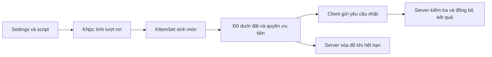

TÓM TẮT 1/5 [NGUỒN] — DONE cho khảo sát tĩnh, phủ đủ 6 nhóm cơ chế từ bảng rơi đến thao tác nhặt.
TÓM TẮT 2/5 [NGUỒN] — Đối chiếu mã server, client và hai bảng mẫu của bản đồ ID 1. Ví dụ cho thấy khoảng trượt và trọng số vượt khoảng quay.
TÓM TẮT 3/5 [NGUỒN] — Đã viết `JX1_OPS/DESIGN/SO-TAY-ROI-DO.md` và bổ sung mục Kết quả vào `JX1_OPS/TASKS/SO-25.md`.
TÓM TẮT 4/5 [NGUỒN] — Tổng quan phụ trách commit. Sandbox từ chối ghi tệp nhịp ngoài worktree.
TÓM TẮT 5/5 [CHƯA KIỂM] — Chưa chạy build, game, exe hoặc VM. Chưa đo tỉ lệ và thời gian trong bản triển khai.

# SO-25 — Bàn giao sổ tay rơi đồ và tỉ lệ rơi của quái

- Loại: khảo sát
- Chủ đề: Kiểm tra bảng rơi, may mắn, quyền nhặt và vòng đời vật phẩm dưới đất.
- Từ khóa: rơi đồ, may mắn, quyền nhặt, DropRate, RandRange, RandRate, KNpc, KItemSet
- Trạng thái: DONE — đủ nội dung khảo sát tĩnh. Tệp nhịp ngoài vùng ghi bị chặn.
- Độ phủ: 6/6 nhóm cơ chế của task, đọc dữ liệu mẫu theo trường hợp đại diện.
- Liên quan: [SO-25 — Sổ tay rơi đồ](../DESIGN/SO-TAY-ROI-DO.md), [A-17 — Rơi đồ boss và trang bị](A-17-roi-do-boss-trang-bi.md), [task SO-25](../TASKS/SO-25.md).
- Cần tôi quyết định: không

## Phạm vi và độ phủ

Các tiền tố đường dẫn `S/`, `E/`, `C/`, `D/` trỏ tới gốc server, engine server, client và dữ liệu mẫu tương ứng trong [bảng nguồn của sổ tay](../DESIGN/SO-TAY-ROI-DO.md#nguồn-và-mức-xác-minh).

| Nhóm | Độ phủ | Điểm đối chiếu |
|---|---|---|
| Settings và gắn bảng | Đã phủ | `D/MapList.ini:17–18`, `S/KNpcSet.cpp:595–616`, `S/KNpcTemplate.cpp:512–551` |
| Tỉ lệ, tiền và số lượt | Đã phủ | `S/KNpc.cpp:11883–11900`, `S/KNpc.cpp:12617–12640`, `E/KRandom.cpp:68–95` |
| May mắn, sinh món | Đã phủ | `S/KNpc.cpp:12677–12770`, `S/KNpc.cpp:12912–12930`, `S/KItemSet.cpp:364–400` |
| Quyền ưu tiên | Đã phủ | `S/KPlayer.cpp:5662–5736`, `S/KObj.cpp:1639–1645` |
| Thời gian tồn tại | Đã phủ | `S/KObjSet.cpp:468`, `S/KObj.cpp:678–695`, `D/ObjSetting.txt:10` |
| Nhặt đồ trong client | Đã phủ | `C/gamecore/CoreShell.cpp:452–455`, `C/gamecore/KNpcAI.cpp:1285–1322`, `C/gamecore/KPlayer.cpp:2306–2315` |

## Giải mã tên

| Tên gốc | Mã hóa | Chữ đúng | Nguồn file:dòng |
|---|---|---|---|
| `剑` | GBK (trang mã 936) | Kiếm (`剑`), mẫu đối tượng DataID 9 | `D/ObjSetting.txt:10` |

## Sắp theo cấu trúc game

Sổ tay đi theo bản đồ → nhóm quái → lượt rơi → món dưới đất → người nhặt. Hai bảng được ghép theo nhóm quái của cùng bản đồ ID `1`. Vật phẩm trong bảng mẫu được dẫn bằng mã `Genre/Detail/Particular`. Nhãn đối tượng dưới đất đi theo `DataID`. `D/MapList.ini:17–18`, `S/KNpcTemplate.cpp:192–208`, `D/ObjSetting.txt:1`.

## Đã xác minh

- **[THẤY]** Bảng thường của bản đồ ID `1` có `Count=53` và tổng trọng số `144.000` trên khoảng `330.000`. Bảng hoàng kim có `Count=51` và tổng `4.516.910` trên khoảng `3.000.000`. Cộng trực tiếp `RandRate` trong các mục đánh số từ 1 đến `Count` bằng PowerShell, đọc lần lượt 337 và 372 dòng. Ở bảng hoàng kim, mục `[51]` bắt đầu sau `2.649.910` ô, còn `350.090` ô hợp lệ trong lượt đầu. `D/droprate/npcdroprate10.ini:2–3`, `D/droprate/goldennpc/golden_lv10.ini:2–3`, `D/droprate/goldennpc/golden_lv10.ini:372`, `S/KNpc.cpp:12617–12640`.
- **[THẤY]** Đối chiếu điều kiện chọn dòng trước khi tính may mắn, các đường tạo món của `KItemSet` và lệnh tạo vật thể trên bản đồ. `S/KNpc.cpp:12617–12640`, `S/KNpc.cpp:12677–12739`, `S/KNpc.cpp:12912–12930`, `S/KNpc.cpp:12945–12974`.
- **[THẤY]** Đối chiếu quyền nhặt, cập nhật hai bộ đếm và đường hồi đáp xóa vật thể. `S/KPlayer.cpp:5662–5736`, `S/KPlayer.cpp:5870–5896`, `S/KObj.cpp:678–695`, `C/gamecore/KProtocolProcess.cpp:2873–2879`.
- **[TÀI LIỆU]** Ví dụ hai đường script của `boss_tieu` dẫn theo A-17. Đã kiểm tra lại điều kiện `.ini` ở nguồn SO-25. `JX1_OPS/REPORTS/A-17-roi-do-boss-trang-bi.md:76–78`, `S/KNpcTemplate.cpp:512–520`.

## Chưa xác minh

- **[CHƯA KIỂM]** Bảng và script thực sự gắn trên bản triển khai, tỉ lệ đo trong game, thời gian theo giây, cạnh tranh nhặt chung và dữ liệu tương ứng của APK. Chưa chạy build, game, exe, VM hay kết nối mạng.
- **[CHƯA KIỂM]** Tệp mẫu `gamesetting_gs001.ini` có `LuckyRate=0`, trong khi `gamesetting.ini` có `100`. Chưa xác nhận nhánh nạp và giá trị đang dùng khi chạy. `D/gamesetting_gs001.ini:442`, `D/gamesetting.ini:424`, `S/KCore.cpp:261–265`.

## Mục sổ thông số

| Nhóm | Tên/hằng số | file:dòng | Giá trị | Đơn vị | Ảnh hưởng | Đổi an toàn | Nguồn đo |
|---|---|---|---|---|---|---|---|
| Chọn dòng | `Count`, `RandRange`, `RandRate` của `[1]` | `D/droprate/npcdroprate10.ini:2–3`, `D/droprate/npcdroprate10.ini:18–22` | `53`, `330.000`, `300` | mục, ô quay, ô quay | Số mục nạp, cỡ khoảng quay, phần khoảng của dòng | CẨN THẬN | Mẫu đọc tĩnh |
| Lượt xét | `nTypeNum` | `D/droprate/npcdroprate10.ini:13`, `S/KNpc.cpp:11776–11788` | `2` trong mẫu | lượt | Số lượt đầu vào cho các vòng tiền và món | CẨN THẬN | Mẫu và mã đọc tĩnh |
| Tiền | `MoneyRate`, `MoneyNum` | `D/droprate/npcdroprate10.ini:5`, `D/droprate/npcdroprate10.ini:15`, `S/KNpc.cpp:11883–11890` | `5`, `50` | trên 100 mỗi lượt, lượng | Cửa xét tiền và số lượng đầu vào của nhánh đã trúng | CẨN THẬN | Mẫu và mã đọc tĩnh |
| Thuộc tính | `MagicRate` | `D/droprate/npcdroprate10.ini:4`, `S/KNpc.cpp:12734–12757` | `1` trong mẫu | điểm đầu vào | Tham gia xét sinh thuộc tính | CẨN THẬN | Mẫu và mã đọc tĩnh |
| Thuộc tính | `LuckyRate` | `S/KGameglobalSet.cpp:90`, `D/gamesetting.ini:424`, `D/gamesetting_gs001.ini:442` | `100` dự phòng, mẫu `100` và `0` | cỡ khoảng quay | Vế phải của phép xét thuộc tính | CẨN THẬN | Mã và hai tệp mẫu đọc tĩnh |
| Quyền nhặt | `OBJ_BELONG_TIME` | `S/KObj.h:46`, `S/KObj.cpp:1639–1645` | `600` | lượt cập nhật đối tượng | Thời gian ưu tiên nhặt thông thường | CẨN THẬN | Hằng số đọc tĩnh |
| Đồ dưới đất | `LifeTime` | `D/ObjSetting.txt:1`, `D/ObjSetting.txt:10`, `S/KObjSet.cpp:468` | `2.400` cho mẫu DataID `9`, giá trị dự phòng đọc cột là `0` | lượt cập nhật đối tượng | Hết mốc thì server xóa vật thể | CẨN THẬN | Mẫu và mã đọc tĩnh, chưa quy đổi ra giây |

## Đề xuất tối ưu

Khi có đợt kiểm thử được duyệt, đối chiếu tệp thực nạp cho một bản đồ mẫu trước khi lấy số liệu. Ghi riêng số lần cửa quay chọn dòng, số món được tạo và số món nhặt được. Đo thời điểm hết ưu tiên và biến mất trên cùng món để xác nhận hai bộ đếm. Khi rà bảng, kiểm tra `Count`, tổng `RandRate` và vị trí đoạn vượt `RandRange` để xác định dòng nào bị cắt.

## Lỗi và kết quả xử lý

| Sự việc | Cách thử và kết quả |
|---|---|
| PowerShell không tìm thấy `rg` | Dùng `Select-String` và đọc theo khoảng dòng ở các tệp đã khoanh vùng. Đã lấy được dẫn chứng cần thiết. |
| Không thấy dấu gốc Graphify tại các thư mục source đã kiểm tra | Dùng `GS001-MAP.md:7` để định vị ban đầu rồi đọc trực tiếp các hàm server và client. |
| Sandbox từ chối ghi `D:\JX-wt\SO-25.nhip` | `Add-Content` trả `Access to the path 'D:\JX-wt\SO-25.nhip' is denied.` Đường dẫn nằm ngoài vùng ghi `D:\JX-wt\SO-25`. Các mốc công việc được báo trong cuộc trò chuyện. |

## Bàn giao

Sổ tay và mục Kết quả đã sẵn sàng cho Tổng quan kiểm tra và commit. Lượt này chưa có commit SHA hoặc push theo phạm vi được giao. Có thể thêm hàng sau vào `JX1_OPS/DESIGN/MUC-LUC-TRI-THUC.md` trong đợt gộp của Tổng quan.

| Chủ đề | Tài liệu | Điểm vào | Mức chắc |
|---|---|---|---|
| Rơi đồ, may mắn, quyền nhặt và thời gian tồn tại | `DESIGN/SO-TAY-ROI-DO.md`, SO-25, A-17 | `KNpc::DoDeath`, `KNpc::LoseSingleItem`, `KItemSet`, `KObj::Activate`, client `PickUpItem` | Khảo sát tĩnh, có bảng Settings mẫu, chưa đo trong game |

Kỹ năng đã dùng: `jx1-retrofit`, `jx1-read-server`, `jx1-read-client`, `jx1-parameters`, `jx1-knowledge`, `jx1-report`.
