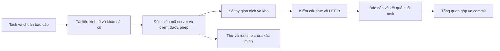

TÓM TẮT 1: [NGUỒN] PARTIAL — hoàn tất sổ tay tĩnh giao dịch/kho/gửi-rút bạc; chưa định vị được thư và không ghi được nhịp ngoài worktree.
TÓM TẮT 2: [NGUỒN] Đã kiểm nguồn thật cho mời/khóa/xác nhận/hủy, chuyển đồ/bạc, gói tin và lưu; không đổi kết luận các tài liệu cũ.
TÓM TẮT 3: [NGUỒN] Đầu ra `JX1_OPS/DESIGN/SO-TAY-GIAO-DICH-KHO.md` có 5 dòng tóm tắt, 1 Mermaid, 106 lượt dẫn nguồn S/C và 58 điểm đầu dòng nguồn khác nhau.
TÓM TẮT 4: [CHƯA KIỂM] Thư, an toàn chống nhân đồ runtime, tràn số, lỗi lưu/mất kết nối và giới hạn server còn chưa xác minh; nhịp bị lỗi Access denied.
TÓM TẮT 5: [NGUỒN] Không build, chạy test game, exe, VM hoặc mạng; không commit/push theo yêu cầu, chưa có SHA; Tổng quan nhận tài liệu và quyết định bước xác minh tiếp.

# SO-26 — Bàn giao sổ tay giao dịch, kho và thư
Loại: khảo sát
Chủ đề: Ghi kết quả, nguồn đọc, giới hạn và kiểm tra đầu ra của SO-26.
Từ khóa: giao dịch, trade, rương, room_repository, bạc, storemoney, mail, chống nhân đồ, lưu nhân vật
Trạng thái: PARTIAL — nội dung sổ tay tĩnh hoàn tất; thư chưa có nguồn xử lý và file nhịp bị sandbox chặn.
Độ phủ: 6/7 mảng có bằng chứng mã trực tiếp; thư đã rà giới hạn, chưa phủ hành vi; không tính kiểm thử runtime vào phần đã xác minh.
Liên quan: `JX1_OPS/TASKS/SO-26.md`; `JX1_OPS/DESIGN/SO-TAY-GIAO-DICH-KHO.md`; `JX1_OPS/DESIGN/SO-TAY-KINH-TE.md`; `JX1_OPS/DESIGN/HIEU-GIAO-DICH-KHO-DO.md`.
Cần tôi quyết định: không — không cần quyết định để bàn giao tài liệu; mọi mở rộng nguồn hoặc thử nghiệm cần task riêng.

## Sơ đồ bàn giao



## Phạm vi và độ phủ

| Hạng mục | Kết quả | Nơi xem |
|---|---|---|
| Giao dịch trực tiếp | [THẤY] Đã đối chiếu tĩnh | `JX1_OPS/DESIGN/SO-TAY-GIAO-DICH-KHO.md:67–75`. |
| Rương và vật phẩm | [THẤY] Đã đối chiếu tĩnh | `JX1_OPS/DESIGN/SO-TAY-GIAO-DICH-KHO.md:77–82`. |
| Gửi/rút bạc | [THẤY] Đã phân biệt gửi rương và trao người khác | `JX1_OPS/DESIGN/SO-TAY-GIAO-DICH-KHO.md:84–95`. |
| Gói tin, giới hạn | [THẤY] Có bảng tên gói và sổ thông số; chưa chốt giới hạn server | `JX1_OPS/DESIGN/SO-TAY-GIAO-DICH-KHO.md:97–123`. |
| Chống nhân đồ | [THẤY]/[CHƯA KIỂM] Ghi lớp chặn và dấu hiệu cần thử, không khẳng định khai thác được | `JX1_OPS/DESIGN/SO-TAY-GIAO-DICH-KHO.md:125–140`. |
| Lưu và kinh tế | [THẤY]/[TÀI LIỆU] Đã đối chiếu riêng bạc túi/rương/XU, gọi lưu từng người | `JX1_OPS/DESIGN/SO-TAY-GIAO-DICH-KHO.md:95,133,137–138`. |
| Thư/đính kèm | [CHƯA KIỂM] Chưa tìm được đường xử lý trong tập nguồn đã rà | `JX1_OPS/DESIGN/SO-TAY-GIAO-DICH-KHO.md:142–146`; nhật ký “Rà thư” bên dưới. |

## Giải mã tên và sắp theo cấu trúc game

- [TÀI LIỆU] Không bổ sung tên riêng vật phẩm, kỹ năng, NPC, quái hay bản đồ. Định danh ASCII `room_equipment`, `room_repository`, `room_trade` được giữ nguyên và giải thích bằng tiếng Việt trong bảng tên của sổ tay. Không gán nhầm mã GBK/TCVN3 cho định danh ASCII. `JX1_OPS/DESIGN/SO-TAY-GIAO-DICH-KHO.md:54–61`.

| Tên gốc | Mã hóa | Chữ đúng UTF-8 | Nguồn file:dòng |
|---|---|---|---|
| `room_equipment` | ASCII, không phải GBK/TCVN3 | [THẤY] Ngăn túi mang theo | `S/KItemList.cpp:3380–3382`. |
| `room_repository` | ASCII, không phải GBK/TCVN3 | [THẤY] Ngăn rương cá nhân | `S/KProtocolProcess.cpp:6139–6142`. |
| `room_trade` | ASCII, không phải GBK/TCVN3 | [THẤY] Khay giao dịch | `S/KPlayer.cpp:6821–6825`. |

- [TÀI LIỆU] Bố cục theo thao tác người chơi → giao dịch → rương → bạc → gói tin/giới hạn → bảo toàn → thư; không theo thứ tự tệp. `JX1_OPS/DESIGN/SO-TAY-GIAO-DICH-KHO.md:63–65`.

## Nguồn đã dùng và cách giới hạn đọc

### Danh sách đọc rút từ task

- [TÀI LIỆU] Đọc chuẩn trước task; task không có mục “Nguồn” riêng, chỉ chỉ định sổ tay kinh tế và hai root mã ở phần phạm vi. Vì vậy, danh sách gốc là `CHUAN-BAO-CAO.md`, `TASKS/SO-26.md`, `DESIGN/SO-TAY-KINH-TE.md` và các tệp giao dịch/kho/gói tin trong đúng hai root. Không tìm repo thay thế. `JX1_OPS/TASKS/SO-26.md:19–26`.
- [THẤY] Đọc đúng sáu skill `.agents/skills/{jx1-retrofit,jx1-read-server,jx1-read-client,jx1-parameters,jx1-knowledge,jx1-report}/SKILL.md`; dùng chuẩn hóa, định vị nguồn, nhãn độ chắc, bảng thông số và bàn giao. Không áp dụng chỉ dẫn commit của skill vì phiên làm việc yêu cầu không commit.
- [TÀI LIỆU] Chỉ tra các dòng liên quan trong `JX1_OPS/DESIGN/MUC-LUC-TRI-THUC.md` và `JX1_OPS/CONTEXT-PACK/GS001-MAP.md`; mở tài liệu đúng chủ đề `D:/jx1-ops-wt/JX1_OPS/DESIGN/HIEU-GIAO-DICH-KHO-DO.md` làm bản đồ rồi kiểm mã thật. Các dòng của báo cáo cũ không thay bằng chứng mã.
- [THẤY] `Get-FileHash -Algorithm SHA256` so bản HG-07 đã đọc ở kho báo cáo với bản cùng tên trong worktree trả `LOCAL_LEGACY_EQUALS_READ_SOURCE=True`. Vì vậy, các trích dẫn HG-07 dùng đường dẫn bản local có nội dung trùng khớp; không thay kết luận cũ.
- [THẤY] Không có `graphify-out/.graphify_root` tại hai root chính đã kiểm. Không tạo/cập nhật graph. `rg` không có trên máy; chuyển sang `Select-String` và `Get-ChildItem` không đệ quy, lọc tên trước khi mở nguồn. Không dùng quét toàn `Folder/`, `SwordOnline/` hay `D:/JX-wt/`.

### Tập mã được dùng

`S/` và `C/` có đúng định nghĩa root trong `JX1_OPS/DESIGN/SO-TAY-GIAO-DICH-KHO.md:19`.

| Nhóm | Tệp được mở/lọc theo symbol | Mục đích |
|---|---|---|
| Server: xử lý nhân vật | `S/KPlayer.cpp`, `S/KPlayer.h`, `S/KPlayerTrade.h` | Mời/trả lời, trạng thái khóa, số bạc, chuyển đồ, gọi lưu. |
| Server: định tuyến | `S/KProtocolProcess.cpp`, `S/KProtocolProcess.h` | Gói trade, di chuyển đồ thường/nhanh, gửi/rút rương. |
| Server: ngăn đồ/tiền | `S/KItemList.cpp`, `S/KItemList.h`, `S/KInventory.cpp`, `S/KInventory.h` | Chỗ nhận, hoàn tác, luân chuyển và kiểm số dư. |
| Server: lưu và đầu mối header | `S/KPlayerDBFuns.cpp`, `S/KItem.h`, `S/KCore.h` | Trường lưu; biết header dùng ngoài root, không mở vượt phạm vi. |
| Server: định vị bổ sung | `S/kitemroom.cpp`, `S/kitemroom.h`, `S/KPlayerChat.cpp` | Loại đầu mối không khớp lớp tiền; rà symbol thư, không dùng làm bằng chứng phủ toàn hệ thống. |
| Client: lõi | `C/gamecore/CoreShell.cpp`, `KItemList.cpp`, `KItemList.h`, `KProtocol.cpp`, `KProtocol.h`, `KProtocolDef.h`, `KRelayProtocol.h` | Lời gọi UI, khai báo/gửi gói và rà thư. Các tên rút gọn trong hàng này cùng thuộc `C/gamecore/`. |
| Client: giới hạn/định vị | `C/gamecore/GameDataDef.h`, `KPlayerDef.h`, `KItem.h`, `KCore.h` | Tìm hằng số thật, phân biệt số đang hoạt động với chú thích; cùng thuộc `C/gamecore/`. |
| Client: giao diện | `C/gameui/KuiPlayerTrade.cpp`, `KuistoreBox.cpp`, `KuigetMoney.cpp` | Đặt/khóa/hủy trade, chọn bạc và kho; cùng thuộc `C/gameui/`. |

### Rà thư

**[THẤY]** Lệnh tìm nội dung đã chạy là `Select-String -LiteralPath <từng-tệp> -Pattern '(?i)\bmail\b|mailbox|sendmail|recvmail|postmail|\bletter\b|attachmoney|mailitem'`. Đếm kết quả bằng `@(...).Count`, không tìm qua mạng. Kết quả cho từng tệp:

| Tệp | Số kết quả |
|---|---:|
| `S/KProtocolProcess.cpp` | 0 |
| `S/KProtocolProcess.h` | 0 |
| `S/KPlayer.cpp` | 0 |
| `S/KPlayer.h` | 0 |
| `S/KPlayerChat.cpp` | 0 |
| `C/gamecore/KProtocol.h` | 0 |
| `C/gamecore/KProtocolDef.h` | 0 |
| `C/gamecore/KRelayProtocol.h` | 0 |

- [THẤY] Rà tên tệp trực tiếp trong `C/gamecore/`, `C/gameui/` bằng nhóm mail/letter/chest/box/bank/sendmoney cho thấy các ứng viên rương nhưng không có ứng viên rõ về thư. Rà tên thư mục trực tiếp của `Sources/MultiServer/` bằng mail/letter/post cũng không có kết quả. Lệnh đều là `Get-ChildItem -LiteralPath <thư-mục> -File/-Directory | Where-Object { $_.Name -match <nhóm-từ> }`, không đệ quy.
- [CHƯA KIỂM] Nhóm từ trên không bao phủ mọi tên gọi có thể có, script, dịch vụ hoặc biến thể build. Không kết luận game không có thư; chưa có gói, hạn mức, phí, lưu trữ hoặc nhận đính kèm một lần để mô tả chắc chắn.

## Đã xác minh

- [THẤY] Mời/trả lời trade đúng đối tác, đặt bạc và khóa/xác nhận: `S/KPlayer.cpp:6605–6653,6734–6766,6796–6845,7054–7115`.
- [THẤY] Chuyển bạc/đồ và gọi lưu riêng từng người: `S/KPlayer.cpp:6947–7037`; bản ghi bạc/vị trí: `S/KPlayerDBFuns.cpp:1522–1531,1618–1653`.
- [THẤY] Gửi/rút rương là giữa hai ngăn của chính người gửi yêu cầu; có kiểm số âm và hoàn nguồn khi cộng đích thất bại: `S/KProtocolProcess.cpp:6135–6142`; `S/KItemList.cpp:3329–3361`.
- [THẤY] Có các điểm cần kiểm thêm về đổi khay sau khóa, lỗi đặt món và lưu; đây chưa phải lỗi đã tái hiện: `S/KProtocolProcess.cpp:5697–5703`; `S/KItemList.cpp:8095–8153,8795–8799,8827–8859`; `S/KPlayer.cpp:7027–7037`.
- [TÀI LIỆU] Đã giữ cách phân biệt bạc túi/rương/XU và các hạn chế cũ: `JX1_OPS/DESIGN/SO-TAY-KINH-TE.md:33–41,108–110`; `JX1_OPS/DESIGN/HIEU-GIAO-DICH-KHO-DO.md:80–84,110–115`.

## Chưa xác minh

- [CHƯA KIỂM] Không chạy build, kiểm thử game, exe, VM, mạng, server/client; không thử lặp gói, mất kết nối, lỗi lưu, tràn số, khay sau khóa hoặc thoát/vào lại. Đây là giới hạn bắt buộc, không phải test đã thất bại. `JX1_OPS/TASKS/SO-26.md:24`.
- [CHƯA KIỂM] Thư và đính kèm, quyền mở kho qua mọi đường, số ô/ngăn server thực dùng, opcode/layout thực trên binary. Header server tham chiếu `../../../header/GameDataDef.h` ở ngoài root `Sources`; không tự đọc thêm. `S/KItem.h:15`; `JX1_OPS/TASKS/SO-26.md:25`.
- [CHƯA KIỂM] Chưa kiểm cơ chế lưu phía sau có giao dịch nguyên tử hoặc chống ghi lặp bổ sung không; đọc hàm gọi lưu chưa chứng minh persistence thành công. `S/KPlayer.cpp:7027–7037`; `S/KPlayerDBFuns.cpp:44–118`.

## MỤC SỔ THÔNG SỐ

| Nhóm | Tên/hằng số | file:dòng | Giá trị | Đơn vị | Ảnh hưởng | Đổi an toàn | Nguồn đo |
|---|---|---|---|---|---|---|---|
| Bạc trade | Miền lời chào | `S/KPlayer.cpp:6640–6653` | [THẤY] 0 đến bạc túi, khóa thì không đổi | Bạc | Kiểm lời chào | CẨN THẬN | Đọc tĩnh |
| Client: rương | Rộng × cao | `C/gamecore/GameDataDef.h:83–85` | [THẤY] 5 × 6 = 30 | Ô/ngăn | Không suy server hay số ngăn được mở | CẨN THẬN | Đọc tĩnh client |
| Client: trade | Rộng × cao | `C/gamecore/GameDataDef.h:87–90` | [THẤY] 6 × 2 = 12 | Ô | Không phải 12 món mọi kích cỡ | CẨN THẬN | Đọc tĩnh client |
| Client: nhập tiền | `setMaxLength` | `C/gameui/KuigetMoney.cpp:108–110`; `C/gameui/KuiPlayerTrade.cpp:345` | [THẤY] 9 | Ký tự | Không phải trần tiền server | CẨN THẬN | Đọc tĩnh client |

## Kiểm tra thực chạy và kết quả

| Kiểm tra | Lệnh/cách làm đã chạy | Kết quả |
|---|---|---|
| Tiếp tục công việc có sẵn | Một lần `git status --short --branch`, kiểm tồn tại đầu ra trước ghi | Nhánh `task/SO-26`, Git sạch; sổ tay và báo cáo SO-26 chưa tồn tại, không có phần cần giữ để tiếp tục. |
| Cấu trúc sổ tay | Regex trên văn bản đầu ra: dòng đầu `TÓM TẮT [1-5]:`, hàng mở Mermaid, tham chiếu S/C có `:số-dòng` | Đúng 5 dòng tóm tắt, 1 Mermaid, 106 lượt dẫn và 58 điểm đầu dòng nguồn khác nhau; vượt yêu cầu tối thiểu 10 dẫn. |
| Tiếng Việt/mã hóa sổ tay | Đọc lại UTF-8; kiểm ba byte đầu và U+FFFD | Không BOM, không ký tự U+FFFD; đọc lại đủ sổ tay theo hai đoạn. |
| Trích dẫn chuẩn/task | `Select-String` lấy dòng hiện tại chứa yêu cầu mã hóa, bảng tên và phạm vi | Chốt chuẩn tại dòng 19/29; task mục tiêu/phạm vi tại dòng 19–26; sửa đúng hai dẫn chuẩn trước bàn giao. |
| Tài liệu nền local/ngoài worktree | So SHA-256 hai bản HG-07, chỉ in kết quả bằng nhau | `True`; không sửa tài liệu nền. |
| Test runtime/build | Không thực hiện | Chưa chạy theo rào chắn của task, không ghi PASS runtime. |
| Bộ ba tệp bàn giao | Giải mã UTF-8 nghiêm ngặt, kiểm BOM/U+FFFD và cặp hàng rào khối mã | Cả sổ tay, báo cáo và task đều đọc được, không BOM/U+FFFD; khối mã cân bằng. |
| Đường dẫn nguồn được dẫn | `Test-Path` trên tập đường dẫn S/C khác nhau của sổ tay | Cả 13 tệp tồn tại tại đúng root; không có tệp trích dẫn bị thiếu. |

## Lỗi, cách thử, nguyên nhân và kết quả

| Vấn đề | Cách thử / xử lý trong lượt | Kết quả và bước tiếp |
|---|---|---|
| Thiếu `rg` | Lệnh tìm báo thiếu cmdlet; chuyển sang `Select-String` / liệt kê trực tiếp có lọc | Tiếp tục hoàn tất đọc tĩnh; không cài công cụ, không lặp kiểm môi trường. |
| Hiển thị sai dấu ở lần đọc đầu | Đặt `[Console]::OutputEncoding` UTF-8 và đọc tài liệu bằng `-Encoding UTF8` | Đã đọc rõ chuẩn/task/skill. Không sửa tệp nguồn chỉ vì hiển thị khác mã; không coi comment lỗi mã là tên đã giải mã. |
| Header/graph không có trong vị trí được giao | Kiểm đúng đường dẫn và lần include tại nguồn | Không tạo graph, không mở header ngoài root, đánh dấu giới hạn server CHƯA KIỂM. |
| File nhịp ngoài worktree bị chặn | Một lần `Add-Content -LiteralPath 'D:/JX-wt/SO-26.nhip'` cho mốc 65% | Lỗi thật: `Access to the path 'D:\JX-wt\SO-26.nhip' is denied.` Không có file nhịp được cập nhật; không đổi quyền hay ghi đường vòng. |
| Thư không định vị được | Lọc tên có giới hạn, tìm biểu tượng trong đúng 8 tệp | 0 kết quả mỗi tệp; ghi giới hạn và bàn giao PM, không đoán có/không. |

### Mốc tiến độ thay cho file nhịp bị chặn

- Bắt đầu: kiểm nhánh/status và đọc chuẩn/task; không có bản ghi giờ file nhịp, không bịa giờ hồi tố.
- Khoảng 03:12–03:13 ngày 19/11/2026, UTC+07:00 — xong đối chiếu giao dịch/kho, rà thư; 65%; thử ghi nhịp bị từ chối.
- 03:14:22 ngày 19/11/2026, UTC+07:00 — xong thu thập bằng chứng chính; 75%; chuyển sang viết.
- 03:18:23–03:19:03 ngày 19/11/2026, UTC+07:00 — sổ tay đã ghi và đọc lại; 90%; hoàn thiện báo cáo và kết quả task.
- [CHƯA KIỂM] Các mốc này chỉ được ghi trong báo cáo; không thay lời khẳng định đã tạo file `D:/JX-wt/SO-26.nhip`. Lỗi quyền ở bảng trên là lý do PARTIAL hành chính.

## Phát hiện khi chuẩn hóa và đối chiếu

- [TÀI LIỆU] Đây là sổ tay mới tổng hợp từ nguồn, không ghi đè báo cáo cũ. Không sửa số liệu, bằng chứng hoặc kết luận của HG-07 hay sổ tay kinh tế. Nhận định “có lớp kiểm tra” vẫn tách khỏi “an toàn runtime”; rủi ro khay sau khóa của HG-07 vẫn giữ là chưa kiểm thử. `JX1_OPS/DESIGN/HIEU-GIAO-DICH-KHO-DO.md:82,112–115`.
- [THẤY] Làm rõ giới hạn mới bằng nguồn đang hoạt động: hằng số client 5×6/6×2 khác các số chú thích cũ; không biến số client thành giới hạn server. `C/gamecore/GameDataDef.h:79–90`; `S/KItem.h:15`.
- [TÀI LIỆU] Không tạo riêng `REPORTS/_CHIMUC/SO-26.tsv` hoặc sửa mục lục vì nằm ngoài vùng tệp được giao. Hàng TSV và hàng mục lục được bàn giao ngay dưới đây để Tổng quan gộp, theo ý định của chuẩn `JX1_OPS/DESIGN/CHUAN-BAO-CAO.md:30` và rào chắn phạm vi của phiên làm việc.

## Đề xuất tối ưu

- [TÀI LIỆU] PM chỉ định nguồn thư hoặc xác nhận phạm vi sản phẩm có chức năng thư; từ đó khảo sát gửi/nhận/đính kèm/hoàn trả, mã giao dịch và giới hạn. Chưa sửa mã hay mở nguồn ngoài task.
- [TÀI LIỆU] Khi được duyệt kiểm thử riêng: ghi tổng bạc và tập ID đồ trước/sau, thử giao dịch/hủy/đầy túi, đổi khay sau khóa, gửi-rút lúc trade, yêu cầu lặp, biên tiền và lỗi một lần lưu. Không chạy các ca này trong SO-26. Điểm đặt ca: `S/KPlayer.cpp:6819–6845,7027–7037`; `S/KItemList.cpp:3338–3361,8827–8859`.

## Bàn giao

- Đã ghi sổ tay đúng `vung_file`, báo cáo được prompt chỉ định và mục `## Kết quả` cuối task; không đổi frontmatter nhiệm vụ, nguồn game, cấu hình, tài liệu nền hay `BAI_HOC.md`.
- Commit: không tạo, chưa có SHA; push: không thực hiện theo yêu cầu “Tổng quan commit hộ”. Đây không phải lỗi Git hay bằng chứng đã push.
- Nhịp: BỊ CHẶN tại đường dẫn ngoài worktree; lỗi thật là Access denied như bảng trên. Không có nhịp ngoài worktree để PM dựa vào.
- Hàng TSV đề xuất cho Tổng quan (cột phân cách bằng tab):

```tsv
file	loại	chủ đề	từ khóa	trạng thái	độ phủ	liên quan
JX1_OPS/DESIGN/SO-TAY-GIAO-DICH-KHO.md	khảo sát	Giao dịch trực tiếp, rương, gửi-rút bạc và phạm vi thư	giao dịch,trade,rương,room_repository,bạc,storemoney,mail,chống nhân đồ	PARTIAL	6/7 mảng có bằng chứng mã; thư chưa định vị	JX1_OPS/DESIGN/SO-TAY-KINH-TE.md;JX1_OPS/DESIGN/HIEU-GIAO-DICH-KHO-DO.md;JX1_OPS/REPORTS/SO-26.md
```

- Hàng đề xuất cho mục lục tri thức: `Giao dịch, rương và phạm vi thư | SO-26 / DESIGN/SO-TAY-GIAO-DICH-KHO.md | KPlayer.cpp, KItemList.cpp, KProtocolProcess.cpp, KPlayerDBFuns.cpp | khảo sát tĩnh; thư và chống nhân đồ runtime chưa kiểm`.

liên quan: `JX1_OPS/TASKS/SO-26.md`; `JX1_OPS/DESIGN/SO-TAY-GIAO-DICH-KHO.md`; `JX1_OPS/DESIGN/SO-TAY-KINH-TE.md`; `JX1_OPS/DESIGN/HIEU-GIAO-DICH-KHO-DO.md`.

Kỹ năng đã dùng: `jx1-retrofit`, `jx1-read-server`, `jx1-read-client`, `jx1-parameters`, `jx1-knowledge`, `jx1-report`.
