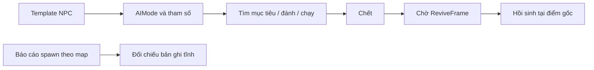

# TÓM TẮT 5 DÒNG
1. [TÀI LIỆU] PARTIAL: đã viết sổ tay AI quái theo mã server và đối chiếu với báo cáo bản đồ quái.
2. [TÀI LIỆU] Làm rõ AIMode, tầm nhìn/đánh, bỏ chạy, vòng chết-hồi sinh và số kiểm kê spawn 94.098 trên 195 map.
3. [TÀI LIỆU] Đầu ra chính: `JX1_OPS/DESIGN/SO-TAY-AI-QUAI.md`; phát hiện `IsRevive` và slot AI có điểm cần PM đối chiếu dữ liệu.
4. [CHƯA KIỂM] Chưa có tọa độ spawn từng map; ghi nhịp ngoài worktree bị từ chối quyền filesystem.
5. [CHƯA KIỂM] Không chạy build/exe/VM/game và không commit/push theo yêu cầu; PM quyết định có giao thêm dữ liệu vùng để hoàn tất bảng spawn từng map.

# SO-27 — Báo cáo sổ tay AI quái
Loại: khảo sát
Chủ đề: Tổng hợp tĩnh hành vi AI quái, tầm nhìn và đánh, bỏ chạy, hồi sinh, cùng giới hạn đối chiếu spawn theo bản đồ.
Từ khóa: AI quái, NPC, AIMode, AIParam, VisionRadius, ActiveRadius, ReviveFrame, spawn, hồi sinh, SO-27
Trạng thái: PARTIAL — còn thiếu tọa độ spawn theo từng map và xác minh runtime.
Độ phủ: đã phủ 6/7 chủ điểm; điểm chưa phủ là danh sách tọa độ spawn từng map.
Liên quan: `JX1_OPS/DESIGN/SO-TAY-AI-QUAI.md`, `JX1_OPS/DESIGN/SO-TAY-QUAI-NPC-BAN-DO.md`, `JX1_OPS/DESIGN/CHUAN-BAO-CAO.md`
Cần tôi quyết định: không

## Phạm vi và độ phủ

| Phần | Kết quả | Độ phủ |
|---|---|---|
| AI quái | [THẤY] Mã server điều phối mode 0–6; tìm mục tiêu, giữ vùng, áp sát và ra skill | Đã phủ tĩnh |
| Tầm nhìn/tầm đánh | [THẤY] Có bán kính nhìn và bán kính skill; đơn vị không được quy đổi sang thế giới thực | Đã phủ tĩnh |
| Bỏ chạy | [THẤY] Nhánh Flee đi ngược hướng địch; một số mode gọi theo ngưỡng máu/xác suất | Đã phủ nhánh |
| Hồi sinh | [THẤY] DeathFrame, ReviveFrame, điểm Origin và điều kiện loại NPC | Đã phủ luồng |
| Spawn-map | [TÀI LIỆU] 94.098 spawn Kind=0 trên 195 map theo báo cáo đối chiếu | Có tổng số; thiếu tọa độ từng map |

## Đã xác minh

- Server đọc `AIMode`, `AIParam1..9`, `ActiveRadius`, `VisionRadius`, `ReviveFrame` và `IsRevive` từ template: `C:/Jx1CocoV3/SwordOnline/SwordOnline/jxOnline/gameserver/Sources/Core/Src/KNpcTemplate.cpp:676–694,732–735`.
- Server dispatch các mode 0–6; các nhánh 7–10 nằm trong comment tại switch: `C:/Jx1CocoV3/SwordOnline/SwordOnline/jxOnline/gameserver/Sources/Core/Src/KNpcAI.cpp:91–134`.
- Tìm mục tiêu theo tầm nhìn và địch lân cận: `C:/Jx1CocoV3/SwordOnline/SwordOnline/jxOnline/gameserver/Sources/Core/Src/KNpcAI.cpp:2621–2682,3789–3812`; đánh hoặc đi áp sát: `C:/Jx1CocoV3/SwordOnline/SwordOnline/jxOnline/gameserver/Sources/Core/Src/KNpcAI.cpp:2962–3014`.
- Nhánh Flee và điều kiện máu thấp: `C:/Jx1CocoV3/SwordOnline/SwordOnline/jxOnline/gameserver/Sources/Core/Src/KNpcAI.cpp:3213–3224,4109–4125,4822–4838,5045–5059`.
- Chết, chờ hồi sinh, khôi phục tại Origin: `C:/Jx1CocoV3/SwordOnline/SwordOnline/jxOnline/gameserver/Sources/Core/Src/KNpc.cpp:2538–2547,2660–2687,3375–3435,13900–13937`.
- Đối chiếu tĩnh về tổng spawn và giới hạn map: `JX1_OPS/DESIGN/SO-TAY-QUAI-NPC-BAN-DO.md:2–3,30–35,41–43`.
- Bản sổ tay chính có dẫn chứng source chi tiết và Mermaid: [SO-TAY-AI-QUAI.md](../DESIGN/SO-TAY-AI-QUAI.md).

## Chưa xác minh

- Không có bảng tọa độ spawn từng map trong báo cáo đối chiếu đã đọc; chưa truy cập dữ liệu vùng/PAK ngoài danh sách nguồn task giới hạn.
- Chưa đo frame thành giây, tỷ lệ xác suất runtime, trạng thái nạp map hay số quái đang sống.
- `IsRevive` được nạp vào `m_IsRevive`, nhưng nhánh `OnDeath` đã đọc quyết định hồi sinh theo loại vàng; chưa xác nhận đây là cờ hồi sinh chung.
- Template đọc chín AIParam vào slot 0–8, trong khi instance tính slot 9 từ bán kính skill lớn nhất; một số mode cũng đọc `pAIParam[9]` làm giới hạn lượt hồi máu. Ghi nhận là điểm cần đối chiếu, chưa kết luận lỗi.
- Client có nhánh `AIMode > 10` cho hoạt ảnh và logic attack riêng, không dùng thay bằng chứng quyết định server: `C:/Jx1CocoV3/Folder/Client2912-20260116T044348Z-3-001/Client2912/Client/Classes/gamecore/KNpcAI.cpp:58–84,89–137,3083–3136`.

## Giải mã tên

| Tên gốc | Mã hóa | Chữ đúng | Nguồn |
|---|---|---|---|
| `AIMode` | tên cột ASCII | kiểu hành vi AI | `C:/Jx1CocoV3/SwordOnline/SwordOnline/jxOnline/gameserver/Sources/Core/Src/KNpcTemplate.cpp:676` |
| `VisionRadius` | tên cột ASCII | bán kính tầm nhìn | `C:/Jx1CocoV3/SwordOnline/SwordOnline/jxOnline/gameserver/Sources/Core/Src/KNpcTemplate.cpp:694` |
| `ActiveRadius` | tên cột ASCII | bán kính hoạt động | `C:/Jx1CocoV3/SwordOnline/SwordOnline/jxOnline/gameserver/Sources/Core/Src/KNpcTemplate.cpp:693` |
| `ReviveFrame` | tên cột ASCII | số frame chờ hồi sinh | `C:/Jx1CocoV3/SwordOnline/SwordOnline/jxOnline/gameserver/Sources/Core/Src/KNpcTemplate.cpp:732` |
| `NpcReviveScript` | hậu tố khóa ASCII | script hồi sinh theo map | `C:/Jx1CocoV3/SwordOnline/SwordOnline/jxOnline/gameserver/Sources/Core/Src/KNpc.cpp:13965–13977` |

## Sắp theo cấu trúc game

1. [TÀI LIỆU] Template NPC → instance và tham số AI. `C:/Jx1CocoV3/SwordOnline/SwordOnline/jxOnline/gameserver/Sources/Core/Src/KNpcTemplate.cpp:676–694,732–735`; `C:/Jx1CocoV3/SwordOnline/SwordOnline/jxOnline/gameserver/Sources/Core/Src/KNpc.cpp:11178–11214`.
2. [TÀI LIỆU] AIMode → tìm mục tiêu → đánh/áp sát hoặc bỏ chạy. `C:/Jx1CocoV3/SwordOnline/SwordOnline/jxOnline/gameserver/Sources/Core/Src/KNpcAI.cpp:91–134,2621–2682,2962–3014`.
3. [TÀI LIỆU] Chết → DeathFrame → điều kiện hồi sinh → ReviveFrame → điểm gốc. `C:/Jx1CocoV3/SwordOnline/SwordOnline/jxOnline/gameserver/Sources/Core/Src/KNpc.cpp:2538–2547,2660–2687,3375–3435,13900–13937`.
4. [TÀI LIỆU] Dữ liệu map → vùng → bản ghi spawn; đối chiếu hiện chỉ có tổng 195 map, chưa có tọa độ theo từng map. `JX1_OPS/DESIGN/SO-TAY-QUAI-NPC-BAN-DO.md:14,35,41–43,69`.

## Lỗi, cách thử và kết quả

- `rg` không có trong shell. Lần đầu `Get-ChildItem -Include` không lọc đúng và trả về danh sách tên rộng hơn dự định; không mở nội dung từ danh sách đó. Sau đó lọc theo tên file/đuôi trong các thư mục nguồn chỉ định và dùng `Select-String`; cách sửa trả về các file NPC/AI liên quan.
- Ghi `D:\JX-wt\SO-27.nhip` bị từ chối quyền truy cập; đã thử một lần, giữ nguyên quyền và nêu tại đây.
- Kiểm UTF-8/no-BOM và diff sau khi ghi; không chạy chương trình, build, VM, exe hoặc test runtime.

## Bàn giao

Không commit/push. PM cần quyết định có giao thêm nguồn dữ liệu vùng để lập bảng tọa độ spawn theo map; nếu không, giữ kết luận PARTIAL và gộp dòng chỉ mục dưới đây:

| Chủ đề | Tài liệu | Nội dung | Độ chắc |
|---|---|---|---|
| AI quái, tầm đánh và hồi sinh | `DESIGN/SO-TAY-AI-QUAI.md` | Hành vi server, tham số template và điểm cần xác minh ở spawn-map | khảo sát tĩnh |

Kỹ năng đã dùng: `jx1-retrofit`, `jx1-read-server`, `jx1-read-client`, `jx1-parameters`, `jx1-knowledge`, `jx1-report`.