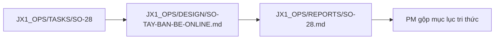

TÓM TẮT 1: [NGUỒN] [THẤY] Hoàn thành khảo sát tĩnh đủ 6/6 nhóm yêu cầu của SO-28; sổ tay chính đã tạo.
TÓM TẮT 2: [NGUỒN] [THẤY] Sổ tay về bạn/kẻ địch/blacklist, thao tác, trạng thái và đường gói có sơ đồ cùng hơn 10 dẫn nguồn file:dòng.
TÓM TẮT 3: [TÀI LIỆU] [THẤY] Đối chiếu SO-TAY-S3RELAY; cấu hình triển khai và một số hành vi relay vẫn chưa kiểm.
TÓM TẮT 4: [CHƯA KIỂM] Không build/test/exe/VM/mạng theo phạm vi task; không đo runtime.
TÓM TẮT 5: [CHƯA KIỂM] Sidecar D:/JX-wt/SO-28.nhip chưa ghi được do nằm ngoài vùng ghi; bàn giao tổng thể ở trạng thái PARTIAL.

# SO-28 — Báo cáo bàn giao

Loại: tổng hợp
Chủ đề: Sổ tay quan hệ bạn bè, danh sách đen, trạng thái online/offline và đường gói liên quan.
Từ khóa: SO-28, bạn bè, friend, blacklist, online, offline, Tong, S3Relay
Trạng thái: PARTIAL, tài liệu tĩnh hoàn tất nhưng sidecar tiến độ không ghi được do giới hạn vùng ghi.
Độ phủ: đã phủ 6/6 nhóm mục tiêu; runtime chưa kiểm.
Liên quan: JX1_OPS/DESIGN/SO-TAY-BAN-BE-ONLINE.md; SO-TAY-S3RELAY.md.
Cần tôi quyết định: không.

## Phạm vi và độ phủ

| Yêu cầu | Kết quả | Bằng chứng |
|---|---|---|
| Thêm/xóa bạn | Đã khảo sát tĩnh | [THẤY] C/vn/gameui/KuiFriendListVN.cpp:108-144,605-614; C/gamecore/KProtocolProcess.cpp:4378-4427,4482-4486 |
| Danh sách đen | Đã khảo sát tĩnh, thêm mới chưa rõ đường | [THẤY] S/MultiServer/GameServer/KSOServer.cpp:2763-2784,2814-2833,2862-2876; [CHƯA KIỂM] C/gamecore/KProtocolProcess.cpp:4487-4491 |
| Online/offline và thông báo | Đã khảo sát tĩnh | [THẤY] C/gamecore/KTongProtocol.h:200-206; C/gamecore/KProtocolProcess.cpp:4382-4427,4464-4468 |
| Luồng GS–S3Relay–client | Đã khảo sát theo mã GS/client và tài liệu relay | [THẤY] S/MultiServer/GameServer/KSOServer.cpp:1721-1765,3610-3630; [TÀI LIỆU] REF/SO-TAY-S3RELAY.md:1-5,93-112 |
| Kiểm chứng runtime | Chưa làm, ngoài quyền task | [CHƯA KIỂM] không build/chạy exe/VM/mạng |

## Đã xác minh / Chưa xác minh

### Đã xác minh
- [THẤY] Giao diện, đồng bộ danh sách, cập nhật màu theo trạng thái: C/vn/gameui/KuiFriendListVN.cpp:253-284,368-440.
- [THẤY] Protocol friend và trạng thái: C/gamecore/KTongProtocol.h:97-114,158-228.
- [THẤY] GameServer định tuyến gói quan hệ qua m_pTongClient và phát relay trả về client: S/MultiServer/GameServer/KSOServer.cpp:1721-1765,3610-3630.
- [THẤY] SO-TAY-S3RELAY đối chiếu Tong 5005 và giới hạn chưa xác minh của triển khai: REF/SO-TAY-S3RELAY.md:1-5,93-112.

### Chưa xác minh
- [CHƯA KIỂM] Không build hoặc chạy bất kỳ exe/game nào, không dùng VM hay mạng; đây là khảo sát source/tài liệu.
- [CHƯA KIỂM] Cổng hiệu lực, xử lý/lưu blacklist bên S3Relay, giới hạn danh sách và kết quả thực tế khi người nhận offline.
- [CHƯA KIỂM] Không chạy automated test; không có test phù hợp cho thay đổi tài liệu.

## Lỗi, cách thử, kết quả và bước tiếp tục

[THẤY] rg không có trong môi trường; chuyển sang Select-String giới hạn trên các tệp đã định vị. Một lần dùng Get-ChildItem đệ quy với bộ lọc không đúng đã liệt kê nhiều đường dẫn không cần thiết; không mở nội dung các tệp đó. Đã dừng và dùng lọc theo tên chính xác cho các lần sau.

[THẤY] Phát hiện điểm cần review riêng: xóa blacklist có thể gọi erase trên danh sách kẻ địch với iterator lấy từ blacklist (C/vn/gameui/KuiFriendListVN.cpp:185-196). Không tái hiện runtime và không sửa source.

[CHƯA KIỂM] Không ghi được D:/JX-wt/SO-28.nhip vì vùng ghi của phiên chỉ bao gồm D:/JX-wt/SO-28. Tiến độ đã được báo qua commentary; không có file sidecar.

## Bàn giao

- Đầu ra chính: JX1_OPS/DESIGN/SO-TAY-BAN-BE-ONLINE.md.
- Báo cáo này: JX1_OPS/REPORTS/SO-28.md; cuối task có mục Kết quả.
- Không commit/push theo chỉ dẫn.
- Hàng mục lục đề xuất để PM gộp: SO-28 | khảo sát | bạn bè, blacklist, online/offline | bạn bè, friend, blacklist, online, offline, Tong, S3Relay | DONE | 6/6 nhóm tĩnh | SO-TAY-S3RELAY.md.
- Nhịp: sidecar ngoài workspace chưa ghi được do quyền ghi chỉ áp dụng trong worktree.

Kỹ năng đã dùng: jx1-retrofit, jx1-read-server, jx1-read-client, jx1-parameters, jx1-knowledge, jx1-report
liên quan: JX1_OPS/DESIGN/SO-TAY-BAN-BE-ONLINE.md; JX1_OPS/DESIGN/SO-TAY-S3RELAY.md.
