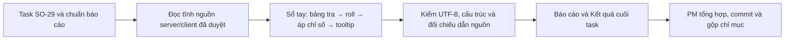

TÓM TẮT 1 [NGUỒN][THẤY]: DONE phần nội dung SO-29, phủ 4/4 phần khảo sát tĩnh tại `JX1_OPS/DESIGN/SO-TAY-THUOC-TINH-MA-PHAP.md:41-51`.
TÓM TẮT 2 [NGUỒN][THẤY]: Sổ tay có 28 nhóm tra cứu, luồng roll, kích hoạt/mặc/tháo và tooltip; `JX1_OPS/DESIGN/SO-TAY-THUOC-TINH-MA-PHAP.md:81-184`.
TÓM TẮT 3 [NGUỒN][THẤY]: Đã tạo sổ tay, báo cáo này và nối Kết quả cuối task; kiểm cấu trúc sổ tay đạt 5 dòng tóm tắt, 1 Mermaid, UTF-8 không BOM.
TÓM TẮT 4 [NGUỒN][THẤY]: File nhịp ngoài worktree bị chặn ghi: `Set-Content D:/JX-wt/SO-29.nhip` trả `UnauthorizedAccessException`; không vượt sandbox.
TÓM TẮT 5 [CHƯA KIỂM]: Không chạy build/test game/exe/VM/mạng; chưa kiểm dữ liệu triển khai; không commit/push theo yêu cầu, chưa có SHA để bàn giao.

# SO-29 — Báo cáo bàn giao sổ tay thuộc tính ma pháp
Loại: tổng hợp
Chủ đề: Bàn giao bằng chứng, độ phủ và giới hạn của sổ tay thuộc tính ma pháp trang bị.
Từ khóa: SO-29, sổ tay, trang bị, magic attrib, roll, kích hoạt, tooltip, KMagicDesc
Trạng thái: DONE — phần tài liệu đạt phạm vi; yêu cầu ghi nhịp ngoài sandbox bị chặn, đã công khai giới hạn.
Độ phủ: 4/4 phần nội dung; 3/3 tệp được người giao việc chỉ định; không xác nhận nhịp đã ghi thành công.
Liên quan: `JX1_OPS/TASKS/SO-29.md`; `JX1_OPS/DESIGN/SO-TAY-THUOC-TINH-MA-PHAP.md`; `JX1_OPS/DESIGN/CHUAN-BAO-CAO.md`; `JX1_OPS/DESIGN/MUC-LUC-TRI-THUC.md`.
Cần tôi quyết định: không — PM có thể nhận tài liệu; việc thay quyền hoặc ghi nhịp ngoài sandbox không thực hiện.

## Sơ đồ bàn giao



**[TÀI LIỆU]** Phạm vi, nguồn và tiêu chí tại `JX1_OPS/TASKS/SO-29.md:20-26`; không tự commit theo chỉ đạo trong phiên giao việc.

## Phạm vi và độ phủ

| Phần tử | Kết quả | Bằng chứng |
|---|---|---|
| Bảng tra | **[THẤY] Đã phủ** 28 nhóm mục, tách ID có trong source với dòng thực sự có trong quỹ roll | `JX1_OPS/DESIGN/SO-TAY-THUOC-TINH-MA-PHAP.md:81-116`; `S/KMagicAttrib.h:39-198` |
| Cách roll | **[THẤY] Đã phủ** lập quỹ, ngưỡng, tránh trùng loại, ba tham số, nhánh GoldMagic | `JX1_OPS/DESIGN/SO-TAY-THUOC-TINH-MA-PHAP.md:118-145`; `S/KItemGenerator.CPP:908-1082` |
| Áp vào nhân vật | **[THẤY] Đã phủ** kích hoạt dòng, mặc/tháo, chuyển hàm xử lý | `JX1_OPS/DESIGN/SO-TAY-THUOC-TINH-MA-PHAP.md:147-174`; `S/KItem.cpp:140-329` |
| Tooltip client | **[THẤY] Đã phủ** mẫu mô tả, thay tham số, WIN32/mobile và dòng xám | `JX1_OPS/DESIGN/SO-TAY-THUOC-TINH-MA-PHAP.md:176-184`; `C/gameui/KuiItemdesc.cpp:1275-1363` |
| Sổ tay | **[THẤY] Đã tạo** đúng vung_file | `JX1_OPS/DESIGN/SO-TAY-THUOC-TINH-MA-PHAP.md:1-230` |
| Báo cáo và Kết quả task | **[TÀI LIỆU]** Ghi đúng hai vị trí người giao việc yêu cầu bổ sung | Báo cáo này; `JX1_OPS/TASKS/SO-29.md:28-32` |
| Nhịp ngoài worktree | **[THẤY] Bị chặn**; không nhận là đã ghi ở các mốc | Lệnh `Set-Content -LiteralPath D:/JX-wt/SO-29.nhip ...` trả Access denied |
| Quỹ cấu hình thật / runtime | **[CHƯA KIỂM] Chưa phủ**; không chạy thêm để lấp giới hạn | `JX1_OPS/DESIGN/SO-TAY-THUOC-TINH-MA-PHAP.md:217-222` |

## Nguồn và cách đọc

- **[TÀI LIỆU]** Alias nguồn giống sổ tay: `S` = `C:/Jx1CocoV3/SwordOnline/SwordOnline/jxOnline/gameserver/Sources/Core/Src`; `C` = `C:/Jx1CocoV3/Folder/Client2912-20260116T044348Z-3-001/Client2912/Client/Classes`. Nguồn được task chỉ định tại `JX1_OPS/TASKS/SO-29.md:25`; không thay bằng bản canonical khác.
- **[THẤY]** Đã đọc chuẩn trước task, kiểm Git một lần: `git status --short --branch` trả `## task/SO-29`, không có dòng tệp thay đổi. Sổ tay và báo cáo SO-29 chưa có khi bắt đầu; tệp task có sẵn và chỉ được nối mục Kết quả.
- **[THẤY]** Định vị bằng mục liên quan của mục lục và GS001-MAP; không có marker `graphify-out/.graphify_root` tại hai root source. Dùng tìm tên/symbol giới hạn phạm vi, kiểm file thật và dòng hiện tại; không dựng lại graph, không coi map là bằng chứng thay source.
- **[THẤY]** Mục lục có nhắc H-01/H-02 nhưng hai đường `D:/jx1-ops-wt/JX1_OPS/REPORTS/H-01.md`, `.../H-02.md` không tồn tại; tìm đúng hai tên chỉ gặp tệp task. Không dùng chúng làm kết luận cũ hoặc giả là đã đọc báo cáo; không đổi bất kỳ báo cáo cũ nào.

## Giải mã tên và sắp theo cấu trúc game

- **[THẤY]** Không thêm tên riêng của kỹ năng, bộ đồ, NPC, quái hoặc bản đồ. Bảng giải mã giữ chữ Hán gốc/định danh, ghi GBK/CP936 hoặc ASCII và nghĩa UTF-8; chưa có tên TCVN3 được xác nhận. Bảng tại `JX1_OPS/DESIGN/SO-TAY-THUOC-TINH-MA-PHAP.md:53-65`, đối chiếu `S/KItem.h:207-220`, `S/KItemGenerator.CPP:1045-1051`.
- **[THẤY]** Trình bày theo món đồ → các lớp thuộc tính → công dụng → sinh → mặc/kích hoạt → tooltip, không xếp theo thứ tự file. Không có bộ đồ riêng để kê từng món; `JX1_OPS/DESIGN/SO-TAY-THUOC-TINH-MA-PHAP.md:67-79`.

## Đã xác minh

| Nội dung | Lệnh/đoạn đã kiểm và kết quả thực |
|---|---|
| File thật và đường gọi | **[THẤY]** Đọc trực tiếp các đoạn `S/KItemList.cpp:1758` → `S/KItem.cpp:171-178` → `S/KNpc.cpp:4461` → `S/KNpcAttribModify.cpp:322-332`; không suy từ graph |
| Điều kiện roll | **[THẤY]** `S/KBasPropTbl.cpp:247-284`, `S/KItemGenerator.CPP:925-1053`; phân biệt mã đang chạy với công thức cũ bị chú thích tại `:960`, `:1084-1105` |
| Mô tả client | **[THẤY]** `C/gamecore/KMagicDesc.cpp:375-381` cho thấy nhánh INI `_vn` bị chú thích; `C/gameui/KuiItemdesc.cpp:1275-1363` cho thấy nhánh nền tảng và màu xám |
| Cấu trúc sổ tay | **[THẤY]** Kiểm trực tiếp bằng PowerShell/.NET: 5 dòng TÓM TẮT; 1 khối Mermaid; 28 nhóm tra cứu; có đúng heading `## Chưa kiểm`; đạt tiêu chí tại `JX1_OPS/TASKS/SO-29.md:20-21` |
| Dẫn nguồn trong sổ tay | **[THẤY]** Đếm biểu thức file:dòng có ranh giới alias S/C: 208 lượt, 176 dẫn khác nhau, thuộc 15 tệp nguồn đều tồn tại; vượt mức ≥10. Số đếm là kiểm cấu trúc, không thay cho đối chiếu ngữ nghĩa đã đọc |
| Mã hóa đầu ra sổ tay | **[THẤY]** `UTF8Encoding(false,true).GetString` thành công; không BOM; không ký tự thay thế U+FFFD; dung lượng 36.358 byte tại lần kiểm |
| Mã hóa nguồn mẫu | **[THẤY]** Decoder UTF-8 nghiêm ngặt trên 4096 byte đầu, không flush ký tự dở: KBasPropTbl và KuiItemdesc sai UTF-8 bên trong mẫu, KMagicDesc hợp lệ trong mẫu; dùng GBK/CP936 và UTF-8 theo đoạn, không đổi source |

## Chưa kiểm

- **[CHƯA KIỂM]** Không đọc cấu hình triển khai ngoài hai root source, chưa đếm tổng dòng quỹ thật, min/max thật theo món và bản dịch đang dùng; các tên cấu hình chỉ thấy ở `S/KItem.h:39-41`, `C/gamecore/KMagicDesc.cpp:11-13`.
- **[CHƯA KIỂM]** Không chạy build, test game, exe, VM, kết nối mạng hay Main VM; chưa có kiểm chứng bản đóng gói, lưu/đồng bộ seed, phân bố xác suất hoặc tooltip thật; quyền tại `JX1_OPS/TASKS/SO-29.md:24-25`.
- **[CHƯA KIỂM]** Không kiểm toàn bộ cường hóa/luyện/bộ đồ, mọi caller cấp level/may mắn, công thức chiến đấu và khả năng hoàn tác từng hàm khi tháo; `JX1_OPS/DESIGN/SO-TAY-THUOC-TINH-MA-PHAP.md:219-221`.

## Mục sổ thông số

| Nhóm | Tên/hằng số | file:dòng | Giá trị | Đơn vị | Ảnh hưởng | Đổi an toàn | Nguồn đo |
|---|---|---|---|---|---|---|---|
| Ma pháp thường | `m_aryMagicAttrib` | `S/KItem.h:219` | **[THẤY]** 6 | ô/món | Cấu trúc trang bị | KHÔNG trong task này | Đọc tĩnh |
| Cấp thuộc tính | `MATF_LEVEL` | `S/KBasPropTbl.h:146` | **[THẤY]** 10 | cấp | Phân nhóm quỹ | KHÔNG trong task này | Đọc tĩnh |
| Kích hoạt | `GetEquipEnhance` | `S/KItemList.cpp:2703-2706` | **[THẤY]** tối đa 3 | lượt | Mở hậu tố | KHÔNG trong task này | Đọc tĩnh |
| Lọc roll | `m_DropRate` | `S/KItemGenerator.CPP:978` | **[THẤY]** >1 và >ngưỡng | số nguyên | Vào danh sách ứng viên | CẨN THẬN, chưa được phép sửa | Đọc tĩnh, chưa đo phân bố |

**[THẤY]** Sổ đầy đủ kèm ảnh hưởng/đơn vị/giới hạn tại `JX1_OPS/DESIGN/SO-TAY-THUOC-TINH-MA-PHAP.md:196-209`; không ghi dữ liệu chưa đo thành 0.

## Lỗi, cách thử và kết quả

| Lỗi/giới hạn gặp thật | Cách xử lý và kết quả |
|---|---|
| **[THẤY]** `rg` không có, trả CommandNotFoundException | Báo một lần; chuyển Select-String và Get-ChildItem có lọc tên trong root duyệt; không cài công cụ |
| **[THẤY]** Lần đọc đầu chuẩn bằng mặc định PowerShell bị lỗi hiển thị dấu | Đọc lại UTF-8 rõ ràng; với source dùng GBK/CP936 hoặc UTF-8 theo đoạn; không sửa source |
| **[THẤY]** Hai đường báo cáo H-01/H-02 dự kiến không tồn tại | Tìm đúng tên trong kho báo cáo đã duyệt, chỉ gặp tệp task; tiếp tục bằng source, không đọc lan sang báo cáo khác |
| **[THẤY]** Một truy vấn source dùng biến root chưa gán trong lời gọi độc lập; ứng viên GameDataDef.h server không tồn tại | Đặt lại root đầy đủ cho KItem.cpp; dùng các khai báo thật trong KItem.h/KBasPropTbl.h. Không dùng tệp lỗi làm bằng chứng |
| **[THẤY]** Một lệnh kiểm mẫu mã hóa có lỗi cú pháp nối pipe sau foreach | Gom kết quả vào biến rồi xuất JSON; lệnh sửa chạy thành công. Điều chỉnh decoder để không nhầm ký tự UTF-8 dở ở biên mẫu với byte lỗi bên trong |
| **[THẤY]** Bộ kiểm dẫn nguồn ban đầu nhận nhầm chữ `S/` trong `JX1_OPS/` là alias server | Thêm điều kiện ranh giới trước alias; kiểm lại còn 15 tệp nguồn, không có tệp thiếu. Sửa số đếm thành 208 lượt / 176 dẫn khác nhau trước bàn giao |
| **[THẤY]** `Set-Content D:/JX-wt/SO-29.nhip` bị Access denied / UnauthorizedAccessException | Không có quyền ghi ngoài worktree; dừng thử cùng đường dẫn, không đổi ACL/credential/config, không nhận là đã ghi các mốc nhịp. Các cập nhật tiến độ được thông báo trong phiên |

## Đề xuất tối ưu và bàn giao

- **[TÀI LIỆU]** Ưu tiên lần bổ sung sau: nối cấu hình triển khai với ID, khoảng roll và khóa tooltip trên cùng một hàng; sau đó mới thiết kế phép đo. Chưa đề xuất đổi cân bằng hay tỉ lệ khi chưa có dữ liệu; căn cứ `S/KBasPropTbl.cpp:1935-1960`, `C/gamecore/KMagicDesc.cpp:415-416`.
- **[TÀI LIỆU]** Chỉ ba tệp được ghi: sổ tay trong vung_file, báo cáo SO-29, và mục Kết quả cuối task theo chỉ đạo bổ sung trong phiên. Không tạo `REPORTS/_CHIMUC/SO-29.tsv` hoặc sửa mục lục chung vì ngoài vùng được giao; hàng chờ PM gộp bên dưới đáp ứng phần bàn giao chỉ mục của `JX1_OPS/DESIGN/CHUAN-BAO-CAO.md:30`.
- **[TÀI LIỆU]** Chưa commit, chưa push, chưa có SHA — đúng yêu cầu “Tổng quan commit hộ”, không phải lỗi Git. PM kiểm diff, gộp chỉ mục rồi commit khi nhận bàn giao. Không gửi thông báo ra ứng dụng ngoài.

Hàng chỉ mục TSV chờ PM gộp (một hàng cho đầu ra tri thức chính, chưa ghi vào tệp chung):

```tsv
file	loại	chủ đề	từ khóa	trạng thái	độ phủ	liên quan
JX1_OPS/DESIGN/SO-TAY-THUOC-TINH-MA-PHAP.md	khảo sát	Thuộc tính ma pháp của trang bị	SO-29; trang bị; magic attrib; roll; kích hoạt; tooltip	DONE	4/4 phần khảo sát tĩnh; 28 nhóm tra cứu; cấu hình thật/runtime chưa kiểm	JX1_OPS/REPORTS/SO-29.md; JX1_OPS/TASKS/SO-29.md
```

Hàng đề nghị cho `MUC-LUC-TRI-THUC.md` (PM gộp, chưa sửa tệp):

| Chủ đề | Báo cáo / tài liệu | File, hàm chính | Độ chắc |
|---|---|---|---|
| Thuộc tính ma pháp trang bị: bảng tra, roll, áp chỉ số, tooltip | `DESIGN/SO-TAY-THUOC-TINH-MA-PHAP.md`; `REPORTS/SO-29.md` | `KItemGenerator::Gen_MagicAttrib`; `KItem::ApplyMagicAttribToNPC`; `KNpcAttribModify::ModifyAttrib`; `KMagicDesc`; `KuiItemdesc` | **[THẤY]** khảo sát tĩnh; cấu hình triển khai và runtime chưa kiểm |

Kỹ năng đã dùng: jx1-retrofit (chuẩn, giữ kết luận; không retrofit báo cáo cũ), jx1-read-server, jx1-read-client, jx1-parameters, jx1-knowledge, jx1-report.
