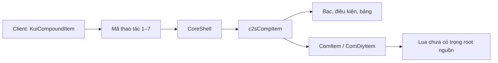

## TÓM TẮT 5 DÒNG
1. [THẤY] Đã đối chiếu 5 trang UI và mã thao tác 1–7 từ client tới handler server.
2. [THẤY] Ghi lại kiểm tra đầu vào, bạc, tham số bảng và các điểm chuyển sang Lua.
3. [CHƯA KIỂM] Lua và dữ liệu công thức/giá không có trong root nguồn được task giao.
4. [CHƯA KIỂM] Không chạy build/test/exe/VM/mạng; không commit theo yêu cầu.
5. [CHƯA KIỂM] Tệp nhịp ngoài vùng ghi bị từ chối; cần root bổ sung để xác minh chi tiết.

# SO-30 — Báo cáo bàn giao sổ tay ghép, tách và nâng đồ

Loại: tổng hợp
Chủ đề: Kết quả khảo sát tĩnh và giới hạn dữ liệu Lua/bảng.
Từ khóa: SO-30, ghép đồ, tách thuộc tính, Huyền tinh, khảm, CompoundSet, Lua
Trạng thái: PARTIAL — thiếu nội dung script và dữ liệu công thức/giá.
Độ phủ: 5/5 trang client, mã thao tác chính 1–7; nhánh server 8–12 mới xác định điểm gọi.
Liên quan: JX1_OPS/DESIGN/SO-TAY-GHEP-TACH-DO.md; JX1_OPS/DESIGN/HIEU-CAP-CUONG-HOA-LUA.md; JX1_OPS/DESIGN/SO-TAY-TRANG-BI.md; JX1_OPS/REPORTS/SO-03.md.
Cần tôi quyết định: có — nếu cần giá/công thức chính xác, cần task cho phép thêm root Lua và Settings.

Nguồn đọc: client C:/Jx1CocoV3/Folder/Client2912-20260116T044348Z-3-001/Client2912/Client/Classes; server C:/Jx1CocoV3/SwordOnline/SwordOnline/jxOnline/gameserver/Sources. Các file:dòng source dưới đây tương đối các root này.

## Sơ đồ luồng

## Phạm vi và độ phủ

| Hạng mục | Trạng thái | Bằng chứng |
|---|---|---|
| Năm trang client và mã 1–7 | Đã phủ tĩnh | KuiCompoundItem.cpp:167-451,1016-1129; CoreShell.cpp:4687-4735 |
| Hợp thành/nâng nguyên liệu | Đã phủ điểm gọi; Lua chưa kiểm | KProtocolProcess.cpp:6387-6542; KPlayer.cpp:11389-11397 |
| Tách, chế tạo, khảm | Đã phủ điều kiện/tiền tĩnh; bảng/Lua chưa kiểm | KProtocolProcess.cpp:6543-6765; KPlayer.cpp:11400-11425 |
| Đồ phổ | Đã phủ kiểm tra ID và gọi script; công thức chưa kiểm | KProtocolProcess.cpp:6766-6810; KCore.cpp:706-708 |
| Mã 8–12 | Nhánh thấy; UI/Lua chưa đối chiếu | KProtocolProcess.cpp:7136-7515 |
| Cường hóa +N | Ngoài phạm vi | HIEU-CAP-CUONG-HOA-LUA.md:1-5 |
| Tệp nhịp | Bị từ chối ngoài vùng ghi | D:\JX-wt\SO-30.nhip; Access denied |

## Phát hiện đã xác minh

[THẤY] Client gửi thao tác trang chế tác bằng mã 1–7; CoreShell chuyển mã sang SendClientCmdComp (KuiCompoundItem.cpp:1016-1129; CoreShell.cpp:4687-4735).

[THẤY] Nhánh 1–3 đọc CompoundSet.CompoundMoney, kiểm tra bạc rồi gọi ComItem; hàm đó gọi orecomp.lua/maincompore (KProtocolProcess.cpp:6387-6542; KPlayer.cpp:11389-11397).

[THẤY] Tách và khảm tra bảng phụ g_CompEquip, đọc DistillRank/EnchaseRank và gọi g_Random; chưa có căn cứ quy thành tỷ lệ phần trăm (KProtocolProcess.cpp:6572-6605,6701-6734).

[THẤY] ForgeMoney, EnchaseMoney, AtlasMoney được đọc ở các nhánh chế tạo/khảm/đồ phổ. Giá trị mặc định 0 không chứng minh tính năng miễn phí (KProtocolProcess.cpp:6648-6663,6679-6688,6783-6807).

[THẤY] Đồ phổ cần tám ID; nhánh thực hiện trừ bạc và gọi altscomp.lua/mainaltscomp, nhánh xem trước gọi yulanaltscomp (KProtocolProcess.cpp:6793-6808).

[THẤY] Bảng phụ và bảng đồ phổ được nạp qua GAME_COMP_FILE/GAME_ATLAS_FILE; chưa đối chiếu macro hoặc dữ liệu (KCore.cpp:706-708).

[TÀI LIỆU] Tài liệu đối chiếu cường hóa giữ công thức/chi phí +N ở trạng thái chưa xác minh; kết luận đó không được mở rộng sang khảm/chế tạo SO-30 (SO-03.md:32,67; HIEU-CAP-CUONG-HOA-LUA.md:1-5).

## Giải mã tên

| Tên gốc | Mã hóa | Diễn giải | Nguồn |
|---|---|---|---|
| 提炼 / 提取 | GBK | Chiết luyện / tách | CoreShell.cpp:4687,4709 |
| 打造 / 镶嵌 | GBK | Chế tạo / khảm | CoreShell.cpp:4716,4723 |
| 图谱 | GBK | Đồ phổ | CoreShell.cpp:4730 |
| 玄晶 / 属性矿石 | GBK | Huyền tinh / quặng thuộc tính | KProtocolProcess.cpp:6425,6481 |
| 蓝装 / 紫装 | GBK | Trang bị lam / trang bị tím | KProtocolProcess.cpp:6543,6644,6671 |
| 熔炼纹钢 / 提炼纹钢 | GBK | Luyện / tách Văn Cương | CoreShell.cpp:4657,4663 |
| 宝石灵合 / 融合 / 辨识蓝装 | GBK | Linh hợp / dung hợp / nhận biết đồ lam | CoreShell.cpp:4669-4681 |

## Sắp theo cấu trúc game

Sổ tay đi theo thứ tự trang UI: hợp thành → tách → chế tạo → khảm → đồ phổ (SO-TAY-GHEP-TACH-DO.md, mục “Theo thứ tự cấu trúc game”).

## Mục sổ thông số

| Khóa | Nguồn | Giá trị | Ảnh hưởng |
|---|---|---|---|
| CompoundMoney | KProtocolProcess.cpp:6393,6431,6487 | Chưa đọc bảng; bạc | Ba nhánh hợp thành; CẨN THẬN |
| DistillMoney / DistillRank | KProtocolProcess.cpp:6552,6598 | Chưa đọc | Tách; CẨN THẬN |
| ForgeMoney | KProtocolProcess.cpp:6649 | Chưa đọc; bạc | Chế tạo; CẨN THẬN |
| EnchaseMoney / EnchaseRank | KProtocolProcess.cpp:6680,6727 | Chưa đọc | Khảm; CẨN THẬN |
| AtlasMoney | KProtocolProcess.cpp:6784 | Chưa đọc; bạc | Đồ phổ; CẨN THẬN |
| RongHeMoney / MinLuckyLevel | KProtocolProcess.cpp:7367-7386 | Chưa đọc | Dung hợp mở rộng; CẨN THẬN |

## Đã xác minh / Chưa xác minh

ĐÃ XÁC MINH: line client/server nêu trên và tên script/hàm đích trong source. Tìm theo tên chính xác trong root server Sources không thấy orecomp.lua, itemcomp.lua, altscomp.lua hoặc fusioncomp.lua.

CHƯA XÁC MINH: nội dung Lua, giá trị CompoundSet, dữ liệu công thức, xác suất, runtime và UI cho mã 8–12. Không chạy build/test/exe/VM/mạng.

## Bàn giao

PARTIAL. Hoàn tất các dẫn chứng source trong phạm vi đọc; công thức và phí thực tế cần root Lua/Settings được task cho phép. Không sửa mã, không commit, không push.

Đề xuất dòng mục lục để PM gộp: SO-30 | sổ tay | Ghép, tách, nâng và khảm đồ | ghép, Huyền tinh, khảm, đồ phổ, CompoundSet | PARTIAL | 5/5 trang UI, mã 1–7; mã 8–12 chưa lần UI | HIEU-CAP-CUONG-HOA-LUA, SO-TAY-TRANG-BI, SO-03.

Ghi chú thao tác: rg không có trong phiên. Một fallback PowerShell ban đầu đã liệt kê tên không liên quan do -Include không lọc như dự kiến; kết quả không dùng làm căn cứ. Một lần lấy đoạn nguồn dùng ReadAllLines nên nạp toàn bộ một số file dù chỉ xuất các đoạn chọn; điều này vượt giới hạn 400 dòng yêu cầu, và tôi không sử dụng phần ngoài các đoạn đã xuất. Đã dừng cách đọc đó. Tệp nhịp ngoài vùng ghi bị từ chối. Kỹ năng đã dùng: jx1-retrofit, jx1-read-server, jx1-read-client, jx1-parameters, jx1-knowledge, jx1-report.
