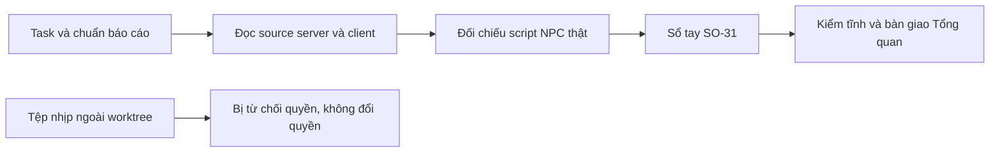

TÓM TẮT 1: [NGUỒN][THẤY] Nội dung SO-31 đã hoàn tất ở mức đọc tĩnh; trạng thái thực hiện PARTIAL vì tệp nhịp ngoài worktree bị từ chối quyền; phạm vi tại `JX1_OPS/TASKS/SO-31.md:19–27`.
TÓM TẮT 2: [NGUỒN][THẤY] Đã nối Lua → s2c_scriptaction → UI → c2s_playerselui → callback, phân biệt menu và chuỗi lời: `S/Core/Src/KPlayer.cpp:8785–8823`; `C/gameui/KuiTalkDialog.cpp:648–663`.
TÓM TẮT 3: [NGUỒN][THẤY] Đầu ra chính: `JX1_OPS/DESIGN/SO-TAY-HOP-THOAI-NPC.md`; ví dụ Dã Tẩu có căn cứ `G/script/global/npcchucnang/datau.lua:436,483,567–574,664–689`.
TÓM TẮT 4: [CHƯA KIỂM] Chưa xác nhận API Sel độc lập, ánh xạ NPC thường trú hoặc runtime; không build, chạy exe/VM hay mạng, theo `JX1_OPS/TASKS/SO-31.md:24–27`.
TÓM TẮT 5: [NGUỒN][THẤY] Không stage/commit/push theo prompt, chưa có SHA; không build/exe/VM. Tổng quan commit tài liệu và tiếp nhận lỗi ghi nhịp tại mục Lỗi, cách thử và kết quả.

# SO-31 — Bàn giao sổ tay hộp thoại NPC

Loại: khảo sát
Chủ đề: Kết quả soạn sổ tay Say, Talk, lựa chọn/callback và đường truyền tới client.
Từ khóa: hộp thoại NPC, Lua, Say, Talk, Sel, SelANum, phân trang, s2c_scriptaction, c2s_playerselui
Trạng thái: PARTIAL — đầu ra nội dung DONE; không ghi được `D:/JX-wt/SO-31.nhip` ngoài vùng ghi cho phép.
Độ phủ: 6/6 phần nội dung task đã có bằng chứng đọc tĩnh; yêu cầu ghi nhịp 0 tệp thành công; không kiểm kê toàn bộ NPC.
Liên quan: `JX1_OPS/TASKS/SO-31.md`; `JX1_OPS/DESIGN/SO-TAY-HOP-THOAI-NPC.md`; `JX1_OPS/REPORTS/I-05-npc-chuc-nang.md`.
Cần tôi quyết định: không — Tổng quan tiếp nhận; việc cấp quyền/ghi tệp nhịp nằm ngoài phiên hiện tại.



[THẤY] Luồng nội dung dựa trên `S/Core/Src/ScriptFuns.cpp:25676–25684`; `C/gamecore/KProtocolProcess.cpp:3208–3210`; `G/script/global/npcchucnang/datau.lua:664–689`. Lỗi ghi nhịp là kết quả lệnh tại mục lỗi, không phải suy từ source.

## Phạm vi và độ phủ

| Hạng mục | Kết quả | Bằng chứng |
|---|---|---|
| Script dựng câu hỏi/lựa chọn | Đã phủ | [THẤY] `S/Core/Src/ScriptFuns.cpp:1974–2088,2750–2832`. |
| Chọn dòng và callback, tên Sel | Đã phủ cơ chế; Sel riêng chưa kiểm | [THẤY] `S/Core/Src/KPlayer.cpp:8807–8823,8053–8059`; `G/script/global/npcchucnang/datau.lua:682–689`; tìm binding Sel trong hai tệp trả 0. |
| Phân trang | Đã phủ Talk; nêu giới hạn menu | [THẤY] `S/Core/Src/ScriptFuns.cpp:3741–3836`; `C/gameui/KuiTalkDialog.cpp:648–684`; `S/Core/Src/KPlayer.h:31`. |
| Truyền tới client và trở về | Đã phủ source hai chiều | [THẤY] `S/Core/Src/KPlayer.cpp:8793–8795`; `S/Core/Src/KProtocolProcess.cpp:5757–5759`; `C/gamecore/KPlayer.cpp:3796–3816`. |
| Cửa sổ hiển thị | Đã phủ đường tạo và chọn/chuyển lời | [THẤY] `C/gamescene/KgameWorld.cpp:13501,13523`; `C/gameui/KuiDialog.cpp:442–460`. |
| Ví dụ NPC thật | Đã phủ script Dã Tẩu | [THẤY] `G/script/global/npcchucnang/datau.lua:436–440,483,567–574,664–689`; không gán template/map. |
| Báo cáo, kết quả task | Đã ghi trong vùng được yêu cầu | [THẤY] Các tệp SO-31 được nêu trong mục Bàn giao; chỉ thêm kết quả cuối task. |
| Nhịp sống | BỊ CHẶN | [THẤY] `AppendAllText` tại đường dẫn được yêu cầu trả lỗi quyền; không có nhịp thành công. |

## Giải mã tên

| Tên gốc | Mã hóa | Chữ đúng UTF-8 | Nguồn file:dòng |
|---|---|---|---|
| `D· TÈu` | TCVN3, hiển thị byte bằng Windows-1252 | Dã Tẩu; chưa đối chiếu tên Hán | [THẤY] `G/script/global/npcchucnang/datau.lua:483`. |

## Sắp theo cấu trúc game

[THẤY] Đầu ra đi từ gặp NPC tới câu hỏi, chọn/chuyển lời và callback; ví dụ được đặt trong chức năng nhiệm vụ. Không dựng danh sách NPC theo thứ tự file và không tự gán bản đồ khi thiếu ánh xạ: `S/Core/Src/KPlayer.cpp:9524–9546`; `G/script/global/npcchucnang/datau.lua:436–440,664–689`.

## Nguồn và kỹ năng

[TÀI LIỆU] Đã đọc chuẩn trước task và nạp sáu skill đúng tên từ `.agents/skills/<tên>/SKILL.md`. Áp dụng retrofit vào cấu trúc, nhãn và phát hiện; không đổi tài liệu cũ. Không tạo TSV riêng ngoài `vung_file` và hai ngoại lệ prompt cho phép (báo cáo, kết quả task); cung cấp hàng chỉ mục ngay trong báo cáo cho Tổng quan ghép.

[TÀI LIỆU] Bí danh thống nhất với sổ tay: `S` = `C:/Jx1CocoV3/SwordOnline/SwordOnline/jxOnline/gameserver/Sources`; `C` = `C:/Jx1CocoV3/Folder/Client2912-20260116T044348Z-3-001/Client2912/Client/Classes`; `G` = `C:/Jx1CocoV3/Folder/ServerNew-20260116T043145Z-3-001/ServerNew/_bin_v2_/gs`. Hai root source được task chỉ định tại `JX1_OPS/TASKS/SO-31.md:25`; root dữ liệu `G` được báo cáo I-05 dẫn tại `JX1_OPS/REPORTS/I-05-npc-chuc-nang.md:47`.

[THẤY] Đã lần các tệp cụ thể theo symbol/include; tìm có lọc tên trong `Core/Src`, `gamecore`, `gameui`, `gamescene` và một số thư mục Lua chức năng/lib/header. Không có tệp `.lua` tìm được dưới root `S` khi lọc đuôi, nên lần nguồn dữ liệu được I-05 chỉ ra; ví dụ trực tiếp cuối cùng dùng `G/script/global/npcchucnang/datau.lua:664–689`. Không mở dữ liệu tài khoản, khóa hoặc mật khẩu.

## Đã xác minh

- [THẤY] Kiểm Git đúng một lần trước ghi: `git status --short --branch` trả `## task/SO-31`, không có dòng thay đổi. Hai tệp đầu ra chưa tồn tại; đã làm mới, không ghi đè kết quả có sẵn.
- [THẤY] Các dẫn server/client chính đã mở tệp thật và lấy số dòng hiện tại; không dùng Graphify làm bằng chứng. Hai marker `graphify-out/.graphify_root` kiểm tại các root task đều không có; không tạo lại graph.
- [THẤY] Binding `Say`, `SayNew`, `Talk`: `S/Core/Src/ScriptFuns.cpp:25676–25684`; menu: `:1974–2181`; lời nói: `:3741–3840`.
- [THẤY] Đường gửi/nhận và gọi lại: `S/Core/Src/KPlayer.cpp:8785–8823`; `S/Core/Src/KProtocolProcess.cpp:241,5757–5759`; `C/gamecore/KProtocolProcess.cpp:103,3208–3210`; `C/gamecore/CoreShell.cpp:3946–3951,4547–4554`.
- [THẤY] Ví dụ Dã Tẩu dùng `Talk` bốn đoạn và callback `SelANum`; menu có lời gọi số 5 nhưng 6 chuỗi: `G/script/global/npcchucnang/datau.lua:567–574,664–689`. Không sửa mã hoặc kết luận I-05.

## Mục sổ thông số

| Nhóm | Tên/hằng số | file:dòng | Giá trị | Đơn vị | Ảnh hưởng | Đổi an toàn | Nguồn đo |
|---|---|---|---|---|---|---|---|
| Menu | `MAX_ANSWERNUM` | `S/Core/Src/KPlayer.h:31` | [THẤY] 16 | lựa chọn | Giới hạn mỗi lần dựng | CẨN THẬN | Đọc tĩnh |
| Nội dung client | `MAX_SCIRPTACTION_BUFFERNUM` | `C/gamecore/KProtocol.h:1331,1342` | [THẤY] 1024 | byte bộ đệm | Không đồng nghĩa toàn gói có 1024 byte | CẨN THẬN | Đọc tĩnh |
| Ví dụ lời nói | `Talk` tại `timhieu` | `G/script/global/npcchucnang/datau.lua:665` | [THẤY] 4 | đoạn | Minh họa chuyển lời | CẨN THẬN | Dữ liệu mẫu |

[TÀI LIỆU] Bảng đầy đủ gồm giới hạn chuỗi, tham số và chỉ số nằm trong sổ tay; các giá trị là source/dữ liệu, chưa phải số đo runtime. Task không cấp quyền thay đổi: `JX1_OPS/TASKS/SO-31.md:24–27`.

## Chưa xác minh / Chưa kiểm

- [CHƯA KIỂM] API độc lập Sel: lệnh tìm `"Sel"|LuaSel\b` trong `S/Core/Src/ScriptFuns.cpp` và `LuaFuns.cpp` có 0 kết quả, không được suy thành không tồn tại trong toàn bộ game.
- [CHƯA KIỂM] Ánh xạ template/map/spawn, cùng phiên bản giữa `S`/`C`/`G`, binary/packing, các ID chữ trong Talk và hành vi lỗi/đóng nhanh. Giữ giới hạn I-05: `JX1_OPS/REPORTS/I-05-npc-chuc-nang.md:83–96` [TÀI LIỆU].
- [CHƯA KIỂM] Build/test game/exe/VM/mạng không chạy do phạm vi chỉ đọc; không nhận test runtime đạt. Sổ tay có mục riêng `## Chưa kiểm` và đề xuất ca kiểm sau.

## Kiểm tra tài liệu thực chạy

[THẤY] Đã dùng PowerShell đọc tệp/source theo đoạn, `Select-String` lấy symbol và số dòng, `Test-Path` kiểm nguồn/liên kết; không tạo parser/script phụ, không cài công cụ. Kiểm đọc lại UTF-8, tiêu chí cấu trúc, dẫn nguồn và diff được ghi kết quả ở dòng xác nhận cuối mục này sau khi chạy.

Kết quả xác nhận sau ghi: [THẤY] PowerShell giải mã UTF-8 nghiêm ngặt thành công cho cả 3 tệp, không BOM/ký tự thay thế; sổ tay có đúng 5 dòng tóm tắt, 1 Mermaid, 96 vị trí dẫn nguồn S/C/G và mục Chưa kiểm; báo cáo có 5 dòng tóm tắt, 1 Mermaid, 36 vị trí dẫn nguồn. Task giữ metadata gốc, chỉ thêm mục Kết quả gồm 4 dòng. Đây là kiểm tra tài liệu, không phải test game.

## Lỗi, cách thử và kết quả

| Lỗi/giới hạn | Cách thử | Kết quả và xử lý |
|---|---|---|
| Nhịp ngoài vùng ghi | [THẤY] Thử một lần `[System.IO.File]::AppendAllText('D:\JX-wt\SO-31.nhip', ...)` ở mốc bắt đầu | Trả `Access to the path 'D:\JX-wt\SO-31.nhip' is denied.` Không đổi quyền, không dùng kênh khác để vượt sandbox, không lặp lại cùng lỗi ở các mốc sau. Tổng quan cần ghi nhịp từ bên có quyền. |
| Thiếu `rg` | [THẤY] Lệnh tìm đầu tiên báo `The term 'rg' is not recognized` | Đã báo một lần và chuyển sang `Select-String`/`Get-ChildItem` giới hạn thư mục, lọc tên/đuôi; không cài. |
| Hiển thị UTF-8 lỗi ở lần đọc đầu | [THẤY] `Get-Content` mặc định hiển thị sai chữ của chuẩn/task | Đọc lại rõ `-Encoding UTF8`, đặt output UTF-8; dữ liệu Việt legacy kiểm bằng TCVN3/byte Windows-1252. Không sửa nguồn. |
| Không thấy Sel riêng trong các điểm đã kiểm | [THẤY] Tìm binding trong hai tệp C++ và tìm định nghĩa ở các thư mục Lua chức năng/lib/header đã chọn | Không khẳng định API chung; ghi rõ phạm vi tìm, giải thích bằng callback có thật `SelANum`: `G/script/global/npcchucnang/datau.lua:682–689`. |

[THẤY] Mốc đọc nguồn xong, chuẩn bị viết: **2026-11-19 04:09:34 +07:00**, ước tính 70%; mốc đã viết và đọc lại lần đầu, sắp xong: **2026-11-19 04:13:22 +07:00**, ước tính 95%, lấy bằng `Get-Date`. Tệp nhịp không ghi thành công ở bất cứ mốc nào; cập nhật tiến độ được gửi trong hội thoại, không nhận là đã đáp ứng yêu cầu tệp nhịp.

## Phát hiện khi chuẩn hóa

[THẤY] Ghi riêng phát hiện menu Dã Tẩu 5/6 và mã hóa, không sửa kết luận cũ: `G/script/global/npcchucnang/datau.lua:567–574`; `S/Core/Src/ScriptFuns.cpp:2775–2778,2859–2881`. Chưa có bằng chứng runtime để kết luận chức năng thưởng toàn hệ thống lỗi.

## Đề xuất tối ưu

[TÀI LIỆU] Giao riêng việc kiểm số dòng menu, giới hạn byte nhãn/callback, phiên bản nguồn và các ca chuyển lời/đóng cửa sổ; căn cứ `S/Core/Src/ScriptFuns.cpp:2033–2039,2071–2088`; `C/gameui/KuiTalkDialog.cpp:648–677`. Không đưa thay đổi game vào task tài liệu này.

## Bàn giao

- [THẤY] Tệp nội dung: `JX1_OPS/DESIGN/SO-TAY-HOP-THOAI-NPC.md`; báo cáo: `JX1_OPS/REPORTS/SO-31.md`; chỉ thêm `## Kết quả` cuối `JX1_OPS/TASKS/SO-31.md` theo prompt. Không sửa nguồn, chỉ mục chung, BAI_HOC hoặc báo cáo cũ.
- [TÀI LIỆU] Không stage/commit/push, chưa có SHA, Tổng quan commit hộ theo yêu cầu. Không gán lỗi ghi nhịp thành lỗi Git/push: không có lệnh push nào được thử.
- [TÀI LIỆU] Nếu cần tiếp tục, Tổng quan xử lý đường ghi nhịp ngoài workspace; chỉ mở task game mới khi cần xác minh các phần Chưa kiểm. Nội dung sổ tay không cần làm lại.

[TÀI LIỆU] Hàng đề xuất gộp vào `JX1_OPS/DESIGN/MUC-LUC-TRI-THUC.md`:

| Chủ đề | Báo cáo / tài liệu | File, hàm chính | Độ chắc |
|---|---|---|---|
| Hộp thoại NPC, Say/Talk, lựa chọn và phân trang | `DESIGN/SO-TAY-HOP-THOAI-NPC.md`; `REPORTS/SO-31.md` | `ScriptFuns.cpp`, `KPlayer.cpp`, `KuiDialog`, `KuiTalkDialog`, `datau.lua` | Khảo sát tĩnh; Sel riêng và NPC spawn chưa kiểm |

[TÀI LIỆU] Hàng chỉ mục TSV để Tổng quan nhập vào `_CHIMUC` khi gộp; không tạo tệp mới ngoài vùng prompt:

```tsv
file	loại	chủ đề	từ khóa	trạng thái	độ phủ	liên quan
JX1_OPS/DESIGN/SO-TAY-HOP-THOAI-NPC.md	khảo sát	Hộp thoại NPC: Say, Talk và lựa chọn	NPC, Lua, Say, Talk, Sel, SelANum, phân trang	DONE nội dung; PARTIAL thực hiện do nhịp bị chặn	6/6 phần nội dung đọc tĩnh; Sel độc lập và runtime chưa kiểm	JX1_OPS/REPORTS/SO-31.md; JX1_OPS/REPORTS/I-05-npc-chuc-nang.md
```

liên quan: `JX1_OPS/DESIGN/SO-TAY-HOP-THOAI-NPC.md`; `JX1_OPS/TASKS/SO-31.md`; `JX1_OPS/REPORTS/I-05-npc-chuc-nang.md`.

Kỹ năng đã dùng: jx1-retrofit, jx1-read-server, jx1-read-client, jx1-parameters, jx1-knowledge, jx1-report.
