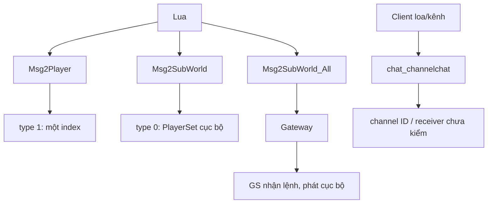

TÓM TẮT 5 DÒNG
1. THẤY — Đã lập sổ tay 6 đường tĩnh; Msg2Player và Msg2SubWorld khác nhau ở target/type gửi: S/Core/Src/ScriptFuns.cpp:5833-5858, 6293-6325; S/Core/Src/KPlayerChat.cpp:1942-1966.
2. THẤY — Msg2SubWorld_All đi Gateway rồi GS nhận lệnh phát cục bộ: S/Core/Src/ScriptFuns.cpp:6375-6391; S/MultiServer/GameServer/KSOServer.cpp:4252-4255.
3. THẤY — Kênh trực tiếp mang channel ID/cost/item ID; BroadcastGlobal đóng relay envelope riêng: C/gamescene/KgameWorld.cpp:3012-3053; S/Core/Src/KNewProtocolProcess.cpp:139-164.
4. CHƯA KIỂM — Không chạy build/test/VM/mạng; chưa xác minh downstream Gateway/relay và chi phí thực tế. .nhip bị Access denied.
5. PARTIAL — Đầu ra và bàn giao đã xong; không commit theo yêu cầu; checkpoint ngoài writable root cần vị trí ghi phù hợp.

# SO-32 — Báo cáo sổ tay thông báo hệ thống và loa

Loại: tổng hợp
Chủ đề: Đường gửi thông báo/chat, phạm vi người nhận, gói tin và giới hạn từ source server/client.
Từ khóa: thông báo, loa, chat, Msg2Player, Msg2SubWorld, Gateway, chat_channelchat, BroadcastGlobal
Trạng thái: PARTIAL — tài liệu tĩnh hoàn tất; checkpoint .nhip bị chặn.
Độ phủ: 6/6 đường mã tĩnh; fan-out liên server chưa xác minh.
Liên quan: JX1_OPS/DESIGN/SO-TAY-THONG-BAO-HE-THONG.md; JX1_OPS/TASKS/SO-32.md; JX1_OPS/CONTEXT-PACK/GS001-MAP.md.
Cần tôi quyết định: không.
liên quan: JX1_OPS/DESIGN/SO-TAY-THONG-BAO-HE-THONG.md; JX1_OPS/TASKS/SO-32.md; JX1_OPS/CONTEXT-PACK/GS001-MAP.md.

## Phạm vi và độ phủ

| Đường | Trạng thái | Kết quả |
|---|---|---|
| Msg2Player | THẤY — đã phủ tĩnh | SendSystemInfo(type=1), một index |
| Msg2SubWorld | THẤY — đã phủ tĩnh | type=0, PlayerSet cục bộ |
| Msg2SubWorld_All | THẤY — một đầu tuyến | Gateway nhận lệnh, GS phát cục bộ |
| Loa/kênh trực tiếp | THẤY — đã phủ gói | c2s_extendchat/chat_channelchat mang channel ID, cost, item ID |
| KSubWorld::BroadCasts | THẤY — đã phủ tĩnh | Lọc SubWorldIndex và kết nối |
| BroadcastGlobal | THẤY — đã phủ tĩnh | Gửi qua relay; nhóm nhận chưa kiểm |

## Sơ đồ

## Kết quả

THẤY — Đầu ra JX1_OPS/DESIGN/SO-TAY-THONG-BAO-HE-THONG.md đáp ứng mục tiêu: lời thường, Mermaid, nhãn độ chắc, mục Chưa kiểm và hơn 10 dẫn chứng file:dòng.

THẤY — Dùng hai source root task cấp và MUC-LUC-TRI-THUC.md/GS001-MAP.md trong worktree để định vị; không đọc runtime, không sửa source. Handler cũ s2c_playersendchat chỉ cast gói, lời gọi cập nhật chat đang comment (C/gamecore/KProtocolProcess.cpp:92, 1227-1232).

THẤY — Ghi nhận nhánh kind tùy chọn của Msg2SubWorld không tới được theo phép gán hiện tại (ScriptFuns.cpp:6295-6316); chỉ ghi tài liệu, không sửa mã.

## Đã xác minh / Chưa xác minh

Đã xác minh: các route và cấu trúc gói trong bảng độ phủ bằng source tĩnh.
Chưa xác minh: build, test, VM, exe, mạng, hiển thị thực tế, cost server-side và tập server mà Gateway/relay phát tới.

## Mục sổ thông số

| Nhóm | Tên/hằng số | file:dòng | Giá trị | Đơn vị | Ảnh hưởng | Đổi an toàn | Nguồn đo |
|---|---|---|---|---|---|---|---|
| Nhịp chat | CHAT_SPEED | S/Core/Src/KPlayerChat.h:21 | 20 | Chưa rõ | Giới hạn một số nhánh | CẨN THẬN | Đọc tĩnh |
| Độ dài câu | MAX_SENTENCE_LENGTH | S/Core/Src/KPlayerChat.cpp:423-438, 1912-1917 | Macro, số chưa định vị | Chưa xác nhận | Kiểm tra câu/gói | CẨN THẬN | Đọc tĩnh |
| Kênh trực tiếp | CHAT_CHANNELCHAT_CMD.cost | C/gamecore/KProtocol.h:2442-2463; C/gamescene/KgameWorld.cpp:5941-6011 | BYTE, mã 0–4 | Tiền/cấp/mana tùy mã | Client gate | CẨN THẬN | Đọc tĩnh |

## Đề xuất tối ưu

Không đề xuất sửa source/thông số. Cần giao task có source định tuyến và quyền runtime nếu muốn xác nhận fan-out hoặc mức trừ cost.

## Giải mã tên

| Tên gốc | Mã hóa | Chữ đúng | Nguồn |
|---|---|---|---|
| Không có tên riêng game trong phạm vi | Không áp dụng | Không phát hiện | SO-32 |

## Sắp theo cấu trúc game

Không áp dụng; báo cáo xếp theo đường phát/phạm vi nhận.

## Phát hiện khi khảo sát

- nParnCount nhận kết quả boolean nên điều kiện >=2 không đạt được theo code hiện tại (S/Core/Src/ScriptFuns.cpp:6295-6316).
- CHAT_CUR_CHANNEL_ALL break trước phần gửi (S/Core/Src/KPlayerChat.cpp:444-473).

## Bàn giao

- PARTIAL; tài liệu hoàn tất, checkpoint .nhip bị Access denied.
- Không commit theo yêu cầu; không có SHA/push.
- PM gộp dòng chỉ mục: SO-TAY-THONG-BAO-HE-THONG.md | tổng hợp | thông báo, loa/chat | thông báo, loa, Msg2Player, Msg2SubWorld, Gateway, BroadcastGlobal | PARTIAL | 6/6 đường tĩnh | SO-32, GS001-MAP.
- Kỹ năng đã dùng: jx1-retrofit, jx1-read-server, jx1-read-client, jx1-parameters, jx1-knowledge, jx1-report.
