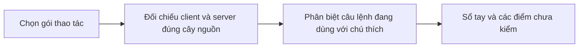

TÓM TẮT 1/5 [NGUỒN] [THẤY] Khảo sát tĩnh đạt; tiến độ tổng thể PARTIAL vì không ghi được tệp nhịp ngoài vùng ghi. `JX1_OPS/DESIGN/SO-TAY-CHONG-GIAN-LAN.md:34`.
TÓM TẮT 2/5 [NGUỒN] [THẤY] Ghi rõ lớp kiểm ID, trạng thái, tốc độ và cự ly. Tách nhánh server, nhánh client và câu lệnh đã chú thích. `GS/Core/Src/KNpc.cpp:6347`, `GS/Core/Src/KSkills.cpp:339`, `GS/Core/Src/KPlayer.cpp:5754`.
TÓM TẮT 3/5 [NGUỒN] [THẤY] Sổ tay đạt kiểm tra định dạng với 5 dòng tóm tắt, 1 khối Mermaid và 93 dẫn nguồn mã duy nhất.
TÓM TẮT 4/5 [NGUỒN] [THẤY] Đường dẫn tệp nhịp nằm ngoài vùng ghi của phiên. Các mốc có ở phần bàn giao. Tổng quan phụ trách commit.
TÓM TẮT 5/5 [CHƯA KIỂM] Chưa build, chạy test game, exe, VM hay kết nối mạng. Chưa đo hành vi của bản đang chạy.

# SO-33 — Báo cáo khảo sát kiểm tra gói tin

Loại: khảo sát\
Chủ đề: Xác định nơi game server kiểm dữ liệu client trong một số thao tác thường gặp.\
Từ khóa: gói tin, chống gian lận, gs001, tốc độ, khoảng cách, nhặt đồ, giao dịch, CheckProtocolSize.\
Trạng thái: PARTIAL — sổ tay khảo sát đạt; tệp nhịp ngoài vùng ghi chưa thể ghi.\
Độ phủ: 5/5 nhóm khảo sát có bằng chứng mã nguồn. Chưa thống kê toàn bộ giao thức.\
Liên quan: [sổ tay SO-33](../DESIGN/SO-TAY-CHONG-GIAN-LAN.md), [K-01](K-01-ban-do-truyen-tin-hieu.md).\
Cần tôi quyết định: không.

## Phạm vi và độ phủ

| Phần | Độ phủ | Dẫn chứng |
|---|---|---|
| Kiểm trước khi chuyển gói | Đã phủ | `GS/Core/Src/CoreServerShell.cpp:2254`, `GS/MultiServer/GameServer/KSOServer.cpp:3744` |
| Đi và chạy thường | Đã phủ | `GS/Core/Src/KProtocolProcess.cpp:5436`, `GS/Core/Src/KNpc.cpp:6333` |
| Dùng kỹ năng thường | Đã phủ | `GS/Core/Src/KProtocolProcess.cpp:5581`, `GS/Core/Src/KNpc.cpp:3673` |
| Nhặt đồ và tiền rơi | Đã phủ | `GS/Core/Src/KPlayer.cpp:5662`, `GS/Core/Src/KPlayer.cpp:5735` |
| Mời giao dịch và đặt tiền | Đã phủ | `GS/Core/Src/KPlayer.cpp:6605`, `GS/Core/Src/KPlayer.cpp:6640` |
| Nhánh đặc biệt và kiểm khi chạy | Chưa phủ | Xem [mục Chưa kiểm trong sổ tay](../DESIGN/SO-TAY-CHONG-GIAN-LAN.md#chưa-kiểm). |

## Giải mã tên

Không có tên riêng mới của kỹ năng, vật phẩm, quái, NPC hoặc bản đồ. Tên gốc của các mã gói ASCII và cách gọi tiếng Việt nằm trong [bảng Giải mã tên](../DESIGN/SO-TAY-CHONG-GIAN-LAN.md#giải-mã-tên). Hai tài liệu dùng UTF-8 không BOM.

## Sắp theo cấu trúc game

Phạm vi đi từ lớp nhận chung đến di chuyển, chiến đấu, nhặt vật rơi và giao dịch. Các nhóm theo thao tác trong game, ngay cả khi dùng chung tệp mã.

## Mục sổ thông số

Tiền tố `GS/` và `CL/` dùng đúng hai cây nguồn đã ghi trong sổ tay. Các giá trị dưới đây đến từ mã nguồn.

| Nhóm | Tên/hằng số | file:dòng | Giá trị | Đơn vị | Ảnh hưởng | Đổi an toàn | Nguồn đo |
|---|---|---|---|---|---|---|---|
| Nhận gói | `m_errorCount` | `GS/MultiServer/GameServer/KSOServer.cpp:761`, `GS/MultiServer/GameServer/KSOServer.cpp:3733` | 50 mặc định khi đọc cấu hình | Lần kiểm mã hoặc độ dài thất bại | So ngưỡng để yêu cầu ngắt phiên có chỉ mục hợp lệ | CẨN THẬN | Đọc tĩnh, chưa đo |
| Nhận gói | `m_nMaxClienLoop` | `GS/MultiServer/GameServer/KSOServer.cpp:743`, `GS/MultiServer/GameServer/KSOServer.cpp:1595` | 50 mặc định khi đọc cấu hình. Vòng xét bộ đếm lớn hơn ngưỡng trước lần đọc tiếp. | Lần đọc có dữ liệu trong vòng xử lý một người chơi | Hạn chế số lần lấy gói liên tiếp trong vòng đó | CẨN THẬN | Đọc tĩnh, chưa đo |
| Di chuyển | `defMAX_PLAYER_SEND_MOVE_FRAME` | `CL/gamecore/GameDataDef.h:29`, `CL/gamecore/KPlayer.cpp:234`, `CL/gamecore/CoreShell.cpp:5034` | 5 | Lượt tăng bộ đếm client | Chờ đủ lượt ở nhánh gửi di chuyển được đọc | CẨN THẬN | Đọc tĩnh, chưa quy đổi sang giây |
| Di chuyển | Trần `MoveSpeed` trong `ServeMove` | `GS/Core/Src/KNpc.cpp:6347`, `GS/Core/Src/KNpc.cpp:6370` | Bề rộng ô bản đồ trừ 1 khi chạm hoặc vượt bề rộng | Đơn vị tốc độ của phép tính bước trong mã | Giới hạn độ lớn bước server tính | CẨN THẬN | Đọc tĩnh, chưa đo |
| Chiến đấu | `GetDelayPerCast()` / `GetHorsePerCast()` | `GS/Core/Src/KNpc.cpp:3647`, `GS/Core/Src/KNpc.cpp:3681` | Theo kỹ năng và nhánh cưỡi ngựa | Đơn vị đồng hồ logic của thế giới | Đặt mốc có thể dùng chiêu tiếp | CẨN THẬN | Đọc tĩnh, chưa tra giá trị từng chiêu |
| Nhặt đồ | Kiểm khoảng cách trong `ServerPickUpItem` | `GS/Core/Src/KPlayer.cpp:5754`, `GS/Core/Src/KPlayer.cpp:5763` | Nằm trong chú thích | Bình phương đơn vị tọa độ bản đồ trong biểu thức | Không tạo điều kiện từ chối đang chạy trong hàm này | CẨN THẬN | Đọc tĩnh, chưa đo |

## Đề xuất tối ưu

Không đề xuất sửa mã trong phạm vi SO-33. Nếu tiếp tục khảo sát, ưu tiên đối chiếu tĩnh các nhánh còn ghi ở mục «Chưa kiểm»: tầm trúng theo từng kỹ năng, va chạm theo trạng thái tìm đường, các kịch bản nhặt vật và xử lý sau lời mời giao dịch.

## Đã xác minh / Chưa xác minh

- **Đã xác minh.** Dùng `Select-String` để định vị hàm và `Get-Content` để đọc các đoạn có số dòng tại đúng cây nguồn. Đối chiếu `_SERVER`, `#ifndef _SERVER` và dấu chú thích ở các đoạn kết luận. `GS/Core/Src/KProtocolProcess.cpp:349`, `GS/Core/Src/KSkills.cpp:339`, `GS/Core/Src/KPlayer.cpp:5754`.
- **Đã xác minh.** Kiểm tệp bằng PowerShell cho kết quả 5 dòng tóm tắt, 1 khối Mermaid, 93 dẫn nguồn GS/CL duy nhất, đủ mục bắt buộc và UTF-8 không BOM. Sơ đồ được kiểm bằng cách đọc cú pháp.
- **Chưa xác minh.** Giá trị cấu hình thực, tầm trúng đòn theo từng chiêu, kịch bản từng vật, xác thực qua các đường xử lý khác và hành vi của bản chạy. Chưa build hoặc chạy test game, exe, VM hay mạng theo phạm vi task. `GS/Core/Src/KSkills.cpp:1024`, `GS/Core/Src/KPlayer.cpp:5771`.

## Lỗi và cách xử lý

| Việc | Cách kiểm tra và kết quả |
|---|---|
| `rg` không có trong PATH | PowerShell trả `CommandNotFoundException`. Đã chuyển sang `Select-String` và đọc theo đoạn, đủ căn cứ cho phạm vi khảo sát. |
| Graphify | Không thấy báo cáo đồ thị tại hai root được chỉ định hoặc thư mục cha trực tiếp. Dùng GS001, mục lục và K-01 để định vị rồi đọc mã thật. |
| Kiểm định dạng | Phép dò BOM bằng so sánh chuỗi báo sai. Kiểm lại bằng byte UTF-8 xác nhận không BOM. Git báo khoảng trắng ở cuối tệp mới do kiểu xuống dòng trộn lẫn, đã thống nhất về LF. |
| Tệp nhịp | `D:/JX-wt/SO-33.nhip` nằm ngoài `D:/JX-wt/SO-33`, vùng ghi của phiên. Ghi mốc trong báo cáo và cập nhật tiến độ trong cuộc trò chuyện. |

## Bàn giao

- Nhịp theo giờ máy (+07:00), 19/11/2026. **04:03** bắt đầu, khoanh nguồn và đọc chuẩn (~15%). **Sau đối chiếu lần đầu** xác định ba nhóm chính (~60%). **04:07** xong đối chiếu nguồn (~80%). **04:09** kiểm khuôn sổ tay, ghi bàn giao (~95%).
- **04:20** tiếp tục trên các đầu ra đã có: kiểm tra sáu skill, bổ sung mục Đề xuất tối ưu; lần ghi `D:\JX-wt\SO-33.nhip` bị từ chối do đường dẫn ngoài vùng ghi. Không đọc/chạy lại mã nguồn.
- Tổng quan phụ trách commit. Hàng đề nghị cho mục lục: **Kiểm tra gói tin và chống gian lận** | `DESIGN/SO-TAY-CHONG-GIAN-LAN.md` | SO-33, K-01 | Đọc tĩnh cửa nhận, di chuyển, kỹ năng, nhặt đồ và giao dịch.
- Kỹ năng đã dùng: `jx1-retrofit`, `jx1-read-server`, `jx1-read-client`, `jx1-parameters`, `jx1-knowledge`, `jx1-report`.
