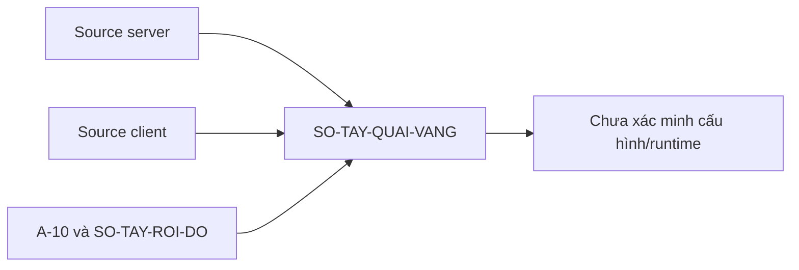

TÓM TẮT 1/5 [NGUỒN] — Đã khảo sát GoldType, tạo biến thể, hệ số thuộc tính, rơi đồ và màu tên bằng source client/server được giao.
TÓM TẮT 2/5 [NGUỒN] — Sổ tay thiết kế có Mermaid, bảng phủ, giải mã tên, sổ thông số và hơn 10 dẫn file:dòng.
TÓM TẮT 3/5 [NGUỒN] — Đã đối chiếu A-10 và SO-TAY-ROI-DO; phân biệt đường nGDropFile với GoldenDropRate theo map.
TÓM TẮT 4/5 [CHƯA KIỂM] — Giá trị template/Settings đang dùng và kết quả runtime chưa xác minh; không build, chạy exe, VM hay mạng.
TÓM TẮT 5/5 [CHƯA KIỂM] — Không commit theo yêu cầu; file nhịp ngoài workspace bị từ chối Access denied, nên trạng thái bàn giao PARTIAL.

# SO-34 — Báo cáo hoàn thành sổ tay quái vàng

- Loại: khảo sát
- Chủ đề: Tạo tài liệu hiểu game cho GoldType, biến thể boss/quái vàng, chỉ số, rơi đồ và màu tên.
- Từ khóa: quái vàng, GoldType, boss xanh, KNpcGold, Treasure, GoldenDropRate, drop, màu tên
- Trạng thái: PARTIAL — tài liệu đã viết; cấu hình/runtime chưa xác minh và file nhịp ngoài workspace không ghi được.
- Độ phủ: 6/6 chủ đề có kết luận tĩnh; các giá trị hệ số Settings/runtime chưa xác nhận.
- Liên quan: [SO-TAY-QUAI-VANG](../DESIGN/SO-TAY-QUAI-VANG.md), [A-10](A-10-lua-trai-boss.md), [SO-TAY-ROI-DO](../DESIGN/SO-TAY-ROI-DO.md).
- Cần tôi quyết định: không

## Phạm vi và độ phủ

| Phần việc | Kết quả |
|---|---|
| GoldType và nhánh tạo quái/boss | Đã phủ tĩnh; dải tự chọn và setter có dẫn source. |
| Chỉ số thưởng | Đã phủ công thức và field; chưa đọc hệ số từ dữ liệu cấu hình. |
| Rơi đồ | Đã phủ nGDropFile, NormalDropFile, GoldenDropRate và DeathPunish; chưa xác minh cấu hình map. |
| Màu tên client | Đã phủ các dải type và mã màu trong source; chưa quan sát runtime. |
| Đối chiếu A-10 và SO-TAY-ROI-DO | Đã đối chiếu; A-10 xác nhận type 2–4/RGB 100,100,255 khớp code; sổ rơi đồ cung cấp ngữ cảnh mẫu. |
| Ghi nhịp tại `D:\JX-wt\SO-34.nhip` | Bị chặn: thử ghi nhận lỗi `Access to the path ... is denied`; đường dẫn nằm ngoài writable root của phiên. Không tạo bản thay thế. |

## Đã xác minh

- `JX1_OPS/DESIGN/SO-TAY-QUAI-VANG.md` được tạo với 5 dòng tóm tắt, thông tin, Mermaid, phạm vi, giải mã tên, xếp theo cấu trúc game, sổ thông số, mức xác minh và Chưa kiểm.
- Dẫn source: `Sources/Core/Src/KNpcGold.h:13,84–115,145–154`; `KNpcGold.cpp:145–193,233–255,322–350,392–432,479–544,626–702`; `KNpcSet.cpp:595–626,769–779`; `KNpc.cpp:2483–2506,2660–2688`; client `gamecore/KNpc.cpp:5334–5356` và `gamecore/KProtocolProcess.cpp:2222–2224`.
- Đối chiếu tài liệu: `JX1_OPS/REPORTS/A-10-lua-trai-boss.md:1`; `JX1_OPS/DESIGN/SO-TAY-ROI-DO.md`.

## Chưa xác minh

- Không đọc dữ liệu Settings/template ngoài root server Sources và client Classes được task chỉ định; không biết hệ số/khóa map cụ thể đang dùng.
- Không chạy build, exe, VM, mạng hoặc kiểm tra runtime theo task.
- Không commit; tổng quan commit do PM phụ trách. `git status` đã kiểm tra một lần trước khi sửa; chưa stage/commit.
- `rg` không có sẵn; đã chuyển sang `Select-String` trên các tệp source mục tiêu và đọc các đoạn dòng cần thiết, không cài công cụ.
- Lỗi nhịp duy nhất: ghi `D:\JX-wt\SO-34.nhip` bị `Access denied`; không retry vì đường dẫn ngoài vùng ghi.

## Bàn giao

Tệp chính: `JX1_OPS/DESIGN/SO-TAY-QUAI-VANG.md`. Đã thêm mục Kết quả cuối task vào `JX1_OPS/TASKS/SO-34.md`. Không sửa mã nguồn hoặc tài liệu tham chiếu; ngoài hai đầu ra, chỉ thêm mục Kết quả vào task theo yêu cầu. Không commit. PM có thể gộp mục lục theo dòng đề xuất trong sổ tay.

Kỹ năng đã dùng: jx1-retrofit, jx1-read-server, jx1-read-client, jx1-parameters, jx1-knowledge, jx1-report.
