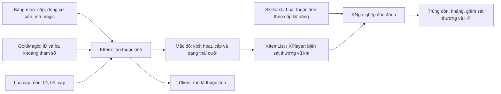

TÓM TẮT 1: [NGUỒN] Đã khảo sát tĩnh bốn món An Bang, 15 vũ khí vàng, 25 mẫu phi phong và 10 cấp ngựa của một dòng.
TÓM TẮT 2: [NGUỒN] Lua cấp bốn món An Bang cơ bản ở cấp món 1. Bảng mẫu ghi cấp 8 hoặc 10 và có 56 bản ghi thuộc nhóm 34 ở hai bảng.
TÓM TẮT 3: [NGUỒN] 22 TSV ghi các dòng cơ bản, yêu cầu, magic và điều kiện áp dụng. Báo cáo nối bảng, Lua và Core để dự đoán sát thương.
TÓM TẮT 4: [CHƯA KIỂM] Bốn tên Hán của An Bang là phục nguyên. Git chặn tạo index.lock nên chưa có commit trên task/T-01.
TÓM TẮT 5: [CHƯA KIỂM] Chỉ đọc và kiểm tệp cục bộ. Chưa build, chạy game/exe, VM, kết nối mạng hoặc đo trong game.

# T-01 — Dự đoán thuộc tính trang bị và sát thương

Loại: khảo sát  
Chủ đề: Dự đoán thuộc tính theo bản ghi và khoảng sát thương cho mẫu trang bị JX1.  
Từ khóa: An Bang, 安邦, ngũ hành, phi phong, ngựa, GoldMagic, KItem, KNpc, TCVN3, sát thương  
Trạng thái: PARTIAL — đã bàn giao khảo sát tĩnh tại worktree, thiếu tên Hán gốc An Bang và bị chặn commit.  
Độ phủ: 106/106 bản ghi mẫu về thuộc tính, 0/4 tên Hán An Bang đối chiếu được với bản gốc, 1/1 đường đánh thường mẫu đã lần tĩnh.  
Liên quan: [Đội test tính năng](../DESIGN/DOI-TEST-TINH-NANG.md), [H-01](H-01-ngu-hanh.md), [H-02](H-02-magic-attrib.md), [H-03](H-03-cuong-hoa.md), [H-07](H-07-trang-suc-mat-na-phi-phong.md).  
Cần tôi quyết định: không.

## Phạm vi và độ phủ

| Hạng mục | Nguồn và bản ghi | Độ phủ |
|---|---|---|
| An Bang Băng Tinh Thạch Hạng Liên, dây chuyền | Mỗi bảng vàng/bạch kim, dòng 166 / 212 / 218 / 387 / 396 / 410 / 426 | Đã phủ 14/14. Chưa xác minh tên Hán gốc. |
| An Bang Cúc Hoa Thạch Chỉ Hoàn, nhẫn | Hai bảng, dòng 167 / 213 / 219 / 388 / 397 / 411 / 427 | Đã phủ 14/14. Chưa xác minh tên Hán gốc. |
| An Bang Điền Hoàng Thạch Ngọc Bội | Hai bảng, dòng 168 / 214 / 220 / 389 / 398 / 412 / 428 | Đã phủ 14/14. Chưa xác minh tên Hán gốc. |
| An Bang Kê Huyết Thạch Giới Chỉ, nhẫn | Hai bảng, dòng 169 / 215 / 221 / 390 / 399 / 413 / 429 | Đã phủ 14/14. Chưa xác minh tên Hán gốc. |
| Vũ khí Kim | `D/GoldItem.txt:8`, `:13`, `:73` | Đã phủ 3/3. |
| Vũ khí Mộc | `D/GoldItem.txt:459`, `:650`, `:1143` | Đã phủ 3/3. |
| Vũ khí Thủy | `D/GoldItem.txt:18`, `:23`, `:123` | Đã phủ 3/3. |
| Vũ khí Hỏa | `D/GoldItem.txt:479`, `:610`, `:625` | Đã phủ 3/3. |
| Vũ khí Thổ | `D/GoldItem.txt:118`, `:489`, `:645` | Đã phủ 3/3. |
| Phi phong thường | `D/PiFeng.txt:2–15`, Particular 0, cấp 1–14 | Đã phủ 14/14. |
| Phi phong vàng từ menu hỗ trợ | `D/GoldItem.txt:3467–3477`, ID 3465–3475 | Đã phủ 11/11. |
| Ngựa thường dòng Liệt Hoàng Mã → Phi Hoàng | `D/horse.txt:2–11`, Particular 0, cấp 1–10 | Đã phủ 10/10. Chọn một dòng làm mẫu. |
| Công thức sát thương | Sát thương vũ khí, một đường đánh thường, kháng và trừ HP | Đã phủ đường mẫu. Các biến thể hiệu ứng và số đo trong game chưa phủ. |

## Nguồn và cách đọc TSV

- `G/` là gói dữ liệu ServerNew trong `Folder/ServerNew-20260116T043145Z-3-001/ServerNew/_bin_v2_/gs`. `D/` là `G/Settings/item/004`.
- `S/` là `D:/JX-source/server/jxOnline/gameserver/Sources/Core/Src`. `E/` là `Sources/Engine/Src` cùng cây server. `H/` là `D:/JX-source/server/jxOnline/header`.
- `C/` là `Folder/Client2912-20260116T044348Z-3-001/Client2912/Client/Classes/gamecore`. Bản đồ GS001 và H-01/H-02 dùng để định vị. Graphify server tìm được thuộc cây build `src18` và đồ thị client thuộc cây Coco. Bằng chứng dưới đây lấy từ các file thật ở các root đã nêu.
- Đầu vào trộn tiêu đề GBK và tên Việt TCVN3 trong cùng tệp. Giữ byte khi tách cột, giải mã theo trường. TSV UTF-8 không BOM. Tên Hán đã đọc được từ GBK có cột riêng. Tên Việt được giải dấu theo TCVN3 và giữ cách viết hoa của từng dòng dữ liệu. Bốn chuỗi Hán phục nguyên có cột riêng và chưa được xác nhận.
- Mỗi bản ghi bắt đầu bằng hàng `món`. `cap_bang` là cấp ghi trong bảng, `cap_lua_mau` là cấp truyền từ Lua đã tìm thấy. Với đồ thường, `id_ban_ghi` là chỉ số dòng dữ liệu bắt đầu từ 0 để tra lại. Với đồ vàng, đó là chỉ số BPT dùng để chọn món. `p1_min` đến `p3_max` giữ thứ tự đầu mút trong nguồn. Ô trống là không có dữ liệu tương ứng. Các số `-1` và `0` có sẵn trong tham số được giữ nguyên. `S/KBasPropTbl.CPP:90–103`, `S/KItemGenerator.CPP:1453–1469`.
- `loai` tách chỉ số cơ bản, độ bền, yêu cầu, magic và mở rộng. Hồ sơ mang tên bạch kim giữ riêng `DefMagic*_10` dưới loại `tạm bạch kim`. Bộ đọc ghi chúng vào `m_TempPlatinaAttrib`, còn đường sinh bạch kim cơ bản tra `m_aryMagicAttribs` từ `DefMagic*_0`. Chưa xác minh khi nào giá trị tạm có hiệu lực. `S/KBasPropTbl.CPP:1683–1703`, `S/KItemGenerator.CPP:1329–1404`.
- `GoldMagic` dùng dòng vật lý bằng mã tham chiếu cộng 1. Thuộc tính cơ bản lấy một khoảng và có hai tham số phụ bằng 0. Magic tra ba khoảng. Hàng `độ bền` dùng để dự đoán độ bền của món, còn hàng `yêu cầu` để kiểm điều kiện mặc. `S/KItem.cpp:524–538`, `:547–566`, `:697–723`, `S/KItemGenerator.CPP:1471–1527`.
- Với hai đầu đều âm, hàm quay đổi dấu rồi đổi lại khi trả. Ví dụ ô `-30,-50` của giảm choáng hợp lệ và có giá trị sinh từ −50 đến −30, kể cả hai đầu. Giữ thứ tự nguồn trong TSV để truy ngược. `D/GoldMagic.txt:424`, `S/KCore.h:323–348`.
- Tên và **ID thực thi** đôi khi lệch nhãn văn bản của riêng `GoldMagic`. Các dòng có ID 226–228, 237 và 243 giữ cả symbol và nhãn nguồn để đối chiếu. Tooltip client tra ID sang khóa `Descript` và dựng mô tả từ tham số. Vì vậy TSV dùng ID làm khóa đối chiếu và giữ nhãn nguồn làm tham khảo. `C/KItem.cpp:2403`, `:2449`, `:2513`, `C/KMagicDesc.cpp:710–730`, `:986`.

## An Bang

[ĐÃ XÁC MINH] Lọc theo tên TCVN3, theo chữ Hán `安邦` và theo `Group=34` trên hai bảng đang được bộ nạp tham chiếu. Mỗi bảng cho 28 hàng tên An Bang và 28 hàng nhóm 34, trùng tập. Bản `GoldItem_.txt` và `platinaequip - Copy.txt` lặp tập 28 tên mỗi bản, không được chọn bởi các tên file nạp trong nguồn này. Bốn tên gốc Hán không xuất hiện trong các hàng khớp. Tên phục nguyên để tra cứu lần lượt là 安邦冰晶石项链, 安邦菊花石指环, 安邦田黄石玉佩 và 安邦鸡血石戒指. `D/GoldItem.txt:1`, `:166–169`, `D/platinaequip.txt:1`, `:166–169`, `S/KBasPropTbl.CPP:36–41`, `:1533–1547`, `:1696–1703`.

| Món cơ bản | ID | Hệ | Cấp bảng / Lua / yêu cầu | Magic trực tiếp | Magic cần lượt kích hoạt |
|---|---:|---|---|---|---|
| Băng Tinh Thạch Hạng Liên | 164 | Thổ | 10 / 1 / 85 | Kháng tất cả 15–20% | Ô trống. `D/GoldMagic.txt:311`. |
| Cúc Hoa Thạch Chỉ Hoàn | 165 | Thủy | 8 / 1 / 80 | Nội lực tối đa +120–200 | Kháng băng 25–30%. `D/GoldMagic.txt:7`, `:313`. |
| Điền Hoàng Thạch Ngọc Bội | 166 | Mộc | 8 / 1 / 75 | Nội lực tối đa +120–200 | Kháng độc 25–30%. `D/GoldMagic.txt:7`, `:314`. |
| Kê Huyết Thạch Giới Chỉ | 167 | Hỏa | 8 / 1 / 80 | Nội lực tối đa +120–200 | Kháng hỏa 25–30%. `D/GoldMagic.txt:7`, `:312`. |

[ĐÃ XÁC MINH] Menu truyền đúng bốn hệ trong bảng và cấp 1 cho cả bốn món. Lua chuyển cấp cho `AddGold` rồi Core gọi `SetLevel`. Dự đoán của menu ở cấp 1 giữ các khoảng magic trên và không mở dòng `ExpandMagic` theo cấp. Các mốc mở trong Core là món cấp 5–9 cho ô mở rộng thứ nhất và cấp ≥10 cho hai ô. Bộ đếm nhóm đọc `Group/GroupNum` và có thể bật cờ đủ bộ. Khi tính lại trang bị, cờ này cấp ba lượt kích hoạt dòng magic. Dòng mở rộng vẫn qua mốc cấp riêng. `G/script/global/npcchucnang/hotrotanthu.lua:728–731`, `S/ScriptFuns.cpp:8698–8724`, `S/KItemGenerator.CPP:1459–1469`, `S/KItem.cpp:159–218`, `S/KItemList.cpp:9596–9620`, `S/KPlayer.cpp:3725–3752`.

[ĐÃ XÁC MINH] Các ô magic đánh số 1/3/5 trong TSV được xét trực tiếp. Ô 2/4/6 dùng lần lượt số lượt kích hoạt từ hệ nhân vật và các ô trang bị tương sinh, giới hạn 3. Các ca đo nên kiểm riêng một món, đủ bộ và tháo lại một món. Ô trống trong TSV không biểu thị rằng Core bỏ qua lượt. Khi cột tham chiếu trống, bộ đọc số dùng −1, phép tra dòng 0 của GoldMagic cho ID mặc định 0. Hàm áp vẫn tính lượt cho ô 2/4/6 có ID 0 do chỉ so với INVALID_ATTRIB=−1, dù ID 0 không có tác dụng cộng chỉ số. `S/KItemList.cpp:54–70`, `:2674–2706`, `S/KItem.cpp:159–178`, `S/KBasPropTbl.CPP:103`, `E/KTabFile.cpp:393–409`, `E/KTabFile.cpp:681–694`, `E/KTabFile.cpp:856–874`, `S/KItemGenerator.CPP:1482–1487`, `S/KNpcAttribModify.cpp:322–332`.

## Vũ khí, phi phong và ngựa

[ĐÃ XÁC MINH] Chọn ba vũ khí vàng mỗi hệ theo `nSeries` của bảng, có hai ô đầu là loại 28 và 29. Tên vũ khí GBK còn nguyên Hán tự trong bốn mẫu. Vũ khí vàng có thể được gán hệ/cấp lúc tạo, nên đội đo phải ghi hệ thực của món. `H/GameDataDef.h:329–335`, `S/KItemGenerator.CPP:1454–1469`.

| Hệ | ID vũ khí theo thứ tự ba TSV | Biên thuộc tính cơ bản |
|---|---|---|
| Kim | 6 / 11 / 71 | 69–128 / 40–114 / 44–100 |
| Mộc | 457 / 648 / 1141 | 40–114 / 60–100 / 1–1 |
| Thủy | 16 / 21 / 121 | 55–165 / 18–158 / 46–86 |
| Hỏa | 477 / 608 / 623 | 46–86 / 46–86 / 40–114 |
| Thổ | 116 / 487 / 643 | 46–86 / 46–86 / 46–86 |

[ĐÃ XÁC MINH] Magic vàng tra `GoldMagic`. Để chọn mẫu đồ trắng, bỏ các tham số sinh magic ngẫu nhiên. Với đồ có thêm magic theo nhánh thường `nPoint=0`, bộ sinh dùng bảng `magicattrib.txt` và mức magic 1–10 để lọc theo loại đồ, hệ và chẵn/lẻ. Ví dụ nhóm 126 ở mức 1 có 5–10% và ở mức 10 có 90–99% trước khi xét lựa chọn cả pool. Hai giá trị này mô tả nhóm ứng viên, chưa đủ để dự đoán một món thả cụ thể. `S/KBasPropTbl.CPP:35`, `:1913`, `S/KItemGenerator.CPP:738–743`, `:925–946`, `D/magicattrib.txt:2`, `:11`.

[ĐÃ XÁC MINH] Phi phong thường Lăng Vân cấp 1 có hai lần quay riêng, mỗi lần 50–100 điểm cho sinh lực và nội lực tối đa. Vô Cực cấp 10 có hai khoảng 1300–1500. Phi phong vàng Lăng Vân cùng tên có sinh lực 200–300 và sáu ô magic theo bảng vàng. Menu gán cấp 1–11 cho 11 món. Món cuối ghi cấp 5 ở bảng và được truyền cấp 11 từ Lua. `D/PiFeng.txt:2`, `:11`, `D/GoldItem.txt:3467`, `:3477`, `D/GoldMagic.txt:419`, `G/script/global/npcchucnang/hotrotanthu.lua:132–162`.

[ĐÃ XÁC MINH] Ngựa Particular 0 cấp 1 có tốc độ 10%, thể lực +50, sinh lực +10, né tránh −10, yêu cầu nhân vật cấp 20. Cấp 10 (Phi Hoàng) lần lượt là 50%, +1000, +200 và −200, yêu cầu cấp 70. Bộ đọc số nguyên dùng `atoi` với ô dạng `10%`. Handler tốc độ tính theo tốc độ cơ bản với phép chia nguyên, riêng tích tốc độ cơ bản × phần trăm từ 50 đến 100 trả mức tăng 1. Handler né tránh chặn chỉ số hiện hành ở 0. Khi tính lại trang bị, Core bỏ qua ô ngựa nếu chưa cưỡi. `D/horse.txt:2`, `:11`, `E/KTabFile.cpp:681–694`, `S/KNpcAttribModify.cpp:1440–1471`, `:2355–2361`, `S/KPlayer.cpp:3725–3762`.

## Công thức sát thương và ca mẫu

[ĐÃ XÁC MINH] (1) Gọi `Wmin/Wmax` là hai biên của sát thương vũ khí. Mỗi biên bằng `(base + tổng magic cộng vào biên tương ứng) × (100 + tổng magic tăng % sát thương vũ khí) / 100`. Hàm cộng từ sáu ô magic theo ba ID `magic_weapondamagemin_v`, `magic_weapondamagemax_v` và `magic_weapondamageenhance_p`. Nhánh này đọc trực tiếp các ô, không có kiểm lượt kích hoạt trong vòng lặp. Player cộng tiếp `sức mạnh hiện tại / 5` cho cận chiến hoặc `thân pháp hiện tại / 5` cho tầm xa. Khi tay không, hàm trả hai biên bằng `sức mạnh hiện tại / 5 + 1`. `S/KItemList.cpp:117–159`, `S/KPlayer.cpp:2859–2876`, `S/KPlayer.h:37–38`.

[Đà XÁC MINH] (2) Lua cấp kỹ năng cung cấp thuộc tính qua `GetSkillLevelData`. Skill 53 đọc `physicsenhance_p` từ `G/script/skill/special/½ü³ÌÎïÀí¹¥»÷.lua`, tên byte hiển thị trên đĩa ứng với GBK 近程物理攻击.lua. Lua trả bộ `0,0,0` cho thuộc tính này, chính xác và tiêu hao đều bằng 0 ở đường Lua mẫu. `G/Settings/Skills.txt:54`, `G/script/skill/special/½ü³ÌÎïÀí¹¥»÷.lua:3–13`, `:23–36`, `S/KSkills.cpp:3187–3199`, `:3215–3216`, `:3250`, `:3678–3683`.

[ĐÃ XÁC MINH] (3) Với nhánh kỹ năng `magic_physicsenhance_p`, đặt `B = biên player + m_CurrentAddPhysicsDamage`. Core tính `B × (100 + % kỹ năng) / 100 + B × % tăng theo loại vũ khí / 100` cho từng biên, chia nguyên ở **mỗi** hạng. Dòng cộng phần trăm ngoại công 126 dùng p3 để chọn nhóm vũ khí, còn dòng cộng điểm 121 đi vào `m_CurrentAddPhysicsDamage`. Nhánh kỹ năng `magic_physicsdamage_v` dùng biên riêng của skill, nhân hệ số kỹ năng và có thể cộng sát thương nội công. `S/KNpc.cpp:5992–5993`, `:6020–6054`, `S/KNpcAttribModify.cpp:2814–2859`.

[ĐÃ XÁC MINH] (4) Khi có kiểm chính xác, `ReceiveDamage` thử trúng đòn trước. Đường vật lý nhân hai biên với `(100 + nDameXGTT)/100`, rồi gọi `CalcDamage`. Hàm quay `lo + g_Random(hi - lo)`, lấy lo khi hai biên bằng nhau. Biên trên bị loại nếu hai biên khác nhau, vì bộ sinh dùng phép dư. Sát thương theo hệ và kháng cho từng loại đi qua phép `raw × (100 − kháng hiệu dụng) / 100`. Với vật lý, cộng kháng hiện hành và trừ `nSeriesDamage` khi hệ người đánh khắc hệ mục tiêu, sau đó kẹp theo trần kháng của mục tiêu và `MAX_RESIST=150`. Cặp khắc gồm Kim → Mộc, Mộc → Thổ, Thổ → Thủy, Thủy → Hỏa, Hỏa → Kim. Nhánh `damage_magic` đặt kháng bước này bằng 0. `S/KNpc.cpp:4487–4503`, `:4684–4690`, `:5085–5183`, `:5185–5266`, `H/GameDataDef.h:116`, `E/KRandom.cpp:68–94`.

[ĐÃ XÁC MINH] (5) Các bước sau gồm giảm sát thương riêng của quái, nhánh PK/skill, lá chắn và giới hạn theo máu còn lại. Chí tử `bFatally` là nhánh trả sớm với 1/10 máu hiện tại. Cần tách sát thương vật lý, băng, hỏa, lôi, độc và magic vì `ReceiveDamage` xử lý riêng. `S/KNpc.cpp:5070–5082`, `:4707–4857`, `:5268–5379`, `:5616–5719`.

[GIẢ THUYẾT KIỂM THỬ] Lấy Phục Ma Tử Kim Côn ID 6, +0, sức mạnh hiện tại 180. Giả sử đã quay được 100% cho ô 1 loại 126, p3=6 áp dụng mọi nhóm vũ khí, ô 4 cộng điểm vật lý chưa kích hoạt, và chỉ còn kênh vật lý của skill 53. Khi ấy biên vũ khí 69–128 thành 105–164 sau sức mạnh, rồi thành `[210, 328)` sau dòng 126. Nếu đòn trúng, kháng vật lý hiệu dụng 20%, HP mục tiêu đủ và không có giảm sát thương, chí mạng hay lá chắn, kỳ vọng trừ **168–261 HP**. Với kháng 0% kỳ vọng **210–327 HP**. Nếu bật riêng lượt kích hoạt thứ hai và ô 4 quay 50 điểm, giữ các giả định khác, biên trước kháng thành `[310, 428)` và kỳ vọng **248–341 HP** ở kháng 20%. `D/GoldItem.txt:8`, `D/GoldMagic.txt:49`, `:72`, `H/GameDataDef.h:133`, `S/KNpcAttribModify.cpp:2814–2832`, `S/KNpc.cpp:6020–6030`, `:5091–5097`, `:5266`.

## Mục sổ thông số

| Nhóm | Tên/hằng số | file:dòng | Giá trị | Đơn vị | Ảnh hưởng | Đổi an toàn | Nguồn đo |
|---|---|---|---|---|---|---|---|
| Trang bị | Lượt kích hoạt | `S/KItemList.cpp:2703` | 3 tối đa | lượt | Số ô lẻ có thể áp | CẨN THẬN | Đọc tĩnh |
| Trang bị | Mở rộng | `S/KItem.cpp:195–218` | 5 và 10 | cấp món | Mở lần lượt hai ô | CẨN THẬN | Đọc tĩnh |
| Cường hóa | `JxQhScale` và `EnChance` | `S/KItem.cpp:3782–3818` | 0–30, +5% gốc/cấp | cấp, % | Tính lại p1 cho ID cho phép, và p3 dương của loại 59–64 | CẨN THẬN | Đọc tĩnh |
| Cường hóa | Thưởng kỹ năng vũ khí | `S/KItem.cpp:184–191` | +1 ở 12–14, +2 từ 15 | cấp kỹ năng | Thêm hiệu ứng khi áp trang bị | CẨN THẬN | Đọc tĩnh |
| Vật lý | Hai số chia thuộc tính | `S/KPlayer.h:37–38` | 5 / 5 | điểm chỉ số mỗi điểm sát thương | Biên cận chiến/tầm xa | CẨN THẬN | Đọc tĩnh |
| Kháng | `MAX_RESIST` | `H/GameDataDef.h:116` | 150 | % | Trần ở bước kháng theo loại | CẨN THẬN | Đọc tĩnh |

[ĐÃ XÁC MINH] Công thức nhánh `EnChance` đã đọc là `gốc + (gốc × 5 × cấp + dấu(gốc) × 50) / 100` với chia nguyên hướng về 0, dùng +50 khi gốc bằng 0. Áp dụng cho sáu ô magic có ID hợp lệ trong danh sách. Yêu cầu, base và ô mở rộng được giữ nguyên trong bảng dự đoán. Ví dụ dòng Phục Ma +100% thành +150% ở +10 theo nhánh này. Đội đo cần xác nhận đường cường hóa của đồ vàng riêng theo H-03. `S/KItem.cpp:641–649`, `:3782–3818`, `D/GoldMagic.txt:49`.

## Đề xuất tối ưu cho lượt đo

- T-03 ghi ID nguồn, cấp món thực, cường hóa, hệ món, trạng thái đủ bộ và trạng thái cưỡi. Ưu tiên cặp An Bang cùng tên nhưng khác ID, phi phong thường/vàng Lăng Vân và ngựa Particular 0 cấp 1/10.
- T-04 dùng cùng nhân vật, mục tiêu và cấp kỹ năng. Ghi riêng đòn hụt, chí mạng, mỗi kênh sát thương và HP còn đủ hay không. Trước khi so khoảng HP, đo hai biên player và giá trị thật đã quay của dòng 126/121.

## Đã xác minh / Chưa xác minh

- **Đã xác minh:** 22 TSV UTF-8 không BOM, 106 bản ghi mẫu, tổng 583 hàng dữ liệu và 22 cột mỗi hàng. Đã kiểm 215 lượt tra GoldMagic. Đối chiếu ID dòng, số bản ghi theo nhóm, nguồn ba tham số GoldMagic, các biên vũ khí trong bảng và hai ca tính số học ở trên bằng PowerShell. Đọc trực tiếp đường Core server, file Lua và formatter của bản Client2912.
- **Chưa xác minh:** tên Hán gốc của bốn món An Bang, biểu hiện tooltip trong bản đang chạy, đường áp `DefMagic*_10`, danh sách mọi ngựa trong gói, APK/binary khớp bảng và mã. Không chạy build, game/server, exe hoặc VM. Không có số liệu runtime. 
- **Lỗi và xử lý:** `rg` không có trên máy, chuyển sang `Select-String` và đọc giới hạn. Tên file Lua theo Hán tự không mở được, đã tìm tên hiện diện trên đĩa theo byte và đọc được. Lần `git add` cho bốn TSV An Bang trả `Permission denied` tại `D:/jx1-reports/.git/worktrees/T-01/index.lock`. Phần dữ liệu còn lại đã lưu tại worktree.

## Bàn giao

- Báo cáo này và [22 TSV dự đoán](../TEST/DU-DOAN/) dùng cùng một lược đồ. Chỉ mục cho PM nằm ở [T-01.tsv](_CHIMUC/T-01.tsv).
- **BỊ CHẶN – CHƯA PUSH.** Chưa có SHA vì Git không ghi được index ở thư mục metadata nằm ngoài worktree. PM có thể commit các tệp T-01 trên nhánh `task/T-01` theo nhóm 3–5 tệp khi quyền ghi index khả dụng.
- Hàng đề xuất cho mục lục tri thức: `Dự đoán thuộc tính trang bị và sát thương | T-01 | GoldItem, GoldMagic, KItemList::GetWeaponDamage, KNpc::CalcDamage | khảo sát tĩnh`.
