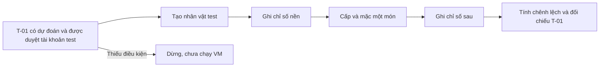

TÓM TẮT 5 DÒNG
1. [NGUỒN] PARTIAL — đã chuẩn bị khung ghi nhận đo trang bị và chỉ số nhân vật; chưa có phép đo runtime.
2. [NGUỒN] Quy trình gồm tạo nhân vật test, ghi chỉ số nền, cấp/mặc một món, rồi ghi chỉ số sau và độ lệch.
3. [NGUỒN] Đầu ra gồm báo cáo này và bảng chỉ mục T-02; chưa có dữ liệu thử nghiệm để so với dự đoán.
4. [CHƯA KIỂM] Chưa có bàn giao T-01 hoặc bằng chứng duyệt tài khoản test trong nguồn đã đọc; chưa kiểm source hay tương thích Bot.
5. [CHƯA KIỂM] Không chạy build, exe, VM hay mạng; không commit/push theo yêu cầu. File .nhip yêu cầu nằm ngoài vùng sandbox được ghi.

# T-02 — Khung đo chỉ số trang bị trên VM thử
Loại: thiết kế
Chủ đề: Chuẩn bị quy trình ghi chỉ số nhân vật trước và sau khi mặc trang bị trên VM thử.
Từ khóa: đo chỉ số, trang bị, equipment, T-02, JX-Test-36, GM/Lua, trước-sau, chênh lệch
Trạng thái: PARTIAL — đã lập khung tài liệu; chưa đủ điều kiện và chưa được phép chạy đo runtime.
Độ phủ: đã mô tả 4/4 bước đo; đã thực hiện runtime 0/4 bước.
Liên quan: `JX1_OPS/DESIGN/DOI-TEST-TINH-NANG.md`, `JX1_OPS/DESIGN/CHUAN-BAO-CAO.md`, `JX1_OPS/TASKS/T-01.md`, `JX1_OPS/TASKS/T-02.md`, `JX1_OPS/REPORTS/E-01b-thieu-giao-thuc.md`.
Cần tôi quyết định: không — đã hoàn tất phần tài liệu theo prompt; việc triển khai/đo thật cần task sau với quyền runtime và đầu vào cụ thể.

## Sơ đồ quy trình

## Phạm vi và độ phủ

Phạm vi thiết kế lấy từ mục tiêu T-02 và luồng T-02 trong tài liệu đội test. Bảng này phân biệt khung được mô tả với thao tác runtime chưa thực hiện.

| Phần tử phạm vi | Đã phủ / chưa phủ | Nguồn và giới hạn |
| --- | --- | --- |
| Tạo nhân vật test trên VM thử | Đã mô tả; chưa thực hiện | `JX1_OPS/TASKS/T-02.md:9`; `JX1_OPS/DESIGN/DOI-TEST-TINH-NANG.md:10`. Chưa có duyệt tài khoản/nhân vật. |
| Đọc và lưu chỉ số nền trước khi mặc | Đã mô tả trong biểu mẫu; chưa đo | `JX1_OPS/DESIGN/DOI-TEST-TINH-NANG.md:10`; chưa có log hoặc số liệu runtime. |
| Cấp trang bị và mặc một món mỗi lượt | Đã mô tả; chưa thực hiện | `JX1_OPS/TASKS/T-02.md:9`; cách cấp qua Lua/GM là mô tả thiết kế, chưa thao tác. |
| Đọc chỉ số sau khi mặc, tính chênh lệch | Đã mô tả trong biểu mẫu; chưa đo | `JX1_OPS/DESIGN/DOI-TEST-TINH-NANG.md:10`; chưa có log hoặc số liệu runtime. |
| Đối chiếu với dự đoán từ T-01 | Chưa phủ | Task T-01 ghi `active` (`JX1_OPS/TASKS/T-01.md:4`) và mục Kết quả còn `(chưa làm)` (`JX1_OPS/TASKS/T-01.md:11`); chưa có báo cáo T-01 trong worktree này. Thiết kế nói T-02 chờ T-01 tại `JX1_OPS/DESIGN/DOI-TEST-TINH-NANG.md:19`. |
| Nguồn đọc server/client cho vòng đo | Chưa phủ; không chặn thiết kế tài liệu | Task T-02 không nêu root/version hoặc danh sách nguồn cần đọc. Không tự chọn root từ báo cáo lịch sử. |
| Điều kiện tiền đề T-01 và duyệt tài khoản | Chưa xác minh | Thiết kế nêu yêu cầu tại `JX1_OPS/DESIGN/DOI-TEST-TINH-NANG.md:10` và `JX1_OPS/DESIGN/DOI-TEST-TINH-NANG.md:19`. Task T-01 ghi `active`, thiết kế ghi “sẵn sàng giao”; chưa xác định tài liệu nào được cập nhật sau. |

Độ phủ thực tế: 4 bước quy trình được mô tả, 0/4 bước runtime đã chạy. Chưa đếm được độ phủ theo vật phẩm/chỉ số vì chưa có danh sách thử T-01 được bàn giao trong worktree này. Không kết luận tình trạng T-01 ở worktree khác.

## Giải mã tên

Không đưa tên kỹ năng, trang bị cụ thể, quái, NPC hoặc bản đồ vào khung đo này, nên không phát sinh tên thực thể cần giải mã. Các tài liệu nguồn có nêu ví dụ cho vòng T-01/T-03/T-04; chưa nhập các ví dụ đó thành danh sách đo T-02. Tài liệu đang đọc và đầu ra dùng UTF-8; không suy diễn mã GBK/TCVN3 của dữ liệu game chưa mở.

| Tên gốc | Mã hóa | Chữ đúng | Nguồn file:dòng |
| --- | --- | --- | --- |
| Không phát sinh tên thực thể trong game ở phạm vi đã đọc | Không áp dụng | Không có dữ liệu cần giải mã | `JX1_OPS/TASKS/T-02.md:9`; `JX1_OPS/DESIGN/DOI-TEST-TINH-NANG.md:10` |

## Sắp theo cấu trúc game

Chưa có dữ liệu trang bị để xếp theo bộ và từng món. Khung ghi nhận giữ thứ tự thao tác đo: nhân vật → chỉ số nền → từng món/slot → thuộc tính hiển thị → chỉ số sau và chênh lệch. Khi có kết quả T-01, các lượt cần được nhóm theo nhóm trang bị rồi liệt kê từng món, không gộp nhiều món vào một lượt.

## Khung đo đề xuất

Toàn bộ biểu mẫu, cách tính và tiêu chí bên dưới là **ĐỀ XUẤT — CHƯA XÁC MINH RUNTIME**. Chúng không phải mô tả API Lua/GM hay gói tin đã chứng minh từ source. Đầu ra hiện tại chỉ gồm báo cáo, chỉ mục và mục Kết quả của task; chưa có mã đo hoặc cấu hình triển khai.

### Điều kiện trước khi đo

1. Có kết quả dự đoán T-01 để chọn món và chỉ số cần so sánh. Task T-01 liệt kê phạm vi tại `JX1_OPS/TASKS/T-01.md:13`, nhưng mục Kết quả còn trống. Kiểm tra thư mục `JX1_OPS/TEST/DU-DOAN` được thiết kế dẫn tới cũng cho kết quả chưa tồn tại trong worktree này.
2. Có phê duyệt cụ thể cho tài khoản/nhân vật thử nghiệm và xác nhận môi trường VM thử đúng theo thiết kế. Không ghi tài khoản, mật khẩu hoặc khóa vào báo cáo.
3. Có root/version source và danh sách `vung_file` nếu cần đối chiếu source server/client. Mục tiêu gốc tại `JX1_OPS/TASKS/T-02.md:9` chưa chỉ định các đầu vào đó; mục Kết quả đã được cập nhật riêng theo prompt.

### Trình tự ghi nhận

1. **Nhân vật:** tạo nhân vật thử nghiệm đã được duyệt. Ghi mã nhân vật thử và mã lượt thay cho thông tin đăng nhập; ghi phiên bản VM/client/server được giao trong task chạy thật. Không tự tạo tài khoản hay ghi DB từ lượt thiết kế này.
2. **Chỉ số nền:** ghi nguyên văn tên từng chỉ số, giá trị và đơn vị nếu nguồn hiển thị có đơn vị. Ghi cùng thời điểm và kênh đọc; lưu bằng chứng ở vị trí nội bộ được giao, dẫn `file:dòng` cho log văn bản. Giữ hồ sơ các món đang mặc, cấp/điểm nhân vật và trạng thái khác có thể quan sát, để phát hiện điều kiện thay đổi giữa hai lần đọc.
3. **Trang bị:** cấp một món qua phương thức GM/Lua đã được duyệt; ghi mã/loại/ô mặc, từng dòng thuộc tính hiển thị và thông số của đúng món được cấp. Không đoán tên hàm hoặc tham số cấp đồ. Nếu cấp đồ đã làm chỉ số nền đổi, ghi nhận và lập lại mốc trước khi mặc. Mỗi lượt chỉ đổi một món.
4. **Sau và đối chiếu:** sau khi có bằng chứng thao tác mặc đã hoàn tất, đọc lại cùng chỉ số qua cùng kênh. Chưa xác định tín hiệu hoàn tất thì ghi chưa kiểm, không chọn thời gian chờ tùy ý làm bằng chứng. Với hai giá trị số cùng đơn vị/cùng điều kiện, tính `chênh lệch = sau - trước`; thiếu giá trị thì ghi `chưa đo`, không thay bằng 0. So với dự đoán T-01, ghi khớp/lệch/chưa so được; nếu làm tròn hoặc quy đổi chưa rõ thì chưa kết luận.

Thiết kế dự kiến đọc bằng log Lua hoặc gói đồng bộ qua Bot (`JX1_OPS/DESIGN/DOI-TEST-TINH-NANG.md:10`). Đây là hai phương án cần chọn và kiểm chứng trong task chạy thật. **Nguồn gián tiếp:** E-01b ghi còn giới hạn giải mã nội dung (`JX1_OPS/REPORTS/E-01b-thieu-giao-thuc.md:115`) và chưa kiểm runtime/binary (`JX1_OPS/REPORTS/E-01b-thieu-giao-thuc.md:165`). T-02 không đọc lại BOT hay source/binary, không chuyển kết quả test lịch sử thành kết quả của lượt này.

### Biểu mẫu mỗi lượt

| Mã lượt | Nhóm/món/ô mặc | Dòng thuộc tính của món | Chỉ số nhân vật | Đơn vị | Trước | Sau | Chênh lệch (sau-trước) | Bằng chứng trước/sau | Dự đoán T-01 có nguồn | Kết quả đối chiếu / ghi chú |
| --- | --- | --- | --- | --- | --- | --- | --- | --- | --- | --- |
| Chưa đo | Chờ bàn giao T-01 | Chưa đo | Chưa đo | Chưa xác định | Chưa đo | Chưa đo | Chưa tính | Chưa có | Chưa có | Chưa đủ điều kiện |

Mỗi dòng ghi rõ chỉ số nhân vật được so, không mặc định một dòng thuộc tính của món tương ứng đúng một chỉ số. Nếu quan hệ chưa biết, giữ nguyên hai loại thông tin và ghi `chưa xác định quan hệ`.

### Tiêu chí nghiệm thu vòng chạy thật

Chỉ đánh dấu khung chạy thật đạt khi có bằng chứng tạo/chọn đúng nhân vật thử, cấp đúng món, mặc thành công, hai lần đọc từ cùng kênh, và ít nhất một cặp chỉ số có thể so với dự đoán T-01 có nguồn. Trường hợp chưa đọc được phải ghi bước dừng và nguyên nhân. Không kết luận khung đạt từ việc có biểu mẫu, parser offline hoặc ghi chênh lệch bằng 0 khi chưa đo. T-02 hiện chưa đạt tiêu chí runtime nào.

Trước một lượt kế tiếp, trả nhân vật về điều kiện nền đã ghi bằng cách hoàn tác được task chạy thật cho phép và đọc kiểm lại. Thiết kế yêu cầu ghi chú hoàn tác cho DB thử tại `JX1_OPS/DESIGN/DOI-TEST-TINH-NANG.md:16`; báo cáo này chưa tạo bản sao/đổi DB, chưa chỉ định lệnh hoàn tác vì chưa có thao tác thực.

### Mục sổ thông số

| Nhóm | Tên/hằng số | file:dòng | Giá trị | Đơn vị | Ảnh hưởng | Đổi an toàn (CÓ/CẨN THẬN/KHÔNG) | Nguồn đo |
|---|---|---|---|---|---|---|---|
| Chỉ số nhân vật | Các dòng chỉ số đọc trước/sau | `JX1_OPS/DESIGN/DOI-TEST-TINH-NANG.md:10` | Chưa đo | Theo từng chỉ số được hiển thị | Đầu vào so sánh trước/sau khi mặc | CẨN THẬN | Chưa đo; cần nguồn được duyệt trong VM thử |
| Trang bị | Các dòng thuộc tính của món thử | `JX1_OPS/TASKS/T-01.md:13` | Chưa có kết quả T-01 | Theo dữ liệu hiển thị | Đối chiếu giá trị món với biến đổi chỉ số | CẨN THẬN | Chưa có dự đoán T-01 hoặc phép đo runtime |
| Chênh lệch | Đề xuất `sau - trước` | `JX1_OPS/DESIGN/DOI-TEST-TINH-NANG.md:11` yêu cầu cột chênh lệch; công thức là thiết kế T-02 | Chưa tính | Cùng đơn vị với chỉ số | Lượng biến đổi quan sát được | CẨN THẬN | Chưa đo; đây là phép tính đề xuất, không phải hằng số/API game |

## Đề xuất tối ưu

- Mỗi lượt chỉ mặc một món và giữ nguyên nhân vật/điều kiện khác; như vậy bảng trước/sau có thể quy kết rõ hơn.
- Tách tên hiển thị của từng dòng thuộc tính khỏi giá trị/đơn vị, giữ nguyên chữ gốc và thêm mã hóa chỉ khi nguồn thực tế xác nhận.
- Dùng mã lượt thay cho tài khoản/nhân vật đăng nhập; chỉ giữ bằng chứng trong vị trí nội bộ được duyệt.
- Không bắt đầu vòng đo đến khi T-01 và phê duyệt tài khoản thử nghiệm được xác nhận, và không dùng source khác phiên bản thay cho root/version được giao.

## Đã xác minh / Chưa xác minh

**Đã xác minh (trong tài liệu):**

- Mục tiêu T-02 là tạo nhân vật test, cấp/mặc trang bị và đọc chỉ số tại `JX1_OPS/TASKS/T-02.md:9`.
- Thiết kế đặt T-02 trên VM thử, nêu cách đọc dự kiến tại `JX1_OPS/DESIGN/DOI-TEST-TINH-NANG.md:10` và điều kiện chờ tại `JX1_OPS/DESIGN/DOI-TEST-TINH-NANG.md:19`.
- Task T-01 có phạm vi dự đoán tại `JX1_OPS/TASKS/T-01.md:13`, nhưng ghi trạng thái `active` tại `JX1_OPS/TASKS/T-01.md:4`; Kết quả chưa có tại `JX1_OPS/TASKS/T-01.md:11`.
- Chuẩn báo cáo yêu cầu tóm tắt 5 dòng tại `JX1_OPS/DESIGN/CHUAN-BAO-CAO.md:7`, Mermaid/độ phủ tại `JX1_OPS/DESIGN/CHUAN-BAO-CAO.md:17`, giải mã/cấu trúc game tại `JX1_OPS/DESIGN/CHUAN-BAO-CAO.md:19` và `JX1_OPS/DESIGN/CHUAN-BAO-CAO.md:20`, chỉ mục tại `JX1_OPS/DESIGN/CHUAN-BAO-CAO.md:30`.

**Chưa xác minh:**

- Chưa tạo tài khoản/nhân vật, cấp hoặc mặc trang bị; chưa đọc bất kỳ chỉ số hay dòng thuộc tính runtime nào.
- Chưa đối chiếu với kết quả T-01; thiết kế ghi “T-01 sẵn sàng giao” nhưng task T-01 hiện ghi `active`.
- Chưa thấy tệp Q-18/Q-19 trong `JX1_OPS` của worktree này; phần tham chiếu trong thiết kế không phải bằng chứng đã duyệt.
- Chưa đọc source server/client do T-02 thiếu root/version; không kết luận hành vi source hoặc runtime. Đây không phải trở ngại cho phần thiết kế tài liệu đã được giao.
- Chưa xác minh Bot có thể đọc chỉ số trong đúng phiên bản/môi trường thử. Nguồn gián tiếp E-01b ghi runtime/binary chưa kiểm tại `JX1_OPS/REPORTS/E-01b-thieu-giao-thuc.md:165`.
- Không chạy build, test game/Bot, exe, VM hoặc mạng theo giới hạn task; không đo thông số.

## Kiểm tra tài liệu, lỗi và cách xử lý

Đã kiểm tra Git status/branch một lần trước ghi: `task/T-02`, worktree sạch. Báo cáo và checkpoint chưa tồn tại khi bắt đầu; không có phần kết quả sẵn để làm lại. Đã xem diff task và nội dung hai file mới một lượt. Kiểm tra cuối thực chạy: `git diff --check -- JX1_OPS/TASKS/T-02.md` trả exit 0; kiểm cấu trúc trực tiếp trên ba đầu ra trả exit 0, đúng 5 dòng tóm tắt, 7 trường metadata, 1 Mermaid, UTF-8 hợp lệ không BOM, không khoảng trắng cuối dòng, TSV có 7 cột mỗi hàng. Không tạo script phụ. Đây là kiểm tra tài liệu, không phải test game/Bot.

Mốc kiểm tra cuối: `18/11/2026 15:07:37 +07:00`, phần tài liệu 100%, runtime 0/4 bước; checkpoint ngoài worktree chưa ghi được như bảng dưới.

| Lỗi/giới hạn | Cách thử hoặc xử lý | Kết quả |
| --- | --- | --- |
| Đọc chuẩn báo cáo bằng encoding mặc định làm đầu ra tiếng Việt sai | Đọc lại trực tiếp với `Get-Content -Encoding utf8` | Đọc được tiếng Việt; không kết luận file nguồn bị hỏng, không sửa tài liệu cũ. |
| `rg` không nhận diện trên PATH trong một đợt hai lệnh đọc song song | Chuyển sang `Select-String`, `Get-Content` và liệt kê tên file trong các thư mục liên quan | Đã lấy các dòng nguồn cần thiết, không cài công cụ. |
| Hai lần gọi công cụ hỏi làm rõ bị từ chối tham số `question` | Đưa câu hỏi vào trường `title` theo schema, gọi lần thứ ba | Lần thứ ba được chấp nhận. Chưa có câu trả lời khi tiếp tục; dùng các đầu ra tài liệu prompt đã cho, không tự chọn source/runtime. |
| T-02 không khai báo `Nguồn cần đọc`, `Phạm vi`, `vung_file` | Dùng mục tiêu tại task, thiết kế được dẫn trực tiếp và các đầu ra được prompt/chuẩn chỉ định | Đã hoàn tất tài liệu; không ghi source, workflow, chỉ mục tri thức chung hoặc báo cáo cũ. |
| Checkpoint `D:\JX-wt\T-02.nhip` ở ngoài vùng được ghi | Đối chiếu với writable root của phiên là `D:\JX-wt\T-02`; không thử vượt sandbox hoặc xin quyền nâng | Chưa ghi được mọi mốc `.nhip`; tiến độ đã được nêu trong hội thoại. Cần Tổng quản đặt checkpoint trong vùng được ghi cho lượt sau. |
| `git diff --no-index` cho file mới trả exit 1 | Đọc diff nhận được | Đây là mã có khác biệt với file rỗng, không phải lỗi test. Không stage/commit/push. |

## Bàn giao

- Commit: không tạo; task không yêu cầu commit. Push: không thực hiện.
- Bước tiếp theo: Tổng quản bàn giao kết quả T-01, chỉ định root/version nếu cần đọc source và vùng file cho phần triển khai; cấp quyền runtime/tài khoản/DB thử cụ thể nếu muốn chuyển sang đo thật. Việc này nằm ngoài prompt đang cấm VM/exe/mạng.
- Chỉ mục đề xuất để PM gộp vào `JX1_OPS/DESIGN/MUC-LUC-TRI-THUC.md`: `T-02 | Khung đo chỉ số trang bị trên VM thử | PARTIAL | khảo sát tĩnh, khung 4 bước; 0/4 runtime`.

liên quan: `JX1_OPS/DESIGN/DOI-TEST-TINH-NANG.md`, `JX1_OPS/DESIGN/CHUAN-BAO-CAO.md`, `JX1_OPS/TASKS/T-01.md`, `JX1_OPS/TASKS/T-02.md`, `JX1_OPS/REPORTS/E-01b-thieu-giao-thuc.md`

## Phát hiện khi chuẩn hóa

- Áp dụng khuôn của `jx1-retrofit`, `jx1-knowledge`, `jx1-parameters` và `jx1-report` cho báo cáo mới; không sửa báo cáo hay kết luận cũ. Không cập nhật `MUC-LUC-TRI-THUC.md`; Tổng quản gộp từ chỉ mục riêng.
- Đã đọc `jx1-read-server` và `jx1-read-client` theo prompt. Quy tắc gốc: “Lấy root/version từ task” (`.agents/skills/jx1-read-server/SKILL.md:6`) và “Ghi root/version task cho phép” (`.agents/skills/jx1-read-client/SKILL.md:6`). Các nguồn task dẫn tới chưa xác định root/version cho T-02, nên chưa mở source; không dùng root trong E-01b làm root hiện hành mặc định. Đây là giới hạn của việc đối chiếu source, không phải yêu cầu xin lại quyền viết báo cáo.
- Thiết kế ghi T-01 “sẵn sàng giao” tại `JX1_OPS/DESIGN/DOI-TEST-TINH-NANG.md:19`, task T-01 ghi `active` tại `JX1_OPS/TASKS/T-01.md:4`; giữ nguyên cả hai tài liệu và chỉ ghi khác biệt.
