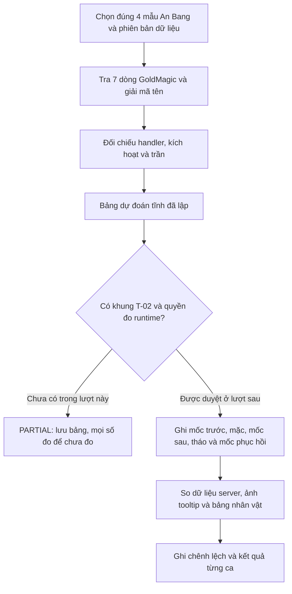

TÓM TẮT 1/5 — [NGUỒN] PARTIAL: đã chuẩn bị vòng An Bang từ 4 món, 7 dòng magic; chưa có số đo trang bị trước/sau.
TÓM TẮT 2/5 — [NGUỒN] Đã đối chiếu GoldItem → GoldMagic → handler server → mô tả client; tách nội lực, kháng, kích hoạt và trần.
TÓM TẮT 3/5 — [NGUỒN] Đầu ra: báo cáo này, chỉ mục T-03.tsv và Kết quả cuối task; giữ nguyên kết luận các báo cáo cũ.
TÓM TẮT 4/5 — [CHƯA KIỂM] Thiếu đầu ra T-01/T-02 tại worktree; ghi nhịp ngoài worktree bị từ chối; Tổng quan nhận commit, chưa có SHA/push.
TÓM TẮT 5/5 — [CHƯA KIỂM] Không build, chạy exe, VM hoặc mạng theo lệnh giao; mọi ca runtime dưới đây chưa chạy, cần lượt đo được duyệt riêng.

# T-03 — Vòng đo trang bị: dòng thuộc tính và chỉ số trước/sau

Loại: kiểm thử
Chủ đề: Chuẩn bị vòng đo bộ An Bang, xác định dòng thuộc tính và cách đối chiếu chỉ số nhân vật trước/sau.
Từ khóa: trang bị, An Bang, GoldItem, GoldMagic, manamax_v, allres_p, kích hoạt, kháng, trước/sau
Trạng thái: PARTIAL — hoàn tất phần đọc tĩnh và mẫu ghi; chưa thực hiện vòng đo runtime do phạm vi cấm VM/exe/mạng.
Độ phủ: đã đối chiếu 4/4 món mẫu và 7/7 tham chiếu magic; đo 0/4 món; mẫu chiếm 4/28 bản ghi Group=34 trong GoldItem local.
Liên quan: JX1_OPS/DESIGN/DOI-TEST-TINH-NANG.md; JX1_OPS/DESIGN/CHUAN-BAO-CAO.md; JX1_OPS/TASKS/T-01.md; JX1_OPS/TASKS/T-02.md; JX1_OPS/REPORTS/H-01-ngu-hanh.md; JX1_OPS/REPORTS/H-02-magic-attrib.md.
Cần tôi quyết định: có — giao lượt đo sau khi có khung T-02 và quyền thực thi phù hợp; không cần quyết định thêm cho phần tài liệu đã hoàn tất.

## Phạm vi và độ phủ

[ĐÃ XÁC MINH — yêu cầu] Mục tiêu T-03 nằm tại `JX1_OPS/TASKS/T-03.md:9`. Thiết kế quy định mỗi vòng một nhóm và bảng dòng hiển thị/trước/sau/chênh lệch/khớp dự đoán tại `JX1_OPS/DESIGN/DOI-TEST-TINH-NANG.md:11`; T-02..T-04 còn phụ thuộc T-01 và duyệt tài khoản test tại `:19`. Lệnh giao hiện tại cấm VM/exe/mạng, vì vậy không thể xác nhận hoàn tất phần đo thật của T-03.

[ĐÃ XÁC MINH — phạm vi ghi] Task không có mục `Nguồn cần đọc`, `Phạm vi` hoặc `vung_file` riêng. Áp dụng đúng hai đường dẫn được người giao chỉ định: báo cáo này và phần Kết quả cuối task; bổ sung chỉ mục `JX1_OPS/REPORTS/_CHIMUC/T-03.tsv` theo `JX1_OPS/DESIGN/CHUAN-BAO-CAO.md:30`. Không sửa báo cáo cũ, source, cấu hình, BAI_HOC hay mục lục chung.

| Phần tử của vòng mẫu, xếp theo bộ → vị trí | Nguồn dữ liệu gốc | Đọc tĩnh | Đo trước/sau |
|---|---|---|---|
| Dây chuyền An Bang Băng Tinh Thạch Hạng Liên | `G/item/004/GoldItem.txt:166` | Đã phủ: 1 dòng magic | Chưa phủ |
| Nhẫn A: An Bang Cúc Hoa Thạch Chỉ hoàn | `G/item/004/GoldItem.txt:167` | Đã phủ: 2 dòng magic | Chưa phủ |
| Nhẫn B: An Bang Kê Huyết Thạch Giới Chỉ | `G/item/004/GoldItem.txt:169` | Đã phủ: 2 dòng magic | Chưa phủ |
| Ngọc bội An Bang Điền Hoàng Thạch Ngọc Bội | `G/item/004/GoldItem.txt:168` | Đã phủ: 2 dòng magic | Chưa phủ |
| Trước/mặc/sau/tháo/phục hồi, dòng ẩn, đủ bộ, trần và UI | `S/KItem.cpp:140`; `S/KItem.cpp:265`; `S/KItemList.cpp:2674`; `C/gamecore/CoreShell.cpp:1623` | Đã lập cách đo và tiêu chí | Chưa phủ, 0 ca runtime |
| Đầu ra dự đoán T-01 và khung đo T-02 | `JX1_OPS/TASKS/T-01.md:13`; `JX1_OPS/TASKS/T-02.md:9` | Chưa có báo cáo T-01*.md/T-02*.md trong thư mục REPORTS của worktree; hai đường TEST/DU-DOAN đã kiểm đều thiếu | Chưa có đầu vào để đối chiếu liên tầng |

[ĐÃ XÁC MINH — đếm trực tiếp] Lọc cột `Group` số 54 trong toàn bộ `G/item/004/GoldItem.txt` cho đúng 28 bản ghi bằng 34, chia thành 7 cụm × 4 món. Bảng dưới nhận diện đầy đủ số bản ghi cùng Group, không suy rằng các biến thể có cùng thuộc tính.

| Nhóm bản ghi An Bang trong GoldItem | Số món | Độ phủ vòng này |
|---|---:|---|
| Mẫu tại `:166`, `:167`, `:169`, `:168` | 4 | Đã đối chiếu dữ liệu và magic; chưa đo |
| Biến thể tại `:212`, `:213`, `:215`, `:214` | 4 | Chỉ nhận diện Group; chưa khảo sát thuộc tính/chưa đo |
| Biến thể cùng tên tại `:218`, `:219`, `:221`, `:220` | 4 | Chỉ nhận diện Group; chưa khảo sát thuộc tính/chưa đo |
| Biến thể tại `:387`, `:388`, `:390`, `:389` | 4 | Chỉ nhận diện Group; chưa khảo sát thuộc tính/chưa đo |
| Biến thể tại `:396`, `:397`, `:399`, `:398` | 4 | Chỉ nhận diện Group; chưa khảo sát thuộc tính/chưa đo |
| Biến thể tại `:410`, `:411`, `:413`, `:412` | 4 | Chỉ nhận diện Group; chưa khảo sát thuộc tính/chưa đo |
| Biến thể tại `:426`, `:427`, `:429`, `:428` | 4 | Chỉ nhận diện Group; chưa khảo sát thuộc tính/chưa đo |

[CHƯA XÁC MINH] Vũ khí năm hệ, phi phong và ngựa thuộc các vòng sau; không cộng chúng vào độ phủ vòng An Bang. Định hướng các nhóm nằm ở `JX1_OPS/DESIGN/DOI-TEST-TINH-NANG.md:11` và `JX1_OPS/TASKS/T-01.md:13`. Chưa đếm tổng các nhóm đó trong dữ liệu gốc.

## Giải mã tên

[ĐÃ XÁC MINH — dữ liệu local] Cột tên món dùng TCVN3; tiêu đề cột và tên hiệu ứng GoldMagic dùng GBK. Cột “tên gốc” TCVN3 dưới đây là cách hiển thị từng byte bằng Latin-1 để bảo toàn dấu vết, không phải tên đã giải mã sai bằng GBK. Bản gốc không bị sửa. Không có tên Hán của bốn món trong các ô đã đọc, nên không tự bổ sung.

| Tên gốc | Mã hóa | Chữ đúng UTF-8 | Nguồn file:dòng |
|---|---|---|---|
| `An Bang` | ASCII trong tên TCVN3 | An Bang | `G/item/004/GoldItem.txt:166` |
| `An Bang B¨ng Tinh Th¹ch H¹ng Liªn` | TCVN3 | An Bang Băng Tinh Thạch Hạng Liên | `G/item/004/GoldItem.txt:166` |
| `An Bang Cóc Hoa Th¹ch ChØ hoµn` | TCVN3 | An Bang Cúc Hoa Thạch Chỉ hoàn | `G/item/004/GoldItem.txt:167` |
| `An Bang Kª HuyÕt Th¹ch Giíi ChØ` | TCVN3 | An Bang Kê Huyết Thạch Giới Chỉ | `G/item/004/GoldItem.txt:169` |
| `An Bang §iÒn Hoµng Th¹ch Ngäc Béi` | TCVN3 | An Bang Điền Hoàng Thạch Ngọc Bội | `G/item/004/GoldItem.txt:168` |
| `内力2` | GBK | Nội lực 2 — 内力2 | `G/item/004/GoldMagic.txt:7` |
| `全抗5` | GBK | Kháng tất cả 5 — 全抗5 | `G/item/004/GoldMagic.txt:311` |
| `冰防5` | GBK | Kháng băng 5 — 冰防5 | `G/item/004/GoldMagic.txt:313` |
| `火防5` | GBK | Kháng hỏa 5 — 火防5 | `G/item/004/GoldMagic.txt:312` |
| `毒防5` | GBK | Kháng độc 5 — 毒防5 | `G/item/004/GoldMagic.txt:314` |
| `series_metal`, `series_wood`, `series_water`, `series_fire`, `series_earth` | ASCII; chú thích Hán/Việt trong header legacy | Kim=0, Mộc=1, Thủy=2, Hỏa=3, Thổ=4 | `H/GameDataDef.h:329` |

[ĐÃ XÁC MINH — nguồn] Các số 2/5 trong tên hiệu ứng là nhãn có sẵn của bảng, không được dùng thay cấp nhân vật, cấp món hay số món bộ. Client có nhánh chuyển TCVN sang UTF-8 tại `C/engine/KGbktoUtf8.h:139`, gọi qua `V2U` tại `:25` và `C/vn/Translate.cpp:49`. [CHƯA XÁC MINH] Tên và chữ hiển thị trong client thực thi chưa được chụp.

## Sắp theo cấu trúc game

[ĐÃ XÁC MINH — cách tổ chức] Một bộ An Bang → dây chuyền → hai nhẫn → ngọc bội; từng món ghi điều kiện nhận diện, dòng hiện rồi dòng ẩn. Hai nhẫn có cùng `DetailType=3`; đặt nhẫn A vào ring1 và nhẫn B vào ring2 là bố trí dự kiến để lặp phép đo, chưa phải trạng thái nhân vật đã quan sát. Thử đảo hai ô là ca riêng vì nguồn kích hoạt phụ thuộc vị trí (`S/KItemList.cpp:63`, `:64`).

## Nguồn và phiên bản đối chiếu

| Ký hiệu | Root chỉ đọc đã kiểm tồn tại | Cách dùng |
|---|---|---|
| S | `D:\JX-source\server\jxOnline\gameserver\Sources\Core\Src` | Server: loader, sinh đồ, mặc/tháo, handler chỉ số |
| H | `D:\JX-source\server\jxOnline\header` | Enum ngũ hành |
| C | `C:\Jx1CocoV3\Folder\Client2912-20260116T044348Z-3-001\Client2912\Client\Classes` | Client bản gói được H-01/H-02 dẫn; không thay bằng client ở root khác |
| G | `C:\Jx1CocoV3\Folder\ServerNew-20260116T043145Z-3-001\ServerNew\_bin_v2_\gs\Settings` | Bảng trang bị/magic và chuỗi mobile rời |

[ĐÃ XÁC MINH — định vị] Đã đọc mục lục tri thức, bản đồ GS001 và phần trang bị H-01/H-02 trước khi mở source. Root được dẫn tại `JX1_OPS/REPORTS/H-01-ngu-hanh.md:12` và `JX1_OPS/REPORTS/H-02-magic-attrib.md:20`. Không thấy marker `.graphify_root` tại các gốc S cấp server/jxOnline và C cấp Client/Classes đã kiểm; không dùng graph khác root, không tạo lại graph. Sau đó tìm giới hạn trong các file đích và mở dòng hiện tại.

[ĐÃ XÁC MINH — dấu vân tay] `Get-FileHash -Algorithm SHA256` ngày 18/11/2026 cho hai file dữ liệu dưới G:

| File | SHA-256 |
|---|---|
| `item/004/GoldItem.txt` | `CE63D39D8C00B8514EED291817558F3B191E497E0E41C3D354284E285A80791E` |
| `item/004/GoldMagic.txt` | `D2D663578D367A0F0AA80D61FD125010F63C5880F5C62200F7191F0EDABD7EB0` |

[CHƯA XÁC MINH] Không có commit/version runtime hay binary tương ứng được xác nhận trong lượt này. Hash trên chỉ ghim dữ liệu local đã đọc; không chứng minh server hoặc client đang nạp chúng.

## 1. Nhận diện bốn món của vòng An Bang

[ĐÃ XÁC MINH — dữ liệu local] Header ở `G/item/004/GoldItem.txt:1`: `SetID` cột 53 khác `SetId` cột 57. Loader gán chúng lần lượt vào `m_nId` và `m_nSetId`; `Group` cột 54 vào `m_nSet`, `GroupNum` cột 55 vào `m_nSetNum` (`S/KBasPropTbl.CPP:1540`). Bản ghi nạp zero-based dùng dòng vật lý = chỉ mục + 2 (`S/KBasPropTbl.CPP:95`). Vì vậy ghi đồng thời dòng vật lý, chỉ mục và ID; không dùng tên món để chọn nhầm biến thể.

| Món / vị trí dự kiến | GoldItem dòng / chỉ mục zero-based / SetID | DetailType / ParticularType | Hệ / nLevel bảng | Require1 / Data1 | DefMagic1..2 | Group / GroupNum / GroupExtend / SetId |
|---|---|---|---|---|---|---|
| Dây chuyền | 166 / 164 / 164 | 4 / 0 | Thổ (4) / 10 | 36 / 85 | 310 / trống | 34 / 4 / 30 / 1 |
| Nhẫn A | 167 / 165 / 165 | 3 / 0 | Thủy (2) / 8 | 36 / 80 | 6 / 312 | 34 / 4 / 30 / 2 |
| Nhẫn B | 169 / 167 / 167 | 3 / 0 | Hỏa (3) / 8 | 36 / 80 | 6 / 311 | 34 / 4 / 30 / 4 |
| Ngọc bội | 168 / 166 / 166 | 9 / 1 | Mộc (1) / 8 | 36 / 75 | 6 / 313 | 34 / 4 / 30 / 3 |

[ĐÃ XÁC MINH — source] Loại nhẫn/dây chuyền/ngọc bội tương ứng 3/4/9 theo enum bắt đầu tại `S/KItem.h:85`. Cấp và hệ trong bảng chỉ là dữ liệu đầu vào: `GetGoldItemByIndex` có thể ghi đè hệ bằng tham số hợp lệ 0..4 và luôn gọi `SetLevel(nLevel)` (`S/KItemGenerator.CPP:1460`, `:1469`). Khi đo phải ghi lại hệ và level thực của món; không suy từ tên hay cấp yêu cầu. Requirement là điều kiện mặc, không phải dòng cộng chỉ số (`S/KItem.cpp:481`, `:482`); ý nghĩa riêng của ID requirement 36 chưa khảo sát thêm trong vòng này.

[ĐÃ XÁC MINH — ô dữ liệu] Bốn hàng mẫu để trống các cột base, ExpandMagic và DefMagic còn lại. “Trống” ghi đúng bảng, không đổi thành số đo 0 và không khẳng định mọi đường tạo đồ đều không phát sinh thuộc tính khác.

## 2. Dự đoán dòng thuộc tính có điều kiện

[ĐÃ XÁC MINH — source/dữ liệu] Tham chiếu DefMagic phải cộng 1 để tra dòng vật lý GoldMagic; `310 → :311`, `6 → :7`, `312 → :313`, `311 → :312`, `313 → :314`. Đã đối chiếu cả `S/KItem.cpp:712` và đường sinh đồ `S/KItemGenerator.CPP:1482`. Ba tham số được lấy riêng; năm dòng GoldMagic được dùng đều có tham số 2 = -1, tham số 3 = 0. Bảng dưới ghi khoảng tham số 1, không phải giá trị món đã roll.

| Dòng đo | Món / slot magic zero-based | ID / key | Nội dung dự kiến từ chuỗi local | Khoảng cộng thô khi áp dụng | Nguồn |
|---|---|---|---|---|---|
| AB-01 | Dây chuyền / 0, trực tiếp | 114 / `allres_p` | Kháng tất cả | 15..20 điểm phần trăm cho mỗi kháng | `G/item/004/GoldItem.txt:166`; `G/item/004/GoldMagic.txt:311`; `G/MagicDesc_mobile.ini:132` |
| AB-02 | Nhẫn A / 0, trực tiếp | 89 / `manamax_v` | Nội lực tối đa | 120..200 điểm | `G/item/004/GoldItem.txt:167`; `G/item/004/GoldMagic.txt:7`; `G/MagicDesc_mobile.ini:107` |
| AB-03 | Nhẫn A / 1, cần kích hoạt | 105 / `coldres_p` | Kháng băng | 25..30 điểm phần trăm | `G/item/004/GoldItem.txt:167`; `G/item/004/GoldMagic.txt:313`; `G/MagicDesc_mobile.ini:123` |
| AB-04 | Nhẫn B / 0, trực tiếp | 89 / `manamax_v` | Nội lực tối đa | 120..200 điểm | `G/item/004/GoldItem.txt:169`; `G/item/004/GoldMagic.txt:7`; `G/MagicDesc_mobile.ini:107` |
| AB-05 | Nhẫn B / 1, cần kích hoạt | 102 / `fireres_p` | Kháng hỏa | 25..30 điểm phần trăm | `G/item/004/GoldItem.txt:169`; `G/item/004/GoldMagic.txt:312`; `G/MagicDesc_mobile.ini:120` |
| AB-06 | Ngọc bội / 0, trực tiếp | 89 / `manamax_v` | Nội lực tối đa | 120..200 điểm | `G/item/004/GoldItem.txt:168`; `G/item/004/GoldMagic.txt:7`; `G/MagicDesc_mobile.ini:107` |
| AB-07 | Ngọc bội / 1, cần kích hoạt | 101 / `poisonres_p` | Kháng độc | 25..30 điểm phần trăm | `G/item/004/GoldItem.txt:168`; `G/item/004/GoldMagic.txt:314`; `G/MagicDesc_mobile.ini:119` |

[ĐÃ XÁC MINH — giới hạn dự đoán] ID 89/101/102/105/114 đã đối chiếu thứ tự enum tại `S/KMagicAttrib.h:104`, `:116`, `:117`, `:120`, `:129`. Khoảng random không cho biết giá trị thật hay phân phối; chưa kiểm helper random có bao gồm cả hai biên. Để so đúng một món, phải lấy bộ `nAttribType, nValue[0..2]` thực của chính món đó; chỉ “nằm trong khoảng bảng” chưa đủ kết luận khớp.

### Kích hoạt và đủ bộ

[ĐÃ XÁC MINH — source] `ApplyMagicAttribToNPC` áp slot 0/2/4 trực tiếp; slot 1/3/5 cần lượt kích hoạt, tại `S/KItem.cpp:159`, `:166`, `:178`. Với ba món có slot 1 trong mẫu, cần `nActive_server >= 1`. Khi chưa kích hoạt, đóng góp dự đoán của riêng dòng ẩn là 0; đây là kỳ vọng có điều kiện, không phải số đo đang thiếu. Dây chuyền có slot 0 nên không cần quan hệ sinh để áp dòng kháng tất cả.

[ĐÃ XÁC MINH — source] `GetEquipEnhance` đếm hệ nhân vật và đồ ở các ô nguồn có quan hệ sinh hệ món, chặn tối đa 3 (`S/KItemList.cpp:2688`, `:2695`, `:2703`). Nguồn ring1 là vũ khí/mũ/đai, ring2 là tay/ngọc bội/dây chuyền, ngọc bội là giày/ring1/mặt nạ (`S/KItemList.cpp:63`, `:64`, `:65`). Ghi toàn bộ bố trí trang bị để thấy tác động lên món đang mặc qua `InfectionNextEquip`, được gọi ở `S/KItemList.cpp:1760`.

[ĐÃ XÁC MINH — source] `GroupNum=4` là ngưỡng đếm bộ qua `GetSet/GetSetNum`; cờ `m_bActiveSet` được đặt ở `S/KItemList.cpp:9604`. Không dùng ngưỡng này thay điều kiện kích hoạt của từng dòng. Hai dòng yin lại dùng level món ở mốc 5/10 (`S/KItem.cpp:195`), không phải số món; các cột ExpandMagic mẫu đang trống. [CHƯA XÁC MINH] Tất cả caller tiêu thụ cờ bộ và mọi hiệu ứng phát sinh khi đủ bốn món.

[ĐÃ XÁC MINH — source client] Bảng nguồn kích hoạt ở `C/gamecore/KItemList.cpp:51` chỉ ghi hai phần tử mỗi hàng, khác ba phần tử bên server tại `S/KItemList.cpp:54`; H-01 đã nêu rủi ro này ở `JX1_OPS/REPORTS/H-01-ngu-hanh.md:54`. Vì vậy ghi riêng `nActive_server` và trạng thái/màu tooltip client. [CHƯA XÁC MINH] Sai khác này có xuất hiện trong bản thực thi của vòng đo hay không.

### Chỉ số nhân vật: nội lực, kháng và trần

[ĐÃ XÁC MINH — source] Nội lực tối đa cộng `nValue[0]` vào `m_CurrentManaMax`; nếu kết quả không dương thì đặt 100 (`S/KNpcAttribModify.cpp:1762`). Không so dòng này với nội lực hiện tại. Client lấy `nManaFull` từ `m_CurrentManaMax` tại `C/gamecore/CoreShell.cpp:1695`.

[ĐÃ XÁC MINH — source] Kháng riêng cộng vào `m_TempColdResist`, `m_TempFireResist`, `m_TempPoisonResist` rồi tính lại từ kháng cơ bản và chặn theo `m_ColdResistMax`, `m_FireResistMax`, `m_PoisonResistMax` (`S/KNpcAttribModify.cpp:1247`, `:1280`, `:1294`; `:2300`, `:2333`, `:2349`; `:2003`, `:2035`, `:2049`). `AllresP` làm tương tự cho cả năm kháng, chặn tại `:600`. Đoạn cộng thẳng vào m_Current ở `:343` là comment, không dùng làm kết luận.

[ĐÃ XÁC MINH — suy tính có điều kiện] Tại riêng handler, giữ nguyên base/trần và các nguồn khác: `T_sau = T_trước + d`; `R_sau = min(R_base + T_sau, M_base)`; `ΔR = R_sau - R_current_trước`. Đơn vị d là điểm phần trăm kháng, không nhân kháng sẵn có với 1+d/100. Mọi cập nhật tiếp theo qua `UpdataCurData` ở `S/KItemList.cpp:1782` còn phải đối chiếu trong vòng thật.

[ĐÃ XÁC MINH — tính số học, không phải số đo] PowerShell đã tính ví dụ giả định kháng base+cộng dồn trước = 70, trần 75, dòng +20: sau handler = 75, chênh = 5. Ví dụ nội lực tối đa trước 1000, dòng +150: sau handler = 1150, chênh = 150. Không có nhân vật thực nào được dùng cho hai ví dụ.

[ĐÃ XÁC MINH — tổng cơ học của bảy dòng] Ba dòng nội lực cộng thô 360..600 điểm. Nếu cả ba dòng ẩn đều được áp, kháng hỏa/băng/độc nhận tổng thô 40..50 điểm phần trăm từng kênh; vật lý/lôi nhận 15..20. Đây chỉ là phép cộng các khoảng nguồn, chưa qua trần, cờ bộ, nguồn buff khác hay cập nhật cuối; không dùng làm số đo cả bộ.

### Dòng hiển thị và cách đối chiếu client

[ĐÃ XÁC MINH — source/chuỗi local] Client dựng dòng từ ID → key → `[Descript]` → `translate` (`C/gamecore/KMagicDesc.cpp:726`, `:728`, `:730`); không lấy tên hiệu ứng GoldMagic làm nguyên văn tooltip. Source chọn `MagicDesc_mobile.Ini`; nhánh `_vn` bị comment (`C/gamecore/KMagicDesc.cpp:11`, `:378`, `:381`). Tooltip bỏ mô tả rỗng, chọn màu dòng hiện/ẩn tại `C/gamecore/KItem.cpp:2449`, `:2454`, `:2472`. Chuỗi dưới G là mẫu đối chiếu; PAK/locale và file thật client nạp chưa xác minh.

[ĐÃ XÁC MINH — source] Bảng kháng UI dùng `BASE_RESIST_DIVIDE_AFTER_MAX` mặc định 15 (`C/gamecore/CoreShell.cpp:1623`); nhánh kháng băng vượt trần có phép trừ chính nó tại `:1638`. Phải ghi cả chuỗi UI và số nguyên server; không lấy chuỗi như “trần + phần dư” để tính trực tiếp chênh lệch server. Đây là phát hiện đã có ở `JX1_OPS/REPORTS/H-01-ngu-hanh.md:131`, không sửa kết luận hay mã.

## 3. Mẫu thu số liệu vòng AB — chưa chạy

[CHƯA XÁC MINH — toàn bộ runtime] Bảng này đáp ứng cấu trúc đầu ra T-03 nhưng chưa chứa số đo. “Chưa đo/chưa chụp” không được thay bằng 0; ô “Khớp?” chỉ được điền sau khi có đủ bằng chứng trước/sau và giá trị roll thật.

| Dòng / món | Dòng thuộc tính hiển thị thực tế | Chỉ số nhân vật cần đọc | Trước | Sau | Chênh lệch | Dự đoán để đối chiếu | Khớp? |
|---|---|---|---|---|---|---|---|
| AB-01 / dây chuyền | Chưa chụp (`allres_p` dự kiến) | Năm kháng, base/temp/trần từng kênh | Chưa đo | Chưa đo | Chưa tính | Giá trị roll thật; áp công thức trần từng kênh | Chưa đối chiếu |
| AB-02 / nhẫn A | Chưa chụp (`manamax_v` dự kiến) | Nội lực tối đa | Chưa đo | Chưa đo | Chưa tính | + giá trị roll thật của slot 0 | Chưa đối chiếu |
| AB-03 / nhẫn A | Chưa chụp (`coldres_p` dự kiến) | Kháng băng, base/temp/trần và nActive | Chưa đo | Chưa đo | Chưa tính | 0 nếu tắt; nếu bật, áp roll và trần | Chưa đối chiếu |
| AB-04 / nhẫn B | Chưa chụp (`manamax_v` dự kiến) | Nội lực tối đa | Chưa đo | Chưa đo | Chưa tính | + giá trị roll thật của slot 0 | Chưa đối chiếu |
| AB-05 / nhẫn B | Chưa chụp (`fireres_p` dự kiến) | Kháng hỏa, base/temp/trần và nActive | Chưa đo | Chưa đo | Chưa tính | 0 nếu tắt; nếu bật, áp roll và trần | Chưa đối chiếu |
| AB-06 / ngọc bội | Chưa chụp (`manamax_v` dự kiến) | Nội lực tối đa | Chưa đo | Chưa đo | Chưa tính | + giá trị roll thật của slot 0 | Chưa đối chiếu |
| AB-07 / ngọc bội | Chưa chụp (`poisonres_p` dự kiến) | Kháng độc, base/temp/trần và nActive | Chưa đo | Chưa đo | Chưa tính | 0 nếu tắt; nếu bật, áp roll và trần | Chưa đối chiếu |

[CHƯA XÁC MINH — hồ sơ cần thu ở lượt sau] Mỗi phép đo ghi mã vòng/ca, thời điểm, ID build và hash bảng đang nạp; nhân vật tổng hợp cấp/hệ; vị trí mọi món; chỉ mục mẫu/GoldId, level/hệ thực, cường hóa và toàn bộ mảng thuộc tính; kỹ năng/buff/trạng thái đặc biệt; `nActive_server`, cờ bộ; chỉ số base/temp/current/trần; ảnh tooltip và bảng nhân vật trước/sau; phương thức thu từ T-02. Không ghi tên đăng nhập, mật khẩu, khóa hoặc thông tin truy cập. Hiện các trường này chưa có dữ liệu thực.

| Ca dự kiến | Thao tác ở lượt đo được duyệt | Tiêu chí đối chiếu | Trạng thái |
|---|---|---|---|
| AB-C01 — mốc nền | Giữ cố định trạng thái; ghi mốc không có bốn món mẫu và toàn bộ đồ/buff còn lại | Hai lần đọc mốc ổn định; mọi biến gây nhiễu có ghi nhận | Chưa chạy |
| AB-C02 — dây chuyền | Từ mốc nền, mặc riêng mẫu dòng 166, ghi sau, tháo và ghi phục hồi | AB-01 áp cả năm kênh theo roll/trần; phục hồi về mốc khi điều kiện không đổi | Chưa chạy |
| AB-C03 — nhẫn A | Riêng dòng 167, lần lượt bố trí nActive=0 và >=1; giữ chính món đó | AB-02 áp trực tiếp; AB-03 phân biệt tắt/bật; không tự roll lại món | Chưa chạy |
| AB-C04 — nhẫn B | Riêng dòng 169, cùng quy tắc nActive và mốc phục hồi | AB-04/AB-05; so server với màu tooltip | Chưa chạy |
| AB-C05 — ngọc bội | Riêng dòng 168, cùng quy tắc nActive và mốc phục hồi | AB-06/AB-07; so server với màu tooltip | Chưa chạy |
| AB-C06 — đủ bộ và đảo nhẫn | Mặc tăng 1→2→3→4 món rồi tháo ngược; đảo nhẫn A/B thành một lần đo riêng | Ghi thay đổi kích hoạt của cả đồ cũ; tách cờ bộ khỏi dòng ẩn; không giả định có thưởng bộ mới | Chưa chạy |
| AB-C07 — trần và hiển thị | Dùng trạng thái đã được T-02 chuẩn bị dưới/gần/vượt trần, giữ nguyên mẫu | So base/temp/current/trần, chuỗi UI và delta; không kết luận sai chỉ từ delta nhỏ hơn dòng đồ | Chưa chạy |
| AB-C08 — lặp và phục hồi | Lặp mặc/tháo cùng món 3 chu kỳ, từ cùng mốc nền | Delta ổn định khi điều kiện không đổi; không cộng lặp, không để buff dư sau tháo | Chưa chạy |

[CHƯA XÁC MINH — điều kiện nhận kết quả] Mỗi ca chỉ ghi ĐẠT khi nhận diện đúng mẫu/version, giá trị roll thật và trạng thái kích hoạt đã biết, delta server khớp công thức có trần và các mốc phục hồi đầy đủ. Thiếu log/ảnh/khung đo thì ghi THIẾU DỮ LIỆU; đủ dữ liệu nhưng lệch thì ghi KHÔNG KHỚP cùng điều kiện tái hiện, không đổi dự đoán hoặc kết luận cũ để hợp thức hóa. Lặp ba chu kỳ là thiết kế ca mới, chưa phải việc đã chạy hay cam kết thống kê xác suất random.

## Mục sổ thông số

| Nhóm | Tên/hằng số | file:dòng | Giá trị | Đơn vị | Ảnh hưởng | Đổi an toàn (CÓ/CẨN THẬN/KHÔNG) | Nguồn đo |
|---|---|---|---|---|---|---|---|
| Bộ | Group / GroupNum | `G/item/004/GoldItem.txt:166` | 34 / 4, giống cả bốn mẫu | ID / món | Nhận diện bộ và ngưỡng đếm; không thay nActive | CẨN THẬN | Đọc tĩnh; chưa đo |
| Món | nLevel bảng | `G/item/004/GoldItem.txt:166`; `:167`; `:169`; `:168` | 10 / 8 / 8 / 8 | cấp món | Có thể bị tham số sinh đồ ghi đè; liên quan yin | CẨN THẬN | Đọc tĩnh; level món thật chưa đo |
| Nội lực | manamax_v, ID 89 | `G/item/004/GoldMagic.txt:7`; `S/KNpcAttribModify.cpp:1765` | 120..200 mỗi món, ba dòng | điểm nội lực tối đa | Cộng vào current mana max, không phải mana hiện tại | CẨN THẬN | Khoảng cấu hình; chưa roll/đo |
| Kháng | allres_p, ID 114 | `G/item/004/GoldMagic.txt:311`; `S/KNpcAttribModify.cpp:349` | 15..20 | điểm phần trăm/kênh | Cộng vào temp năm kháng, tính lại và chặn trần | CẨN THẬN | Đọc tĩnh; chưa đo |
| Kháng ẩn | cold/fire/poison, ID 105/102/101 | `G/item/004/GoldMagic.txt:313`; `:312`; `:314` | 25..30 mỗi dòng | điểm phần trăm | Chỉ áp slot 1 khi có kích hoạt | CẨN THẬN | Khoảng cấu hình; chưa đo |
| Kích hoạt | MAX_ITEM_ACTIVE / nRet | `S/KItemList.h:6`; `S/KItemList.cpp:2703` | tối đa 3 | lượt kích hoạt | Giới hạn số hậu tố ẩn được áp | KHÔNG | Hằng cấu trúc/caller liên quan; không sửa trong task |
| Trần | m_ColdResistMax / m_FireResistMax / m_PoisonResistMax | `S/KNpcAttribModify.cpp:1294`; `:2349`; `:2049` | chưa đo; không mặc định 75/150 | điểm phần trăm | Làm delta current nhỏ hơn cộng thô khi sát trần | CẨN THẬN | Tên trường từ source; giá trị runtime chưa có |
| UI | BASE_RESIST_DIVIDE_AFTER_MAX | `C/gamecore/CoreShell.cpp:1623` | mặc định source 15; cấu hình nạp chưa kiểm | điểm dư trên một đơn vị hiển thị | Định dạng chuỗi kháng vượt trần; không thay công thức server | CẨN THẬN | Đọc tĩnh; chưa đo |
| Thiết kế đo | số chu kỳ AB-C08 | Mục “Mẫu thu số liệu vòng AB” của báo cáo này | 3 | chu kỳ cùng món | Kiểm mốc phục hồi/cộng lặp, không suy xác suất | CẨN THẬN | Đề xuất, chưa chạy |

[ĐÃ XÁC MINH — giới hạn] Đánh giá an toàn chỉ ghi mức thận trọng khi thay thông số về sau; không cấp quyền sửa. Không thông số nào được thay đổi trong lượt này.

## Đã xác minh / Chưa xác minh

### Đã xác minh

- [ĐÃ XÁC MINH] Git status/branch đọc một lần trước ghi: `## task/T-03`, không có thay đổi local; chưa có báo cáo T-03, nên không có phần dở cần viết lại.
- [ĐÃ XÁC MINH] Đọc chuẩn trước task; dùng sáu skill JX1 được chỉ định, chỉ đối chiếu tài liệu trang bị cần thiết. Quy tắc retrofit áp dụng ở phần giữ kết luận cũ/giải mã/chỉ mục; không chuẩn hóa lại H-01/H-02.
- [ĐÃ XÁC MINH] `ReadAllLines` kết hợp `Split` theo tab đối chiếu trực tiếp 4 hàng × 65 cột, 7 tham chiếu magic, 5 ID; đếm đủ 28 hàng Group=34. Đã tính số học tổng nội lực 360..600 và hai ví dụ giả định ở trên bằng PowerShell; không tạo parser/script phụ.
- [ĐÃ XÁC MINH] Mở file thật và dòng hiện tại cho loader, enum, generator, Apply/Remove, GetEquipEnhance, GetIfActive, handler kháng/nội lực và đường tooltip/UI; các dẫn nguồn ở thân báo cáo chỉ xác nhận source/dữ liệu trên đĩa.
- [ĐÃ XÁC MINH] Kiểm tra tài liệu cuối lượt: UTF-8 không BOM, 5 dòng tóm tắt, khối thông tin, một Mermaid, bảng phạm vi/giải mã/sắp theo game, mẫu đủ 7 dòng, sổ thông số, bàn giao và TSV 7 cột; xem diff đúng các đầu ra một lần sau sửa.

### Chưa xác minh

- [CHƯA XÁC MINH] Toàn bộ 8 ca AB-C01..C08; 0 món có số đo trước/sau, 0 ảnh tooltip, chưa có log mốc nền/phục hồi, không có kết quả ĐẠT/KHÔNG KHỚP runtime.
- [CHƯA XÁC MINH] T-01/T-02 hoàn tất ở nơi khác hay chưa; không đọc worktree worker khác, DB, tài khoản, máy chạy hay dịch vụ. Không tự đồng nhất bảng local với dữ liệu đang nạp.
- [CHƯA XÁC MINH] Giá trị roll/hệ/level thực, getter/log khả dụng trong khung T-02, handler/caller còn lại của cờ bộ, binary/source tương ứng, PAK/locale và ưu tiên dữ liệu client.
- [CHƯA XÁC MINH] Build, exe, VM, mạng, chiến đấu/sát thương và tạo nhân vật/cấp đồ: đều chưa chạy theo lệnh giao; không có benchmark hoặc số đo game để tuyên bố đạt.

## Lỗi, cách thử và kết quả

| Vấn đề | Cách thử / kết quả thực | Cách xử lý và phần còn lại |
|---|---|---|
| Không ghi được nhịp ngoài worktree | Một lần gọi `WriteAllText` cho `D:\JX-wt\T-03.nhip` thất bại: `Access to the path 'D:\JX-wt\T-03.nhip' is denied.` / `UnauthorizedAccessException` | Đường đích ngoài writable root. Không lặp lỗi, không đổi quyền hay tạo đường vòng. Cập nhật mốc trong trao đổi; nhịp đúng đường dẫn vẫn chưa ghi được. |
| Không có rg | Hai phép tìm độc lập cùng đợt đầu trả `CommandNotFoundException` | Đã báo một lần, chuyển Select-String/Get-ChildItem giới hạn thư mục và đọc file đích; không cài công cụ. |
| Nguồn T-01/T-02 chưa có trong worktree | Không có báo cáo tương ứng; `JX1_OPS/TEST/DU-DOAN` và `TEST/DU-DOAN` không tồn tại | Dự đoán tĩnh trong báo cáo này có nguồn riêng, không nhận là đầu ra của T-01 hoặc khung T-02 đã chạy. |
| Đọc mã hóa không phù hợp ở lần đầu | Đọc tên TCVN3 bằng GBK cho chữ sai; đọc KMagicDesc.cpp bằng GBK làm đoạn định vị không đáng dùng | Đã trích tên bằng ánh xạ byte TCVN3, đọc cột Hán bằng GBK; đọc lại KMagicDesc/Translate bằng UTF-8 và kiểm symbol/dòng client. Không dùng đoạn đọc sai làm bằng chứng. |
| Lệnh kiểm dữ liệu bị lỗi cú pháp một lần | PowerShell báo `ParserError`, chuỗi thiếu dấu đóng; không chạy phép kiểm trong lần đó | Sửa dấu đóng, chạy lại thành công lúc 14:37:17 +07:00: 4 món, 7 dòng, tổng 360..600; không có thay đổi file từ lần lỗi. |

[ĐÃ XÁC MINH — mốc tiến độ] Các mốc đã thông báo: bắt đầu/kiểm Git; xong tra phạm vi; xong đối chiếu nguồn lúc 14:34:52 +07:00 (ước tính 70% phần tài liệu); sắp xong lúc 14:43:00 +07:00 (95% phần tài liệu, kiểm UTF-8 và cấu trúc đạt, còn xem diff). Do nhịp bị chặn ngay lần đầu, không nhận rằng file `.nhip` đã được cập nhật. Tỷ lệ tiến độ chỉ nói về phần tài liệu, không phải tỷ lệ hoàn tất đo runtime.

## Đề xuất tối ưu

[ĐỀ XUẤT — chưa thực hiện] T-02 nên cung cấp cùng một bản ghi trước/sau cho base/temp/current/trần, giá trị magic thật và nActive, kèm ảnh UI. Dùng lại chính món đã tạo cho mọi chu kỳ; khi đổi ô nhẫn phải ghi thành ca mới. Việc này giúp tách lệch do roll, do kích hoạt, do trần hoặc do giao diện mà không cần sửa kết luận khảo sát cũ.

## Bàn giao

[ĐÃ XÁC MINH — đầu ra local] Báo cáo: `JX1_OPS/REPORTS/T-03.md`; chỉ mục: `JX1_OPS/REPORTS/_CHIMUC/T-03.tsv`; Kết quả ở cuối `JX1_OPS/TASKS/T-03.md`. Không stage/commit/push theo yêu cầu Tổng quan nhận commit; chưa có SHA kết quả. Trạng thái toàn task: **PARTIAL**. Phần đo runtime bị chặn bởi phạm vi hiện tại; lỗi ghi nhịp: **BỊ CHẶN – CHƯA PUSH**. Chưa thử push; không có lỗi Git/push để suy diễn.

[BƯỚC TIẾP THEO] Tổng quan nhận ba file tài liệu, ghép đầu ra T-01 và khung T-02 đúng phiên bản, rồi giao lượt chạy AB-C01..C08 với quyền VM/exe/mạng cụ thể. Khi đó bổ sung số đo và đánh giá từng ca vào bảng hiện có; không cần làm lại phần nguồn đã đối chiếu nếu hash/version giữ nguyên. Đường nhịp ngoài worktree cần được ghi bởi bên có vùng ghi phù hợp; lượt này không xin/vượt quyền.

[ĐỀ XUẤT MỤC LỤC — PM gộp, chưa sửa file chung]

| Chủ đề | Báo cáo / tài liệu | File, hàm chính | Độ chắc |
|---|---|---|---|
| Vòng đo bộ An Bang: 4 món, 7 dòng, trước/sau và trần kháng | `REPORTS/T-03.md` | `GoldItem.txt:166`; `GoldMagic.txt:7`; `KItemList::GetEquipEnhance`; `KNpcAttribModify::AllresP`, `ManaMaxV` | khảo sát tĩnh; PARTIAL, chưa đo runtime |

## Phát hiện khi chuẩn hóa

[ĐÃ XÁC MINH — chuẩn hóa đầu ra mới] Task T-03 đang ở khuôn tối giản, chưa ghi nguồn/phạm vi/vùng file riêng; báo cáo đã nêu rõ cách giới hạn đầu ra theo lệnh giao. Bảng An Bang có nhiều biến thể cùng Group và có cả tên trùng; đã phơi bày 24 bản ghi chưa phủ, không gộp số liệu của chúng vào bốn mẫu. Không sửa số liệu, bằng chứng hoặc kết luận H-01/H-02; điểm chưa đo được giữ nguyên là chưa xác minh.
