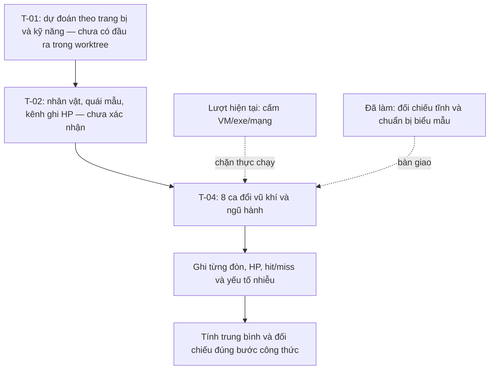

TÓM TẮT 1/5 — [NGUỒN] T-04 BLOCKED ở mục tiêu đo sát thương thật: lượt này cấm VM/exe/mạng; thiết kế còn ghi chờ T-01 và duyệt tài khoản test.
TÓM TẮT 2/5 — [NGUỒN] Đã đối chiếu map 53 và hai template cùng tên Heo trắng (43/1256); chưa xác nhận quái đang sống, cấp và ngũ hành thực tế.
TÓM TẮT 3/5 — [NGUỒN] Đã chuẩn bị 8 ca đo, mẫu ghi từng đòn, cách tính trung bình và điểm đối chiếu công thức; đầu ra gồm báo cáo, chỉ mục T-04 và Kết quả task.
TÓM TẮT 4/5 — [CHƯA KIỂM] Chưa có mẫu chiến đấu hoặc trung bình thực đo; ghi nhịp ngoài worktree bị từ chối truy cập; Tổng quản cần tiếp nhận các điều kiện còn thiếu.
TÓM TẮT 5/5 — [CHƯA KIỂM] Không build, chạy exe game/server, VM hoặc mạng; không commit/push theo yêu cầu, chưa có SHA bàn giao.

# T-04 — Vòng đo sát thương lên quái mẫu

Loại: kiểm thử
Chủ đề: Chuẩn bị vòng đo sát thương lên Heo trắng tại Ba Lăng Huyện và ghi rõ điều kiện chưa thể đo.
Từ khóa: sát thương, damage, Heo trắng, Heo tr¾ng, Ba Lăng Huyện, CalcDamage, Series, HP, T-04
Trạng thái: BLOCKED — mục tiêu thực đo chưa được thực hiện trong phạm vi chỉ đọc của lượt này.
Độ phủ: đã đối chiếu tĩnh 1/1 map ứng viên, 2/2 dòng cùng tên tìm thấy trong bảng NPC; đã thiết kế 8/8 ca, thực chạy 0/8 ca. Đây không phải độ phủ quái hoặc bản đồ toàn game.
Liên quan: JX1_OPS/DESIGN/DOI-TEST-TINH-NANG.md; JX1_OPS/DESIGN/CHUAN-BAO-CAO.md; JX1_OPS/REPORTS/H-01-ngu-hanh.md; JX1_OPS/REPORTS/I-03-khao-sat-quai-vat.md; JX1_OPS/REPORTS/E-01b-thieu-giao-thuc.md.
Cần tôi quyết định: có — nếu tiếp tục đo, Tổng quản cần giao phiên runtime có quyền phù hợp, dữ liệu dự đoán và fixture test; đường dẫn nhịp cũng cần quyền ghi hợp lệ.



## Phạm vi và độ phủ

**[ĐÃ XÁC MINH — yêu cầu]** Mục tiêu T-04 là đánh quái nhiều lần, đổi vũ khí/ngũ hành, tính trung bình và so công thức (`JX1_OPS/DESIGN/DOI-TEST-TINH-NANG.md:12`). Tài liệu ghi T-02..T-04 chờ T-01 và duyệt tài khoản test (`JX1_OPS/DESIGN/DOI-TEST-TINH-NANG.md:19`). Prompt của lượt này giới hạn chỉ đọc, không VM/exe/mạng; không dùng quyền lịch sử của task khác để thực chạy.

| Phần tử của phạm vi, theo cấu trúc game | Đã phủ / chưa phủ | Nguồn và giới hạn |
|---|---|---|
| Bản đồ Ba Lăng Huyện, ứng viên map 53 | Đã phủ cấu hình; chưa vào map | `GS/Settings/MapList.ini:654`, `GS/Settings/MapList.ini:657`; không chứng minh map runtime đã nạp |
| Quái mẫu: hai dòng tên Heo trắng | Đã phủ hai dòng bảng; chưa xác nhận instance/spawn | `GS/Settings/NpcS.txt:45`, `GS/Settings/NpcS.txt:1258`; ID template tính theo `S/KNpcTemplate.cpp:642` |
| Nhân vật, bộ trang bị W0/W1, kỹ năng và cấp | Chưa có fixture hoặc dự đoán T-01 để chốt | Thiết kế đầu ra T-01 tại `JX1_OPS/DESIGN/DOI-TEST-TINH-NANG.md:9`; chưa thấy `REPORTS/T-01*`, `REPORTS/T-02*`, `REPORTS/T-03*` khi liệt kê trực tiếp `JX1_OPS/REPORTS`; chưa có thư mục `JX1_OPS/TEST/DU-DOAN` |
| Lặp đo trước/đổi vũ khí/khôi phục, C01–C03 | Đã thiết kế 3/3; thực chạy 0/3 | Ma trận bên dưới là đề xuất quy trình, chưa phải kết quả |
| Năm hệ quái, C04–C08 | Đã thiết kế 5/5; thực chạy 0/5 | Enum tại `H/GameDataDef.h:329`; hệ instance có thể bị ghi đè tại `S/KNpcSet.cpp:569` |
| Ghi từng đòn và tính trung bình | Đã có biểu mẫu/công thức thống kê; chưa có mẫu thật | Không có trung bình, min/max hoặc độ lệch thực đo để báo cáo |
| So dự đoán với đo và xác định chênh lệch | Đã đối chiếu bước tương khắc/kháng và đường hiển thị HP; chưa chấm runtime | `S/KNpc.cpp:5101`, `S/KNpc.cpp:5266`, `C/KProtocolProcess.cpp:2533`; chưa có công thức sát thương cuối theo fixture cụ thể |

## Giải mã tên

**[ĐÃ XÁC MINH — đọc tĩnh]** Cột tên Việt cũ được giữ nguyên bằng cách biểu diễn byte qua Windows-1252, rồi đối chiếu ký tự TCVN3; đây không phải khẳng định dữ liệu gốc dùng Windows-1252. Đường dẫn Hán được đọc riêng bằng GBK, không giải mã toàn bộ file hỗn hợp bằng một bảng mã. Không dùng tên làm khóa thay cho ID.

| Tên gốc | Mã hóa | Chữ đúng UTF-8 | Nguồn file:dòng |
|---|---|---|---|
| `Heo tr¾ng` | TCVN3 | Heo trắng; chưa có tên Hán đối chiếu | `GS/Settings/NpcS.txt:45`, `GS/Settings/NpcS.txt:1258` |
| `Ba L¨ng HuyÖn` | TCVN3 | Ba Lăng Huyện | `GS/Settings/MapList.ini:655` |
| `两湖区\巴陵县` | GBK; giữ đường dẫn gốc | Khu vực Lưỡng Hồ / Ba Lăng Huyện (巴陵县) | `GS/Settings/MapList.ini:654` |
| `series_metal` | ASCII | Kim | `H/GameDataDef.h:329`; đối chiếu nghĩa Việt tại `JX1_OPS/REPORTS/H-01-ngu-hanh.md:20` |
| `series_wood` | ASCII | Mộc | `H/GameDataDef.h:330`; đối chiếu nghĩa Việt tại `JX1_OPS/REPORTS/H-01-ngu-hanh.md:20` |
| `series_water` | ASCII | Thủy | `H/GameDataDef.h:331`; đối chiếu nghĩa Việt tại `JX1_OPS/REPORTS/H-01-ngu-hanh.md:20` |
| `series_fire` | ASCII | Hỏa | `H/GameDataDef.h:332`; đối chiếu nghĩa Việt tại `JX1_OPS/REPORTS/H-01-ngu-hanh.md:20` |
| `series_earth` | ASCII | Thổ | `H/GameDataDef.h:333`; đối chiếu nghĩa Việt tại `JX1_OPS/REPORTS/H-01-ngu-hanh.md:20` |

**[CHƯA XÁC MINH]** Chưa chọn món trang bị hoặc kỹ năng có tên riêng; W0/W1 chỉ là nhãn hai cấu hình đo dự kiến. Khi nhận fixture phải bổ sung tên gốc, tên đã giải mã và ID của từng món/kỹ năng, không dùng nhãn này làm tên vật phẩm thật.

## Sắp theo cấu trúc game

Trình tự báo cáo và dữ liệu đo: **bản đồ → quái/instance → nhân vật → trang bị/kỹ năng → từng đòn → tổng hợp theo ca**. Năm hệ xếp Kim → Mộc → Thủy → Hỏa → Thổ theo enum đã đối chiếu. Chưa có danh sách món hoặc kỹ năng nên chưa thể xếp tiếp theo bộ trang bị hoặc phái → nhánh → cấp học.

### Bản đồ → quái mẫu

| Bản đồ | Quái, dòng gốc | ID template / STT / Kind / Series trong bảng | Cách dùng khi đo |
|---|---|---|---|
| Ba Lăng Huyện, map ứng viên 53 | `Heo tr¾ng`, `GS/Settings/NpcS.txt:45` | 43 / 44 / 0 / 3 | Ứng viên quái thường; chưa chứng minh instance này xuất hiện tại map 53 |
| Cùng map ứng viên, chưa có liên kết spawn | `Heo tr¾ng`, `GS/Settings/NpcS.txt:1258` | 1256 / 1257 / 3 / 3 | Dòng trùng tên, Kind bảng là đối thoại; không tự coi là quái đánh được chỉ từ tên |

**[ĐÃ XÁC MINH — đọc tĩnh]** `Kind=0` là `kind_normal`, `Kind=3` là `kind_dialoger` (`H/GameDataDef.h:364`, `H/GameDataDef.h:367`). Quan hệ ID template = dòng vật lý − 2 lấy từ `InitNpcBaseData` (`S/KNpcTemplate.cpp:642`); không áp dụng cho ID instance.

**[ĐÃ XÁC MINH — đọc tĩnh]** Map 53 có `NpcSeriesAuto=1` và năm khóa hệ đều mang giá trị 20 (`GS/Settings/MapList.ini:658`, `GS/Settings/MapList.ini:659`, `GS/Settings/MapList.ini:663`). Nhánh nạp vùng xét tự chọn hệ (`S/KRegion.cpp:663`), sau đó đường tạo NPC chép hệ và có thể chép Kind từ bản ghi spawn (`S/KNpcSet.cpp:569`, `S/KNpcSet.cpp:570`). Không diễn giải các số 20 thành xác suất thực tế khi chưa phân tích đầy đủ thuật toán và chưa đo. Series=3 trong template không đủ chứng minh quái gặp trong game luôn thuộc Hỏa.

### Nhân vật → sát thương → quan sát

**[ĐÃ XÁC MINH — đọc tĩnh]** Đường nhận sát thương có kiểm tra trúng mục tiêu khi `bUseAR` bật, và trả `FALSE` nếu trượt (`S/KNpc.cpp:4494`, `S/KNpc.cpp:4496`, `S/KNpc.cpp:4502`). Phải ghi cả số lần thử và số đòn trúng; không biến mất mẫu quan sát thành sát thương bằng 0.

**[ĐÃ XÁC MINH — đọc tĩnh]** Trong `CalcDamage`, tương khắc dùng `m_Series` của người đánh và mục tiêu, với năm cặp 0→1, 1→4, 2→3, 3→0, 4→2 (`S/KNpc.cpp:5101`, `S/KNpc.cpp:5106`, `S/KNpc.cpp:5116`, `S/KNpc.cpp:5126`, `S/KNpc.cpp:5136`, `S/KNpc.cpp:5146`). Không thay hệ người đánh bằng hệ vũ khí khi đối chiếu switch này. Đổi vũ khí vẫn có thể đổi thuộc tính và các đầu vào khác; cần ghi chỉ số trước/sau từ fixture.

**[ĐÃ XÁC MINH — đọc tĩnh, cô lập kênh vật lý]** Với trần M không âm, gọi D0 là sát thương đã chọn ở `S/KNpc.cpp:5093` hoặc `S/KNpc.cpp:5097`, R là kháng vật lý, S là `nSeriesDamage`, I bằng 1 khi đúng cặp khắc và bằng 0 ở cặp khác:

```text
R_raw = R - I*S
R_eff = min(MAX_RESIST, clamp(R_raw, -M, M))
D_R   = trunc_toward_zero(D0 * (100 - R_eff) / 100)
```

Nguồn: cộng tương khắc/kháng tại `S/KNpc.cpp:5157`, `S/KNpc.cpp:5162`; chặn theo trần tại `S/KNpc.cpp:5163`; `MAX_RESIST=150` tại `H/GameDataDef.h:116`; nhân/chia nguyên tại `S/KNpc.cpp:5266`. Đây là bước sau kháng, chưa phải HP cuối. Phạm vi số nguyên không tràn là điều kiện của biểu thức toán học trên; chưa kiểm tràn số hoặc toàn bộ đường ghép sát thương theo fixture. Không tự lấy trung điểm min/max làm kỳ vọng khi chưa có phân bố/đầu vào từ T-01.

**[ĐÃ XÁC MINH — đọc tĩnh]** Sau bước kháng còn nhánh giảm sát thương người chơi lên NPC (`S/KNpc.cpp:5268`, `S/KNpc.cpp:5272`). Cuối hàm chặn sát thương theo HP còn lại rồi trừ HP (`S/KNpc.cpp:5716`, `S/KNpc.cpp:5719`); nhánh chí tử `bFatally` trừ một phần mười HP và trả sớm (`S/KNpc.cpp:5075`, `S/KNpc.cpp:5077`). Vì vậy đòn kết liễu và đòn chí tử phải có nhãn riêng; không dùng chúng để suy sát thương thường không bị chặn.

**[ĐÃ XÁC MINH — đọc tĩnh]** Server có trường HP theo thang 1.000 (`S/KNpc.cpp:7976`, `S/KNpc.cpp:8212`). Client nhánh NPC nhận HP tối đa, dựng HP hiện tại bằng tích rồi chia nguyên 1.000, và dùng chênh HP dựng lại để hiện máu mất (`C/KProtocolProcess.cpp:2522`, `C/KProtocolProcess.cpp:2533`, `C/KProtocolProcess.cpp:2546`). Kênh này có lượng tử hóa và có thể gộp thay đổi giữa hai lần đồng bộ. Không nhận riêng ảnh thanh máu hoặc số bay từ nhánh này là số đo chính xác từng đòn; cần kênh HP tuyệt đối/từng sự kiện đã được T-02 xác nhận. Chưa đo sai số thực tế hoặc khẳng định mọi đường hiển thị đều dùng nhánh này.

**[CHƯA XÁC MINH]** Chưa biết source đang đọc khớp binary nào trên môi trường test; không lấy source client để thay công thức server. `JX1_OPS/BOT/worldsync.py:47` chỉ được đọc, không chạy; vòng tách record trả các lát byte tại `JX1_OPS/BOT/worldsync.py:71`. Báo cáo E-01b vẫn để tương thích binary và kết quả đánh thực tế ở mức chưa kiểm (`JX1_OPS/REPORTS/E-01b-thieu-giao-thuc.md:111`, `JX1_OPS/REPORTS/E-01b-thieu-giao-thuc.md:116`). Chưa có bằng chứng phiên đo hoạt động để dùng BOT thay thế.

## Ma trận ca đo — đề xuất, chưa chạy

**[CHƯA XÁC MINH — kế hoạch]** Mọi ca cần fixture và quyền runtime được giao riêng. Đề xuất thu ít nhất **30 đòn thường hợp lệ không kết liễu/ca**; 8 ca tương ứng tối thiểu 240 mẫu loại này nếu tất cả đủ điều kiện. Đây là cỡ mẫu khởi đầu do T-04 đề xuất, không phải hằng số game hoặc bảo đảm độ tin cậy thống kê. Lưu toàn bộ lần thử, kể cả trượt, chí tử, kết liễu và mẫu bị nhiễu, với lý do phân nhóm.

| Ca | Nhân vật/vũ khí | Quái mục tiêu | Biến thay đổi và điều kiện đối chiếu | Kết quả hiện tại |
|---|---|---|---|---|
| C01 | Cấu hình gốc W0, một kỹ năng/cấp cố định | Template/cấp/GoldType/hệ đã nhận diện | Baseline; ghi đầy đủ đầu vào và HP | CHƯA CHẠY |
| C02 | Đổi sang W1, giữ nhân vật/kỹ năng/cấp | Cùng điều kiện C01 | Ghi tất cả thuộc tính/chỉ số đổi cùng vũ khí; chỉ kết luận về toàn cấu hình nếu chưa cô lập từng thuộc tính | CHƯA CHẠY |
| C03 | Khôi phục W0 | Cùng điều kiện C01 | Kiểm tra baseline có trôi do buff, trang bị, hồi máu hoặc thời gian hay không | CHƯA CHẠY |
| C04 | W0 và hệ người đánh cố định | Cùng template/cấp/GoldType, hệ Kim (0) | Ghi kháng/trần thực tế; đánh dấu cặp khắc theo hệ người đánh | CHƯA CHẠY |
| C05 | Như C04 | Hệ Mộc (1) | Như C04 | CHƯA CHẠY |
| C06 | Như C04 | Hệ Thủy (2) | Như C04 | CHƯA CHẠY |
| C07 | Như C04 | Hệ Hỏa (3) | Như C04 | CHƯA CHẠY |
| C08 | Như C04 | Hệ Thổ (4) | Như C04 | CHƯA CHẠY |

Nếu chưa có đủ năm fixture phù hợp thì đánh dấu đúng ca chưa phủ; không tự sinh quái, đổi cấu hình hoặc đổi trạng thái VM trong lượt chỉ đọc. Nếu hệ quái làm đổi kháng hoặc chỉ số khác, so bằng dự đoán riêng cho từng bộ đầu vào; chưa coi chênh lệch thuần là hệ số ngũ hành.

### Mẫu ghi dữ liệu

Mỗi phiên ghi bản server/client, dấu nhận diện bản dữ liệu, mã fixture không chứa thông tin tài khoản, map/region/tọa độ và cách quan sát HP. Mỗi cấu hình ghi hệ/cấp nhân vật, từng món đang mặc, thuộc tính kích hoạt, chỉ số trước/sau đổi vũ khí, ID/cấp kỹ năng, kênh sát thương và các trạng thái ảnh hưởng.

Mỗi lần thử dùng một dòng, các cột tối thiểu:

```text
ca | lần_thử | thời_gian/tick | mã_cấu_hình | map_ID | template_ID | instance_ID
   | cấp_quái | Kind | Series_người_đánh | Series_quái | GoldType
   | skill_ID/cấp | kênh_damage | kháng/trần | nSeriesDamage
   | HP_trước | HP_sau | hồi_HP_trong_khoảng | trạng_thái_đòn
   | damage_dự_đoán | damage_quan_sát | nguồn_bằng_chứng | hợp_lệ/lý_do
```

**[CHƯA XÁC MINH — quy trình]** Ghi `CHƯA ĐO` hoặc `KHÔNG ĐỦ DỮ LIỆU` khi thiếu trường; chỉ ghi 0 nếu đã quan sát đúng giá trị 0. Tách trượt khỏi trúng nhưng sát thương 0. Baseline ưu tiên đòn một lần gây sát thương, không độc theo thời gian, không buff/lá chắn/phản đòn hoặc người khác cùng đánh; nếu không kiểm soát được thì lưu nhãn nhiễu và chưa chấm công thức. HP hồi được phải do kênh đo xác nhận, không mặc định bằng 0. Quái mới/hồi sinh phải có instance mới hoặc mốc nhận diện rõ.

### Tính trung bình và so công thức

Với khoảng quan sát chỉ có sát thương đang xét và lượng hồi HP đã biết:

```text
d_i = HP_trước_i + hồi_HP_i - HP_sau_i
trung_bình_đòn_thường = tổng(d_i hợp lệ) / n_đòn_thường_hợp_lệ
trung_bình_dự_đoán   = tổng(p_i tương ứng cùng mẫu) / n_đòn_thường_hợp_lệ
chênh_lệch           = trung_bình_đo - trung_bình_dự_đoán
chênh_lệch_%         = 100 * chênh_lệch / trung_bình_dự_đoán  (chỉ khi mẫu số khác 0)
```

Nếu chưa tách hồi máu, nguồn damage khác, nhiều kênh/nhiều tick hoặc đồng bộ gộp thì không gán `d_i` cho một đòn. Báo thêm số lần thử, số trúng/trượt, số thường/chí tử/kết liễu, số mẫu bị nhiễu, min/max và độ phân tán trong đúng nhóm. Khi n bằng 0, trung bình ghi `CHƯA ĐO`; khi dự đoán bằng 0, tỷ lệ phần trăm ghi `KHÔNG XÁC ĐỊNH`. Không tự đặt ngưỡng PASS cho sai khác ngẫu nhiên hoặc kênh có lượng tử hóa. Đối chiếu cần dự đoán **HP cuối cùng** theo cùng điều kiện; không so trực tiếp HP cuối với riêng `D_R` sau kháng.

| Nhóm kết quả | Ca đã chạy | Số mẫu thực | Trung bình đo | Trung bình dự đoán theo fixture | Chênh lệch / khớp? |
|---|---|---|---|---|---|
| Baseline/đổi vũ khí/khôi phục, C01–C03 | 0/3 | CHƯA ĐO | CHƯA ĐO | CHƯA CÓ | CHƯA ĐỦ DỮ LIỆU |
| Ngũ hành quái, C04–C08 | 0/5 | CHƯA ĐO | CHƯA ĐO | CHƯA CÓ | CHƯA ĐỦ DỮ LIỆU |

## Mục sổ thông số

Mọi giá trị dưới đây là dữ liệu/source đọc tĩnh, không phải số đo chiến đấu. Đánh giá đổi an toàn không cấp quyền thay đổi.

| Nhóm | Tên/hằng số | file:dòng | Giá trị | Đơn vị | Ảnh hưởng | Đổi an toàn (CÓ/CẨN THẬN/KHÔNG) | Nguồn đo |
|---|---|---|---|---|---|---|---|
| Bản đồ | Map ID ứng viên | `GS/Settings/MapList.ini:654` | 53 | ID map | Định vị Ba Lăng Huyện | KHÔNG — khóa nhận diện dữ liệu | Đọc tĩnh; chưa vào map |
| Bản đồ | `53_NpcSeriesAuto` | `GS/Settings/MapList.ini:658` | 1 | cờ cấu hình | Có nhánh chọn lại hệ NPC khi nạp vùng | CẨN THẬN — thay đổi quái, cần fixture/kiểm thử | Đọc tĩnh; chưa xác nhận cấu hình đang nạp |
| Quái | ID template / Kind / Series | `GS/Settings/NpcS.txt:45`, `S/KNpcTemplate.cpp:642` | 43 / 0 / 3 | ID / enum / enum | Ứng viên quái thường, chưa phải hệ instance | KHÔNG — định danh; CẨN THẬN với thuộc tính | Đọc tĩnh |
| Tên trùng | ID template / Kind / Series | `GS/Settings/NpcS.txt:1258`, `S/KNpcTemplate.cpp:642` | 1256 / 3 / 3 | ID / enum / enum | Tránh chọn nhầm cùng tên | KHÔNG — định danh; CẨN THẬN với thuộc tính | Đọc tĩnh |
| Kháng quái ứng viên | `PhysicsResist` | `GS/Settings/NpcS.txt:45`, `S/KNpcTemplate.cpp:960` | `0\|0.6` | chuỗi tham số Lua; chưa đánh giá | Không được lấy 0.6 làm kháng runtime | CẨN THẬN — phụ thuộc Lua/cấp/hệ | Đọc tĩnh; chưa chạy Lua |
| Trần kháng quái | Physics / Cold / Fire / Light / Poison `ResistMax` | `GS/Settings/NpcS.txt:45` | 90 / 60 / 75 / 75 / 75 | điểm phần trăm trong bảng | Đầu vào cần xác nhận ở instance | CẨN THẬN — có thể đổi sát thương | Đọc tĩnh; chưa xác nhận trần hiện tại |
| Hồi máu quái | `LifeReplenish` | `GS/Settings/NpcS.txt:45`, `S/KNpcTemplate.cpp:900` | `0\|0.05` | chuỗi tham số Lua; chưa đánh giá | Cần quan sát hồi HP giữa hai mốc | CẨN THẬN — làm nhiễu HP delta | Đọc tĩnh; chưa có lượng hồi thực |
| Công thức | `MAX_RESIST` | `H/GameDataDef.h:116`, `S/KNpc.cpp:5171` | 150 | điểm phần trăm | Chặn trên sau bước trần riêng | CẨN THẬN — ảnh hưởng nhiều NPC | Đọc tĩnh; không phải trần mặc định mọi quái |
| Quan sát | Thang `nLifeDamagePerCent` | `S/KNpc.cpp:8212`, `C/KProtocolProcess.cpp:2533` | 1.000 | mức tỷ lệ HP | Có lượng tử hóa khi dựng HP client | KHÔNG — cần đồng bộ hợp đồng client/server | Đọc tĩnh; chưa đo sai số |
| Đòn cuối | Giới hạn theo `m_CurrentLife` | `S/KNpc.cpp:5716` | HP còn lại tại thời điểm xử lý, CHƯA ĐO | HP | Đòn kết liễu bị chặn | KHÔNG — cần giữ ngữ nghĩa chiến đấu | Đọc tĩnh; chưa có mẫu thực |

## Đã xác minh / Chưa xác minh

**ĐÃ XÁC MINH:** Đã đọc chuẩn trước task, nạp sáu skill được yêu cầu và tra mục lục tri thức/bản đồ server để định vị. Git status đầu lượt là `## task/T-04`, không có local thay đổi; chưa có báo cáo hoặc chỉ mục T-04 nên không có kết quả cũ để làm lại. Đã kiểm file thật/dòng hiện tại của map, hai dòng NPC, đường tạo template/instance, bước sát thương server và nhánh HP client như dẫn chứng trong thân. Không sửa các kết luận H-01/I-03/E-01b.

Nguồn đọc, kế thừa root từ `JX1_OPS/REPORTS/H-01-ngu-hanh.md:12` và `JX1_OPS/REPORTS/I-03-khao-sat-quai-vat.md:11`:

| Tiền tố | Root/version chỉ đọc |
|---|---|
| S/ | `D:\JX-source\server\jxOnline\gameserver\Sources\Core\Src` |
| H/ | `D:\JX-source\server\jxOnline\header` |
| GS/ | `C:\Jx1CocoV3\Folder\ServerNew-20260116T043145Z-3-001\ServerNew\_bin_v2_\gs` |
| C/ | `C:\Jx1CocoV3\Folder\Client2912-20260116T044348Z-3-001\Client2912\Client\Classes\gamecore` |

Các root không được ghim revision trong task; chưa chứng minh khớp executable. Chỉ dùng symbol ASCII để đối chiếu source; comment nguồn có bảng mã cũ/hỗn hợp, không dùng chuỗi giải mã lỗi làm bằng chứng tên game. Tài liệu đầu ra dùng UTF-8 không BOM.

**CHƯA XÁC MINH:** Tài khoản/nhân vật test và quyền runtime hiện có ở ngoài lượt này; dữ liệu T-01 ở worktree khác; spawn cụ thể Heo trắng tại map 53; ID/cấp/hệ/GoldType/HP/kháng/trần thực tế; trang bị/kỹ năng chọn đo; đầu vào sát thương sau ghép; binary/ABI/giao thức và kênh log theo từng đòn. Không suy việc thiếu file trong worktree này thành kết luận T-01 chưa làm ở mọi nơi.

**Test thực chạy/chưa chạy:** Chưa chạy ca chiến đấu nào, unit test BOT, build, exe game/server, VM, Lua hoặc kết nối mạng. Các thao tác thực hiện là đọc file/tra dòng, kiểm tồn tại đầu ra và kiểm tài liệu; không nhận là test gameplay đạt. Đã chạy kiểm tra PowerShell lúc 14:54:20 +07:00: `UTF8_NO_BOM_OK` cho cả ba đầu ra; `REPORT_STRUCTURE_OK` cho 5 dòng tóm tắt, 7 trường thông tin, 1 Mermaid, 8 ca, TSV 7 cột và Kết quả task BLOCKED; `SOURCE_LOCATIONS_OK` cho các vị trí nguồn. Kiểm vị trí chỉ xác nhận file/dòng tồn tại, không thay việc đọc nội dung.

## Lỗi, cách thử, kết quả và nhịp

| Lỗi hoặc điều kiện | Cách thử thực tế | Kết quả / bước tiếp |
|---|---|---|
| `rg` không có trong phiên | Thử một lệnh tìm file có giới hạn | Báo `The term 'rg' is not recognized`; chuyển sang `Get-ChildItem`, `Select-String`, `Get-Content`, không cài công cụ |
| Một số kết quả đọc gộp quá dài | Tìm trong các báo cáo liên quan với context | Đầu ra bị cắt; đã thu hẹp sang file/dòng và trường dữ liệu cần thiết, không coi phần bị cắt là đã đối chiếu |
| Chưa có đầu ra phụ thuộc trong worktree | Liệt kê trực tiếp `JX1_OPS/REPORTS` theo mẫu T-01..T-03; kiểm `JX1_OPS/TEST/DU-DOAN` | Chưa tìm thấy; Tổng quản cung cấp hoặc ghép đầu ra đã có, không làm lại T-01..T-03 tại đây |
| NHỊP: **BỊ CHẶN GHI** `D:\JX-wt\T-04.nhip` | Thử ghi mốc bắt đầu một lần bằng `WriteAllText`, UTF-8 không BOM | `Access to the path 'D:\JX-wt\T-04.nhip' is denied.` Đường dẫn ở ngoài writable root `D:\JX-wt\T-04`; không có quyền nâng trong phiên. Các mốc sau chỉ thông báo trong hội thoại, không có file nhịp tại đường dẫn yêu cầu; không đổi ACL hoặc dùng đường dẫn khác để vượt giới hạn |
| Mục tiêu đo thực tế bị giới hạn | Đối chiếu prompt và `JX1_OPS/DESIGN/DOI-TEST-TINH-NANG.md:19` | **BLOCKED runtime**; không thử chạy để kiểm vì prompt đã cấm. Bước tiếp cần phiên được giao đúng quyền và fixture |

Mốc thời gian đã đọc từ đồng hồ máy: **18/11/2026 14:47:17 +07:00** — xong đối chiếu tên/mẫu và đường quan sát; **14:48:41 +07:00** — xong kiểm phụ thuộc/nguồn, chuyển sang viết báo cáo, ước tính 70% phần chuẩn bị; **14:54:20 +07:00** — ghi đủ ba đầu ra và kiểm tài liệu đạt, khoảng 95%, còn xem diff để bàn giao. Các tỷ lệ chỉ dành cho phần chuẩn bị tài liệu, không phải tỷ lệ hoàn thành mục tiêu thực đo.

## Đề xuất tối ưu

**[ĐỀ XUẤT — CHƯA KIỂM RUNTIME]** Dùng cùng bảng fixture từ T-01/T-02 cho trang bị, kỹ năng và quái; nhận diện mục tiêu bằng map + template + instance thay vì tên. Giữ cặp đổi vũ khí rồi khôi phục W0 để phát hiện trôi điều kiện. Ưu tiên quan sát HP tuyệt đối theo từng sự kiện đã kiểm chứng; chỉ dùng ảnh/UI để bổ trợ khi cần tách sai số lượng tử hóa. Mở rộng cỡ mẫu khi có độ phân tán thực, không ấn định sai số đạt chỉ từ 30 đòn. Đây là đề xuất cho lượt được cấp quyền, không phải thay đổi mã/cấu hình.

## Bàn giao

- Đầu ra trong phạm vi task: `JX1_OPS/REPORTS/T-04.md`, `JX1_OPS/REPORTS/_CHIMUC/T-04.tsv`, mục `Kết quả` cuối `JX1_OPS/TASKS/T-04.md`. Chỉ mục là đầu ra kèm báo cáo theo chuẩn/skill; không sửa mục lục chung hoặc báo cáo cũ.
- **BLOCKED** cho mục tiêu đo thật; phần đối chiếu tĩnh và bộ ca đo đã chuẩn bị. Tổng quản tiếp tục từ ma trận trên khi nhận dự đoán T-01, fixture/kênh đo T-02 và phiên runtime được phép; không cần làm lại phần đọc có bằng chứng nếu nguồn không đổi.
- Không stage/commit/push theo yêu cầu Tổng quản sẽ commit hộ; **chưa có SHA mới**. Không chạy lệnh Git ghi nên không báo lỗi commit hoặc gắn nhãn Git bị chặn. Lỗi quyền đã gặp thuộc riêng file nhịp.
- Tổng quản xử lý đường dẫn nhịp bằng phiên có quyền ghi đúng đường dẫn đã yêu cầu hoặc chỉ định đường dẫn hợp lệ cho lượt sau; báo cáo này không thay cho file nhịp.

Hàng đề xuất bổ sung vào `JX1_OPS/DESIGN/MUC-LUC-TRI-THUC.md` để PM gộp:

| Chủ đề | Báo cáo / tài liệu | File, hàm chính | Độ chắc |
|---|---|---|---|
| Đo sát thương trên quái mẫu: Heo trắng, Ba Lăng Huyện; phân biệt template cùng tên, hệ instance và HP client | `REPORTS/T-04.md` | `KNpc::CalcDamage`, `KNpcTemplate::InitNpcBaseData`, `KProtocolProcess.cpp:2533` | Đọc tĩnh đã đối chiếu; thực đo BLOCKED, 0/8 ca |

## Phát hiện khi chuẩn hóa

- Task T-04 chỉ có Mục tiêu và Kết quả trống; không có mục Nguồn cần đọc hoặc `vùng_file`. Dùng tài liệu thiết kế được task dẫn và các nguồn đúng chủ đề, giữ ghi trong đầu ra T-04; không coi thiếu metadata là lý do dừng phần chuẩn bị.
- Chưa có báo cáo T-04 cũ để retrofit. Áp dụng khuôn mới ngay, giữ nguyên kết luận, số liệu và bằng chứng của các báo cáo cũ; phát hiện hai dòng Heo trắng và giới hạn quan sát được ghi tại báo cáo mới này.
