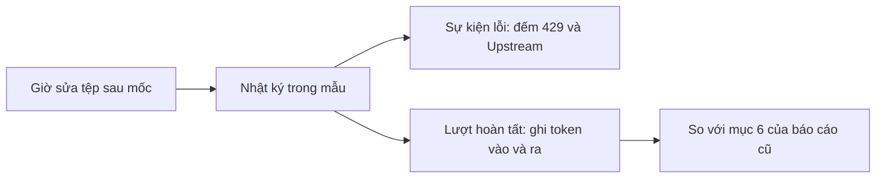

TÓM TẮT 1: [NGUỒN] [THẤY] Đã đọc đủ 16 nhật ký có giờ sửa sau 22:50 ngày 18/11/2026 (UTC+7). `JX1_OPS/TASKS/TK-01.md:19`, bảng phạm vi bên dưới.
TÓM TẮT 2: [NGUỒN] [THẤY] Có 0 sự kiện 429 và 7 sự kiện Upstream trong 8 sự kiện lỗi. `W-01a.codex.log:18`, `W-01b.codex.log:126`, bảng phạm vi bên dưới.
TÓM TẮT 3: [NGUỒN] [THẤY] 7 nhật ký có số token, trung bình 2.710.084 vào và 30.360 ra mỗi việc. 9 nhật ký còn lại chưa có số. `W-01a.codex.log:172`, `SO-03.codex.log:95`, `TK-01.codex.log:34`, bảng phạm vi bên dưới.
TÓM TẮT 4: [NGUỒN] [TÀI LIỆU] Trung bình token vào của mẫu mới thấp hơn mốc `high` 12,0%, còn token ra cao hơn 56,5%. `JX1_OPS/REPORTS/TIEU-YEU-429-VA-TOKEN.md:57`.
TÓM TẮT 5: [CHƯA KIỂM] Chưa xác định mức suy luận của mẫu mới hoặc tác động riêng của Q-51/#195. Phép đọc nhật ký đã chạy, chưa chạy build, chương trình game, máy ảo hoặc mạng. Tổng quan phụ trách commit. `JX1_OPS/TASKS/TK-01.md:19`, `JX1_OPS/TASKS/TK-01.md:25`.

# TK-01 — Theo dõi token và lỗi 429 sau mốc Q-51/#195

Loại: khảo sát  
Chủ đề: Đếm lỗi và token của từng việc trong các nhật ký mới hơn mốc theo dõi.  
Từ khóa: giới hạn yêu cầu, 429, lỗi phía dịch vụ, Upstream, token, lượt hoàn tất, Q-51, #195, TK-01  
Trạng thái: DONE — đã đo và đối chiếu toàn bộ tệp trong mẫu chốt.  
Độ phủ: 16/16 nhật ký đọc được, 7/16 có số token khi đọc.  
Liên quan: `JX1_OPS/TASKS/TK-01.md`, `JX1_OPS/REPORTS/TIEU-YEU-429-VA-TOKEN.md`, `JX1_OPS/DESIGN/CHUAN-BAO-CAO.md`  
Cần tôi quyết định: không

## Phạm vi và độ phủ

[THẤY] Mỗi hàng là một tệp `D:\JX-wt\<việc>.codex.log` khớp mẫu tên ngay dưới `D:\JX-wt`. Giờ sửa dùng múi giờ UTC+7. Phép lọc chọn tệp có giờ sửa **lớn hơn** 18/11/2026 22:50:00, theo yêu cầu ở `JX1_OPS/TASKS/TK-01.md:19`. Kết quả ghi nhận phần nhật ký hiện có lúc đọc. Trong cột bằng chứng, mỗi cặp `tệp:dòng` chỉ tới sự kiện lỗi hoặc lượt hoàn tất. `tệp:1–N` là phạm vi đã kiểm khi thiếu một trong hai loại sự kiện. Các tệp trong bảng đều là UTF-16.

| Việc | Giờ sửa tệp (UTC+7) | Độ phủ | Sự kiện lỗi | 429 | Upstream | Token vào | Token vào đã lưu đệm | Token ra | Bằng chứng |
|---|---|---|---:|---:|---:|---:|---:|---:|---|
| W-01a | 18/11 22:54:40 | Đã phủ | 2 | 0 | 1 | 2.812.637 | 2.316.646 | 59.933 | `W-01a.codex.log:18`, `W-01a.codex.log:88`, `W-01a.codex.log:172` |
| W-01b | 18/11 23:20:35 | Đã phủ | 2 | 0 | 2 | 6.900.693 | 5.392.310 | 39.916 | `W-01b.codex.log:126`, `W-01b.codex.log:195`, `W-01b.codex.log:240` |
| HG-04 | 19/11 00:16:27 | Đã phủ | 0 | 0 | 0 | 1.668.236 | 1.320.905 | 15.233 | `HG-04.codex.log:1–96`, `HG-04.codex.log:96` |
| SO-01 | 19/11 00:17:08 | Đã phủ | 0 | 0 | 0 | 1.623.121 | 1.145.448 | 15.836 | `SO-01.codex.log:1–69`, `SO-01.codex.log:69` |
| SO-02 | 19/11 00:18:21 | Đã phủ | 0 | 0 | 0 | 1.622.192 | 1.228.477 | 18.829 | `SO-02.codex.log:1–88`, `SO-02.codex.log:88` |
| HG-01 | 19/11 00:20:29 | Đã phủ | 1 | 0 | 1 | 2.905.112 | 2.720.200 | 31.361 | `HG-01.codex.log:56`, `HG-01.codex.log:70` |
| HG-05 | 19/11 00:21:54 | Đã phủ, chưa có token | 0 | 0 | 0 | — | — | — | `HG-05.codex.log:1–97` |
| SO-03 | 19/11 00:22:29 | Đã phủ | 0 | 0 | 0 | 1.438.600 | 1.146.542 | 31.411 | `SO-03.codex.log:1–95`, `SO-03.codex.log:95` |
| KC-01 | 19/11 00:22:35 | Đã phủ, chưa có token | 0 | 0 | 0 | — | — | — | `KC-01.codex.log:1–106` |
| HG-03 | 19/11 00:22:54 | Đã phủ, chưa có token | 0 | 0 | 0 | — | — | — | `HG-03.codex.log:1–106` |
| HG-02 | 19/11 00:22:59 | Đã phủ, chưa có token | 1 | 0 | 1 | — | — | — | `HG-02.codex.log:1–101`, `HG-02.codex.log:65` |
| KC-02 | 19/11 00:23:06 | Đã phủ, chưa có token | 1 | 0 | 1 | — | — | — | `KC-02.codex.log:1–99`, `KC-02.codex.log:99` |
| SO-05 | 19/11 00:23:06 | Đã phủ, chưa có token | 1 | 0 | 1 | — | — | — | `SO-05.codex.log:1–40`, `SO-05.codex.log:40` |
| SO-06 | 19/11 00:23:07 | Đã phủ, chưa có token | 0 | 0 | 0 | — | — | — | `SO-06.codex.log:1–62` |
| SO-04 | 19/11 00:23:18 | Đã phủ, chưa có token | 0 | 0 | 0 | — | — | — | `SO-04.codex.log:1–51` |
| TK-01 | 19/11 00:23:23 | Đã phủ, đang ghi khi khảo sát | 0 | 0 | 0 | — | — | — | `TK-01.codex.log:1–34` |
| **Tổng thấy** | | **16/16 tệp, 7/16 có token** | **8** | **0** | **7** | **18.970.591** | **15.270.528** | **212.519** | Các hàng trên |

## Giải mã tên

| Tên gốc | Mã hóa | Chữ đúng | Nguồn file:dòng |
|---|---|---|---|
| Không phát sinh tên game | Không áp dụng | Báo cáo theo mã việc của nhật ký Codex | `JX1_OPS/TASKS/TK-01.md:18–24` |

## Sắp theo cấu trúc game

Không áp dụng cho số liệu vận hành Codex. Bảng xếp theo giờ sửa nhật ký và mã việc. `JX1_OPS/TASKS/TK-01.md:19`.

## Cách đọc số liệu

[THẤY] Chỉ đếm sự kiện JSON có `type` cấp ngoài là `error`. Trong thông báo của các sự kiện này, dấu hiệu 429 là mã `429` hoặc cụm `Too Many Requests`. Dấu hiệu Upstream là từ `upstream` chỉ lỗi phía dịch vụ. Bảy sự kiện Upstream đều có thông báo thử kết nối lại. Sự kiện thứ tám chỉ khớp dấu hiệu thử kết nối lại. Các loại sự kiện khác được bỏ qua, trừ `turn.completed` dùng để lấy số lượng token. Phép đọc chỉ xuất số đếm, số dòng và số token. `W-01a.codex.log:18`, `W-01a.codex.log:88`, `W-01a.codex.log:172`, bảng phạm vi.

[TÀI LIỆU] Cộng bốn hàng theo số việc chạy cùng lúc trong báo cáo cũ cho 15 sự kiện 429 và 128 sự kiện Upstream trên 136 việc, tương ứng 0,11 và 0,94 sự kiện mỗi việc. Mẫu hiện tại có 0 và 0,44 sự kiện mỗi tệp ở thời điểm đọc. Khoảng thời gian được ghi nhận của từng việc và mức độ hoàn tất của hai mẫu khác nhau. `JX1_OPS/REPORTS/TIEU-YEU-429-VA-TOKEN.md:11–15`, `JX1_OPS/REPORTS/TIEU-YEU-429-VA-TOKEN.md:31–37`, bảng phạm vi.

### So với mục 6 của báo cáo cũ

Token là đơn vị đếm lượng nội dung mà mô hình nhận vào hoặc sinh ra. Số vào bao gồm cả phần được dùng lại từ bộ nhớ đệm. Số trung bình của mẫu mới lấy tổng chia cho 7 việc có số, làm tròn đến đơn vị. Mức chênh lấy `(trung bình mới ÷ mốc cũ − 1) × 100%`.

| Mẫu đối chiếu | Việc có token | Vào/việc | Ra/việc | Chênh mẫu mới so với mốc (vào / ra) | Nguồn |
|---|---:|---:|---:|---:|---|
| [THẤY] Mẫu mới, chưa rõ mức suy luận | 7 | 2.710.084 | 30.360 | — | Bảng phạm vi |
| [TÀI LIỆU] `max` | 51 | 4.464.797 | 46.797 | −39,3% / −35,1% | `JX1_OPS/REPORTS/TIEU-YEU-429-VA-TOKEN.md:56` |
| [TÀI LIỆU] `high` | 70 | 3.078.250 | 19.396 | −12,0% / +56,5% | `JX1_OPS/REPORTS/TIEU-YEU-429-VA-TOKEN.md:57` |
| [TÀI LIỆU] `medium` | 4 | 1.811.963 | 9.675 | +49,6% / +213,8% | `JX1_OPS/REPORTS/TIEU-YEU-429-VA-TOKEN.md:58` |
| [TÀI LIỆU] `low` | 2 | 176.896 | 769 | +1.432,0% / +3.848,0% | `JX1_OPS/REPORTS/TIEU-YEU-429-VA-TOKEN.md:59` |

[THẤY] Phần dùng lại từ bộ nhớ đệm là 80,5% tổng token vào trong mẫu mới (15.270.528 ÷ 18.970.591). [TÀI LIỆU] Mốc cũ là 82,4%, chênh 1,9 điểm phần trăm. `JX1_OPS/REPORTS/TIEU-YEU-429-VA-TOKEN.md:61`, bảng phạm vi.

### Sổ thông số

| Nhóm | Tên/hằng số | file:dòng | Giá trị | Đơn vị | Ảnh hưởng | Đổi an toàn | Nguồn đo |
|---|---|---|---|---|---|---|---|
| Chọn tệp | Mốc giờ sửa, UTC+7 | `JX1_OPS/TASKS/TK-01.md:19` | 18/11/2026 22:50 | giờ địa phương | Quyết định tệp được tính | CẨN THẬN | [TÀI LIỆU] Quy định của task |
| Lỗi | `type` cấp ngoài | `JX1_OPS/REPORTS/TIEU-YEU-429-VA-TOKEN.md:11` | `error` | loại sự kiện | Giữ cách đếm đồng nhất | CẨN THẬN | [TÀI LIỆU] Cách đếm của báo cáo gốc |
| Token | `input_tokens`, `cached_input_tokens`, `output_tokens` | `W-01a.codex.log:172` | Tổng lần lượt 18.970.591, 15.270.528, 212.519 | token | Dùng cho 7 việc đã có số | CẨN THẬN | [THẤY] Số liệu Codex ghi ở lượt hoàn tất |

### Đề xuất tối ưu

[CHƯA KIỂM] Khi đo đợt sau, lấy một nhóm việc đã ghi lượt hoàn tất và có cùng mức suy luận, rồi so các việc tương đương về phạm vi. Ghi riêng số tệp còn thiếu token để người đọc thấy độ phủ. `JX1_OPS/REPORTS/TIEU-YEU-429-VA-TOKEN.md:13`, `JX1_OPS/REPORTS/TIEU-YEU-429-VA-TOKEN.md:61`.

## Đã xác minh / Chưa xác minh

- **Đã xác minh [THẤY]** — PowerShell lọc theo giờ sửa, đọc từng dòng và chỉ phân tích các loại sự kiện cần thiết. Phép đọc thu đủ 16/16 tệp, không gặp dòng sự kiện đích lỗi định dạng. Lần mở đầu báo lỗi chia sẻ trên 9 tệp đang được tiến trình khác giữ. Mở lại 9 tệp đó bằng chế độ chỉ đọc cho phép chia sẻ với tiến trình ghi thành công, và thuộc tính giờ sửa/kích thước của từng tệp đó ổn định trong lúc mở lại. `HG-05.codex.log:1–97`, `TK-01.codex.log:1–34`, bảng phạm vi.
- **Chưa xác minh [CHƯA KIỂM]** — Giờ sửa chỉ cho biết tệp có thay đổi sau mốc. Chưa rõ giờ bắt đầu từng việc, mức suy luận, số token cuối của 9 tệp thiếu số, hoặc tác động riêng của Q-51/#195. Build, chương trình game, máy ảo và mạng chưa chạy theo phạm vi khảo sát tĩnh. `JX1_OPS/TASKS/TK-01.md:19–28`, `JX1_OPS/REPORTS/TIEU-YEU-429-VA-TOKEN.md:11–15`, `JX1_OPS/REPORTS/TIEU-YEU-429-VA-TOKEN.md:61`.
- **Giới hạn [CHƯA KIỂM]** — Số đếm lấy toàn bộ sự kiện hiện có trong tệp được chọn, chưa tách được sự kiện trước/sau 22:50. Hai tệp W-01a và W-01b có thể chứa phần việc trước mốc. Đây là mẫu tệp mới được sửa sau mốc, chưa phải mẫu các việc chắc chắn bắt đầu sau khi áp dụng Q-51/#195. `W-01a.codex.log:1–172`, `W-01b.codex.log:1–240`, `JX1_OPS/REPORTS/TIEU-YEU-429-VA-TOKEN.md:12`.

## Bàn giao

Báo cáo đặt ở đường dẫn khai báo tại `JX1_OPS/TASKS/TK-01.md:13` và `JX1_OPS/TASKS/TK-01.md:20`. Ghi kết quả cuối tệp task theo dòng 29. Tổng quan phụ trách commit. Tệp nhịp `D:\JX-wt\TK-01.nhip` nằm ngoài vùng ghi của phiên, các mốc được báo trong phiên làm việc.

Dòng chỉ mục để PM gộp vào `MUC-LUC-TRI-THUC.md` nếu cần: `TIEU-YEU-TOKEN-THEO-DOI-01.md | khảo sát | Token và lỗi 429 sau mốc Q-51/#195 | 429, Upstream, token, Q-51, #195, TK-01 | DONE | 16/16 nhật ký, 7/16 có token | TIEU-YEU-429-VA-TOKEN.md`.

Kỹ năng đã dùng: `jx1-retrofit` (khuôn), `jx1-knowledge` (trình bày), `jx1-parameters`, `jx1-report`. Đã đọc `jx1-read-server` và `jx1-read-client`, phần tra mã nguồn nằm ngoài phạm vi nhật ký.
